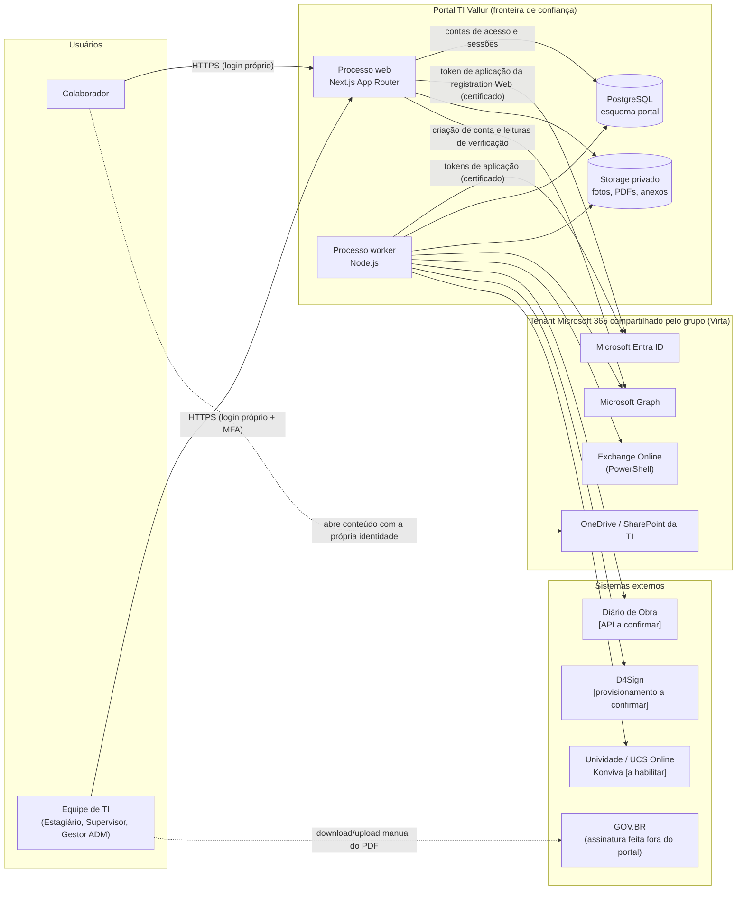
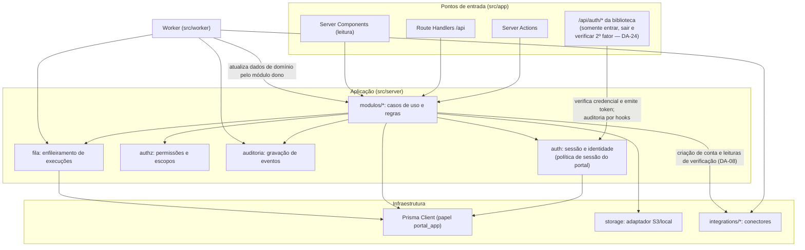
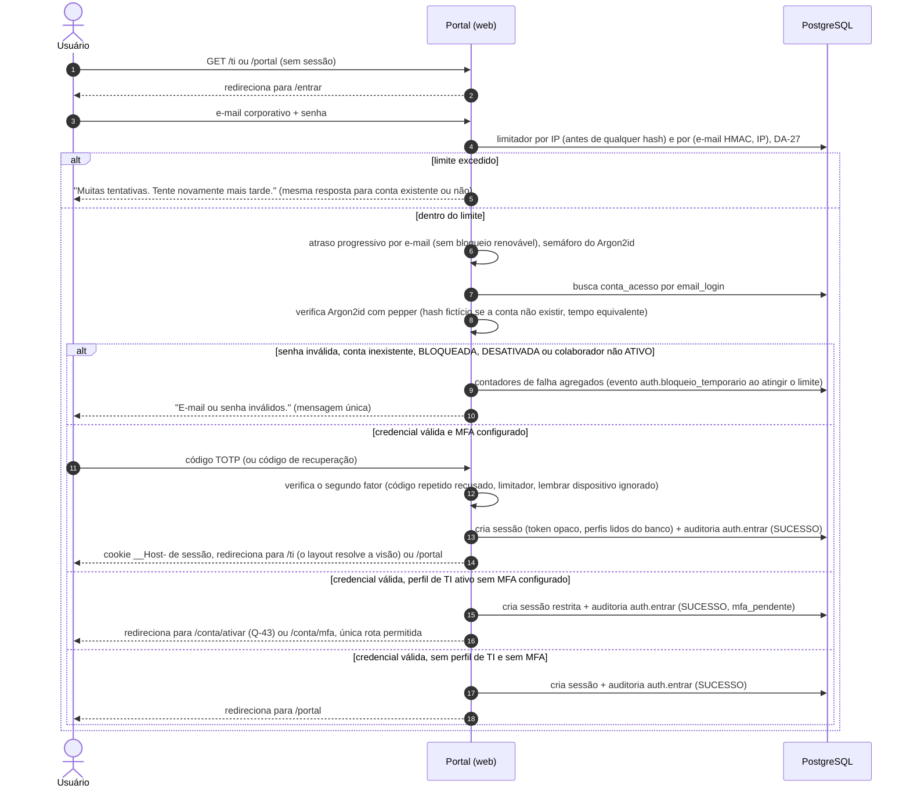
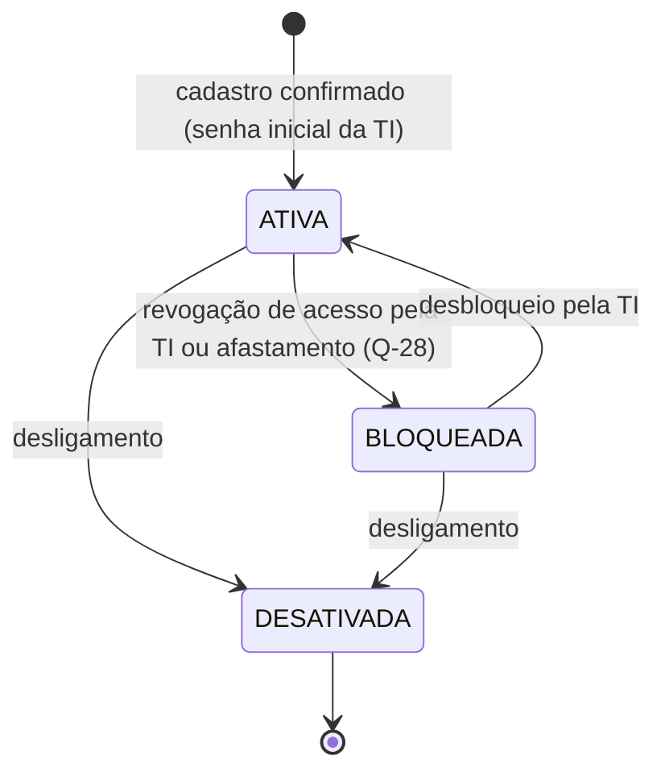
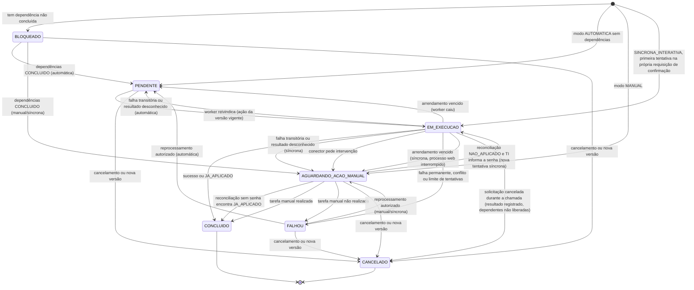
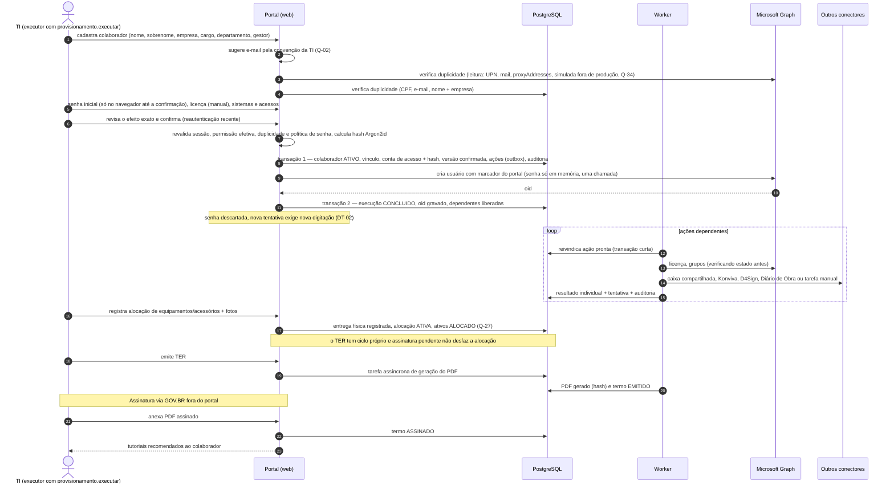
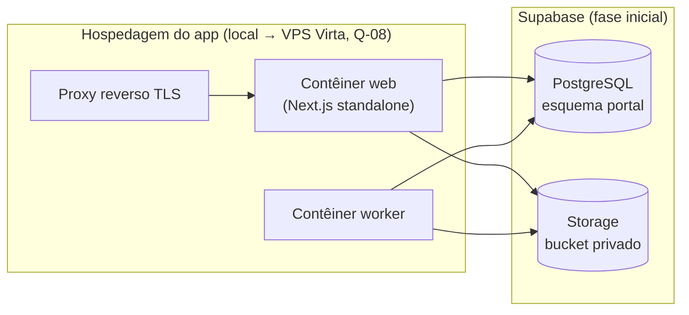

# Arquitetura Técnica — Portal TI Vallur

**Repositório:** `vallur-ti-portal`
**Fase:** 01 — Arquitetura e planejamento
**Situação deste documento:** proposta para revisão. Nada do que está descrito aqui foi implementado.
**Fonte primária:** `docs/plano-mestre/PORTAL_TI_VALLUR_PLANO_MESTRE.md` (versão 1.2, 15/10/2026; o PDF da mesma pasta corresponde à v1.1 e está desatualizado), citado como **PM §n**.
**Revisão 01.1 (14/10/2026):** incorpora as decisões aprovadas Q-04, Q-07, Q-25, Q-27 e Q-30; Q-09 permanece aberta. Consolidação em `REVISAO_FINAL_FASE_01.md`.
**Revisão 01.3 (14/10/2026):** registra a inspeção do tenant feita pela TI (Q-09 continua pendente), a trava de ambiente contra escrita no tenant de produção (§13.1.1, DA-23), a questão Q-34 e a correção de referências cruzadas. Detalhes em `REVISAO_FINAL_FASE_01.md` §6.
**Revisão 01.4 (15/10/2026):** incorpora as decisões da TI DT-01 a DT-07 (§16.2): autenticação própria do portal, sem login Microsoft (DT-01); senha inicial definida pela TI no cadastro e senhas do portal e do Microsoft 365 independentes (DT-02); nenhuma aprovação hierárquica em provisionamento (DT-03); Supervisor TI e Gestor ADM sem hierarquia e com autoridade equivalente (DT-04, DT-05); experiência gerencial para o Gestor ADM (DT-06); limites do Estagiário TI (DT-07). Novas propostas DA-24 a DA-27, riscos R-24 a R-26 e questões Q-36 a Q-42. Substituídas: DA-02, Q-04, Q-25; encerradas: Q-33, R-20. O Plano Mestre passou à versão 1.2 (o PDF continua na v1.1 e está desatualizado). Correções da revisão especializada (mesma data): Q-43, R-27, DA-24 a DA-27 revistas, reconciliação sem senha (§11.4), concorrência na confirmação (§7.2, §11.3), restrições dependentes do alvo com falha fechada (§10.1) e ativação do perfil de TI (§9.6).

Documentos irmãos (formam uma única especificação):

| Documento | Conteúdo |
|---|---|
| `ARQUITETURA_TECNICA.md` | Este documento: decisões, fronteiras, fluxos, infraestrutura, riscos e pendências consolidadas |
| `MODELO_DE_DADOS.md` | Entidades, relacionamentos, restrições e estratégia de migrações |
| `INTEGRACOES.md` | Conectores externos, permissões, falhas parciais e procedimentos manuais |
| `PERMISSOES_RBAC.md` | Perfis, matriz de permissões e pontos de aplicação |
| `PLANO_DE_IMPLEMENTACAO.md` | Etapas, critérios de aceite, testes e pontos de aprovação |
| `DESIGN_SYSTEM.md` | Direção visual, tokens propostos, componentes e responsividade |
| `REVISAO_FINAL_FASE_01.md` | Revisão final da Fase 01: decisões incorporadas, correções, riscos, classificação das pendências (§8–9), verificações e prontidão para a aprovação A-00 |

---

## 1. Convenções de classificação

Toda afirmação relevante nestes documentos é classificada com um dos rótulos abaixo. Os rótulos são usados de forma idêntica nos seis documentos.

| Rótulo | Significado |
|---|---|
| **[REQ-PM]** | Requisito confirmado no Plano Mestre (com referência PM §n) |
| **[REQ-PROMPT]** | Requisito explícito da instrução de execução da Fase 01 que não contradiz o Plano Mestre. A instrução foi fornecida na sessão de trabalho e não está versionada no repositório; "REQ-PROMPT §n" cita a seção da instrução |
| **[DECISÃO-PM]** | Decisão de arquitetura ou tecnologia já confirmada no Plano Mestre |
| **[DECISÃO-TI]** | Decisão de negócio aprovada pela TI da Vallur após o Plano Mestre e registrada em §16: questões resolvidas (ex.: Q-07) ou decisões `DT-nn` (§16.2). Prevalece sobre regra anterior contraditória |
| **[PROPOSTA]** | Decisão de arquitetura proposta nesta fase; requer aprovação (ver §15) |
| **[PREMISSA]** | Premissa técnica adotada para planejar; deve ser confirmada ou invalidada |
| **[DEP-EXT]** | Dependência de sistema, fornecedor ou ambiente externo |
| **[PENDENTE-TI]** | Questão que exige decisão da equipe de TI da Vallur (ver §16, IDs `Q-nn`) |

Identificadores usados em todos os documentos: decisões de arquitetura `DA-nn` (§15), riscos `R-nn` (§14), questões `Q-nn` (§16), decisões da TI posteriores à A-00 `DT-nn` (§16.2), permissões `dominio.acao` (`PERMISSOES_RBAC.md`).

### 1.1 Glossário (terminologia única)

| Termo | Definição |
|---|---|
| **Colaborador** | Pessoa cadastrada no portal. A equipe de TI também é composta de colaboradores com perfis adicionais |
| **Vínculo** | Período em que um colaborador está associado a uma empresa, cargo, departamento e gestor. Vínculos não são sobrescritos |
| **Perfil** | Papel de acesso: `COLABORADOR`, `ESTAGIARIO_TI`, `SUPERVISOR_TI`, `GESTOR_ADM`. **Perfis administrativos** = `SUPERVISOR_TI` e `GESTOR_ADM`, sem hierarquia entre si e com autoridade equivalente (Q-07, DT-04, DT-05) |
| **Experiência de interface** | Visão operacional (Supervisor TI, Estagiário TI) ou gerencial (Gestor ADM) da área de TI; nunca altera permissões (DT-06) |
| **Conta de acesso** | Conta local do portal (`conta_acesso`), vinculada 1:1 ao cadastro do colaborador; login = e-mail corporativo; senha guardada só como hash Argon2id (DT-01, DT-02) |
| **Permissão individual** | Permissão sensível concedida a uma pessoa específica, além das do seu perfil (Q-30) |
| **Restrição obrigatória** | Regra que nenhuma permissão individual contorna (ex.: Estagiário nunca altera perfis nem regras de segurança — DT-07) |
| **Permissão** | Operação autorizável no backend, no formato `dominio.acao` (ex.: `provisionamento.executar`) |
| **Solicitação** | Pedido que agrupa ações em sistemas externos (ex.: provisionamento de admissão). Não exige aprovação hierárquica (DT-03): é preparada, revisada, confirmada e executada por quem tem `provisionamento.executar` |
| **Confirmação** | Ato explícito de quem executa: revisa o efeito exato e confirma; gera a versão imutável da solicitação (`versao_solicitacao`) e as ações. **Não é aprovação hierárquica** (DT-03) |
| **Executor** | Pessoa que confirmou a versão e disparou a execução; registrada na versão, nas tentativas e na auditoria |
| **Confirmação reforçada** | Confirmação de operação destrutiva: lista do que será removido, digitação da contagem ou do identificador e reautenticação recente (DT-03) |
| **Ação solicitada** | Item de uma solicitação: uma operação em um sistema (ex.: atribuir licença) com parâmetros validados |
| **Aprovação**, **Autoaprovação** | *Termos históricos (até a Revisão 01.3), substituídos por DT-03.* Designavam a decisão de Supervisor TI ou Gestor ADM sobre uma versão da solicitação e a aprovação feita por quem a preparou (Q-04, substituída) |
| **Execução** | Estado de cumprimento de uma ação solicitada em um sistema externo |
| **Tentativa** | Uma chamada individual de execução; uma execução pode ter várias tentativas |
| **Tarefa manual** | Trabalho atribuído a uma pessoa quando a ação não pode ou não deve ser automatizada |
| **Conector** | Módulo isolado que fala com um sistema externo |
| **Ativo** | Bem controlado individualmente (patrimônio/número de série) |
| **Item de estoque** | Acessório controlado por quantidade |
| **Alocação** | Entrega física de ativos e/ou itens de estoque a um colaborador; começa na entrega (Q-27). O TER documenta a entrega, mas tem ciclo próprio |
| **Entrega física** | Momento em que o equipamento passa às mãos do colaborador; torna o ativo `ALOCADO` (Q-27) |
| **Devolução** | Recebimento de itens alocados, documentado por um TDV |
| **Termo** | Documento TER ou TDV, com versões emitida e assinada |
| **Evidência fotográfica** | Fotografia associada a um ativo e a um evento (cadastro, entrega, devolução, manutenção) |
| **Evento de auditoria** | Registro imutável de operação relevante |
| **Tarefa assíncrona** | Trabalho interno do worker sem solicitação (ex.: gerar PDF de termo, selar auditoria) |

Termos técnicos mantidos em inglês, em itálico quando aparecem no texto: *outbox* (registro de trabalho gravado na mesma transação do dado), *jitter* (variação aleatória no intervalo de retentativa), *toast* (notificação breve), *debounce* (espera antes de reagir à digitação), *pipeline* (esteira de integração contínua), *lint* (verificação estática de código), *branch* (ramo do Git).

---

## 2. Visão técnica executiva

O Portal TI Vallur é uma aplicação web corporativa única, construída em **Next.js (App Router) + React + TypeScript** [DECISÃO-PM, PM §15], que atende dois públicos com fronteiras de segurança distintas:

1. **Área de TI** (`/ti`): administração de empresas, colaboradores e contas de acesso, solicitações e execução de provisionamento, Microsoft 365, inventário, alocações, TER/TDV, chamados, tutoriais, auditoria, integrações e segurança; visão operacional ou gerencial conforme o perfil (DT-06).
2. **Portal do colaborador** (`/portal`): somente os próprios equipamentos, chamados, documentos disponibilizados e tutoriais publicados ao seu público [REQ-PM, PM §11].

A arquitetura proposta é um **monólito modular** com um **processo worker** separado, ambos gerados do mesmo código-fonte e da mesma imagem Docker [PROPOSTA, DA-01]:

- O **processo web** (Next.js) atende requisições, aplica autenticação, autorização e regras de negócio, e grava estado no PostgreSQL.
- O **processo worker** (Node.js) executa ações em sistemas externos de forma assíncrona, com retentativas, idempotência e registro de cada tentativa.
- O **PostgreSQL** (Supabase inicialmente, sem recursos proprietários) é a fonte de verdade de todos os estados, inclusive da fila de execução [PROPOSTA, DA-05].
- **Arquivos** (fotos, PDFs, anexos) ficam em armazenamento privado atrás de um adaptador substituível [DECISÃO-PM, PM §15 e §17].
- **Autenticação própria do portal** [DECISÃO-TI, DT-01]: tela de login própria (e-mail corporativo e senha), sessões próprias no PostgreSQL e MFA para os perfis de TI, com biblioteca consolidada [PROPOSTA, DA-24 a DA-27]. Supabase Auth não é usado. O **Microsoft Entra ID** deixa de autenticar o acesso ao portal e continua como diretório das contas Microsoft 365, alcançado só pelas integrações com autenticação de aplicação (DA-09). *Até a Revisão 01.3: "Entra ID é a única autoridade de autenticação" (DA-02, substituída).*

O princípio dominante é: **nenhuma ação sensível parte do navegador diretamente para o banco ou para um sistema externo**. Toda operação passa por um serviço de domínio no servidor que autentica, autoriza, valida (Zod), executa e audita [REQ-PM, PM §16].

---

## 3. Princípios de arquitetura

| # | Princípio | Consequência prática |
|---|---|---|
| P1 | Plano Mestre como fonte da verdade | Regras de negócio não são alteradas para simplificar a interface (CLAUDE.md, PM §22) |
| P2 | Autorização sempre no servidor | Menus ocultos são conveniência; cada Server Action, Route Handler e consulta verifica a permissão (`PERMISSOES_RBAC.md` §6) |
| P3 | Histórico nunca é sobrescrito | Vínculos, alocações, movimentações, versões confirmadas e execuções são registros novos, não atualizações destrutivas (PM §3, §8, §22.7) |
| P4 | Preparado ≠ confirmado ≠ executado | Estados separados para rascunho, conteúdo confirmado (versão imutável com executor) e resultado em cada sistema (PM §3, §13; DT-03). *Até a Revisão 01.3: "Solicitado ≠ aprovado ≠ executado".* |
| P5 | Idempotência e reconciliação antes de repetir | Antes de reexecutar, o conector verifica o estado real no sistema externo (PM §3, §22.9) |
| P6 | Segredos nunca persistem | A senha inicial existe apenas em memória durante a requisição de confirmação; o único destino persistente é o hash Argon2id da senha do **portal** (DT-02, DA-25); nenhuma senha do Microsoft 365 é guardada em forma alguma; tokens, segredos TOTP e chaves nunca vão para logs, auditoria ou banco em claro (PM §4, §19) |
| P7 | Portabilidade de PostgreSQL | Apenas recursos padrão do PostgreSQL; nada de regra de negócio em Edge Functions, RLS do Supabase como mecanismo principal ou Supabase Auth; autenticação própria com tabelas no esquema `portal` (PM §17; DT-01) |
| P8 | Integração não confirmada = procedimento manual auditado | Conectores sem API validada geram tarefas manuais (PM §5) |
| P9 | Conectores isolados | Cada fornecedor em módulo próprio, com contrato comum, sem vazar tipos do fornecedor para o domínio (PM §5, §16) |
| P10 | Mínimo de dependências | Nada é adicionado além do stack aprovado sem justificativa registrada em `DA-nn` |

---

## 4. Stack aprovado e complementos

### 4.1 Tecnologias confirmadas [DECISÃO-PM, PM §15]

Next.js (App Router), React, TypeScript, Tailwind CSS, shadcn/ui + componentes próprios, PostgreSQL, Supabase (PostgreSQL inicial), Prisma, SQL, Microsoft Entra ID e Microsoft Graph (somente para integrações — DT-01), React Hook Form + Zod, TanStack Table, TanStack Query, Vitest, Playwright, Node.js, storage privado com adaptador, Redis + BullMQ (quando necessário), Docker, Git + GitHub privado, GitHub Actions, PowerShell (opcional, legado Teams).

Autenticação do portal [DECISÃO-TI, DT-01; PM v1.2 §15 e §24]: própria, com biblioteca consolidada compatível com Next.js, TypeScript, Prisma e PostgreSQL (proposta em DA-24); não Supabase Auth.

> A instrução da Fase 01 não lista TanStack Query, GitHub Actions, Redis/BullMQ, Node.js e o adaptador de storage, mas também não os exclui. Por precedência, prevalece o Plano Mestre e eles permanecem no stack.

### 4.2 Bibliotecas complementares propostas [PROPOSTA]

Somente o estritamente necessário para cumprir requisitos já confirmados. Cada uma requer aprovação (DA-03, DA-07, DA-16, DA-24, DA-25).

| Necessidade | Proposta | Motivo | Alternativa |
|---|---|---|---|
| Autenticação própria do portal (verificação de credencial, emissão do token de sessão, MFA TOTP, limitador de tentativas) | `better-auth` 1.7.x com versão exata fixada (1.7.9 era a `latest` no npm em 15/10/2026), adaptador Prisma, plugin de dois fatores (DA-24, DA-26, DA-27). **Superfície mínima:** só as rotas de entrar, sair e verificar o segundo fator ficam expostas; a política de sessão e as demais operações de conta são do portal (DA-24 revista). Encaixe validado por prova de conceito na Etapa 1 (R-27) | Biblioteca consolidada exigida por DT-01; traz verificação de senha, MFA TOTP e limitador | Auth.js (v5 ainda em beta; Credentials sem persistência, redefinição, MFA nem limitador); implementação própria (alternativa de R-27: sessão própria sobre as mesmas tabelas, usando da biblioteca só hash e TOTP) |
| Hash de senha | `@node-rs/argon2` (Argon2id; binário pré-compilado; 2.2.2 no npm em 15/10/2026), ligado às funções `hash`/`verify` da biblioteca, com *pepper* aplicado antes do Argon2id (DA-25) | Argon2id preferido pela instrução da TI; exemplo oficial da biblioteca usa este pacote | `scrypt` padrão da biblioteca |
| Tokens de aplicação para o Graph | `@azure/msal-node` (biblioteca oficial Microsoft), **somente** *client credentials* com certificado — não faz login de usuários (DA-03 revista) | Mantida pela Microsoft; credencial por certificado | `fetch` direto ao endpoint de token (mais código de segurança) |
| Cliente HTTP do Graph | `fetch` nativo com wrapper próprio tipado | Evita SDK pesado; controle total de retry e sanitização | `@microsoft/microsoft-graph-client` |
| Storage S3 | `@aws-sdk/client-s3` | Um único adaptador serve Supabase Storage (endpoint S3), MinIO na VPS ou qualquer S3 | Adaptador de sistema de arquivos local (apenas desenvolvimento) |
| PDF do TER/TDV | Renderização HTML → PDF com Chromium headless (biblioteca `playwright-core` no worker) | Preserva o layout dos modelos HTML existentes (`TER_VALLUR_v22.html`) | `@react-pdf/renderer` (exigiria redesenhar o layout) |
| Ícones | `lucide-react` (padrão do shadcn/ui) | Já é a dependência de ícones do shadcn/ui | — |
| Datas | `date-fns` + `date-fns-tz` | Fuso `America/Sao_Paulo` e formatação pt-BR | `Intl` nativo apenas |

---

## 5. Fronteiras da aplicação

### 5.1 Diagrama de contexto



### 5.2 Fronteiras de confiança

| Fronteira | De | Para | Controle |
|---|---|---|---|
| F1 | Navegador | Processo web | Autenticação própria (e-mail corporativo + senha; segundo fator para perfis de TI — DT-01, DA-24 a DA-27); sessão opaca no banco (cookie `__Host-`, `HttpOnly`, `Secure`, `SameSite=Lax`); limitador de tentativas e resposta única contra enumeração; CSRF nativo das Server Actions + verificação de `Origin`; autorização por permissão |
| F2 | Processo web/worker | PostgreSQL | Papel de banco restrito (`portal_app`), sem DDL, sem `UPDATE/DELETE` em auditoria; TLS |
| F3 | Processo web/worker | Storage | Credencial apenas no servidor; objetos privados; acesso por URL assinada de curta duração emitida após autorização |
| F4 | Processo web/worker | Microsoft Graph / Exchange | Somente autenticação de aplicação: app registrations separadas — web (criação e leitura de usuários) e worker (licenças, grupos, Exchange) —, com certificado; permissões de aplicação mínimas e segregadas; credenciais nunca chegam ao navegador (DA-09). A senha do colaborador nunca é credencial de integração; sem ROPC (DT-02) |
| F5 | Worker | Terceiros | Credenciais por conector, em variáveis de ambiente/cofre; logs sanitizados |
| F6 | Colaborador | OneDrive/SharePoint | O portal só lista o que foi publicado ao público do colaborador; o acesso ao arquivo é feito com a identidade Microsoft do próprio colaborador, fora do portal (DA-12, Q-11) |

---

## 6. Arquitetura de frontend

### 6.1 Organização

- **App Router** com dois grupos de rotas e layouts distintos:
  - `src/app/(ti)/ti/...`: layout administrativo com navegação lateral (desktop) e gaveta (celular).
  - `src/app/(colaborador)/portal/...`: layout simplificado, com navegação superior/inferior.
  - `src/app/(publico)/entrar`: tela de login própria (e-mail corporativo e senha), segundo fator (`/entrar/segundo-fator`; sem desafio pendente, volta a `/entrar`), sessão expirada ou encerrada (`/entrar?motivo=expirada|encerrada`) e mensagens de acesso negado (DT-01). A recuperação pelo próprio colaborador (`/entrar/recuperar`) fica desenhada e desligada até Q-37.
  - `src/app/(conta)/conta`: "Minha conta" — troca da própria senha, configuração do próprio MFA (`/conta/mfa`) e sessões ativas (`/conta/sessoes`) (`conta.gerenciar_propria`), para qualquer perfil; ativação do perfil de TI com código de uso único (`/conta/ativar`, Q-43) [PROPOSTA]. Para quem tem perfil de TI sem MFA configurado, `/conta/mfa` (ou `/conta/ativar`) é a única rota permitida.
  - **Sessão durante formulários longos** [PROPOSTA]: aviso "Sua sessão vai expirar em 2 min — Continuar", com renovação (WCAG 2.2.1); Server Actions e `/api` devolvem **erro tipado de sessão** (sem redirecionar) e a tela abre o diálogo de entrada ou de reautenticação no lugar, sem perder o preenchimento (exceto a senha). Na saída e na revogação, navegação completa (`window.location`) para limpar também o cache do roteador; resposta 401 durante o *polling* leva a `/entrar?motivo=encerrada`.
- **Server Components por padrão** para leitura de dados: a página chama serviços de domínio no servidor, que já aplicam autorização. Dados sensíveis não autorizados nunca são serializados para o cliente.
- **Client Components** apenas para interatividade: formulários (React Hook Form + Zod), tabelas (TanStack Table), filtros, diálogos.
- **TanStack Query** [DECISÃO-PM] para dados que mudam enquanto a tela está aberta: estado de execução de provisionamento (polling), tabelas com paginação/ordenação/filtros no servidor e contadores do dashboard. Consome Route Handlers `GET /api/...`.
- **Mutações** via **Server Actions** que chamam exatamente um caso de uso do serviço de domínio [PROPOSTA, DA-13]. Server Actions são endpoints HTTP públicos; cada uma revalida sessão e permissão (ver `PERMISSOES_RBAC.md` §6).
- **Caminho único de dados** [PROPOSTA]: a página (Server Component) e o Route Handler `GET /api/...` chamam **a mesma função de caso de uso**. Quando a tela usa TanStack Query, a página faz o *prefetch* no servidor e entrega o resultado por `HydrationBoundary`, evitando busca dupla na primeira carga. A chave da consulta é derivada dos `searchParams` (o estado das tabelas fica na URL — `DESIGN_SYSTEM.md` §8).
- **Atualização após mutação**: a Server Action chama `revalidatePath`/`revalidateTag` no servidor e o cliente executa `queryClient.invalidateQueries` para as chaves afetadas.
- **Esquemas Zod compartilhados**: o mesmo esquema valida o formulário no cliente (experiência) e a entrada no servidor (segurança). A validação do servidor é a única que conta.
- **Sem cache compartilhado de dados que dependem de quem está logado** [PROPOSTA]: nada de `use cache`, `unstable_cache` ou `fetch` em cache para esses dados; Route Handlers de `/api/*` respondem com `Cache-Control: private, no-store`; a saída limpa o cache do TanStack Query (`queryClient.clear()`). Um teste E2E entra com o usuário A e depois com o B no mesmo navegador e confirma que B não vê dados de A.

### 6.2 Componentes e design system

- `src/components/ui/`: componentes shadcn/ui gerados via MCP `shadcn` e ajustados aos tokens do `DESIGN_SYSTEM.md`.
- `src/components/` (demais pastas): componentes próprios do produto: `DataTable`, `PageHeader`, `StatusBadge`, `EmptyState`, `ConfirmDialog`, `FormSection`, `FileDropzone`, `PhotoChecklist`, `Timeline`, `FaixaAmbiente` e, a partir da Revisão 01.4, `CampoSenhaTransitoria`, `PainelConfirmacao`, `ConfirmacaoReforcada`, `DialogoReautenticacao`, `ConfiguracaoMfa` e `AvisoExpiracaoSessao` (`DESIGN_SYSTEM.md` §6).
- Nenhuma tela define cores ou espaçamentos próprios fora dos tokens.

### 6.3 Rotas principais (proposta)

| Área | Rota | Módulo (PM §2) |
|---|---|---|
| Público | `/entrar`, `/entrar/segundo-fator`, `/entrar?motivo=expirada\|encerrada`, `/entrar/recuperar` (desligada até Q-37) | Login próprio, segundo fator e sessão expirada (DT-01, DA-26) |
| Todos | `/conta`, `/conta/mfa`, `/conta/sessoes`, `/conta/ativar` (Q-43) | Minha conta: senha, MFA, sessões; ativação do perfil de TI |
| TI | `/ti` | Dashboard: painel operacional ou gerencial (DT-06) |
| TI | `/ti/empresas` | Empresas |
| TI | `/ti/colaboradores`, `/ti/colaboradores/[id]` | Colaboradores (dados, vínculos, acesso ao portal, contas externas, ativos, termos, histórico) |
| TI | `/ti/solicitacoes`, `/ti/solicitacoes/nova`, `/ti/solicitacoes/[id]` | Cadastro, revisão, confirmação e acompanhamento da execução do provisionamento (sem aprovação — DT-03). *A rota `/ti/aprovacoes` da Revisão 01.3 foi removida* |
| TI | `/ti/microsoft-365/licencas`, `/ti/microsoft-365/caixas-compartilhadas`, `/ti/microsoft-365/grupos` | Microsoft 365 |
| TI | `/ti/inventario/ativos`, `/ti/inventario/estoque`, `/ti/inventario/manutencoes` | Inventário |
| TI | `/ti/alocacoes`, `/ti/devolucoes` | Alocações; devolução simples na V1 e TDV na expansão (Q-12) |
| TI | `/ti/termos` | TER e TDV |
| TI | `/ti/chamados` | Chamados |
| TI | `/ti/tutoriais` | Central de Tutoriais (administração) |
| TI | `/ti/tarefas-manuais` | Fila de ações manuais de integração |
| TI | `/ti/auditoria` | Auditoria |
| TI | `/ti/configuracoes/perfis`, `/ti/configuracoes/integracoes`, `/ti/configuracoes/catalogos` | Administração do portal (perfis e permissões individuais — Q-07, Q-30, DT-05) |
| TI | `/ti/configuracoes/seguranca` | Política de senha, MFA, sessão e limites de tentativa (`seguranca.configurar` — DT-07) |
| TI | `/ti/relatorios` | Consultas e exportações da visão gerencial (Q-42) |
| Colaborador | `/portal` | Início |
| Colaborador | `/portal/equipamentos` | Meus equipamentos |
| Colaborador | `/portal/chamados` | Meus chamados |
| Colaborador | `/portal/documentos` | Meus documentos disponibilizados |
| Colaborador | `/portal/tutoriais` | Tutoriais |

---

## 7. Arquitetura de backend

### 7.1 Camadas



Regras de dependência (verificáveis por lint de importação na Fase 02):

1. `src/app/**` só importa `src/server/modulos/**` (casos de uso), `src/features/**` e `src/components/**`. Nunca importa Prisma nem conectores.
2. `src/server/modulos/**` não importa nada de `src/app/**` nem de React.
3. `src/integrations/**` não importa Prisma nem módulos de domínio; recebe dados por parâmetro e devolve resultados tipados.
4. **Rotas da biblioteca de autenticação** [PROPOSTA, DA-24 revista]: a rota *catch-all* `/api/auth/*` expõe **somente** entrar, sair e verificar o segundo fator; todas as demais rotas da biblioteca ficam desativadas (ex.: `disabledPaths`, a confirmar na Etapa 1). Troca de senha, configuração e desativação de MFA, encerramento de sessões, alteração de e-mail e de dados da conta passam por casos de uso do portal (permissão, reautenticação, política de senha Q-39, auditoria). Os campos adicionais da conta (`situacao`, `troca_senha_exigida`...) não são graváveis pelo cliente. Login e troca de senha usam Server Actions que chamam a API da biblioteca no servidor, para que os códigos de erro da biblioteca não cheguem ao navegador. Um teste (S-01) lista as rotas expostas e falha se surgir outra.
5. Todo arquivo em `src/server/**` e `src/integrations/**` importa `server-only`, impedindo empacotamento no cliente. **Ponto a resolver na Etapa 1:** fora da condição `react-server`, `server-only` lança exceção, e o worker (Node puro) reutiliza esses módulos. Escolher entre executar o worker com `--conditions=react-server` ou manter `server-only` só nos arquivos de borda do Next e garantir a fronteira por regra de importação no *lint*; um teste de CI confirma que o worker inicia com os módulos compartilhados.

### 7.2 Padrão de caso de uso

Pseudocódigo (ilustrativo, não é código de produção):

```ts
// src/server/modulos/solicitacoes/confirmar-solicitacao.ts
// Confirmação de solicitação de alteração (sem senha). A admissão segue o mesmo padrão, com as etapas de §11.4.
export async function confirmarSolicitacao(ctx: ContextoRequisicao, entrada: unknown) {
  const dados = ConfirmarSolicitacaoSchema.parse(entrada);          // 1. validação Zod estrita
  const ator = await exigirSessao(ctx, { autenticacaoRecenteMin: 15 }); // 2. autenticação (+ reautenticação recente)
  await exigirPermissao(ator, 'provisionamento.executar');          // 3. permissão efetiva no momento da confirmação
                                                                   //    (perfil + individuais − restrições obrigatórias)
  // A tela de revisão já exibiu o "conteúdo resolvido" (identificadores externos resolvidos ANTES da revisão,
  // fora de qualquer transação) e enviou o hash desse conteúdo. Nenhuma chamada externa dentro da transação (§11.1).
  try {
    return await db.$transaction(async (tx) => {
      // 1) Trava a linha da solicitação com a transição condicional ANTES de criar a versão (BE-02).
      const alteradas = await tx.solicitacao.updateMany({
        where: { id: dados.solicitacaoId, versaoAtual: dados.versaoEsperada,
                 estado: { in: ['RASCUNHO', 'EM_EXECUCAO', 'CONCLUIDA_COM_PENDENCIAS'] } },   // EM_EXECUCAO = nova versão
        data: { estado: 'EM_EXECUCAO', versaoAtual: { increment: 1 } },
      });
      exigirRegra(alteradas.count === 1, 'SOLICITACAO_ALTERADA_OU_JA_CONFIRMADA');
      const conteudo = await carregarConteudoResolvido(tx, dados.solicitacaoId);   // rascunho ou correção, já resolvido
      exigirRegra(hashCanonico(conteudo) === dados.hashExibido, 'SOLICITACAO_ALTERADA'); // confirma o que foi revisado
      if (contemRemocoes(conteudo)) exigirConfirmacaoReforcada(dados, conteudo); // DT-03: lista + contagem digitada
      // 2) Nova versão: cancela ações não concluídas da versão anterior; aborta se alguma estiver EM_EXECUCAO.
      await cancelarAcoesNaoConcluidasOuAbortar(tx, dados.solicitacaoId);   // UPDATE ... WHERE estado IN (PENDENTE,
                                                                           // BLOQUEADO, AGUARDANDO_ACAO_MANUAL, FALHOU)
      const versao = await tx.versaoSolicitacao.create({                   // UNIQUE(chave_confirmacao)
        data: { solicitacaoId: dados.solicitacaoId, conteudo, hashConteudo: dados.hashExibido,
                confirmadaPorId: ator.colaboradorId, chaveConfirmacao: dados.chaveConfirmacao, origemPermissao, ... },
      });
      await gerarAcoesDaVersao(tx, versao);                               // 4. outbox: ações + execuções
      await registrarAuditoria(tx, { acao: 'solicitacao.confirmar', versaoSolicitacaoId: versao.id, origemPermissao, ... }); // 5. auditoria
      return versao;
    });
  } catch (e) {
    // Violação de UNIQUE(chave_confirmacao) aborta a transação no PostgreSQL: tratar FORA dela (BE-02).
    // Reenvio (duplo clique, duas abas, rede sem resposta) devolve o resultado da confirmação já gravada,
    // sem nova execução e sem chamar o Graph.
    if (violouChaveConfirmacao(e)) return buscarConfirmacaoExistente(dados.chaveConfirmacao);
    throw e;
  }
}
```

Pontos-chave:

- **Validação, autenticação, autorização e auditoria** são etapas obrigatórias de todo caso de uso que altera estado.
- **A confirmação não é aprovação** (DT-03): é o ato explícito de quem tem `provisionamento.executar`, depois de revisar o efeito exato. O executor fica registrado na versão e na auditoria.
- **Auditoria na mesma transação** que a alteração: não existe alteração sem evento correspondente. Eventos de negação e falha são gravados em transação própria, para não serem desfeitos junto com a operação.
- **Outbox transacional**: ações e execuções são geradas a partir da versão confirmada, na mesma transação da confirmação; o worker só enxerga execuções de versões confirmadas. A reivindicação do worker exige que a ação pertença à **versão vigente** (`versao_atual`) e que a solicitação não esteja `CANCELADA` [PROPOSTA].
- **Hash do conteúdo revisado** [PROPOSTA]: os identificadores externos (SKU, `objectId` de grupos, caixas) são resolvidos **antes** da tela de revisão; a tela envia o hash do conteúdo exibido e o servidor recusa se divergir ("O cadastro mudou; revise de novo"). A correção para a versão N+1 é feita num campo editável próprio (`solicitacao.correcao`, sem senha), porque o rascunho só é editável em `RASCUNHO`.
- **Erros de domínio** têm códigos estáveis (`SOLICITACAO_ALTERADA`, `ATIVO_JA_ALOCADO`...) traduzidos para mensagens pt-BR na interface.

### 7.3 Tratamento de erros

| Tipo | Exemplo | Resposta ao usuário | Registro |
|---|---|---|---|
| Validação | CPF inválido | Erro junto ao campo | Não audita (não houve alteração) |
| Autorização negada | Estagiário sem concessão individual tenta executar provisionamento | "Você não tem permissão para esta ação." | Evento de auditoria `resultado=NEGADO` (transação própria) |
| Regra de domínio | Ativo já alocado | Mensagem específica com caminho de correção | Log estruturado nível `info` |
| Falha de integração | Graph 503 | Estado da execução + opção de repetir (quando autorizado) | Tentativa com erro sanitizado |
| Erro inesperado | Exceção | Mensagem genérica com ID de correlação | Log nível `error` sem dados pessoais nem segredos |

**Sanitização obrigatória**: um utilitário único `sanitizarErro()` remove cabeçalhos `Authorization`, corpo de requisições com `passwordProfile`, tokens, segredos e qualquer campo marcado como sensível antes de qualquer log ou persistência. Testes unitários garantem que a senha nunca aparece em erros serializados (ver `PLANO_DE_IMPLEMENTACAO.md`, critério S-03).

### 7.4 Logs e observabilidade

- Logs estruturados em JSON (stdout) com `correlationId` propagado do request ao worker e às chamadas externas (inclui o `request-id` retornado pela Microsoft, quando houver).
- Lista de bloqueio de campos (`password`, `senha`, `novaSenha`, `currentPassword`, `newPassword`, `passwordProfile`, `hash`, `hash_senha`, `authorization`, `cookie`, `token`, `secret`, `totp`, `totpURI`, `codigo`, `backupCodes`, `cpf`, `client_secret`) aplicada no serializador de logs, inclusive nos logs da biblioteca de autenticação (corpo de requisição nunca registrado).
- Logs técnicos são diferentes da auditoria: logs são efêmeros e de diagnóstico; auditoria é registro de negócio imutável.
- Endpoint `GET /api/saude` (sem dados sensíveis) para verificação do contêiner.

---

## 8. Estrutura de diretórios proposta

Baseada na estrutura sugerida em PM §16, detalhada [PROPOSTA]:

```text
vallur-ti-portal/
  docs/
    plano-mestre/                 # Plano Mestre (fonte da verdade)
    ARQUITETURA_TECNICA.md  MODELO_DE_DADOS.md  INTEGRACOES.md
    PERMISSOES_RBAC.md  PLANO_DE_IMPLEMENTACAO.md  DESIGN_SYSTEM.md
    referencias/                  # TER/TDV HTML e materiais da TI (a incluir, sem dados pessoais)
  src/
    app/
      (publico)/entrar/           # login próprio, segundo fator, sessão expirada
      (conta)/conta/              # minha conta: senha, MFA, sessões
      (ti)/ti/...                 # área administrativa (visão operacional ou gerencial)
      (colaborador)/portal/...    # portal do colaborador
      api/
        auth/[...all]/route.ts    # rotas da biblioteca (DA-24): SOMENTE entrar, sair e verificar 2º fator;
                                  # demais desativadas; cadastro público desativado (§7.1, regra 4)
        arquivos/[id]/route.ts    # download autorizado (URL assinada)
        ...                       # consultas paginadas para TanStack Query
    components/
      ui/                         # shadcn/ui
      layout/  data-table/  forms/  feedback/
    features/
      colaboradores/  solicitacoes/  inventario/  alocacoes/  termos/
      chamados/  tutoriais/  auditoria/  empresas/  microsoft-365/
        (componentes de tela, esquemas Zod, hooks de cliente)
    server/
      auth/                       # configuração da biblioteca (DA-24), hash Argon2id (DA-25), sessões e
                                  # reautenticação, MFA (DA-26), limitador (DA-27), contas de acesso
      authz/                      # catálogo de permissões, políticas, escopos
      auditoria/                  # gravação e consulta de eventos
      db/                         # Prisma Client, papéis, helpers de transação
      fila/                       # enfileirar, reivindicar, concluir execuções
      storage/                    # interface ArmazenamentoArquivos + adaptadores
      documentos/                 # renderização TER/TDV (HTML → PDF)
      modulos/
        empresas/ colaboradores/ contas-acesso/ solicitacoes/ microsoft365/
        inventario/ alocacoes/ termos/ chamados/ tutoriais/ integracoes/
    integrations/
      core/                       # contrato Conector, erros, retry, sanitização
      microsoft-graph/            # usuários, licenças, grupos; tokens de aplicação via MSAL (DA-03 revista)
      exchange-online/            # caixas compartilhadas (ponte PowerShell)
      teams/                      # expansão
      onedrive/                   # catálogo de tutoriais
      konviva/                    # Unividade / UCS Online (a habilitar)
      diario-de-obra/             # a confirmar
      d4sign/                     # a confirmar
      manual/                     # conector de tarefa manual
    worker/
      index.ts                    # laço de reivindicação e despacho
    lib/                          # utilitários sem efeito colateral (formatação, CPF, datas)
  prisma/
    schema.prisma
    migrations/
    seed.ts                       # somente dados de catálogo e de desenvolvimento fictícios
  tests/
    unit/  integration/  e2e/  fixtures/
  docker/
    Dockerfile  compose.dev.yml
  .github/workflows/
  .env.example                    # sem segredos reais
```

> **Observação de localização [Q-20]:** o Plano Mestre oficial está em `docs/plano-mestre/PORTAL_TI_VALLUR_PLANO_MESTRE.md`, versão 1.2 (o PDF da mesma pasta é a versão 1.1, desatualizado), e o `CLAUDE.md` passou a citar esse caminho exato (Etapa 01.1). A instrução da Fase 01 citava `docs/PORTAL_TI_VALLUR_PLANO_MESTRE.md`, que não existe. Os modelos TER/TDV estão hoje em `TER - TDV/` (raiz) e as planilhas da TI em `docs/Inventário/`, `docs/SGSI/` e `docs/dISTRIBUIÇÃO DE CUSTOS/`; a pasta `docs/referencias/` acima é a proposta de destino para versões **sem dados pessoais** (R-21). Nenhum arquivo foi movido.

---

## 9. Autenticação

> **Revisão 01.4:** esta seção foi reescrita por DT-01 e DT-02. Até a Revisão 01.3, o acesso ao portal era feito por login Microsoft Entra ID (OIDC com PKCE, `@azure/msal-node`, chave de identidade `oid` + `tid`, reautenticação por `max_age`/`auth_time`). Esse desenho foi **substituído** e só permanece como histórico (DA-02 substituída, DA-03 revista, Q-33 encerrada).

### 9.1 Decisões

- **Autenticação própria do portal** [DECISÃO-TI, DT-01]: tela de login própria; o login é o **e-mail corporativo** do colaborador; a senha é configurada pela TI no cadastro (DT-02); o portal mantém suas próprias sessões e seu próprio controle de autenticação. **Não há login Microsoft** (SSO/OIDC) para entrar no portal.
- **Conta local vinculada ao cadastro interno**: cada colaborador tem no máximo uma `conta_acesso` (1:1), com `email_login` derivado de `email_corporativo`. O identificador interno estável é `conta_acesso.id`/`colaborador.id`; o e-mail é atributo, não identidade (`MODELO_DE_DADOS.md` §5).
- **`entra_object_id`** continua armazenado para as integrações, quando disponível; **não** é chave de login nem identificador principal (DT-01).
- **Biblioteca consolidada** [PROPOSTA, DA-24 revista]: Better Auth 1.7.x com versão exata fixada, e-mail + senha, adaptador Prisma, sessões no PostgreSQL (esquema `portal`), cache de sessão em cookie desativado, cadastro público desativado, somente o plugin de dois fatores habilitado. **Divisão de responsabilidades:** a biblioteca **verifica a credencial e emite/valida o token**; o portal aplica a **política de sessão** em `exigirSessao` sobre colunas próprias (inatividade por área, expiração absoluta a partir de `criada_em`, `autenticado_em`, `segundo_fator_em` — §9.3) e a **autorização** (`exigirPermissao`, DA-22). **Superfície mínima:** só entrar, sair e verificar o segundo fator ficam expostos pela biblioteca (§7.1, regra 4). Compatibilidade com Next.js 16 e Prisma 7 não verificada em execução: **prova de conceito na Etapa 1** com critério de saída (rotas mínimas, política de sessão própria, revogação imediata, MFA conforme DA-26, gravação de conta e credencial dentro da transação do portal); se falhar, alternativa de R-27.
- **Hash de senha** [PROPOSTA, DA-25]: Argon2id (`@node-rs/argon2`), parâmetros no próprio hash (formato PHC), *pepper* (segredo fora do banco) aplicado antes do Argon2id; política de senha conforme Q-39.
- **MFA** [DECISÃO-TI: planejar MFA obrigatório para a TI; mecanismo PROPOSTA, DA-26]: TOTP obrigatório para quem tem perfil de TI ativo (Q-38); ativação do perfil de TI com código de uso único (Q-43, §9.6).
- **Proteção contra força bruta, enumeração e negação de serviço** [PROPOSTA, DA-27 revista].
- Supabase Auth **não** é usado sem nova decisão explícita da TI (DT-01).

### 9.2 Fluxo de entrada



- O desafio do segundo fator depende de o **MFA estar configurado** na conta, não só do perfil. Perfil de TI ativo **sem MFA confirmado**: a sessão só acessa `/conta/ativar` (Q-43) ou `/conta/mfa`; `ti.acessar` exige sessão com segundo fator verificado (DA-26).
- Mensagem única para senha errada, conta inexistente, bloqueada ou desativada; o motivo real fica só nos contadores e nos eventos agregados de auditoria (DA-27). A mensagem "Muitas tentativas" é a mesma para conta existente ou não e não revela existência.
- **Auditoria de falhas agregada** [PROPOSTA]: falhas de login alimentam contadores e geram eventos `auth.bloqueio_temporario` ao atingir o limite; não se grava um evento selado por tentativa (evita inundar a cadeia de auditoria). Sucessos, bloqueios e desbloqueios continuam individuais.

### 9.3 Regras de sessão [PROPOSTA; valores Q-15]

| Item | Valor proposto |
|---|---|
| Armazenamento | Sessão opaca no PostgreSQL (tabela `sessao`); o cookie guarda só o token. A biblioteca emite e valida o token; a política abaixo é aplicada por `exigirSessao` em colunas próprias (DA-24 revista). Se a biblioteca guardar o token em claro no banco, avaliar na prova de conceito da Etapa 1 e preferir hash. Cache de sessão em cookie **desativado** (revogação imediata) |
| Cookie | Prefixo `__Host-`, `HttpOnly`, `Secure`, `SameSite=Lax`, `Path=/`, sem `Domain` (configuração da biblioteca a verificar na Etapa 1); verificação de `Origin` (`trustedOrigins`) |
| Expiração por inatividade | 30 min para operações da área TI e 8 h para o portal do colaborador, com último uso registrado por área na mesma sessão — Q-15 |
| Expiração absoluta | 12 h, contadas a partir de `criada_em` pelo portal; a renovação automática da biblioteca (expiração deslizante) **não** pode estendê-la [PROPOSTA] |
| Aviso de expiração | Aviso 2 min antes, com opção de continuar (WCAG 2.2.1); erro tipado de sessão nas Server Actions (§6.1) |
| Revalidação de perfis | A cada requisição, a partir do banco (não do cookie) |
| Revogação | Saída; troca da própria senha (demais sessões); redefinição de senha pela TI, bloqueio, desativação da conta, revogação de perfil, atribuição de perfil de TI (Q-43) e redefinição de MFA (todas as sessões da pessoa), na mesma transação. **Revogar = excluir a linha da sessão** (efeito imediato também nas rotas da biblioteca); o histórico fica no evento de auditoria `auth.sessao_revogada`, com o motivo [PROPOSTA] |
| Reautenticação para operação de alto risco | Autenticação há menos de 15 min (Q-15): diálogo próprio que pede a senha e, para perfis de TI, o código TOTP, e atualiza `sessao.autenticado_em`. O diálogo passa pelo mesmo limitador do login (DA-27) e recusa código TOTP repetido. Em fluxos com senha de terceiros (cadastro), a reautenticação é verificada **antes** de a senha sair do navegador (§11.4). O conceito de "sessão nova" da biblioteca (`freshAge`, baseado na criação da sessão) **não** substitui essa verificação. Operações: `provisionamento.executar`, `execucao.reprocessar`, `perfil.atribuir`/`revogar`, `permissao_individual.gerenciar`, `colaborador.vincular_identidade`, `conta_acesso.redefinir_senha`, `conta_acesso.redefinir_mfa`, `conta_acesso.bloquear`/`desbloquear`, `seguranca.configurar`, `integracao.configurar`, `auditoria.exportar`, `desligamento.executar` |
| Saída | Remove a sessão no banco e o cookie; limpa o cache do TanStack Query (§6.1) |

### 9.4 Recuperação e redefinição de senha

| Caminho | Regra |
|---|---|
| **Redefinição pela TI** (`conta_acesso.redefinir_senha`) | A TI informa uma nova senha (sujeita à política, Q-39) e a entrega ao titular por canal fora do portal definido pela TI (nunca planilha, R-22); revoga todas as sessões; auditada (`conta_acesso.redefinir_senha`, sem a senha). Restrição obrigatória quando o alvo tem perfil de TI ativo e o ator não tem perfil administrativo (§10.1). `troca_senha_exigida` só é marcado se Q-36 decidir assim. **Controles compensatórios** [PROPOSTA]: o titular vê no próximo acesso "Sua senha foi redefinida por <nome> em <data>"; a primeira sessão aberta depois de uma redefinição por terceiro fica marcada na auditoria; redefinição de senha ou de MFA de membro da TI gera alerta no painel dos demais administradores (§10.1) |
| **Recuperação pelo próprio colaborador** | Link de uso único enviado ao e-mail corporativo (token guardado com hash, validade ≤ 30 min, revoga as sessões ao concluir); resposta sempre "Se o e-mail estiver cadastrado, enviaremos instruções". **Desenhada e desligada até Q-37** (canal de envio de e-mail). Em contas com MFA, recuperar a senha **não** dispensa o segundo fator |
| **Troca pelo titular** (`conta.gerenciar_propria`) | Em "Minha conta", por caso de uso do portal (não pela rota da biblioteca — §7.1, regra 4); exige a senha atual; passa pelo limitador (DA-27) e pela política de senha (Q-39); encerra as demais sessões; auditada (`conta.alterar_propria_senha`); não faz nenhuma chamada ao Microsoft Graph (DT-02: senhas independentes) |
| **Perda do MFA** | `conta_acesso.redefinir_mfa`, somente perfis administrativos, com verificação de identidade definida pela TI (Q-38); revoga as sessões; para membro da TI, o novo segundo fator é configurado com código de ativação de uso único (Q-43, §9.6). Membro da TI **não** desativa o próprio MFA (só a redefinição por administrador) [PROPOSTA, DA-26] |

A troca obrigatória da senha no primeiro acesso **não** é requisito confirmado (DT-02); depende de Q-36. Recomendação técnica: exigir (R-24).

### 9.5 Ciclo de vida da conta de acesso



- Bloqueio e desativação revogam todas as sessões na mesma transação e geram auditoria. `DESATIVADA` é definitiva. [PROPOSTA, revista] `email_login` é **único em toda a tabela**: ao desativar, o valor é trocado por um marcador de conta desativada (não utilizável como e-mail) e o e-mail original fica no detalhe da auditoria; assim o e-mail pode ser reutilizado no futuro por outra conta, sem duas contas com o mesmo e-mail e sem misturar históricos (identidade = `conta_acesso.id`). Isso também evita conflito com a busca por e-mail da biblioteca, que pressupõe e-mail único.
- **Alteração de e-mail** (ex.: mudança do e-mail corporativo): atualiza `email_login` na **mesma** conta, sem criar nova identidade; encerra as demais sessões; audita `conta_acesso.alterar_email_login` com os valores antigo e novo no detalhe da auditoria. Para quem tem perfil de TI, exige `colaborador.editar_equipe_ti` (restrição obrigatória para não administradores). Quando a mudança decorre do provisionamento (correção de UPN), `email_corporativo`, `upn` e `email_login` só mudam **depois** de o UPN ser confirmado no Microsoft 365, na mesma transação (§11.4) [PROPOSTA].
- Regra do **último administrador** (`PERMISSOES_RBAC.md` §8): o sistema impede revogar o último perfil administrativo, bloquear, desativar, **afastar** ou desligar o último administrador ativo (perfil administrativo ativo + conta `ATIVA` + colaborador `ATIVO`). A verificação é serializada com bloqueio consultivo de transação (`pg_advisory_xact_lock`), para que dois administradores revogando ou bloqueando um ao outro ao mesmo tempo não zerem a administração [PROPOSTA]. Recomendação à TI: manter pelo menos dois administradores ativos.
- Bloqueio temporário por tentativas (DA-27) é separado da situação `BLOQUEADA`: vence sozinho e não exige ação da TI.

### 9.6 Primeiro acesso e bootstrap

- O primeiro perfil administrativo (`GESTOR_ADM` ou `SUPERVISOR_TI`) é criado por comando administrativo executado no servidor (script de bootstrap auditado), nunca por tela [PROPOSTA]. O script cria o colaborador e a conta de acesso, lê a senha no terminal **sem eco e sem registro**, recusa executar se já houver administrador ativo, grava evento `ator_tipo = SISTEMA` com a identificação de quem o executou, compara `AMBIENTE` com o ambiente gravado no banco (§13.1.1) e marca o MFA como obrigatório no primeiro acesso. Não exige mais `entra_object_id` (DT-01). O **procedimento de emergência** para perda de todos os administradores (ou de todos os segundos fatores) e o **desbloqueio de emergência** do limitador são entregues já na **Etapa 1** (antes: Etapa 7a), também como comandos de servidor auditados [PROPOSTA].
- Contas de acesso de colaboradores existentes não são criadas pela carga inicial (Q-40); a TI as cria uma a uma, com senha informada no momento. `conta_acesso.criar` é restrita pelo alvo: só perfis administrativos criam conta de acesso para quem já tem perfil de TI ativo (§10.1).
- **Ativação do perfil de TI** [PROPOSTA; decisão da TI em Q-43]: sem este controle, quem conhece a senha inicial (o Estagiário que cadastrou ou redefiniu a senha, ou quem conhece a senha do Microsoft 365 quando é a mesma — R-24) poderia entrar antes do titular e cadastrar o próprio TOTP numa conta que depois recebe perfil administrativo. Por isso, ao atribuir perfil de TI: (1) as sessões do alvo são revogadas; (2) o perfil só concede `ti.acessar` depois que o titular **define a própria senha** e **configura o MFA com um código de ativação de uso único**, gerado pelo administrador que atribuiu o perfil e entregue fora do portal (`/conta/ativar`); (3) o mesmo vale depois de `conta_acesso.redefinir_mfa` de membro da TI. Evento `conta_acesso.ativar_perfil_ti`. Antes da Revisão 01.4 (correções), isto era só recomendação (Q-31 e).

### 9.7 Vinculação de identidade Microsoft

- `colaborador.entra_object_id` só é gravado a partir do resultado verificado do provisionamento, da carga inicial revisada ou da ação `colaborador.vincular_identidade` (somente perfis administrativos — Supervisor TI ou Gestor ADM; restrição obrigatória para os demais, `PERMISSOES_RBAC.md` §3.10). Nenhuma edição comum de cadastro e nenhuma tarefa manual alteram esse campo.
- **Justificativa revista (R-18):** o `oid` não concede mais login no portal (DT-01). Um vínculo errado, porém, direciona ações de integração (licença, grupos, caixas, desligamento) à conta Microsoft de outra pessoa; por isso a restrição é mantida.

### 9.8 Proibições explícitas [DECISÃO-TI, DT-01 e DT-02]

1. Sem SSO/OIDC Microsoft para entrar no portal.
2. Sem fluxo ROPC (*resource owner password credentials*) para autenticar no Microsoft por trás da tela do portal.
3. Sem sincronização de senhas entre portal e Microsoft 365 por métodos não oficiais: depois da criação, as senhas são independentes; alterar uma não altera a outra.
4. Sem consulta ou leitura de senhas existentes no Entra ID.
5. Sem Supabase Auth — e **desligado de fato** no projeto Supabase (cadastro de usuários e provedores desativados), com teste automatizado [PROPOSTA]; "proibido" não basta, porque o serviço vem com cadastro aberto por padrão.
6. A senha do colaborador nunca é credencial das integrações: as integrações usam autenticação de aplicação com certificado e permissões mínimas segregadas (DA-09).

**Verificação** [PROPOSTA]: além da revisão de código, o CI falha se encontrar `acquireTokenByUsernamePassword` (ROPC), escopos delegados de login (`openid`, `offline_access`) em código de integração ou `passwordProfile` fora do conector de `m365.criar_conta`; um teste confirma que trocar ou redefinir a senha do portal não faz nenhuma chamada ao Microsoft Graph.

---

## 10. Pontos de aplicação da autorização

Detalhamento completo em `PERMISSOES_RBAC.md` §6. Resumo:

| Camada | Papel | Pode ser a única barreira? |
|---|---|---|
| `proxy.ts` do Next.js (antigo `middleware`, renomeado na versão 16) | Redirecionar quem não tem sessão própria do portal para `/entrar` | **Não.** Apenas conveniência. A própria documentação do Next.js orienta verificar autenticação e autorização dentro de cada Server Function; a falha CVE-2025-29927 (contorno do middleware por cabeçalho forjado) mostrou o risco de depender só dessa camada |
| Layout de grupo de rotas (`(ti)/layout.tsx`) | Bloquear renderização da área TI para quem não tem perfil de TI ou não verificou o segundo fator na sessão (DA-26) | Não; defesa em profundidade |
| **Caso de uso (`src/server/modulos`)** | `exigirSessao()` (sessão própria válida, segundo fator e reautenticação quando exigidos) + `exigirPermissao()` (permissão efetiva: perfil + permissões individuais − restrições obrigatórias, inclusive as dependentes do alvo, §10.1) + escopo de dados | **Sim. Barreira obrigatória** |
| Consulta de dados | Filtro por escopo (ex.: `colaboradorId = ator.id` no portal) aplicado no repositório | Sim, complementa a anterior |
| Banco de dados | Papel `portal_app` sem `UPDATE/DELETE` em auditoria; restrições de integridade | Protege contra falha da aplicação |
| Storage | Objetos privados; URL assinada só é emitida após autorização | Sim, para arquivos |

### 10.1 Permissão efetiva e permissões individuais [DECISÃO-TI, Q-07, Q-30, DT-05 e DT-07; algoritmo PROPOSTA]

A função única `permissaoEfetiva(ator, permissao, alvo?)` (`PERMISSOES_RBAC.md` §3.10) é chamada por todo caso de uso e decide nesta ordem: (1) **restrições obrigatórias** — prevalecem sobre tudo e valem quando o ator não tem perfil administrativo ativo ou tem `ESTAGIARIO_TI` ativo: nunca altera perfis (`perfil.atribuir`/`revogar`), nunca concede permissões individuais (nem a si mesmo), nunca vincula identidade Microsoft, nunca altera regras de segurança (`seguranca.configurar`), nunca redefine MFA (`conta_acesso.redefinir_mfa`) e nunca age sobre credenciais e acesso de quem tem perfil de TI ativo (`conta_acesso.criar`, `conta_acesso.redefinir_senha`, `bloquear`, `desbloquear`, `encerrar_sessoes`, `colaborador.editar_equipe_ti`, `desligamento.executar` com alvo da TI) e nunca executa provisionamento para si mesmo nem para quem tem perfil de TI ativo (`provisionamento.executar` com alvo = o próprio ator ou membro da TI — derivada de DT-07, proposta que a TI confirma) — restrições **dependentes do alvo**; nem inclui grupos no catálogo de grupos permitidos (`catalogo.gerenciar_grupos`, idem); (2) permissões do **perfil** — Supervisor TI e Gestor ADM têm conjuntos idênticos (Q-07, DT-05); (3) **permissões individuais** ativas, apenas das marcadas como concedíveis no catálogo e somente enquanto a pessoa tiver perfil de TI ativo (Q-30) — é assim que o Estagiário recebe `provisionamento.executar` (DT-07); (4) negar por padrão. A origem (`PERFIL:<perfil>`, `INDIVIDUAL:<id>` ou `RESTRICAO_OBRIGATORIA`) é gravada no evento de auditoria. Perfis e concessões são lidos do banco a cada requisição. *Até a Revisão 01.3, a lista incluía `solicitacao.aprovar`, que deixou de existir (DT-03).*

**Restrições dependentes do alvo — falha fechada e serialização** [PROPOSTA]: para as permissões dessa lista, o parâmetro `alvo` é **obrigatório**; chamada sem `alvo` é **negada** (um teste percorre o catálogo e confirma). Os perfis do alvo são lidos com `SELECT … FOR UPDATE` na linha do colaborador-alvo, dentro da transação da operação, e `permissaoEfetiva(ator, permissao, alvo)` é chamada dentro dessa transação; `perfil.atribuir`/`revogar` tomam o mesmo bloqueio, para que uma atribuição concorrente de perfil de TI não escape da restrição (em READ COMMITTED, apenas "ler na mesma transação" não basta).

**Alertas compensatórios** (R-26) [PROPOSTA]: geram alerta no painel dos administradores (canal dentro do portal até Q-35/Q-37) a atribuição de perfil administrativo, a concessão de `provisionamento.executar`, a alteração de `seguranca.configurar`, a redefinição de senha ou de MFA de membro da TI e operações destrutivas acima de um limite configurável. A concessão individual de `provisionamento.executar` tem `valida_ate` **obrigatório** [PROPOSTA; a TI confirma].

A diferença entre a visão operacional e a gerencial (DT-06) é só de experiência: não entra na avaliação de permissões.

---

## 11. Processamento assíncrono e orquestração de integrações

### 11.1 Estratégia [PROPOSTA, DA-05]

O Plano Mestre prevê "Redis + BullMQ (quando necessário)". Proposta para a V1:

- **A fila é o próprio PostgreSQL**, em duas tabelas: `execucao_acao` (ações de solicitações confirmadas) e `tarefa_assincrona` (trabalhos internos sem solicitação: geração de PDF de termos, selagem da auditoria, sincronização de SKUs, verificação de tutoriais, verificação de backups). Ver `MODELO_DE_DADOS.md` §6.5 e §6.8.
- **Reivindicação em uma única instrução curta**, executada com `$queryRaw` do Prisma (compatível com o pooler em modo transação):

```sql
-- pseudocódigo: reivindica até :n itens prontos ou com arrendamento vencido
UPDATE portal.execucao_acao e
   SET estado = 'EM_EXECUCAO', reservado_por = :worker, reservado_ate = now() + :arrendamento,
       tentativas = e.tentativas + 1, iniciado_em = coalesce(e.iniciado_em, now())
 WHERE e.id IN (
   SELECT id FROM portal.execucao_acao
    WHERE modo = 'AUTOMATICA'
      AND ((estado = 'PENDENTE' AND proxima_tentativa_em <= now())
        OR (estado = 'EM_EXECUCAO' AND reservado_ate < now()))   -- worker anterior caiu
    ORDER BY proxima_tentativa_em
    LIMIT :n
    FOR UPDATE SKIP LOCKED)
RETURNING e.*;
```

- **A transação de reivindicação termina antes da chamada externa.** Nenhuma transação do banco fica aberta durante chamadas ao Graph, PowerShell ou terceiros.
- **Gravação do resultado protegida pelo arrendamento**: `UPDATE ... WHERE id = :id AND reservado_por = :worker`. Se nenhuma linha for afetada, o arrendamento foi perdido e o resultado é descartado (a próxima passagem começa por `verificarEstado()`).
- **Vantagens**: a fila e o estado de negócio ficam no mesmo banco, com outbox transacional na confirmação; não há infraestrutura adicional; os backups incluem a fila; portabilidade total.
- **Critério para introduzir Redis + BullMQ**: volume que gere contenção no PostgreSQL, agendamentos complexos ou limitação de taxa distribuída entre várias réplicas do worker. Nesse caso o PostgreSQL continua como fonte de verdade e o BullMQ passa a ser apenas mecanismo de despacho.
- O worker roda como processo separado e, ao concluir uma ação, chama o **módulo de domínio dono** do dado (`modulos/microsoft365`, `modulos/solicitacoes`...) para atualizar `conta_externa`, `atribuicao_licenca`, `membro_grupo` e o estado agregado da solicitação — o conector nunca grava no banco.

### 11.2 Ciclo de vida da execução

Estados do Plano Mestre [REQ-PM, PM §5]: `PENDENTE`, `EM_EXECUCAO`, `CONCLUIDO`, `FALHOU`, `AGUARDANDO_ACAO_MANUAL`. Complemento proposto: `BLOQUEADO` (aguardando dependência) e `CANCELADO` (não será executada) [PROPOSTA, Q-05].

Modos de execução (`execucao_acao.modo`): `AUTOMATICA` (worker), `MANUAL` (tarefa manual) e `SINCRONA_INTERATIVA` (criação de conta Microsoft com a senha digitada no cadastro — §11.4).

**Motivo da espera** [PROPOSTA]: `AGUARDANDO_ACAO_MANUAL` tem sentidos diferentes, registrados em `execucao_acao.motivo_espera`: `AGUARDANDO_SENHA` (criação de conta que precisa de nova tentativa com senha, só depois da reconciliação sem senha — §11.4), `TAREFA_MANUAL` (trabalho manual da TI) e `AGUARDANDO_DEPENDENCIA_EXTERNA` (ex.: caixa postal que ainda não apareceu).



`EM_EXECUCAO → CANCELADO` [PROPOSTA]: quando a solicitação é cancelada enquanto a chamada está em curso, a chamada não é interrompida; a transação 2 grava o resultado (ex.: o `oid`, para não perder a conta criada) mas não libera as dependentes, e a ação termina `CANCELADO` com o efeito registrado ("efeitos aplicados").

### 11.3 Regras de orquestração

1. **Grafo de dependências** (tabela `dependencia_acao`): ex.: atribuir licença depende de criar conta; acesso a caixa compartilhada depende da caixa postal existir. Na **mesma transação** em que uma ação fica `CONCLUIDO`, suas dependentes saem de `BLOQUEADO`.
2. **Independência de resultados** [REQ-PM, PM §3]: falha no D4Sign não afeta a conta Microsoft concluída; cada ação tem estado próprio.
3. **Reconciliação antes de escrever** (P5): toda execução chama primeiro `verificarEstado()`. Se o efeito já existir no sistema externo, a execução é marcada `CONCLUIDO` com o ID externo encontrado, sem nova escrita.
4. **Resultado desconhecido** (timeout após envio): nunca se repete a escrita às cegas; a próxima passagem começa pela reconciliação.
5. **Retentativa automática** apenas para falhas transitórias (HTTP 429, 5xx, timeout de rede), com recuo exponencial e variação aleatória (*jitter*), respeitando `Retry-After`. Limite proposto: 5 tentativas em até ~30 min [PROPOSTA].
6. **Reprocessamento e nova tentativa** [PROPOSTA, revista]: ação em `AGUARDANDO_ACAO_MANUAL` exige `provisionamento.executar`; ação em `FALHOU` exige `execucao.reprocessar` **e** `provisionamento.executar` (o Estagiário com só uma das concessões não repete escritas externas — DT-07); ambas com reautenticação recente e os mesmos parâmetros confirmados [PM §3 "repetição autorizada"]. A tomada da ação é feita por atualização condicional mais arrendamento (duas pessoas não tentam ao mesmo tempo). Depois de `RESULTADO_DESCONHECIDO`, há um intervalo mínimo antes da nova tentativa (atraso de replicação do Entra ID). No modo `SINCRONA_INTERATIVA`, a nova tentativa começa pela **reconciliação sem senha** e só pede a senha se o estado for `NAO_APLICADO` (§11.4).
7. **Mudança de parâmetros após a confirmação** (ex.: conflito de UPN): a TI corrige no campo de correção (`solicitacao.correcao`), revisa e **confirma de novo**, criando a versão N+1 a partir de `EM_EXECUCAO` ou `CONCLUIDA_COM_PENDENCIAS`. Concorrência [PROPOSTA]: a transição condicional da solicitação trava a linha antes da criação da versão; as ações não concluídas da versão anterior passam a `CANCELADO` (motivo `SUBSTITUIDA_POR_NOVA_VERSAO`) por `UPDATE ... WHERE estado IN ('PENDENTE','BLOQUEADO','AGUARDANDO_ACAO_MANUAL','FALHOU')` e a operação **aborta** se restar ação `EM_EXECUCAO`; o worker só reivindica ações da versão vigente (§7.2). As concluídas são preservadas e as novas ações nascem na confirmação da nova versão. Não há aprovação (DT-03). *Até a Revisão 01.3, a nova versão voltava para `AGUARDANDO_APROVACAO`.*
8. **Estado agregado da solicitação** (calculado na mesma transação de cada mudança de execução; tabela de decisão definida já nesta revisão [PROPOSTA], em vez de ficar para PB-10):

   | Condição (avaliada nesta ordem) | Estado agregado |
   |---|---|
   | Solicitação `CANCELADA` | `CANCELADA` — **absorvente**: o agregador não recalcula e o reprocessamento é proibido |
   | Todas as ações `CONCLUIDO` | `CONCLUIDA` |
   | Existe ação `PENDENTE` ou `EM_EXECUCAO`, ou `BLOQUEADO` cujas dependências estão `PENDENTE`, `EM_EXECUCAO` ou `BLOQUEADO` que ainda progride | `EM_EXECUCAO` |
   | Nenhuma ação progride sozinha e há ação em `FALHOU`, `CANCELADO`, `AGUARDANDO_ACAO_MANUAL` (qualquer `motivo_espera`) ou `BLOQUEADO` atrás de dependência em `FALHOU`, `CANCELADO` ou `AGUARDANDO_ACAO_MANUAL` | `CONCLUIDA_COM_PENDENCIAS` (estado de trabalho para a TI; volta a `EM_EXECUCAO` quando uma pendência é retomada) |
9. **Operações destrutivas** (remover licença, remover de grupo, revogar acesso a caixa compartilhada, bloquear em sistema externo, remoções do Teams, desligamento) exigem **confirmação reforçada** antes da confirmação: lista do que será removido, digitação da contagem ou do identificador e reautenticação recente (DT-03).

### 11.4 Cadastro, senha inicial e criação de conta Microsoft [DECISÃO-TI, DT-02 e DT-03; mecanismo PROPOSTA, DA-08 revista]

**Regra de negócio (DT-02, DT-03, 15/10/2026):** a TI informa a senha inicial no formulário de cadastro, e ela é usada **imediatamente** na execução, porque não há etapa de aprovação. A mesma senha pode ser usada para criar a conta Microsoft 365. Depois da criação, as senhas do portal e do Microsoft 365 são independentes. A senha nunca é persistida em texto: para o portal guarda-se só o hash Argon2id (DA-25); para o Microsoft 365 a senha vai só pela integração de backend autorizada (DA-09). Se uma nova tentativa ocorrer depois do fim da requisição original, a senha é pedida de novo. *Até a Revisão 01.3 (Q-25, substituída): a senha da preparação era descartada e redigitada depois da aprovação.*

**Passos da TI** (instrução da TI de 15/10/2026): 1 abrir o cadastro → 2 nome, sobrenome, empresa, cargo, departamento (e gestor, PM §3) → 3 o sistema sugere o e-mail corporativo (Q-02) e verifica duplicidade → 4 senha inicial → 5 licença Microsoft 365 (seleção manual) → 6 sistemas adicionais → 7 revisão → 8 confirmação → 9 o portal registra o colaborador → 10 provisionamento autorizado → 11 resultado individual por integração → 12 continuar com equipamentos, acessórios e TER.

**Mecânica**

1. **Rascunho sem senha.** O rascunho pode ser salvo no servidor (`solicitacao.rascunho`, colaborador `PRE_CADASTRO`). A senha **nunca** entra no rascunho: ela vive só no navegador, numa referência do componente do assistente fora do estado do formulário (sem `name`), até a confirmação; é **limpa ao sair do assistente, ao salvar o rascunho, ao cancelar, ao recarregar e no evento `pagehide`** — não ao trocar de etapa, porque a etapa 5 precisa dela (`DESIGN_SYSTEM.md` §9.2). Ao salvar o rascunho, a tela avisa que a senha foi descartada e a etapa 5 bloqueia a confirmação sem senha. O rascunho é serializado por lista explícita de campos. O esquema Zod do rascunho é estrito e **rejeita** chaves de senha; se uma chegar ao servidor (requisição forjada), é recusada sem ser registrada.
2. **Campo de senha.** Uma senha inicial; opção "Usar a mesma senha no Microsoft 365" (padrão marcado, DT-02) ou campo separado para a senha do Microsoft 365 (recomendado, R-24); botão "Gerar senha aleatória" [PROPOSTA]. É a senha de **outra pessoa**: `autocomplete="new-password"` e atributos de exclusão dos gerenciadores de senha (`data-1p-ignore`, `data-lpignore="true"`, `data-bwignore`), colar permitido, mostrar/ocultar (`DESIGN_SYSTEM.md` §9.2). Navegadores podem ignorar esses atributos: "sem oferta de salvar" é esforço máximo, verificado por teste Playwright no Chrome e no Edge. O gerador não copia a senha para a área de transferência por padrão (o histórico da área de transferência guarda o valor — R-24).
3. **Confirmação** (uma única Server Action). **Antes** de a senha sair do navegador, ao entrar na etapa 5, uma Server Action **sem senha** verifica a reautenticação; se necessário, o diálogo de reautenticação (formulário próprio) é exibido e só depois a confirmação é enviada, num envio único [PROPOSTA]. Se a rede falhar sem resposta, o reenvio com a mesma `chave_confirmacao` devolve o resultado já gravado (§7.2). O servidor verifica, na mesma requisição: sessão válida e reautenticação recente (≤ 15 min, Q-15); permissões efetivas (`colaborador.criar`, `conta_acesso.criar` e, se houver ações externas, `provisionamento.executar` — `PERMISSOES_RBAC.md` §3.10); esquema estrito; duplicidade (CPF por HMAC, e-mail, UPN, nome + empresa); política de senha (Q-39); hash do conteúdo exibido na revisão (§7.2). O hash Argon2id (com *pepper*, DA-25) é calculado **antes** da transação, sob o semáforo do Argon2id (DA-27).
4. **Transação 1.** Cria ou atualiza `colaborador` (`ATIVO`) e `vinculo_colaborador`; cria `conta_acesso` (`ATIVA`, com o e-mail sugerido) e `credencial_senha` (hash) **pelo Prisma, dentro da transação do portal**, usando a mesma função de hash configurada na biblioteca (a API da biblioteca não participa da transação; teste de contrato contra o esquema da biblioteca — DA-24 revista); grava a `versao_solicitacao` confirmada (`chave_confirmacao` única: duplo envio não cria duas execuções); gera `acao_solicitada` e `execucao_acao` (outbox); toma o arrendamento curto (proposta: 2 min) da ação `m365.criar_conta` (modo `SINCRONA_INTERATIVA`, `reservado_por` = identificador da requisição); grava a auditoria. O caso de quem **não** tem `provisionamento.executar` segue o caminho próprio descrito depois desta lista.
5. **Chamada.** Depois do commit, na mesma requisição, o processo web chama **de forma síncrona** o conector Graph (`POST /users`, registration Web, DA-09) com a senha do Microsoft 365. É **uma única chamada HTTP**, sem retentativa automática, com `cache: 'no-store'` e com o marcador do portal (Q-23) no corpo, para permitir a reconciliação. O *timeout* da chamada é **menor que o arrendamento menos uma margem** [PROPOSTA], para que o resultado chegue antes de a varredura considerar a ação interrompida. A senha é passada como parâmetro direto à função que monta o corpo; não é copiada para objetos de contexto, variáveis de escopo de módulo nem *closures* de longa duração.
6. **Transação 2.** Grava o resultado **com guarda de arrendamento** (`WHERE reservado_por = :requisicao`): `CONCLUIDO` com `oid` (grava `colaborador.entra_object_id` e libera as dependentes para o worker), `FALHOU` (falha permanente, ex.: senha recusada pela política do tenant — Q-03; conflito de UPN) ou `AGUARDANDO_ACAO_MANUAL` (falha transitória ou resultado desconhecido). Se o arrendamento tiver sido perdido, o resultado não é descartado às cegas: a ação segue a reconciliação sem senha (item 8), que grava o `oid` encontrado.
7. **Descarte.** Após a tentativa, as referências à senha são abandonadas; nada a retém. A senha serve **somente** ao hash da conta do portal e à ação `m365.criar_conta`: não é repassada a outros conectores (Diário de Obra, D4Sign, Konviva) nem reaproveitada em outra ação.
8. **Falha parcial e reconciliação sem senha** [PROPOSTA, revista]. A conta de acesso do portal já existe e permanece; o colaborador fica `ATIVO`; a ação Microsoft mostra o estado no painel de execução. **Nenhuma exclusão automática.** Depois de *timeout*, resultado desconhecido, interrupção ou arrendamento perdido, a conta pode **já ter sido criada no Microsoft 365 com a senha informada na confirmação**. Por isso `verificarEstado()` roda **sem senha** — na varredura (item 9) e ao abrir o diálogo de nova tentativa:
   - `JA_APLICADO` (marcador do portal encontrado): a ação é concluída **sem pedir senha**, o `oid` é gravado, e a tela avisa que **a senha original informada na confirmação continua valendo** no Microsoft 365 (nenhuma senha nova é pedida nem entregue ao colaborador);
   - `NAO_APLICADO`: só então a senha é pedida de novo (`motivo_espera = AGUARDANDO_SENHA`), com `provisionamento.executar` e reautenticação (§11.3, regra 6);
   - `CONFLITO`: `FALHOU`, para análise humana.
   Duplicidade impedida por `chave_confirmacao`, `chave_idempotencia`, unicidade de colaborador e conta de acesso e reconciliação.
   **UPN e e-mail:** `email_corporativo`, `upn` e `email_login` só mudam **depois** de o UPN ser confirmado no Microsoft 365, na mesma transação, com auditoria e encerramento das demais sessões. Se a criação falhar por conflito de UPN e a TI corrigir o e-mail na versão N+1, os três campos são atualizados quando o novo UPN for confirmado. Marcador igual com UPN diferente do confirmado → `CONFLITO` (análise humana). O formato do marcador precisa caber no atributo escolhido (`employeeId` aceita até 16 caracteres; um UUID não cabe) — Q-23.
9. **Interrupção.** Se o processo web cair entre o commit e a chamada, ou durante ela, a ação fica `EM_EXECUCAO` com arrendamento vencido. A tarefa de varredura (`tarefa_assincrona` `RECUPERAR_EXECUCOES_SINCRONAS`) executa a **reconciliação sem senha** (item 8): conclui a ação se encontrar a conta; senão, devolve-a a `AGUARDANDO_ACAO_MANUAL` (`motivo_espera = AGUARDANDO_SENHA`), com tentativa `RESULTADO_DESCONHECIDO`. O worker **nunca** executa a escrita das ações do modo `SINCRONA_INTERATIVA` e nunca recebe senha; a varredura só lê.
10. **Conector desativado ou manual.** Tarefa manual: a TI cria a conta no Centro de Administração do Microsoft 365 com a senha digitada lá (o portal nunca exibe a senha); o `oid` é gravado só por `colaborador.vincular_identidade` (§9.7). Concluir manualmente `m365.criar_conta` **não** libera licença, grupos e demais dependentes: elas só saem de `BLOQUEADO` depois que `colaborador.vincular_identidade` grava o `oid` [PROPOSTA].
11. **Modo `SIMULACAO`.** Resultado simulado marcado (`simulado = true`); nunca grava `entra_object_id`.
12. **Dependentes.** Licença, grupos, caixas e sistemas externos seguem pelo worker, como antes; operações destrutivas exigem confirmação reforçada (§11.3, regra 9).
13. **Auditoria.** Eventos `solicitacao.confirmar` (executor, versão, `origem_permissao`), `conta_acesso.criar` e `provisionamento.executar` com resultado e `correlation_id` — **somente metadados**.

**Caminho de quem não tem `provisionamento.executar`** [PROPOSTA, revisto] (ex.: Estagiário sem concessão individual, DT-07):

- Usa um caso de uso próprio, **"Registrar colaborador e acesso ao portal"**, com chave de idempotência própria (duplo envio não cria dois colaboradores). Ele grava colaborador, vínculo, conta de acesso e credencial (transação 1 sem ações externas) e deixa a solicitação de provisionamento em `RASCUNHO`, sem senha.
- A opção "Usar a mesma senha no Microsoft 365" é **ocultada** nesse caminho, e o servidor **rejeita** qualquer senha do Microsoft 365 enviada: quem executar depois não conhece a senha do portal.
- A parte cadastral já confirmada fica **congelada** (hash) e não é reeditada pelo rascunho de provisionamento; alterações cadastrais seguem `colaborador.editar`.
- Quem tem `provisionamento.executar` abre o rascunho, revisa, informa a senha do **Microsoft 365** (nova) e confirma. Essa segunda confirmação exige só `provisionamento.executar` (com reautenticação) e **não** toca em `conta_acesso` nem em `credencial_senha`.
- É execução por quem tem permissão, **não** aprovação (DT-03).

**Caminhos de persistência controlados pela aplicação e respectiva proteção**

| Caminho | Proteção |
|---|---|
| Banco de dados (todas as tabelas, inclusive `solicitacao.rascunho`, `versao_solicitacao`, `execucao_acao`, `tentativa_execucao`, `tarefa_manual`, `tarefa_assincrona`, `evento_auditoria`, `detalhe_auditoria`) | Nenhum campo de senha em texto no modelo; o único destino persistente é `credencial_senha.hash_senha` (Argon2id com *pepper*) da senha do **portal**. O fluxo do Microsoft 365 não persiste a senha em forma alguma; quando a TI usa a mesma senha nos dois sistemas, o hash do portal é o hash dessa mesma senha (R-24) — por isso o *pepper* fora do banco (DA-25). Esquemas Zod estritos; teste que procura a senha de teste (em claro) em todas as tabelas após o fluxo |
| Filas e payloads de trabalho | Contêm apenas identificadores; o modo síncrono não usa fila |
| Logs da aplicação e da biblioteca de autenticação | Serializador com lista de bloqueio (`password`, `senha`, `passwordProfile`, `hash`...; §7.4); o corpo de requisições nunca é registrado |
| Logs do proxy reverso, WAF ou CDN | Sem registro de corpo de requisição em nenhum componente na frente da aplicação (configuração obrigatória do host) |
| Relatórios de erro / telemetria | Nenhuma ferramenta externa é proposta; se for adotada, a captura de corpo de requisição e de variáveis locais fica desativada e há filtro de campos; a senha nunca vai para telemetria ou análise |
| Arquivos temporários | Nenhum arquivo temporário persistente recebe a senha ou o corpo da requisição |
| Depuração | `NODE_DEBUG`/registro HTTP detalhado desativados em homologação e produção; *heap snapshots* e *core dumps* desativados no contêiner |
| Cache do Next.js | A chamada ao Graph é `POST` com `cache: 'no-store'`; a Server Action não usa cache de dados |
| Retorno da Server Action | O estado devolvido ao formulário (`useActionState`) nunca inclui a senha |
| Navegador | Sem `localStorage`, `sessionStorage`, IndexedDB ou rascunho com senha; senha só numa referência do assistente, limpa ao sair, salvar rascunho, cancelar, recarregar e em `pagehide`; campo da senha de outra pessoa com atributos contra a oferta de salvar no gerenciador de senhas do operador (esforço máximo, testado no Chrome e no Edge); sem cópia automática para a área de transferência |
| Retentativas automáticas | O `POST /users` com `passwordProfile` é **uma única chamada HTTP**: o cliente do Graph não a repete (nem por 429/5xx) e a Server Action não é reenviada pelo cliente. A repetição é sempre uma nova tentativa, precedida da reconciliação sem senha; a senha só é digitada de novo se a conta não existir (item 8) |
| Erros do framework | A Server Action trata exceções em `try/catch` próprio; nenhum `console.error` recebe o objeto da requisição; mensagens de validação do Zod nunca incluem o valor digitado |
| Instantâneos e histórico | Rascunho, `versao_solicitacao`, auditoria e trilhas de execução nunca recebem a senha nem o hash |

**Limite reconhecido:** a senha precisa existir na memória do processo web durante a requisição de confirmação — agora para dois usos (cálculo do hash e chamada ao Graph). Em JavaScript não é possível apagar com garantia um texto da memória. Os controles acima **minimizam** a exposição (cópias mínimas, tempo mínimo, fronteira de execução restrita) e **impedem a persistência** pelos caminhos que a aplicação controla; não eliminam o risco de memória em absoluto (R-07).

**Credenciais:** o processo web usa uma app registration **própria e mínima** (`User.Create` + leitura de usuários), distinta da registration do worker, que detém as permissões de licenças, grupos e Exchange (DA-09, `INTEGRACOES.md` §2.2). A senha do colaborador nunca é credencial de integração (DT-02).

### 11.5 Fluxo de admissão de ponta a ponta

Ordem confirmada [REQ-PM, PM §3 (v1.2); DECISÃO-TI, DT-03]:



Quando quem cadastra não tem `provisionamento.executar` (ex.: Estagiário sem concessão individual — DT-07), usa o caso de uso "Registrar colaborador e acesso ao portal" (§11.4): o fluxo para depois da transação 1, sem a opção "mesma senha", com a solicitação de provisionamento em `RASCUNHO`; outra pessoa com a permissão abre o rascunho, revisa, informa a senha do Microsoft 365 e confirma. Não existe fila de aprovação nem aprovador (DT-03). Se a chamada ao Graph não tiver resposta, a recuperação segue a reconciliação sem senha (§11.4, item 8).

---

## 12. Documentos (TER/TDV) e arquivos

### 12.1 TER e TDV

- **Situação das referências [R-01, Q-01]:** desde 14/10/2026 os arquivos estão em `TER - TDV/`. A análise estrutural preliminar (campos, regras, layout, sem dados pessoais) está em `MODELO_DE_DADOS.md` §9.4 e confirma a compatibilidade com o modelo, com ajustes listados ali. A análise ainda precisa ser aprovada pela TI; os textos jurídicos não foram alterados. O TER distribuído contém dados pessoais embutidos (R-21).
- **Mecanismo proposto [PROPOSTA, DA-16]:** o modelo HTML de referência é convertido em template de servidor **sem alterar a redação jurídica** [REQ-PROMPT §8]; os dados são injetados a partir de um **instantâneo imutável** (`conteudo_snapshot`) gravado no momento da emissão; a emissão cria uma `tarefa_assincrona` (`GERAR_PDF_TERMO`) e o worker gera o PDF com Chromium headless; calcula-se SHA-256 do PDF; o termo passa a `EMITIDO` quando o PDF está gravado.
- **Isolamento da renderização** (o HTML contém dados digitados por usuários): escape contextual de todos os campos; JavaScript desativado; todas as requisições de rede e `file://` bloqueadas durante a renderização (somente recursos embutidos); processo de navegador isolado, sem acesso às credenciais dos conectores.
- **Assinatura:** externa via GOV.BR [REQ-PM, PM §7]. O portal **não** alega integração com GOV.BR. O PDF assinado é enviado por upload; o portal registra hash, quem anexou e quando. A verificação técnica da assinatura (ex.: validação no Validador ITI) é questão em aberto (Q-13).
- **Versão do modelo:** cada termo guarda `versao_modelo` (ex.: `TER_VALLUR_v22`). Novas versões do modelo não alteram termos já emitidos.
- **Estados do TER** [REQ-PM: estados "sugeridos", PM §7]: `RASCUNHO`, `EMITIDO`, `AGUARDANDO_ASSINATURA`, `ASSINADO`, `CANCELADO`. O TDV usa os mesmos estados [PROPOSTA, Q-12]. Recusa ou insucesso de assinatura não têm estado aprovado (Q-32).
- **Ciclo independente da alocação** [DECISÃO-TI, Q-27]: a alocação começa na entrega física; o TER é gerado, enviado para assinatura e registrado depois, sem alterar o estado da alocação. Cancelar ou reemitir um TER não desfaz a alocação; só devolução, transferência ou cancelamento anterior à entrega encerram itens alocados.

### 12.2 Armazenamento de arquivos [DECISÃO-PM + PROPOSTA, DA-07]

```ts
// Contrato do adaptador (pseudocódigo)
interface ArmazenamentoArquivos {
  gravar(chave: string, conteudo: Readable, meta: { mime: string; sha256: string }): Promise<void>;
  ler(chave: string): Promise<Readable>;
  urlAssinadaLeitura(chave: string, validadeSegundos: number): Promise<string>;
  remover(chave: string): Promise<void>;   // uso restrito a política de retenção
}
```

- Chaves de objeto não contêm dados pessoais: `{classe}/{aaaa}/{mm}/{uuid}` (ex.: `evidencias/2026/10/3f2c...`).
- Validação no upload: lista de tipos permitidos verificada pelo conteúdo (assinatura binária) e não só pela extensão; tamanho máximo por classe; remoção de metadados EXIF de localização das fotos [PROPOSTA]; SHA-256 calculado e gravado.
- Download sempre por `GET /api/arquivos/{id}`: autoriza a partir da entidade dona (termo, chamado, comentário, evidência) e responde com redirecionamento para URL assinada de curta duração (≤ 5 min) ou faz streaming pelo servidor. **Arquivo sem entidade dona: acesso negado.**
- **Quarentena e análise** [PROPOSTA, DA-19]: arquivos enviados por colaboradores (anexos de chamados) ficam em `situacao_analise = PENDENTE` até a análise antimalware no worker (proposta: ClamAV em contêiner próprio — dependência de infraestrutura, Q-29); só ficam disponíveis após `LIBERADO`.
- **Limites de uso por usuário** em envio de arquivos, abertura de chamados, revelação de CPF e retorno de login, com alerta à TI para revelações de CPF em volume atípico [PROPOSTA].
- **Backup separado**: o backup do PostgreSQL não inclui os objetos do storage [REQ-PM, PM §17.4]; ver §13.4.

---

## 13. Infraestrutura

### 13.1 Ambientes [REQ-PM, PM §19]

| Ambiente | Banco | Storage | Entra ID (somente integrações) | Conectores | Dados |
|---|---|---|---|---|---|
| Desenvolvimento local | PostgreSQL 17 em Docker (DA-21); login próprio com contas fictícias (DT-01) | Adaptador local ou MinIO em Docker | **Nenhuma** app registration: o portal não usa login Microsoft (DT-01; Q-33 encerrada). Nenhuma app registration com permissão de aplicação no tenant de produção para desenvolvimento | Modo `SIMULACAO` (respostas simuladas) | Fictícios |
| Homologação | Projeto Supabase dedicado | Bucket dedicado | App registrations de homologação somente em tenant de testes ou ambiente não produtivo autorizado — **nenhum identificado até agora** (Q-09) | `SIMULACAO`; `ATIVO` somente contra tenant de testes ou ambiente não produtivo explicitamente autorizado — nunca o tenant de produção como alternativa implícita | Fictícios ou anonimizados |
| Produção | Projeto Supabase de produção → futuramente VPS Virta | Bucket de produção | Tenant Virta; app registrations de aplicação de produção (Web e Worker, DA-09) | `ATIVO` somente com autorização formal da TI para o ambiente (A-06; PM §22.10) | Reais |

Cada conector tem uma variável de modo: `DESATIVADO`, `SIMULACAO` ou `ATIVO` [PROPOSTA, DA-15]. O modo `ATIVO` em produção só é ligado após o marco de validação de integração do `PLANO_DE_IMPLEMENTACAO.md`. **`SIMULACAO` é proibido em produção**: a aplicação recusa iniciar com essa combinação, e todo resultado simulado é marcado (`simulado = true`) e exibido como tal.

#### 13.1.1 Identificação de ambiente e trava contra escrita no tenant de produção [PROPOSTA, DA-23]

Como o único tenant Microsoft 365 conhecido é o de produção (Q-09), um erro de configuração em desenvolvimento ou homologação não pode resultar em escrita real. Quatro barreiras independentes:

1. **Ambiente explícito.** A variável `AMBIENTE` (`DESENVOLVIMENTO`, `HOMOLOGACAO`, `PRODUCAO`) é obrigatória e validada na inicialização (esquema Zod da configuração). Sem ela, web e worker não iniciam. O ambiente aparece em todo log, no evento de auditoria (`ambiente`) e numa faixa fixa na interface fora de produção. `NODE_ENV` não serve para isso, porque vale `production` em qualquer build otimizado.
2. **Lista de tenants permitidos para escrita.** `TENANT_PRODUCAO_ID` é constante versionada no código (o identificador do tenant não é segredo), e não variável de ambiente. O `tid` do tenant Virta é informado pela TI (Centro de Administração do Microsoft Entra) e **nunca é inferido do domínio**. Fora de produção, um conector Microsoft só aceita o modo `ATIVO` se o `tid` configurado estiver em `TENANTS_ESCRITA_AUTORIZADOS` (vazia por padrão; só muda com registro da autorização da TI) **e** for diferente de `TENANT_PRODUCAO_ID`. Em produção, exige-se `tid = TENANT_PRODUCAO_ID`. A combinação proibida faz a aplicação **recusar a inicialização**, e não apenas registrar um aviso. O conector repete a checagem antes de cada escrita, comparando o `tid` do token obtido com a lista. Conectores de terceiros (D4Sign, Konviva, Diário de Obra) seguem a mesma regra, com uma lista de destinos autorizados por sistema.
3. **Ambiente gravado no banco.** Uma tabela de linha única (`portal.instalacao`: `ambiente`, `criado_em`), gravada na criação do banco, é comparada com `AMBIENTE` por web, worker, *seed*, bootstrap, carga e utilitários de teste; divergência impede a inicialização (evita configuração de desenvolvimento apontando para o banco de produção e vice-versa). *Seeds*, `migrate reset`, `db push` e criação de sessão de teste recusam executar com `AMBIENTE=PRODUCAO`. Segredos de produção ficam restritos ao ambiente de implantação de produção, com revisores obrigatórios no CI.
4. **Barreira de credencial (a mais forte).** Ambientes não produtivos nunca recebem credenciais com permissão de aplicação no tenant de produção. *Até a Revisão 01.3, esta barreira previa uma exceção para uma app registration de login de desenvolvimento no tenant Virta (Q-33). Com a autenticação própria (DT-01), essa exceção **não se aplica**: nenhum ambiente registra app de login no tenant, e o login de desenvolvimento usa contas locais fictícias.* Testes automatizados podem continuar criando sessão diretamente no banco, somente fora de produção (`PLANO_DE_IMPLEMENTACAO.md` §4).

Leituras com permissão de aplicação no tenant de produção a partir de ambientes não produtivos (ex.: verificação de duplicidade, carga inicial) também ficam proibidas até decisão específica (Q-34): elas expõem dados pessoais reais fora de produção. Testes automatizados verificam que cada combinação proibida impede a inicialização.

### 13.2 Topologia inicial



- Um único Dockerfile com dois alvos de build: `web` (saída `standalone` do Next.js) e `worker` (inclui Chromium headless e PowerShell com o módulo do Exchange). O processo web não carrega essas ferramentas.
- Segredos injetados por variável de ambiente/cofre do host; `.env.example` documenta nomes, nunca valores [REQ-PM, PM §17.5].
- CI no GitHub Actions: lint, verificação de tipos, Vitest, `prisma migrate diff` para checar migrações, build da imagem, Playwright contra ambiente efêmero. Deploy fora do escopo da Fase 01.

### 13.3 Uso do Supabase sem dependência proprietária [DECISÃO-PM + PROPOSTA, DA-06]

| Recurso do Supabase | Uso | Justificativa |
|---|---|---|
| PostgreSQL | **Sim** | Banco gerenciado inicial |
| Storage (via protocolo S3) | Sim, atrás do adaptador | Substituível por MinIO/S3 |
| Supabase Auth | **Não** | Autenticação própria do portal, com tabelas no esquema `portal` (DT-01; PM §15 v1.2). Uso só com nova decisão explícita da TI |
| Data API (PostgREST) / chaves `anon` e `service_role` no cliente | **Não** | O navegador nunca acessa o banco (PM §16). Data API desativada (ou, no mínimo, esquema `portal` não exposto); `REVOKE ALL ON SCHEMA portal FROM anon, authenticated, public`; `public` fica vazio. RLS **não** é usado: com RLS ativo e sem políticas, o próprio papel `portal_app` (que não é dono das tabelas) seria bloqueado |
| Rede e TLS | Restrições de rede do banco aos IPs do host da aplicação e exigência de SSL, quando disponíveis no plano | Reduz superfície de ataque |
| Projetos por ambiente | Um projeto Supabase por ambiente | As chaves S3 do Storage valem para o projeto inteiro |
| Edge Functions, Realtime, triggers proprietários | **Não** | Portabilidade (PM §17.3) |
| Extensões | Apenas as disponíveis em PostgreSQL comunitário (`pgcrypto`, `citext` se necessário) | Portabilidade |

**Papéis de banco** [PROPOSTA]: `portal_owner` (dono do esquema; usado somente por migrações via conexão direta), `portal_app` (DML no esquema `portal`, sem DDL; somente `INSERT/SELECT` em `evento_auditoria`), `portal_leitura` (relatórios e suporte, somente leitura, sem colunas criptografadas e sem acesso a `credencial_senha`, `fator_mfa`, `codigo_recuperacao`, `token_verificacao`, `sessao` e `limite_tentativa`), `portal_selo` (somente `INSERT` em `selo_auditoria`, usado só pelo trabalho de selagem) e um papel próprio para a anonimização de `detalhe_auditoria` (`MODELO_DE_DADOS.md` §11.2).

**Conexões**: web e worker usam somente transações curtas (nenhuma transação atravessa chamada externa) e podem usar o pooler em modo transação; migrações usam conexão direta ou modo sessão. No Prisma 7 a conexão passa por *driver adapter* (ex.: `@prisma/adapter-pg`); a configuração do pooler com o adaptador e o tamanho do pool por processo serão verificados na Etapa 1. Parâmetros verificados na documentação oficial do Supabase e do Prisma estão em `INTEGRACOES.md` §10.

### 13.3.1 Versões de plataforma e compatibilidade [PROPOSTA — DA-17, DA-18, DA-20, DA-21]

Verificação feita em documentação oficial em 14/10/2026 (resultado e URLs em `REVISAO_FINAL_FASE_01.md` §10.2). Nenhuma dependência foi instalada.

| Tecnologia | Versão proposta | Compatibilidade verificada | Situação |
|---|---|---|---|
| Next.js | 16.x — última correção estável no início da Fase 02 (16.4 é a estável em 14/10/2026) | Exige Node ≥ 20.9; a série 16 está em LTS ativa; `proxy.ts`, APIs de requisição assíncronas, Turbopack padrão | Proposta (DA-18) |
| Prisma ORM | 7.x (fixar `prisma@7` e `@prisma/client@7` com versão exata no `package.json`) | Node `^20.19`, `^22.12` ou `^24`; PostgreSQL 9.6 a 18; *driver adapter* `@prisma/adapter-pg` obrigatório; ESM; `prisma.config.ts`; `partialIndexes` ainda em *Preview*. Prisma 8 em *release candidate*: segundo a página oficial de situação das versões, `npm install prisma` sem versão já instala o CLI do Prisma 8, que não lê `schema.prisma` — por isso a fixação explícita é obrigatória | Proposta (DA-17) |
| Node.js | 24.x LTS | Atende Next.js 16 e Prisma 7; LTS ativa até 20/10/2026 e, a partir daí, LTS de manutenção (só correções críticas e de segurança) até 30/04/2028. Node 26 vira LTS em 28/10/2026, mas não consta nas versões suportadas pelo Prisma 7; Node 22 termina em 30/04/2027; Node 20 já está fora de suporte | Proposta (DA-20) |
| PostgreSQL | 17 (desenvolvimento, homologação e destino da migração) | Suportado pelo Prisma 7; suporte oficial até 08/11/2029. A versão dos projetos novos do Supabase **não foi confirmada** em página oficial (indícios apontam 17) — conferir no painel do projeto antes de fixar. 18 também é compatível; 19 ainda está em beta; 14 termina em 12/11/2026 | Proposta (DA-21) |

### 13.4 Backup e recuperação [PROPOSTA; parâmetros PENDENTE-TI, Q-16]

| Item | Proposta |
|---|---|
| Backup do banco | Backups do provedor **mais** `pg_dump` lógico diário independente, criptografado, armazenado fora do Supabase (não depender exclusivamente do plano contratado) |
| Backup do storage | Cópia diária incremental dos objetos para destino independente |
| Consistência | Banco e storage são copiados na mesma janela; arquivos órfãos/ausentes detectados por rotina de verificação de hash |
| Teste de restauração | Antes de dados reais (PM §17.6) e depois trimestralmente, em ambiente isolado |
| Restauração e autenticação [PROPOSTA] | Restaurar um backup traz de volta sessões já revogadas, senhas antigas e contas desbloqueadas. Por isso, após qualquer restauração, **todas as sessões devem ser encerradas** e bloqueios, desativações, redefinições de senha e de MFA posteriores ao ponto de restauração devem ser **reaplicados a partir da auditoria** (ou da exportação externa da auditoria) antes de reabrir o acesso |
| RPO/RTO | A definir pela TI (Q-16). Sugestão inicial: RPO 24 h, RTO 8 h |
| Segredos | Certificados, chaves de criptografia e segredo da biblioteca de autenticação com cópia de segurança fora do servidor de aplicação; perda da chave de CPF torna o dado irrecuperável; perda da chave dos segredos TOTP obriga a reconfigurar o MFA de todos (DA-26) |

### 13.5 Estratégia de migração para a infraestrutura da Virta [REQ-PM, PM §17]

Pré-condição: confirmar que o destino é PostgreSQL de versão major igual ou superior (Q-08). Se for SQL Server ou MySQL, o esforço muda de natureza (PM §17, ressalva) e exige nova análise.

1. **Preparação**: provisionar PostgreSQL na VPS; criar papéis `portal_owner`, `portal_app`, `portal_leitura`, `portal_selo` e o de anonimização; provisionar storage compatível com S3 (ex.: MinIO) ou sistema de arquivos com o adaptador correspondente.
2. **Ensaio**: `pg_dump` do esquema `portal` (formato custom) → `pg_restore` no destino; `prisma migrate status` deve indicar nenhuma migração pendente; cópia dos objetos de storage; verificação de contagens por tabela e de hashes dos arquivos.
3. **Validação funcional** em homologação: login próprio (as contas de acesso, hashes, segredos de MFA cifrados e sessões migram junto com o banco; o *pepper* e a chave dos segredos TOTP migram pelo cofre, não pelo dump; **todas as sessões devem ser encerradas** no corte, e o que mudou depois do dump final é reaplicado a partir da auditoria — §13.4), consultas, download de termos e fotos, integrações em modo `SIMULACAO`.
4. **Corte**: janela de manutenção; modo somente leitura na aplicação; parada do worker; dump final; restauração; cópia incremental do storage; troca de variáveis (`DATABASE_URL`, `STORAGE_*`); reativação do worker; verificação pós-corte.
5. **Retorno**: manter o ambiente Supabase íntegro e somente leitura até a aceitação formal.

---

## 14. Riscos técnicos principais

| ID | Risco | Impacto | Mitigação | Responsável pela decisão |
|---|---|---|---|---|
| R-01 | Regras e textos dos modelos `TER_VALLUR_v22.html` e `TDV_VALLUR_v08.html` ainda não aprovados para migração (arquivos disponíveis desde 14/10/2026; análise estrutural preliminar em `MODELO_DE_DADOS.md` §9.4) | Termos podem não refletir regras e textos jurídicos válidos | Aprovar a análise com a TI antes de implementar o TER; nenhuma alteração de texto jurídico sem autorização | TI |
| R-02 | Nenhum ambiente seguro de testes Microsoft 365 definido (Q-09 pendente). A inspeção da TI encontrou apenas o tenant de produção (Virta) entre os diretórios acessíveis à conta consultada | Validação real de provisionamento (I-02/I-03) fica bloqueada; um erro de configuração poderia apontar um ambiente não produtivo para o tenant de produção | `SIMULACAO`, *fixtures* e testes de contrato; trava de ambiente (§13.1.1, DA-23); o tenant de produção nunca é alternativa implícita; uso de qualquer ambiente real exige autorização explícita (`INTEGRACOES.md` §13) | TI |
| R-03 | Permissões de aplicação amplas no Graph (`User.Create`, `LicenseAssignment.ReadWrite.All`, `GroupMember.ReadWrite.All`; `User.ReadWrite.All` se houver atualização de atributos) | Comprometimento da credencial afeta o tenant inteiro | Certificado em vez de segredo; app registration exclusiva; menor privilégio; poucos proprietários da app registration; monitoramento de entradas da entidade de serviço; rotação. Nada no desenho depende de recursos do Entra ID P2 (PIM, Identity Protection, revisões de acesso) nem de Acesso Condicional para identidades de carga de trabalho (licença à parte, `INTEGRACOES.md` §13) | TI + segurança |
| R-04 | Caixas compartilhadas e permissões de caixa não são expostas no Microsoft Graph | Exige Exchange Online PowerShell no worker ou procedimento manual | Ponte PowerShell isolada; contingência manual na V1 (ver `INTEGRACOES.md` §3) | TI |
| R-05 | APIs de Diário de Obra, D4Sign (contas) e Konviva não confirmadas | Escopo de automação pode não existir | Conectores manuais auditados; automação só após validação documental e contratual | TI + fornecedores |
| R-06 | Exposição acidental via Data API do Supabase | Vazamento de dados pessoais | Data API desativada ou esquema `portal` não exposto; `REVOKE ALL ON SCHEMA portal FROM anon, authenticated, public`; RLS não usado (§13.3); chaves `anon`/`service_role` nunca distribuídas; teste automatizado verificando a não exposição | Desenvolvimento |
| R-07 | Senha inicial vazar por log, erro, telemetria, cache ou navegador | Comprometimento de conta (portal e, se for a mesma senha, Microsoft 365) | Fluxo DT-02 (revisto na Revisão 01.4): a senha serve a dois usos na mesma requisição de confirmação (hash Argon2id da conta do portal e `POST /users`); o único destino persistente é o hash; criação síncrona sem fila (DA-08); rascunho sem senha; nova digitação em toda tentativa posterior; tabela de caminhos de persistência protegidos (§11.4); testes que procuram a senha em todos os destinos. Exposição em memória durante a requisição é minimizada, não eliminada | Desenvolvimento |
| R-08 | Políticas LGPD (retenção, base legal) indefinidas | Retenção indevida ou exclusão de evidência legal | Modelo preparado para retenção por classe; nenhuma exclusão automática até definição (Q-17) | TI + jurídico |
| R-09 | Estagiário com acesso a CPF e auditoria (PM §12) | Superfície maior de acesso a dados pessoais | Mantido conforme PM; acesso ao CPF mascarado por padrão e revelação auditada; recomendação de revisão (Q-06) | TI |
| R-10 | Infraestrutura da VPS Virta desconhecida | Migração pode exigir retrabalho | Portabilidade estrita (P7); avaliação antes de qualquer decisão de produção (Q-08) | TI + Virta |
| R-11 | Tutoriais em OneDrive de conta individual | Perda de acesso se a conta mudar; permissões difíceis de governar | Recomendação de biblioteca SharePoint (PM §10); catálogo independente da origem | TI |
| R-12 | Geração de PDF por Chromium headless | Imagem Docker maior; consumo de memória | Executar apenas no worker; limite de concorrência | Desenvolvimento |
| R-13 | Comportamento assíncrono do Exchange (caixa postal aparece minutos após a licença) | Ações dependentes falham se executadas cedo | Ação `m365.aguardar_caixa_postal` com verificação periódica antes das dependentes | Desenvolvimento |
| R-14 | Escopo de V1 extenso (12 módulos) | Atraso e qualidade | Etapas com critérios de aceite e pontos de aprovação (`PLANO_DE_IMPLEMENTACAO.md`) | TI + desenvolvimento |
| R-15 | Mudança de versão major do Prisma (8 em release candidate) durante o projeto | Retrabalho de esquema e migrações | Fixar Prisma 7 (DA-17); migração planejada e isolada | Desenvolvimento |
| R-16 | Registro de DDL do banco indisponível no plano do Supabase | Desativação de triggers de auditoria poderia passar sem registro | Selagem e ancoragem externa da cadeia (MODELO §11.2); verificar `pgaudit` na Etapa 1 | TI + desenvolvimento |
| R-17 | Renderização de PDF com dados digitados por usuários | Requisições indevidas a partir do worker (SSRF) | Isolamento da renderização (§12.1) | Desenvolvimento |
| R-18 | Vinculação indevida de identidade (`entra_object_id`) | Revisto na Revisão 01.4: o `oid` não concede mais login no portal (DT-01), mas um vínculo errado direciona ações de integração (licença, grupos, caixas, desligamento) à conta Microsoft de outra pessoa | Campo protegido; `colaborador.vincular_identidade` só para perfis administrativos, com restrição obrigatória que impede concessão individual (§9.7) | Desenvolvimento |
| R-19 | Configuração incorreta de permissões individuais (Q-30) | Acesso sensível concedido além do necessário | Catálogo fechado de permissões concedíveis; restrições obrigatórias avaliadas primeiro; justificativa e validade; auditoria com origem; revisão periódica das concessões [PROPOSTA] | TI |
| R-20 | **Encerrado (DT-03, 15/10/2026)**: não há aprovação; o risco equivalente passa a R-26. *Texto histórico: autoaprovação reduz a segregação de funções (Q-04, substituída)* | — | — | — |
| R-21 | Dados sensíveis em arquivos de referência ainda não versionados: `TER_VALLUR_v22.html` com catálogo embutido de colaboradores (inclusive CPFs) e restos do último preenchimento; `SGSI - Novo Usuário.xlsx` com **senhas iniciais em texto puro**; `Inventário de TI.xlsx` com chaves de produto e contas | Exposição de dados pessoais e credenciais se forem versionados no GitHub ou compartilhados | Não versionar esses arquivos (incluir no `.gitignore` ou mover para fora do repositório) até a TI produzir versões sanitizadas; tratar as senhas como expostas | TI |
| R-22 | Procedimento atual de senha inicial gera senhas previsíveis (fórmula baseada em empresa e iniciais) e as registra em planilha | Contas novas vulneráveis até a troca; conflito com PM §4 e DT-02 (nada de senha persistida). Com DT-02, a mesma senha previsível pode passar a valer também no portal (R-24) | O portal não guarda senhas em texto (DT-02); gerador de senha aleatória no cadastro [PROPOSTA]; recomendar à TI senhas não previsíveis, troca obrigatória no primeiro acesso no Microsoft 365 (Q-03) e no portal (Q-36) e fim do registro em planilha | TI |
| R-23 | Inspeção de 14/10/2026 (somente contagens, sem leitura de valores): além do registrado em R-21, `Inventário de TI.xlsx` tem uma aba de colaboradores com padrões compatíveis com CPF e uma aba de logins de ferramentas de IA com coluna de senha; `SGSI - Teams.xlsx` e `Distribuição de Custos.xlsx` têm nomes e e-mails de colaboradores associados a cargos, equipes, licenças e rateios. Nenhum desses arquivos está versionado (repositório sem commits) | Mesmo de R-21; `.gitignore` não protege contra `git add -f`, cópia da pasta ou compartilhamento fora do Git | `.gitignore` reforçado em 14/10/2026; verificação de segredos antes do primeiro commit (`REVISAO_FINAL_FASE_01.md` §7); mover os originais para fora do repositório ou para local controlado pela TI; tratar credenciais encontradas como expostas e decidir sobre troca (fora do escopo desta fase) | TI |
| R-24 | **Reutilização da senha inicial do Microsoft 365 como senha inicial do portal** (DT-02) | Quem conhece uma conhece a outra até a primeira troca; vazamento por um canal (ex.: entrega da senha ao colaborador, planilha — R-22) compromete os dois acessos; quem cadastrou conhece ambas (Q-31 e); a mesma senha transita no processo web para dois usos | Recomendar senha diferente para cada sistema ou, no mínimo, troca no primeiro acesso nos dois (Q-03 com `forceChangePasswordNextSignIn`; Q-36 no portal); gerador de senha aleatória no formulário [PROPOSTA]; nunca persistir nem reexibir; entrega ao colaborador por canal fora do portal definido pela TI (nunca planilha); MFA para perfis de TI antes de qualquer acesso à área TI (DA-26); ativação do perfil de TI com senha definida pelo titular e MFA configurado com código de ativação de uso único (§9.6, Q-43). **Correções da revisão especializada** [PROPOSTA]: o gerador de senha não copia para a área de transferência por padrão (o histórico da área de transferência e sua sincronização guardam o valor); o canal de entrega da senha ao colaborador é definido pela TI e não deve guardar a mensagem (Teams e e-mail guardam); *pepper* fora do banco (DA-25), para que um dump ou backup não permita quebrar offline o hash de uma senha que também vale no Microsoft 365; "mesma senha" segue como opção da TI (DT-02), com a recomendação de usar o gerador e senhas diferentes | TI |
| R-25 | **Autenticação própria amplia a superfície de ataque** e perde controles herdados do Entra (MFA e Acesso Condicional do tenant deixam de proteger o acesso ao portal) | Força bruta, *credential stuffing*, enumeração de contas, sequestro de sessão, recuperação de senha como vetor de tomada de conta, falhas da biblioteca | DA-24 a DA-27; MFA obrigatório para a TI; sessões no banco com revogação imediata; reautenticação para operações de alto risco; versão da biblioteca fixada e avisos de segurança acompanhados; marco S-01 revisto; alertas de falhas de login em volume atípico. **Negação de serviço e memória** [PROPOSTA, DA-27 revista]: e-mails de administradores são previsíveis (Q-02), então o bloqueio não pode ser renovável indefinidamente só pelo e-mail — limite por (e-mail, IP) e atraso progressivo por e-mail; limite por IP antes de calcular o hash; o Argon2id de dezenas de MiB por tentativa (inclusive o hash fictício) pode esgotar a memória do processo web, que também cria contas — semáforo de concorrência e parâmetros calibrados; desbloqueio de emergência na Etapa 1 | Desenvolvimento + TI |
| R-26 | **Provisionamento sem segunda verificação** (DT-03) | Erro ou abuso de quem executa (licença errada, grupo indevido, remoção em massa no Teams, desligamento errado) sem segundo olhar antes da execução | Permissão `provisionamento.executar` só por perfil administrativo ou concessão individual justificada; tela de revisão com o efeito exato; confirmação reforçada para operações destrutivas; reautenticação recente; catálogo fechado de SKUs e grupos e lista de grupos proibidos; auditoria com executor; visão gerencial com provisionamentos por executor e revisão periódica recomendada. **Controles compensatórios** [PROPOSTA, §10.1]: alerta no painel dos demais administradores para atribuição de perfil administrativo, concessão de `provisionamento.executar`, alteração de `seguranca.configurar`, redefinição de senha ou MFA de membro da TI e operações destrutivas acima de limite; `valida_ate` obrigatório na concessão de `provisionamento.executar`; hash do conteúdo revisado conferido na confirmação; o Estagiário não provisiona para si nem para membro da TI e não inclui grupos no catálogo | TI |
| R-27 | **Encaixe da biblioteca de autenticação no modelo do portal** | A biblioteca tem sessão com expiração deslizante única, revogação por exclusão da linha, token possivelmente em claro, rotas próprias (`/api/auth/*`) que não passam por `exigirPermissao` nem pela auditoria e API que não participa da transação do Prisma; sem tratamento, a política de sessão (Q-15), a revogação e a auditoria ficariam incompletas | DA-24 revista: superfície mínima de rotas (§7.1, regra 4), política de sessão do portal em colunas próprias (§9.3), revogação por exclusão com histórico na auditoria, conta e credencial gravadas pelo Prisma na transação do portal com teste de contrato; **prova de conceito na Etapa 1** com critério de saída; alternativa se falhar: sessão própria sobre as mesmas tabelas, usando da biblioteca só hash e TOTP | Desenvolvimento |

---

## 15. Decisões de arquitetura

| ID | Decisão | Classificação | Alternativas consideradas | Situação |
|---|---|---|---|---|
| DA-01 | Monólito modular Next.js + worker separado, mesma base de código e imagem | PROPOSTA | Microsserviços (excessivo para o porte); tudo no processo web (sem resiliência para integrações) | Aguardando aprovação |
| DA-02 | Autenticação própria do portal (DT-01); Microsoft Entra ID deixa de autenticar o acesso ao portal e continua como diretório das contas Microsoft 365; sem Supabase Auth. *Texto até a Revisão 01.3: "Microsoft Entra ID como única autoridade de autenticação; sem Supabase Auth"* | DECISÃO-PM (v1.1) | — | **Substituída por DT-01 (15/10/2026)** |
| DA-03 | **Revista (Revisão 01.4):** `@azure/msal-node` deixa de fazer login e é usado só para obter tokens de aplicação (*client credentials* com certificado) dos conectores Graph; a sessão opaca no PostgreSQL passa para DA-24. *Texto até a Revisão 01.3: "`@azure/msal-node` com authorization code + PKCE e sessão opaca no PostgreSQL"* | PROPOSTA | `fetch` direto ao endpoint de token; `@azure/identity` | Aguardando aprovação (revista) |
| DA-04 | Perfis de acesso e permissões individuais armazenados e administrados no portal. *Retirado na Revisão 01.4: "grupo de segurança Entra opcional como pré-requisito da área TI" (não há login Entra — DT-01)* | PROPOSTA (as regras de negócio — Q-07, Q-30, DT-04, DT-05, DT-07 — estão decididas) | App roles do Entra (administração fora do portal, contraria PM §12 "alterar perfis administrativos") | Aguardando aprovação (revista) |
| DA-05 | Fila de execução em PostgreSQL (`SKIP LOCKED`); Redis + BullMQ apenas quando necessário | PROPOSTA (compatível com PM §15) | Redis + BullMQ desde o início | Aguardando aprovação |
| DA-06 | Esquema dedicado `portal`, Data API não exposta, papéis de banco separados | PROPOSTA | Esquema `public` com RLS do Supabase (acopla ao Supabase) | Aguardando aprovação |
| DA-07 | Adaptador de storage com protocolo S3 | PROPOSTA (detalha PM §15) | SDK do Supabase Storage (acoplamento) | Aguardando aprovação |
| DA-08 | **Revista (Revisão 01.4):** criação de conta Microsoft síncrona **na mesma requisição da confirmação do cadastro** (sem aprovação), com a senha somente em memória; nova digitação em toda tentativa posterior ao fim da requisição original (DT-02, §11.4). *Texto até a Revisão 01.3: "Criação de conta Microsoft síncrona, com senha somente em memória e reentrada a cada tentativa" (após a aprovação, Q-25)* | PROPOSTA de mecanismo (a regra de negócio é DECISÃO-TI DT-02; decorre de PM §4) | Guardar senha cifrada temporariamente (viola PM §4 e DT-02) | Aguardando aprovação (revista) |
| DA-09 | **Revista (Revisão 01.4):** **duas** app registrations por ambiente, ambas de aplicação e com certificado: "web" (`User.Create` + leitura de usuários) e "worker" (licenças, grupos, Exchange). A registration "login" deixa de existir (DT-01). Fora de produção, as registrations só existem em tenant de testes ou ambiente não produtivo autorizado (Q-09, DA-23); no tenant de produção ficam só as de produção | PROPOSTA | Uma única app registration (mistura privilégios e expõe permissões amplas no processo voltado à internet) | Aguardando aprovação (revista) |
| DA-10 | Auditoria somente inserção: privilégios de banco + triggers de bloqueio (inclusive `TRUNCATE`) + selagem assíncrona em cadeia de hash + âncora externa + exportação periódica; dados pessoais do detalhe separados e anonimizáveis | PROPOSTA | Apenas tabela comum (sem proteção contra adulteração, contraria PM §12) | Aguardando aprovação |
| DA-11 | CPF cifrado na aplicação (AES-256-GCM) + HMAC para unicidade e busca exata | PROPOSTA | Texto puro com controle de acesso apenas | Aguardando aprovação |
| DA-12 | Tutoriais: catálogo no portal; arquivo aberto com a identidade Microsoft do próprio colaborador; sem `Files.Read.All` de aplicação | PROPOSTA | Proxy com permissão de aplicação em todo o OneDrive (privilégio excessivo) | Aguardando aprovação (Q-11) |
| DA-13 | Server Actions para mutações; Route Handlers para arquivos e consultas paginadas | PROPOSTA | API REST separada (duplicação) | Aguardando aprovação |
| DA-14 | Integrações sem API confirmada operam como tarefa manual auditada | DECISÃO-PM (PM §5) | — | Confirmada |
| DA-15 | Modo por conector: `DESATIVADO`, `SIMULACAO`, `ATIVO` | PROPOSTA | — | Aguardando aprovação |
| DA-16 | TER/TDV: template HTML do modelo existente → PDF via Chromium headless isolado no worker, por tarefa assíncrona | PROPOSTA (depende de R-01) | `@react-pdf/renderer`; impressão pelo navegador | Aguardando análise dos modelos |
| DA-17 | Fixar **Prisma ORM 7** (estável) na V1; reavaliar Prisma 8 após GA e período de estabilização (compatibilidade em §13.3.1) | PROPOSTA | Prisma 8 (release candidate em out/2026; substitui `schema.prisma` por `contract.prisma` e muda o sistema de migrações) | Aguardando aprovação |
| DA-18 | Fixar **Next.js 16** (App Router, `proxy.ts`) na versão estável vigente no início da Fase 02, com atualizações de segurança acompanhadas | PROPOSTA | — | Aguardando aprovação |
| DA-19 | Quarentena e análise antimalware de arquivos enviados por colaboradores (ClamAV no worker) | PROPOSTA | Sem análise (TI abriria arquivos não verificados) | Aguardando aprovação (Q-29) |
| DA-20 | Node.js **24.x LTS** como runtime de web, worker e CI | PROPOSTA | Node 22 (fim em abr/2027); Node 26 (fora das versões documentadas do Prisma 7) | Aguardando aprovação |
| DA-21 | PostgreSQL **17** em todos os ambientes e no destino da migração, após confirmar a versão do projeto Supabase | PROPOSTA | PostgreSQL 18 (compatível; usar se o Supabase já estiver em 18) | Aguardando aprovação |
| DA-22 | Avaliação única de permissão efetiva (restrições obrigatórias → perfil → permissões individuais → negar), com origem auditada. **Revista (Revisão 01.4):** mecanismo mantido; restrições obrigatórias revistas (DT-03, DT-07) e avaliação com o **alvo** para as restrições sobre credenciais de membros da TI (`permissaoEfetiva(ator, permissao, alvo?)`, §10.1) | PROPOSTA de mecanismo (regras de negócio Q-07, Q-30, DT-05, DT-07 decididas) | Permissões individuais como perfis ad hoc (perde a distinção de origem) | Aguardando aprovação (revista) |
| DA-23 | Trava de ambiente: `AMBIENTE` obrigatório, lista de tenants autorizados para escrita fora de produção, ambiente gravado no banco (`portal.instalacao`) comparado com `AMBIENTE`, recusa de inicialização em combinação proibida e ausência de credenciais de aplicação do tenant de produção em ambientes não produtivos (§13.1.1) | PROPOSTA (decorre de PM §19, §22.10 e da situação de Q-09) | Apenas disciplina operacional (depende de não errar a configuração) | Aguardando aprovação |
| DA-24 | **Biblioteca de autenticação: Better Auth** (versão 1.7.x fixada com versão exata; `latest` no npm em 15/10/2026 = 1.7.9; a documentação já mostra 1.8 em beta), com e-mail + senha, adaptador Prisma, **sessões no PostgreSQL** (tabela própria no esquema `portal`), cache de sessão em cookie **desativado** (revogação imediata), cadastro público **desativado** (contas só criadas por caso de uso da TI no servidor), somente o plugin de dois fatores habilitado (sem OAuth/social, sem plugins de API key, *device authorization*, *magic link*, personificação). Os casos de uso do portal envolvem a biblioteca (`exigirSessao`, `exigirPermissao`): a biblioteca autentica; a autorização continua sendo do portal (DA-22). **Revista (correções da revisão especializada):** (1) **superfície mínima** — só entrar, sair e verificar o segundo fator expostos em `/api/auth/*`; demais rotas desativadas; troca de senha, MFA, sessões e e-mail por casos de uso do portal; campos adicionais não graváveis pelo cliente; teste que lista as rotas expostas (§7.1, regra 4); (2) **divisão de responsabilidades** — a biblioteca verifica a credencial e emite/valida o token; a política de sessão (inatividade por área, expiração absoluta a partir de `criada_em`, reautenticação, segundo fator) é do portal, em colunas próprias (§9.3); (3) **revogação = exclusão da linha** da sessão, com histórico na auditoria; (4) conta e credencial gravadas **pelo Prisma na transação do portal**, com a mesma função de hash e teste de contrato; (5) Supabase Auth desligado de fato no projeto, com teste; (6) **prova de conceito na Etapa 1** com critério de saída — se falhar, alternativa de R-27. Compatibilidade com Next.js 16 e Prisma 7 **não verificada** em execução — verificar na Etapa 1 (a documentação do adaptador Prisma diz que, desde o Prisma 7, o caminho `output` do cliente é obrigatório e que as migrações são do Prisma, não da biblioteca). Histórico de avisos de segurança exige fixação de versão e acompanhamento (ex.: CVE-2025-61928 no plugin de API key, corrigido em 1.3.26; CVE-2026-45337 no plugin de *device authorization*, corrigido em 1.6.11; CVE-2026-45364, contorno do limitador por rotação de IPv6, corrigido em 1.4.17 — fontes: avisos públicos agregados, a confirmar nos avisos oficiais do GitHub) | PROPOSTA (decorre de DT-01) | Auth.js (pacote `next-auth`; v5 ainda em beta — `5.0.0-beta.32` no npm em 15/10/2026; o provedor Credentials não persiste nada por padrão e não traz redefinição de senha, MFA nem limite de tentativas, segundo a documentação oficial); implementação própria (mais código de segurança a manter, contraria a instrução de usar biblioteca consolidada); Supabase Auth (proibido sem nova decisão, DT-01) | Aguardando aprovação |
| DA-25 | **Armazenamento e política de senha.** Hash **Argon2id** com `@node-rs/argon2` (binário pré-compilado; 2.2.2 no npm em 15/10/2026) ligado às funções `hash`/`verify` da biblioteca (o padrão do Better Auth é `scrypt`; a documentação oficial mostra a troca por Argon2id com essa biblioteca). Parâmetros mínimos do OWASP Password Storage Cheat Sheet: m = 19 MiB (19456 KiB), t = 2, p = 1; proposta: m = 46 MiB, t = 1, p = 1, calibrados no host. Parâmetros gravados no próprio hash (formato PHC) para permitir re-hash transparente. Política de senha conforme Q-39. Senha nunca registrada; o campo é redigido no serializador de logs. **Revista:** *pepper* — segredo guardado fora do banco (cofre/variável de ambiente) aplicado antes do Argon2id (ex.: HMAC da senha) —, para que um dump ou backup do banco não permita ataque offline sem o segredo; isso importa porque, com "mesma senha" (DT-02), o hash do portal é o hash de uma senha que também vale no Microsoft 365 (R-24). Parâmetros calibrados à memória do contêiner web, com semáforo de concorrência (DA-27) | PROPOSTA (decorre de DT-02) | bcrypt (limite de 72 bytes); scrypt padrão da biblioteca (aceitável, mas a instrução prefere Argon2id) | Aguardando aprovação |
| DA-26 | **MFA TOTP para perfis de TI** (plugin de dois fatores da biblioteca, método TOTP, códigos de recuperação de uso único, bloqueio por tentativas que a própria biblioteca aplica). Quem tem perfil de TI ativo sem MFA confirmado só acessa a configuração do próprio MFA; `ti.acessar` exige sessão com segundo fator verificado. "Lembrar dispositivo" **desativado** para perfis de TI. Segredo TOTP cifrado e códigos de recuperação com hash — **verificar na Etapa 1** como a biblioteca os armazena (a documentação consultada não informa); se não atender, cifrar com a mesma chave/padrão do CPF (DA-11). **Revista:** "lembrar dispositivo" **forçado a falso no servidor** (o parâmetro enviado pelo cliente é ignorado); código TOTP já usado na janela é **recusado**; o limitador vale também na verificação do TOTP, na reautenticação e na troca de senha; membro da TI **não desativa** o próprio MFA (só `conta_acesso.redefinir_mfa` por administrador); **ativação do perfil de TI** com senha definida pelo titular e MFA configurado com código de ativação de uso único gerado pelo administrador e entregue fora do portal, também após redefinição de MFA (§9.6; decisão em Q-43) | PROPOSTA (a TI pediu planejar MFA obrigatório para seus integrantes; detalhes em Q-38) | MFA só para Gestor/Supervisor; OTP por e-mail (depende de Q-37 e liga o MFA ao e-mail) | Aguardando aprovação |
| DA-27 | **Proteção contra força bruta, enumeração e abuso.** Limitador da biblioteca com armazenamento **no banco** (o padrão em memória não funciona com várias instâncias); regra própria por conta e por IP: após 10 falhas em 15 min para o mesmo e-mail, bloqueio temporário de 15 min (aplicado também a e-mails inexistentes, para não revelar existência), alerta à TI em volume atípico; nenhum bloqueio permanente automático por falhas (evita negação de serviço contra administradores) — bloqueio permanente só por ação da TI. NIST SP 800-63B-4 exige limitar falhas consecutivas a no máximo 100. Mensagem única "E-mail ou senha inválidos"; mesmo tempo de resposta (verificação contra hash fictício quando a conta não existe); recuperação (quando houver) sempre responde "Se o e-mail estiver cadastrado, enviaremos instruções". Cookies `HttpOnly`, `Secure`, `SameSite=Lax`, prefixo `__Host-` (configuração a verificar na biblioteca), verificação de `Origin` (`trustedOrigins`). **Revista (negação de serviço):** o bloqueio temporário passa a valer por **(e-mail, IP)**; para o e-mail sozinho, **atraso progressivo** em vez de bloqueio renovável (e-mails de administradores são previsíveis — Q-02 — e não podem ficar bloqueados indefinidamente por terceiros); limite **por IP aplicado antes do cálculo do hash**; IP lido só do cabeçalho do proxy confiável; o limitador usa o IP completo (o truncamento /24 vale só na auditoria); **semáforo de concorrência** do Argon2id (o hash fictício também conta); falhas registradas em **contadores e eventos agregados** (`auth.bloqueio_temporario`), não um evento selado por tentativa; mensagem "Muitas tentativas. Tente novamente mais tarde." igual para conta existente ou não; **desbloqueio de emergência** por comando de servidor auditado já na Etapa 1. Limites iniciais e o critério de "tempo de resposta equivalente" ficam parametrizados em `seguranca.configurar` (proposta: diferença de mediana < 50 ms em 200 tentativas) | PROPOSTA (decorre de DT-01) | CAPTCHA (barreira cognitiva; WCAG 2.2 3.3.8); bloqueio permanente após N falhas (permite DoS) | Aguardando aprovação |

---

## 16. Registro de decisões e questões (para a TI)

Lista única referenciada pelos demais documentos. A coluna "Situação" distingue **decisão de negócio resolvida** de **implementação técnica**: uma questão resolvida pode ter trabalho técnico ainda por fazer. A classificação de prioridade (A — bloqueio da Etapa 0/fundação; B — bloqueio de módulo ou integração; C — não bloqueante) está em `REVISAO_FINAL_FASE_01.md` §8 e §9.

| ID | Tema | Pergunta original | Situação | Decisão / observação | Afeta |
|---|---|---|---|---|---|
| Q-01 | Referências | Disponibilizar `TER_VALLUR_v22.html` e `TDV_VALLUR_v08.html` no repositório | Parcialmente atendida | Arquivos presentes em `TER - TDV/` desde 14/10/2026; análise estrutural preliminar em `MODELO_DE_DADOS.md` §9.4. Pendentes: aprovação da análise pela TI, versão de referência sem dados pessoais (R-21) e correção da revisão do TER (cabeçalho "Revisão 20" × rodapé "Revisão 22") | Etapa 3 (TER), Etapa 6 (TDV) |
| Q-02 | E-mail | Qual é a convenção oficial de endereço (formato, acentos, homônimos, domínio por empresa)? | Aberta | A planilha `docs/SGSI/SGSI - Novo Usuário.xlsx` indica `primeironome.sobrenome@<domínio do grupo de licença>` (5 grupos de licença, com domínios de login e de e-mail distintos), mas os dados mostram falhas (pontos duplos, acentos no UPN). Falta a TI confirmar regra, tratamento de acentos e homônimos | Etapa 2 |
| Q-03 | Microsoft 365 | Políticas de senha do tenant, troca obrigatória no primeiro acesso, `usageLocation` padrão | Aberta | O procedimento atual usa senha previsível (R-22); recomenda-se troca obrigatória no primeiro acesso à conta Microsoft (`forceChangePasswordNextSignIn`). **Revisão 01.4:** esta questão trata só do **tenant**; é independente da política de senha do portal (Q-39) e da troca no primeiro acesso ao portal (Q-36). A senha inicial usada nos dois sistemas precisa atender às duas políticas (DT-02) | Etapa 2 |
| Q-04 | Aprovação | Quem prepara pode aprovar a própria solicitação? | **Substituída por DT-03 (15/10/2026)** | Não há mais aprovação hierárquica em nenhum provisionamento (§16.2). *Decisão anterior (14/10/2026, substituída): Supervisor TI e Gestor ADM podiam aprovar solicitações que eles mesmos prepararam; Estagiário preparava, mas nunca aprovava; criador e aprovador registrados e autoaprovação marcada na auditoria; aprovação de uma versão imutável (hash), com nova aprovação a cada alteração; sem segundo aprovador obrigatório. Proposta original (também substituída): "não" (segregação de funções)* | RBAC, Modelo, Etapa 2 |
| Q-05 | Execução | Aprovar os estados complementares `BLOQUEADO` e `CANCELADO` | Aberta | Proposta técnica; integra a aprovação das decisões `DA-nn` | Etapa 2 |
| Q-06 | Permissões | Estagiário consulta CPF e auditoria (PM §12) ou só visualização mascarada? | Aberta | Mantido o PM até decisão. Restringir uma permissão de perfil para uma pessoa específica é tratado em Q-31 | RBAC |
| Q-07 | Permissões | Supervisor TI pode alterar perfis administrativos? (PM §12: "A definir") | **Resolvida — Aprovada (14/10/2026); reafirmada e complementada por DT-04, DT-05 e DT-06 (15/10/2026)** | Supervisor TI e Gestor ADM têm permissões administrativas equivalentes: ambos concedem e removem perfis administrativos, inclusive `GESTOR_ADM` e `SUPERVISOR_TI`, e realizam as mesmas operações administrativas. Não há hierarquia entre eles (DT-04); o Gestor ADM tem experiência de interface gerencial, sem limitação de autorização (DT-06). *Proposta anterior (substituída): limitar o Supervisor a gerir Estagiários* | RBAC, Modelo, Plano, Design |
| Q-08 | Infraestrutura | VPS Virta: SO, banco, recursos, backups, TLS, domínio | Aberta | Destino precisa ser PostgreSQL ≥ versão adotada (DA-21) | Etapa 7a |
| Q-09 | Ambientes | Existe tenant Microsoft 365 de testes? | **Pendente — ambiente seguro de testes de integração Microsoft 365 ainda não definido** | Inspeção da TI no Centro de Administração do Entra (14/10/2026): tenant corporativo **Virta**, domínio principal `virtaeng.onmicrosoft.com`, licenciamento Entra ID P1, usado por todas as empresas do grupo. Na troca de diretório, só **Virta** apareceu entre os diretórios acessíveis à conta consultada: **nenhum tenant de testes dedicado foi identificado entre esses diretórios**, o que **não prova** que não exista outro tenant na organização. Até a definição: desenvolvimento com `SIMULACAO`, *fixtures* e testes de contrato; trava de ambiente (§13.1.1); I-02/I-03 bloqueados; o tenant de produção **nunca** é alternativa implícita (`INTEGRACOES.md` §13). Opções para decisão em `INTEGRACOES.md` §13.2 | Etapa 2 (I-02, I-03), Q-34 (Q-33 encerrada em 15/10/2026) |
| Q-10 | Microsoft 365 | Catálogo inicial de grupos e caixas compartilhadas; tipos de grupo | Aberta | — | Etapa 2 |
| Q-11 | Tutoriais | Pasta, escopo de compartilhamento, público, migração para SharePoint | Aberta | **Revisão 01.4:** sem login Microsoft no portal (DT-01), deixa de existir a opção de cadastrar tutoriais navegando com a permissão delegada do administrador; o cadastro é por link de compartilhamento (alternativa A) ou por permissão de aplicação granular (alternativa B). O colaborador continua abrindo o arquivo no OneDrive/SharePoint com a própria conta Microsoft, fora do portal (DA-12) | Etapa 4 |
| Q-12 | TDV | Estados do TDV; transferência exige TDV + novo TER?; devolução sem TDV na V1? | Aberta | A análise dos modelos (Q-01) deve subsidiar a resposta | Etapas 3 e 6 |
| Q-13 | Assinatura | Apenas arquivar o PDF assinado ou também validar a assinatura? | Aberta | — | Etapa 3 |
| Q-14 | Chamados | SLA, horários, prioridades, escalonamento | Aberta | — | Etapa 4 |
| Q-15 | Sessão | Tempos de inatividade e de reautenticação | Aberta | Valores propostos em §9.3 podem ser usados até a decisão. **Revisão 01.4:** aplicam-se às sessões próprias do portal (DT-01); a reautenticação pede senha e, para perfis de TI, o segundo fator | Etapa 1 (parâmetro) |
| Q-16 | Operação | RPO/RTO, destino dos backups, testes de restauração | Aberta | — | Etapa 7a |
| Q-17 | LGPD | Retenção, base legal, encarregado, atendimento a titulares | Aberta | Bloqueia carga de dados pessoais reais | Etapas 2–3 (carga real), 7a |
| Q-18 | Organização | Vínculo ativo simultâneo com mais de uma empresa? Departamento por empresa? | Aberta | Premissa atual: um vínculo vigente | Etapa 1 (modelo) |
| Q-19 | Inventário | Acessórios por quantidade × individuais; condições de conservação | Aberta | Os modelos divergem: TER usa "Novo/Usado" e acessórios como linhas livres; TDV usa "Excelente/Bom/Regular/Danificado"; categorias do catálogo excedem as classes do PM (`MODELO_DE_DADOS.md` §9.4) | Etapa 3 |
| Q-20 | Repositório | Local único do Plano Mestre | Aberta (não bloqueante) | Verificado: `docs/plano-mestre/PORTAL_TI_VALLUR_PLANO_MESTRE.md` existe; `CLAUDE.md` atualizado com o caminho exato. Falta apenas a confirmação formal | — |
| Q-21 | Escopo da TI | Perfis de TI veem todas as empresas ou por empresa? | Aberta | Premissa: todas | RBAC |
| Q-22 | Marca | Logotipos, cores e tipografia oficiais | Aberta | Paleta preliminar em uso | Design final |
| Q-23 | Identificador | Atributo do Entra para o marcador do portal | Aberta | — | Etapa 2 |
| Q-24 | Integrações | Contatos e contratos com Senior, D4Sign e Diário de Obra | Aberta | — | Etapa 5 |
| Q-25 | Provisionamento | Quem informa a senha inicial e dispara a criação após a aprovação? | **Substituída por DT-02 (15/10/2026)** | A TI informa a senha inicial no cadastro e ela é usada imediatamente na execução, sem aprovação (§11.4, §16.2). *Decisão anterior (14/10/2026, substituída): a senha digitada na preparação era descartada; após a aprovação, um usuário autorizado informava a senha novamente na execução; cada nova tentativa exigia nova digitação; a senha nunca era persistida. Os perfis que recebiam `provisionamento.executar_conta` seguiam a matriz proposta — Q-31 (c)* | Etapa 2 |
| Q-26 | Inventário | A baixa definitiva de ativos inclui o Estagiário? | Aberta | Mantido o PM (permitido) até decisão | Etapa 3 |
| Q-27 | Inventário | O ativo passa a `ALOCADO` na entrega física ou só com o TER assinado? | **Resolvida — Aprovada (14/10/2026)** | Alocado na entrega física. O TER tem ciclo próprio e pode ficar pendente de assinatura; assinatura pendente não desfaz a alocação | Modelo, Etapa 3 |
| Q-28 | Organização | Tratamento de colaborador `AFASTADO` | Aberta | Comportamento provisório: sem acesso ao portal até decisão (com a autenticação própria: conta de acesso `BLOQUEADA` e sessões revogadas — §9.5) | Etapa 2 |
| Q-29 | Infraestrutura | Ferramenta antimalware e armazenamento com bloqueio de objeto | Aberta | — | Etapas 3–4, 7a |
| Q-30 | Permissões | Restrições propostas além do PM (importação, SLA, vinculação de identidade, cadastro da TI) | **Resolvida — Aprovada (14/10/2026); mantida** | Permissões administrativas sensíveis podem ser configuradas individualmente, com aplicação no backend, auditoria e precedência das restrições obrigatórias. Modelo de avaliação em `PERMISSOES_RBAC.md` §3.9–3.10. **Revisão 01.4:** restrições obrigatórias revistas (DT-03, DT-07): `solicitacao.aprovar` deixou de existir; novas restrições sobre regras de segurança e sobre credenciais de membros da TI; o Estagiário recebe `provisionamento.executar` somente por concessão individual | RBAC, Modelo, Etapa 1 |
| Q-31 | Permissões | Casos-limite não cobertos por Q-04/Q-07/Q-30: (a) aprovação em que o aprovador é o próprio colaborador-alvo; (b) restringir, para uma pessoa específica, permissão que vem do perfil; (c) perfis que recebem `provisionamento.executar_conta` (nome até a Revisão 01.3; hoje `provisionamento.executar`) por padrão; (d) alteração dos próprios perfis; (e) quem informa a senha inicial conhece a senha da nova conta: perfis de TI só devem ser atribuídos depois do primeiro acesso do próprio titular com MFA?; (f) "Estagiário" é definido pelo perfil `ESTAGIARIO_TI` ou também pelo cargo? | Aberta (itens e, f acrescentados em 14/10/2026; revista em 15/10/2026) | **Revisão 01.4:** (a) **obsoleta** — não há aprovação (DT-03); (b) inalterada: não suportado — só concessões; (c) **resolvida** para o Estagiário por DT-07 (`provisionamento.executar` só por concessão individual); perfis administrativos a têm pelo perfil; (d) inalterada: permitido e auditado, com a regra do último administrador; (e) **agravada**: quem cadastra conhece a senha inicial do portal e, se for a mesma, a do Microsoft 365 (R-24); a revisão especializada mostrou que isso permite tomar uma conta que depois recebe perfil de TI. Passou a ter proposta técnica aplicada (ativação do perfil de TI com senha própria e MFA com código de ativação — §9.6), a confirmar em **Q-43**; troca no primeiro acesso continua em Q-36; (f) inalterada: pelo perfil; PROPOSTA: `ESTAGIARIO_TI` não coexiste com perfil administrativo (`PERMISSOES_RBAC.md` §3.10) | Etapas 1–2 |
| Q-32 | TER | O fluxo de assinatura prevê recusa ou insucesso? Há prazo? | Aberta (nova) | Nenhum estado jurídico novo foi criado; um eventual `ASSINATURA_NAO_OBTIDA` seria proposta | Etapa 3 |
| Q-33 | Ambientes | Onde registrar o app de login de desenvolvimento/homologação (depende de Q-09) e quem autoriza o registro | **Encerrada — não se aplica (DT-01, 15/10/2026)** | O portal não usa login Microsoft; não há app registration de login em nenhum ambiente. *Situação anterior: registrar no tenant de produção (Virta) um app de login de desenvolvimento exigiria autorização explícita da TI e só com escopos delegados de login* | — |
| Q-34 | Ambientes | Ambientes não produtivos podem ler dados do tenant de produção com permissão de aplicação (ex.: `User.Read.All` para verificação de duplicidade ou ensaio de carga inicial)? | Aberta (nova, 14/10/2026) | Até decisão: **não**. Essas leituras expõem dados pessoais reais fora de produção (PM §19). Desenvolvimento e homologação usam respostas simuladas; a verificação de duplicidade contra o tenant real só ocorre em produção, após A-06 | Etapa 2 (ensaio de carga inicial e verificação real de duplicidade) |
| Q-35 | Operação | Por qual canal a TI quer receber alertas operacionais (fila parada, falhas de integração, selagem da auditoria atrasada, backup ausente, certificado vencendo)? | Aberta (nova, 14/10/2026) | Enviar e-mail pelo Graph exigiria `Mail.Send`, que não está previsto; alternativa: monitor externo. Alertas propostos em `REVISAO_FINAL_FASE_01.md` §9 (OPS-04). **Revisão 01.4:** o mesmo canal de e-mail serviria à recuperação de senha pelo próprio colaborador (Q-37) e aos alertas de falhas de login em volume atípico (DA-27) | Etapa 7a (I-04) |
| Q-36 | Senha do portal | Exigir troca da senha do portal no primeiro acesso e após redefinição pela TI? | Aberta (nova, 15/10/2026) | **Não exigida** até decisão (DT-02 proíbe torná-la requisito sem autorização). O modelo prevê o indicador `troca_senha_exigida` (padrão `false`). Recomendação técnica: exigir (R-24) | Etapa 1 |
| Q-37 | Recuperação | Por qual canal o portal envia e-mails (recuperação de senha pelo próprio colaborador; alertas de Q-35)? Graph `Mail.Send` limitado a uma caixa remetente, SMTP autenticado, ou nenhum? | Aberta (nova, 15/10/2026) | **Sem recuperação pelo próprio colaborador** até decisão: só redefinição pela TI (`conta_acesso.redefinir_senha`). A recuperação por link fica desenhada e desligada (§9.4) | Etapa 1 (desenho), Etapa 7a |
| Q-38 | MFA | MFA dos integrantes da TI: método (proposta: TOTP por aplicativo autenticador), códigos de recuperação, quem redefine o MFA, MFA opcional para colaboradores? | Aberta (nova, 15/10/2026) | Proposta (DA-26): TOTP obrigatório para quem tem perfil de TI ativo antes de acessar `/ti`; códigos de recuperação de uso único; redefinição só por perfil administrativo; colaboradores sem MFA | Etapa 1 |
| Q-39 | Senha do portal | Política de senha do portal: comprimento mínimo, lista de bloqueio, consulta a serviço externo de senhas vazadas | Aberta (nova, 15/10/2026) | Proposta (DA-25), alinhada ao NIST SP 800-63B-4: mínimo 15 caracteres para conta sem MFA e 8 para conta com MFA (proposta para a TI: 12), máximo ≥ 64, sem regras de composição, sem troca periódica, lista de bloqueio local; consulta externa só com decisão (envia prefixo de hash a terceiro). A senha inicial também precisa atender à política do tenant quando usada no Microsoft 365 (Q-03) | Etapa 1 |
| Q-40 | Carga inicial | Como os colaboradores já existentes recebem conta no portal (senha inicial definida pela TI, uma a uma? link de definição de senha, que depende de Q-37?) | Aberta (nova, 15/10/2026) | A carga cria colaboradores **sem** conta de acesso; a conta é criada depois pela TI (`conta_acesso.criar`), uma a uma, com senha informada naquele momento | Etapa 2 (carga) |
| Q-41 | Login | Colaborador sem e-mail corporativo (ex.: sem licença Microsoft 365) pode ter conta no portal? Com qual login? | Aberta (nova, 15/10/2026) | **Não** até decisão: o login é o e-mail corporativo (DT-01); sem e-mail corporativo não há conta de acesso | Etapa 2 |
| Q-42 | Visão gerencial | Quais indicadores, relatórios e exportações compõem a experiência do Gestor ADM (DT-06)? | Aberta (nova, 15/10/2026) | Painel com os indicadores já previstos no PM §2 (ativos, chamados, pendências), provisionamentos por período e executor, falhas de integração e eventos críticos de auditoria; "Relatórios" limitado às exportações já existentes | Etapa 4 |
| Q-43 | Ativação de perfil de TI | Ao atribuir perfil de TI a uma pessoa, exigir que o perfil só passe a valer depois que o titular (a) defina a própria senha e (b) configure o MFA usando um código de ativação de uso único gerado pelo administrador que atribuiu o perfil e entregue fora do portal (também após redefinição de MFA)? | Aberta (nova, 15/10/2026) | **Aplicado como proposta técnica** até decisão (§9.6, DA-26): sem esse controle, quem conhece a senha inicial (o Estagiário que cadastrou ou redefiniu a senha, ou quem conhece a senha do Microsoft 365 quando é a mesma — R-24) poderia entrar antes do titular e cadastrar o próprio TOTP numa conta que recebe perfil administrativo (revisão de segurança, SEC-01). Ligada a Q-31 (e), Q-36 e Q-38 | Etapa 1 |

### 16.1 Histórico de alterações do registro

| Data | Alteração |
|---|---|
| 14/10/2026 | Registro criado na Fase 01 (Q-01 a Q-30) |
| 14/10/2026 (Etapa 01.1) | Q-04, Q-07, Q-25, Q-27 e Q-30 resolvidas por decisão aprovada da TI; Q-09 confirmada como aberta; Q-01 parcialmente atendida; Q-02 e Q-20 atualizadas com fatos do repositório; criadas Q-31, Q-32 e Q-33; ordem das linhas corrigida (Q-26 antes de Q-27). As propostas anteriores substituídas foram mantidas em itálico na coluna de decisão |
| 14/10/2026 (Etapa 01.3) | Q-09 atualizada com a inspeção do tenant feita pela TI (Virta, `virtaeng.onmicrosoft.com`, Entra ID P1, compartilhado por todas as empresas do grupo; nenhum tenant de testes identificado entre os diretórios acessíveis à conta consultada, o que não prova a inexistência de outro) e mantida **pendente**; Q-33 atualizada; criada Q-34; criadas DA-23 (trava de ambiente) e R-23 (arquivos sensíveis no diretório de trabalho do repositório); Q-31 ganhou os itens (e) e (f); criada Q-35 (canal de alertas); classificação das pendências em `REVISAO_FINAL_FASE_01.md` §8–9 |
| 15/10/2026 (Revisão 01.4) | Decisões da TI DT-01 a DT-07 registradas em §16.2 (instrução de atualização consolidada; na mesma sessão a TI confirmou que a remoção da aprovação alcança todo o provisionamento e que o Estagiário só provisiona por concessão individual). Q-04 e Q-25 substituídas (texto anterior mantido em itálico); Q-07 reafirmada e complementada; Q-30 mantida com restrições revistas; Q-31 revista (a obsoleta, c resolvida para o Estagiário, e agravada); Q-33 encerrada (não se aplica); Q-03, Q-11, Q-15, Q-28 e Q-35 atualizadas; criadas Q-36 a Q-42; criadas DA-24 a DA-27 e R-24 a R-26; DA-02 substituída; DA-03, DA-04, DA-08, DA-09 e DA-22 revistas; R-07, R-18 e R-22 revistos; R-20 encerrado |
| 15/10/2026 (Revisão 01.4, correções da revisão especializada) | Revisões com as skills senior-architect, senior-security, senior-backend, senior-frontend e senior-qa. Criadas Q-43 (ativação de perfil de TI) e R-27 (encaixe da biblioteca de autenticação); DA-24 a DA-27 revistas (superfície mínima da biblioteca, política de sessão do portal, revogação por exclusão, *pepper*, MFA sem lembrar dispositivo e sem autodesativação, limitador contra negação de serviço); R-24, R-25 e R-26 ampliados; Q-31 (c) e (e) revistas. Sem mudança em DT-01 a DT-07 |

### 16.2 Decisões da TI posteriores à A-00 (DT-01 a DT-07)

Origem: instrução de atualização consolidada da TI (sessão de 15/10/2026), mais duas confirmações feitas na mesma sessão: (1) o alcance da remoção da aprovação é **todo o provisionamento** (criação, alterações em contas existentes, Teams, desligamento), e não só a admissão; (2) a permissão de provisionamento do Estagiário TI é **concessão individual**, não padrão do perfil. Classificação: [DECISÃO-TI]. Prevalecem sobre as regras anteriores contraditórias; as regras substituídas permanecem registradas como histórico nas linhas indicadas.

| ID | Decisão | Data | Substitui / afeta |
|---|---|---|---|
| DT-01 | **Autenticação própria do portal.** Tela de login própria; sem login Microsoft (SSO/OIDC) para entrar no portal. Login = e-mail corporativo do colaborador; senha configurada pela TI no cadastro. O portal mantém suas próprias sessões e controle de autenticação. A conta local fica vinculada ao cadastro interno do colaborador. O `entra_object_id` continua armazenado para integrações, quando disponível, mas não é chave de login nem identificador principal. Supabase Auth continua proibido sem nova decisão explícita da TI | 15/10/2026 | PM §1, §4, §11, §15, §17.2, §19, §20.1 (PM v1.2); DA-02 (substituída); DA-03 e DA-09 (revistas); Q-33 (encerrada); §9 |
| DT-02 | **Senha inicial definida pela TI no cadastro.** A TI informa a senha inicial no formulário de cadastro; ela é usada imediatamente na execução (sem etapa de aprovação). Pode ser a mesma informada para criar a conta Microsoft 365. Depois da criação, as senhas do portal e do Microsoft 365 são **independentes**: alterar uma não altera a outra; nenhuma sincronização por métodos não oficiais; **proibido ROPC** para autenticar no Microsoft por trás da tela do portal; proibido consultar senhas no Entra. Senha nunca persistida em texto (nem em solicitações, filas, banco, logs, auditoria, telemetria, arquivos temporários persistentes); para o portal guarda-se só o hash (Argon2id); para o Microsoft 365 a senha vai só por integração de backend autorizada. Se uma nova tentativa ocorrer depois do fim da requisição original, a senha é pedida de novo. Troca obrigatória no primeiro acesso **não** é requisito confirmado (Q-36) | 15/10/2026 | Q-25 (substituída); DA-08 (revista); PM §4; §11.4; R-24 |
| DT-03 | **Sem aprovação hierárquica obrigatória em nenhum provisionamento.** Criação de colaboradores e de contas Microsoft 365, alterações em contas existentes (licenças, grupos, caixas compartilhadas, acessos externos), aplicação de regras do Teams e desligamento **não** dependem de aprovação de Supervisor TI ou Gestor ADM. Removidos: fila de aprovação, estado "aguardando aprovação", exigência de aprovador, bloqueio por falta de aprovação, autoaprovação. Mantidos: confirmação explícita antes da execução (revisão do que será executado), validação, permissão de provisionamento verificada no backend, prevenção de duplicidade, idempotência, tratamento de falhas, auditoria completa, registro do executor e **confirmação reforçada para operações destrutivas**. A confirmação feita pelo próprio executor **não é** aprovação hierárquica. Em falha parcial, nada é excluído automaticamente | 15/10/2026 | Q-04 (substituída); PM §2 (módulo Aprovações removido da V1), §3, §4, §12, §13, §19, §20.2, §22.3 (PM v1.2); R-20 (encerrado); R-26; §11 |
| DT-04 | **Supervisor TI e Gestor ADM não têm relação hierárquica.** Nenhum está acima do outro | 15/10/2026 | Reafirma Q-07 |
| DT-05 | **Autoridade administrativa equivalente.** Supervisor TI e Gestor ADM têm as mesmas permissões administrativas: administram perfis e permissões, concedem e removem perfis administrativos (inclusive `GESTOR_ADM` e `SUPERVISOR_TI`), gerenciam integrações, colaboradores, inventário e suporte | 15/10/2026 | Reafirma Q-07; PM §12 ("Alterar perfis administrativos — Supervisor: A definir" passa a "Sim") |
| DT-06 | **Gestor ADM com experiência de interface gerencial.** A interface do Gestor ADM prioriza dashboards, indicadores, consultas, relatórios e auditoria; a do Supervisor TI é operacional. A diferença é **só de experiência**, nunca limitação de autorização | 15/10/2026 | Novo; `DESIGN_SYSTEM.md`; Q-42 |
| DT-07 | **Estagiário TI executa a operação diária com limites de privilégio.** Cadastra e atualiza colaboradores; trabalha com inventário, alocações, TER, TDV e chamados; cria contas Microsoft 365 e executa provisionamento **somente se possuir a permissão individual `provisionamento.executar`** (concedida por Supervisor TI ou Gestor ADM, com justificativa e auditoria). Não modifica perfis administrativos, não concede privilégios a si mesmo nem a outros, não altera regras de segurança | 15/10/2026 | Q-30 (mantida; restrições revistas); Q-31 (c) resolvida para o Estagiário; `PERMISSOES_RBAC.md` §3 |

---

## 17. Rastreabilidade requisito → componente

| Requisito (fonte) | Componente(s) | Documento |
|---|---|---|
| Fonte oficial de dados organizacionais (PM §1) | `modulos/colaboradores`, entidades `colaborador`, `vinculo_colaborador` | MODELO §4 |
| Transferências sem sobrescrever (PM §3) | `vinculo_colaborador` com vigência | MODELO §4 |
| Admissão com confirmação explícita, sem aprovação (PM §3 v1.2; DT-03) | `modulos/solicitacoes`, `versao_solicitacao` confirmada, permissão `provisionamento.executar` | ARQ §11, RBAC §4 |
| Idempotência e falha parcial (PM §3, §22.9) | `fila`, `integrations/core`, `execucao_acao`, `tentativa_execucao` | ARQ §11, INTEGRACOES §9 |
| Senha não armazenada em texto (PM §4; DT-02) | DA-08, DA-25, `credencial_senha` (só hash Argon2id), `sanitizarErro` | ARQ §11.4 |
| `oid` como chave de integração, não de login (PM §4; DT-01) | `colaborador.entra_object_id`, `conta_externa` | MODELO §4, §7; ARQ §9.7 |
| Caixas compartilhadas (PM §4) | `integrations/exchange-online`, `caixa_compartilhada` | INTEGRACOES §3 |
| Conectores com estados padronizados (PM §5) | `integrations/*`, `execucao_acao.estado` | INTEGRACOES §1 |
| Inventário e transições (PM §6) | `modulos/inventario`, `ativo`, `movimentacao_ativo` | MODELO §8 |
| Bem serializado não duplicado (PM §6) | índice único parcial em `item_alocacao` | MODELO §8, §12 |
| Evidências por ativo e evento (PM §6) | `evidencia_fotografica` | MODELO §9 |
| TER e estados (PM §7) | `modulos/termos`, `termo` | MODELO §9 |
| TDV no modelo desde o início (PM §8) | `devolucao`, `item_devolucao`, `termo(tipo=TDV)` | MODELO §8, §9 |
| Chamados (PM §9) | `modulos/chamados`, `chamado` | MODELO §10 |
| Tutoriais com permissão (PM §10) | `modulos/tutoriais`, DA-12 | INTEGRACOES §7 |
| Portal do colaborador restrito (PM §11) | escopo `PROPRIO`, layout `(colaborador)` | RBAC §5 |
| Auditoria imutável (PM §12) | DA-10, `evento_auditoria` | MODELO §11, RBAC §7 |
| Teams com prévia e confirmação reforçada de remoções (PM §13 v1.2; DT-03) | `regra_teams`, solicitação tipo `TEAMS_SINCRONIZACAO` | INTEGRACOES §4 |
| Portabilidade do banco (PM §17) | DA-05, DA-06, DA-07 | ARQ §13 |
| Design system local (PM §18) | `components/`, `DESIGN_SYSTEM.md` | DESIGN_SYSTEM |
| Ambientes separados (PM §19) | DA-15, §13.1 | ARQ §13 |
| Perfis administrativos equivalentes e sem hierarquia (Q-07, DT-04, DT-05) | matriz de permissões, `perfil.atribuir` | RBAC §2, §3, §8 |
| Tenant de testes pendente (Q-09) | modos de conector, I-02/I-03 | INTEGRACOES §13, PLANO §12 |
| Alocação na entrega física (Q-27) | `alocacao`, `item_alocacao`, `termo` | MODELO §8.5, §9.3 |
| Permissões individuais sensíveis (Q-30) | `permissao_individual`, `permissaoEfetiva` | RBAC §3.9–3.10, MODELO §5.3 |
| Autenticação própria do portal (DT-01; PM §24 v1.2) | `server/auth`, `conta_acesso`, `sessao`, DA-24, DA-27 | ARQ §9, MODELO §5, DESIGN |
| Senha inicial definida pela TI e senhas independentes (DT-02) | §11.4, modo `SINCRONA_INTERATIVA`, DA-08, DA-25, R-24 | INTEGRACOES §2.6, PLANO §5 |
| Sem aprovação hierárquica em provisionamento (DT-03) | confirmação (`versao_solicitacao.chave_confirmacao`), confirmação reforçada, R-26 | ARQ §7.2, §11; MODELO §6; RBAC §4 |
| Gestor ADM com experiência gerencial (DT-06) | painel gerencial de `/ti`, Q-42 | DESIGN |
| Limites do Estagiário TI (DT-07) | restrições obrigatórias, concessão individual de `provisionamento.executar`, `seguranca.configurar` | RBAC §3.9–3.10; ARQ §10.1 |
| MFA para perfis de TI (DT-01; DA-26) | plugin de dois fatores, `fator_mfa` | ARQ §9; MODELO §5 |
| Ativação do perfil de TI sem tomada de conta (Q-43; SEC-01) | código de ativação de uso único, senha definida pelo titular, `conta_acesso.criar` restrita pelo alvo | ARQ §9.6, §10.1; RBAC §3.10 |
| Reconciliação sem senha após falha da criação de conta (DT-02, DT-03) | `verificarEstado()` sem senha, `motivo_espera`, varredura `RECUPERAR_EXECUCOES_SINCRONAS` | ARQ §11.2–§11.4; INTEGRACOES §2.6, §9 |
| Encaixe da biblioteca de autenticação (R-27; DA-24) | rotas mínimas, política de sessão do portal, prova de conceito da Etapa 1 | ARQ §7.1, §9.3; PLANO §4 |
