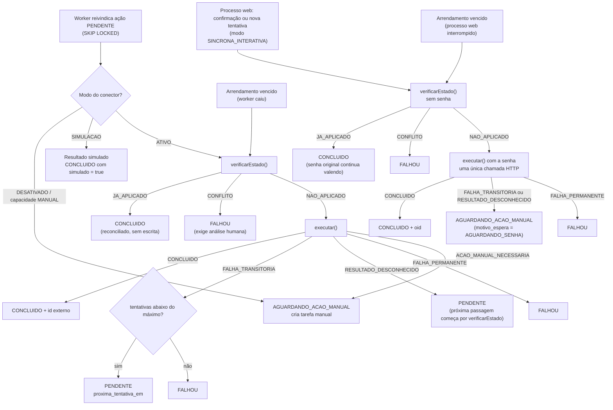

# Integrações — Portal TI Vallur

**Fase:** 01 — Arquitetura e planejamento
**Situação:** proposta para revisão. **Nenhuma chamada foi feita a qualquer tenant, API ou sistema externo.** Nenhuma integração foi validada em ambiente real.
**Referências:** `ARQUITETURA_TECNICA.md` (`DA-nn`, `R-nn`, `Q-nn`), Plano Mestre (`PM §n`).
**Revisão 01.1 (14/10/2026):** incorpora as decisões aprovadas Q-04, Q-07, Q-25, Q-27 e Q-30; Q-09 permanece aberta. Consolidação em `REVISAO_FINAL_FASE_01.md`.
**Revisão 01.3 (14/10/2026):** registra a inspeção do tenant (Q-09 continua pendente) e as opções de ambiente de testes (§13), os limites do licenciamento P1 e a verificação das capacidades do Exchange (§3) e do Graph (§2.4).
**Revisão 01.4 (15/10/2026):** incorpora as decisões da TI DT-01 a DT-07 (`ARQUITETURA_TECNICA.md` §16.2). O portal tem autenticação própria e não usa o Entra ID para login (DT-01): a app registration de login deixa de existir e o MSAL serve só para tokens de aplicação (§2.2). A senha inicial é informada no cadastro e usada na mesma requisição (DT-02, substitui Q-25; §2.6). Nenhum provisionamento depende de aprovação hierárquica (DT-03, substitui Q-04): confirmação explícita, reforçada nas operações destrutivas (§4, §9). Q-33 encerrada; nova questão Q-37 (canal de e-mail, §2.8). Depois da revisão especializada: reconciliação **sem senha** antes de pedir nova senha (§2.6, §9.2), cadastro parcial sem "mesma senha", permissões da nova tentativa e do reprocessamento (§9.3), modo `SINCRONA_INTERATIVA` no contrato do conector (§1.1, §1.3), marcador com UPN divergente (§2.5) e Supabase Auth desligado de fato (§10).

## 0. Como ler a coluna "Verificação"

| Situação | Significado |
|---|---|
| **Documentado (oficial)** | Lido em documentação oficial do fornecedor em 14/10/2026 (URL indicada). Não foi testado no tenant Virta nem em outro ambiente do grupo |
| **Mencionado no PM** | Citado no Plano Mestre; não foi possível confirmar em documentação pública |
| **Não documentado** | Não encontrado na documentação oficial consultada |
| **Pendente** | Depende de confirmação do fornecedor, contrato ou teste em homologação |

Documentação oficial não substitui validação: toda capacidade "Documentado (oficial)" ainda passa pelo marco de validação de integração do `PLANO_DE_IMPLEMENTACAO.md` antes do modo `ATIVO`.

---

## 1. Padrão comum dos conectores [REQ-PM, PM §5; PROPOSTA]

### 1.1 Contrato

```ts
// src/integrations/core/contrato.ts — pseudocódigo
export interface Conector<TAcao extends AcaoConector> {
  readonly sistema: CodigoSistema;
  /** Declara por tipo de ação se é automática, manual ou síncrona interativa neste ambiente.
   *  SINCRONA_INTERATIVA = executada pelo processo web na requisição do usuário, com dado
   *  transitório (ex.: senha inicial em m365.criar_conta); nunca reivindicada pelo worker. */
  capacidades(): Record<TAcao['tipo'], 'AUTOMATICA' | 'MANUAL' | 'SINCRONA_INTERATIVA'>;
  /** Lê o estado real no sistema externo; nunca escreve e nunca recebe senha. Base da idempotência
   *  e da reconciliação sem senha (§2.6). */
  verificarEstado(acao: TAcao, ctx: ContextoExecucao): Promise<EstadoExterno>;
  /** Executa a escrita. Só é chamado se verificarEstado indicar que é necessário.
   *  No modo SINCRONA_INTERATIVA, o dado transitório vem em `transitorio`, passado direto à
   *  função que monta o corpo, nunca copiado para `ctx`. */
  executar(acao: TAcao, ctx: ContextoExecucao, transitorio?: DadoTransitorio): Promise<ResultadoExecucao>;
  /** Instruções para tarefa manual (texto sem segredos). */
  instrucoesManuais(acao: TAcao): string;
}

export type ResultadoExecucao =
  | { tipo: 'CONCLUIDO'; idExterno?: string; resumo: ResumoSanitizado }
  | { tipo: 'FALHA_TRANSITORIA'; erro: ErroSanitizado; tentarAposSegundos?: number }
  | { tipo: 'FALHA_PERMANENTE'; erro: ErroSanitizado }
  | { tipo: 'RESULTADO_DESCONHECIDO'; erro: ErroSanitizado }   // ex.: timeout após envio
  | { tipo: 'ACAO_MANUAL_NECESSARIA'; motivo: string };

export type EstadoExterno =
  | { tipo: 'JA_APLICADO'; idExterno?: string }
  | { tipo: 'NAO_APLICADO' }
  | { tipo: 'CONFLITO'; descricao: string };   // ex.: UPN existe mas pertence a outra pessoa
```

### 1.2 Regras comuns

| Tema | Regra |
|---|---|
| Isolamento | Um diretório por fornecedor em `src/integrations/`; tipos do fornecedor não saem do conector |
| Autenticação | Sempre no servidor; credenciais em variáveis de ambiente/cofre; nunca no banco, no Git ou no navegador (PM §19) |
| Estados | `PENDENTE`, `EM_EXECUCAO`, `CONCLUIDO`, `FALHOU`, `AGUARDANDO_ACAO_MANUAL` (PM §5) + `BLOQUEADO`, `CANCELADO` propostos (Q-05) |
| Identificador externo | Gravado em `execucao_acao.id_externo` e `conta_externa.id_externo` (PM §3) |
| Erro | Gravado sanitizado: código, mensagem curta, status HTTP, ID da requisição externa. Nunca corpo completo, cabeçalhos, tokens ou senha |
| Timeout | Por chamada (proposta: 30 s; 120 s para PowerShell). Timeout após envio = `RESULTADO_DESCONHECIDO` → reconciliação |
| Retentativa | Somente falhas transitórias (429, 5xx, rede); recuo exponencial com jitter; respeitar `Retry-After`; máximo 5 tentativas (proposta) |
| Idempotência | `verificarEstado()` antes de toda escrita; chave de idempotência determinística por ação |
| Limites de uso | Concorrência máxima por conector configurável (proposta: 2 simultâneas por sistema) |
| Modo | `DESATIVADO`, `SIMULACAO`, `ATIVO` por conector e ambiente (DA-15). `SIMULACAO` é proibido em produção; resultados simulados ficam com `simulado = true` |
| Auditoria | Evento por execução e por tentativa: ator (usuário ou worker), sistema, ação, alvo, resultado, `correlation_id`, referência à solicitação e à versão confirmada, com o executor que confirmou (DT-03; antes: "referência à aprovação") |
| Contingência manual | Todo conector tem `instrucoesManuais()`; a TI conclui a tarefa informando resultado e ID externo |

### 1.3 Diagrama do ciclo de uma ação



O modo `SINCRONA_INTERATIVA` (DA-08) nunca passa pelo worker: a reivindicação do worker seleciona só `modo = 'AUTOMATICA'`. A varredura `RECUPERAR_EXECUCOES_SINCRONAS` roda `verificarEstado()` sem senha nas ações síncronas com arrendamento vencido (§2.6).

---

## 2. Microsoft Entra ID e Microsoft Graph

### 2.1 Visão geral

| Item | Definição |
|---|---|
| Finalidade | Criar e atualizar contas; atribuir licenças; gerenciar grupos de segurança e Microsoft 365 (PM §4). **Não autentica usuários no portal** [DECISÃO-TI, DT-01]: o acesso ao portal tem login e sessões próprios (`ARQUITETURA_TECNICA.md` §9); até a Revisão 01.3 o Entra ID também autenticava o acesso ao portal |
| Proibições [DECISÃO-TI, DT-01, DT-02] | Sem login Microsoft (SSO/OIDC) no portal; **sem fluxo ROPC** (*resource owner password credentials*) para autenticar no Microsoft por trás da tela do portal; sem sincronização de senhas entre portal e Microsoft 365 por métodos não oficiais; sem consulta a senhas existentes no Entra. Depois da criação, as senhas do portal e do Microsoft 365 são independentes |
| Fronteira | Conector `src/integrations/microsoft-graph/`; somente API v1.0 (sem `beta` em produção) [PROPOSTA] |
| Responsabilidades | Criar usuário; verificar existência por UPN/e-mail; ler SKUs; atribuir/remover licença; adicionar/remover membro de grupo; atualizar atributos organizacionais (empresa, cargo, departamento, gestor) |
| Não faz | Caixas compartilhadas e permissões de caixa (ver §3); grupos de distribuição e de segurança habilitados para e-mail (ver §2.4); Teams (§4) |
| Dependências | App registrations de aplicação no tenant; consentimento administrativo; licenças disponíveis; política de senha do tenant (Q-03) |

### 2.2 App registrations [PROPOSTA, DA-09 — revista na Revisão 01.4]

| Registro | Tipo | Permissões | Credencial | Usado por |
|---|---|---|---|---|
| `Portal TI Vallur – Web (<ambiente>)` | Aplicativo | `User.Create` + leitura de usuários (menor permissão a confirmar, provavelmente `User.Read.All`) | Certificado | Processo web: verificação de duplicidade e criação síncrona de conta na confirmação do cadastro (DA-08) |
| `Portal TI Vallur – Worker (<ambiente>)` | Aplicativo | `LicenseAssignment.ReadWrite.All`, `GroupMember.ReadWrite.All`, leitura de usuários, `User.ReadWrite.All` somente se a propagação de atributos for decidida pela TI; `Exchange.ManageAsApp` | Certificado | Somente o worker |

> **Removida na Revisão 01.4 (DT-01):** a registration `Portal TI Vallur – Login (<ambiente>)` (delegada, `openid`, `profile`, `email`), que servia ao login no portal pelo Entra ID. O portal não tem mais login Microsoft; por isso também não há escopo delegado de leitura de arquivos (Q-11, §7).

Assim, o processo exposto à internet não detém permissões de licenças, grupos ou Exchange.

**Autenticação de aplicação** [DECISÃO-TI, DT-01; mecanismo PROPOSTA, DA-03 revista]: `@azure/msal-node` é usado **somente** para obter tokens de aplicação (*client credentials* com certificado) dos conectores Graph; não faz login de usuários. As integrações usam autenticação de aplicação com permissões mínimas e segregadas por processo (Web × Worker). **A senha de um colaborador nunca é credencial das integrações**, nem permanente nem temporária.

Fora de produção, as registrations de aplicação (Web e Worker) só existem em tenant de testes ou ambiente não produtivo autorizado (Q-09, DA-23). No tenant de produção (Virta) ficam só as de produção (`ARQUITETURA_TECNICA.md` §13.1.1). Q-33 (registration de login de desenvolvimento) foi **encerrada — não se aplica (DT-01)**.

Recomendação de credencial (tradução livre da documentação oficial): "não use credenciais de senha, também chamadas de segredos" — preferir identidade gerenciada/federada ou certificado. Fonte: https://learn.microsoft.com/en-us/entra/identity-platform/security-best-practices-for-app-registration

### 2.3 Capacidades e permissões

| Operação | Endpoint (Graph v1.0) | Permissão de aplicação de menor privilégio | Verificação | Observações |
|---|---|---|---|---|
| Criar usuário | `POST /users` | `User.Create` (maiores: `User.ReadWrite.All`, `Directory.ReadWrite.All`) | Documentado (oficial) — https://learn.microsoft.com/en-us/graph/api/user-post-users?view=graph-rest-1.0 | Obrigatórios: `accountEnabled`, `displayName`, `mailNickname`, `passwordProfile`, `userPrincipalName`. `passwordProfile` aceita `forceChangePasswordNextSignIn` e `forceChangePasswordNextSignInWithMfa`. Usar ou não a troca obrigatória na conta Microsoft é Q-03; ela é a principal mitigação do lado Microsoft para a reutilização da senha inicial no portal (R-24) e não afeta a senha do portal (Q-36) |
| Atribuir/remover licença | `POST /users/{id}/assignLicense` | `LicenseAssignment.ReadWrite.All` | Documentado (oficial) — https://learn.microsoft.com/en-us/graph/api/user-assignlicense?view=graph-rest-1.0 | `usageLocation` é exigido para usuários que recebem licenças (definir na criação; Q-03) |
| Listar SKUs | `GET /subscribedSkus` | `LicenseAssignment.Read.All` | Documentado (oficial) — https://learn.microsoft.com/en-us/graph/api/subscribedsku-list?view=graph-rest-1.0 | Alimenta `licenca_m365` |
| Adicionar membro a grupo | `POST /groups/{id}/members/$ref` | `GroupMember.ReadWrite.All` | Documentado (oficial) — https://learn.microsoft.com/en-us/graph/api/group-post-members?view=graph-rest-1.0 | Retorna **400 se já for membro**; também 400 por atraso de replicação logo após criação do grupo (repetir após breve intervalo); **403 para grupos não gerenciáveis via Graph** |
| Ler usuário (verificação de duplicidade/reconciliação) | `GET /users?$filter=...` | `User.Read.All` [a confirmar na implementação] | Pendente | Filtrar por `userPrincipalName`, `mail`, `proxyAddresses` |
| Atualizar atributos organizacionais / gestor | `PATCH /users/{id}`, `PUT /users/{id}/manager/$ref` | Provavelmente `User.ReadWrite.All` — **menor privilégio a confirmar** | Pendente | Só se a TI aprovar a propagação de dados do portal para o Entra |
| Gravar identificador do portal no usuário | `employeeId` ou `onPremisesExtensionAttributes` | Mesma de atualização | Documentado (oficial) — https://learn.microsoft.com/en-us/graph/api/resources/user?view=graph-rest-1.0 | `employeeId` (até 16 caracteres); `extensionAttribute1–15` graváveis apenas para usuários somente nuvem (Q-23) |
| Limitação de taxa | — | — | Documentado (oficial) — https://learn.microsoft.com/en-us/graph/throttling | HTTP 429 com `Retry-After`; sem cabeçalho, recuo exponencial; requisições em lote são limitadas individualmente |

### 2.4 Tipos de grupo

| Tipo de grupo | Gerenciável pelo Graph? | Conector proposto |
|---|---|---|
| Segurança | Sim | `microsoft-graph` |
| Microsoft 365 | Sim | `microsoft-graph` |
| Segurança habilitada para e-mail | **Não (somente leitura no Graph)** | `exchange-online` (PowerShell) ou manual |
| Distribuição | **Não (somente leitura no Graph)** | `exchange-online` (PowerShell) ou manual |

Fonte: https://learn.microsoft.com/en-us/graph/api/resources/groups-overview?view=graph-rest-1.0. O catálogo `grupo_m365.tipo` define o conector de cada ação (Q-10).

### 2.5 Idempotência específica

| Ação | `verificarEstado()` | Tratamento |
|---|---|---|
| `m365.criar_conta` | Primeiro `colaborador.entra_object_id` (conta já vinculada → `JA_APLICADO`) e busca pelo marcador do portal (Q-23), independentemente do UPN — evita segunda conta quando uma nova versão confirmada corrige o UPN; depois, busca por UPN e `mail`/`proxyAddresses` | UPN inexistente e nenhum usuário com o marcador → cria, já enviando o marcador do portal (`employeeId` ou atributo definido em Q-23) no corpo do `POST /users`. UPN existente **e** marcador igual ao colaborador → `JA_APLICADO` (adota o `oid`). UPN existente sem marcador ou com outro → `CONFLITO` (nunca adota conta de outra pessoa). **Marcador igual com UPN diferente do UPN da versão vigente** (ex.: a versão N+1 corrigiu o e-mail, mas a conta já tinha sido criada com o UPN da versão N) → `CONFLITO` para análise humana [PROPOSTA, Revisão 01.4]: a conta não é adotada silenciosamente com um UPN que não é o confirmado, e `email_login`, `email_corporativo` e `upn` só mudam depois de o UPN ser confirmado no Microsoft 365 (`ARQUITETURA_TECNICA.md` §11.4). **Formato do marcador:** precisa caber no atributo escolhido em Q-23 — `employeeId` aceita até 16 caracteres, então um UUID (36) não cabe; usar um identificador curto derivado do colaborador (ex.: prefixo do portal + número sequencial) ou outro atributo [PENDENTE-TI, Q-23] |
| `m365.atribuir_licenca` | Lê `assignedLicenses` do usuário | SKU já presente → `JA_APLICADO` |
| `m365.adicionar_grupo` | Consulta associação | Já membro → `JA_APLICADO`. Um 400 na escrita não basta para concluir (também ocorre por atraso de replicação): o conector verifica a mensagem de erro específica e confirma com `verificarEstado()` antes de marcar `CONCLUIDO` |
| `m365.aguardar_caixa_postal` | Verifica se a caixa postal existe (via Exchange) | Repetição periódica com prazo máximo, depois `AGUARDANDO_ACAO_MANUAL` |

### 2.6 Criação de conta e senha inicial [REQ-PM, PM §4; DECISÃO-TI, DT-02 e DT-03; mecanismo PROPOSTA, DA-08 revista]

> **Histórico:** até a Revisão 01.3 valia Q-25 (substituída por DT-02 em 15/10/2026): a senha digitada na preparação era descartada, a solicitação ia para aprovação sem senha e, depois da aprovação, a senha era digitada de novo na execução. Sem etapa de aprovação (DT-03), esse fluxo deixou de existir.

- **Cadastro:** a TI informa a senha inicial no formulário de cadastro (etapa "Acesso ao portal e conta Microsoft"). Ela pode ser a mesma para o portal e para o Microsoft 365 (opção padrão, DT-02) ou a TI pode informar uma senha separada para o Microsoft 365 (recomendado, R-24). O rascunho salvo no servidor **nunca** contém senha (`ARQUITETURA_TECNICA.md` §11.4).
- **Cadastro parcial por quem não tem `provisionamento.executar`** [PROPOSTA, Revisão 01.4] (ex.: Estagiário sem concessão individual, DT-07): o caso de uso "registrar colaborador e acesso ao portal" grava só o colaborador e a conta do portal, com chave de idempotência própria. Nesse caminho a opção "mesma senha" **não é oferecida** e o servidor **rejeita** qualquer senha do Microsoft 365 enviada, sem registrá-la. Depois, quem tem `provisionamento.executar` abre o rascunho de provisionamento, informa uma senha para o Microsoft 365 (ela não conhece a senha do portal, que não é persistida em texto) e confirma; essa segunda confirmação exige só `provisionamento.executar` e **não** toca na conta do portal nem na credencial.
- **Confirmação e execução na mesma requisição:** ao confirmar, o processo web valida sessão, reautenticação recente e permissão efetiva (`provisionamento.executar`), grava em uma transação o colaborador, a conta de acesso do portal (somente o hash Argon2id da senha do portal), a versão confirmada e as ações, e **depois do commit**, ainda na mesma requisição, chama o Graph de forma síncrona com a senha do Microsoft 365. Não há fila de aprovação nem estado "aguardando aprovação".
- **Fronteira de fila:** a ação `m365.criar_conta` (modo `SINCRONA_INTERATIVA`) nunca entra na fila do worker; payloads de trabalho contêm apenas identificadores. O worker nunca recebe senha.
- **Reconciliação sem senha** [PROPOSTA, Revisão 01.4]: depois de *timeout*, resultado desconhecido, interrupção do processo web ou perda do arrendamento na gravação do resultado, a conta pode já ter sido criada com a senha original. Por isso `verificarEstado()` roda **sem senha** — na varredura `RECUPERAR_EXECUCOES_SINCRONAS` e ao abrir o diálogo de nova tentativa, antes de exibir o campo de senha. Se o resultado for `JA_APLICADO` (marcador do portal), a ação é concluída **sem pedir senha**, o `oid` é gravado e a tela informa que **a senha original informada na confirmação continua valendo** no Microsoft 365. A senha só é pedida quando o estado for `NAO_APLICADO`. Assim a TI não digita (nem entrega ao colaborador) uma segunda senha que não foi aplicada.
- **Nova tentativa:** se a criação precisar ser repetida depois do fim da requisição original e a reconciliação indicar `NAO_APLICADO`, a senha do Microsoft 365 é **pedida de novo**, com reautenticação recente. Permissões [PROPOSTA]: ação em `AGUARDANDO_ACAO_MANUAL` exige `provisionamento.executar`; ação em `FALHOU` exige `execucao.reprocessar` **e** `provisionamento.executar`. A tentativa é tomada por atualização condicional + arrendamento (uma segunda pessoa recebe "Criação já em andamento"). Depois de `RESULTADO_DESCONHECIDO`, a nova tentativa respeita um intervalo mínimo (proposta: 2 min) para absorver o atraso de replicação do Entra ID antes da reconciliação.
- **Montagem da requisição:** o corpo com `passwordProfile` é montado numa função isolada, enviado em **uma única chamada HTTP**, sem retentativa automática do cliente, com `cache: 'no-store'`, e nunca é passado ao *logger*, a `sanitizarErro()` sem redação, a ferramentas de telemetria ou a mensagens de erro. O *timeout* da chamada é **menor que o arrendamento menos uma margem** (proposta: 60 s para um arrendamento de 2 min), e a gravação do resultado usa a guarda `reservado_por`; se o arrendamento tiver sido perdido, o resultado segue pela reconciliação sem senha.
- **Uso exclusivo:** a senha serve somente à criação da conta Microsoft e, se a TI escolher a mesma senha, ao hash da conta do portal. Não é repassada a outros conectores (Diário de Obra, D4Sign, Konviva) nem reaproveitada para contas de outros sistemas, porque nenhuma decisão autoriza esse reuso.
- **Senhas independentes depois da criação** (DT-02): alterar a senha do Microsoft 365 não altera a do portal, e vice-versa. O portal não sincroniza senhas, não usa ROPC e não consulta senhas no Entra (§2.1).
- **Política do tenant:** se a senha for recusada, a resposta é `FALHA_PERMANENTE` com orientação à TI, sem ecoar a senha. A senha do portal segue a política própria do portal (Q-39); quando for a mesma, precisa atender às duas.
- **Falha parcial:** se o Microsoft 365 falhar depois da criação da conta do portal, a conta do portal permanece, o estado parcial fica visível e nada é excluído automaticamente; a duplicidade é impedida pela chave de confirmação, pela chave de idempotência e pela reconciliação (§2.5, §9.2).
- **Duplo envio:** reenvio da confirmação com a mesma `chave_confirmacao` (duplo clique, duas abas, falha de rede sem resposta) devolve o resultado da confirmação já gravada, **sem** nova chamada ao Graph; a violação de unicidade é tratada fora da transação abortada [PROPOSTA].
- **Conclusão manual da criação de conta:** se a conta for criada manualmente (tarefa manual), as ações dependentes (licença, grupos, caixas) só saem de `BLOQUEADO` depois que `colaborador.vincular_identidade` gravar o `oid` (`ARQUITETURA_TECNICA.md` §9.7) [PROPOSTA].
- **Auditoria:** apenas metadados (executor, solicitação, versão confirmada, resultado, `correlation_id`). Nenhum evento contém senha nem hash.

### 2.7 Segurança

- Certificado com chave privada fora do repositório; rotação planejada antes do vencimento.
- Recomenda-se à TI monitorar entradas da entidade de serviço e avaliar política de Acesso Condicional para identidades de carga de trabalho [PENDENTE-TI]. Essa política **não** está incluída no Entra ID P1 do tenant: exige licença Workload Identities Premium (§13). Sem ela, as mitigações são certificado, menor privilégio, rotação e monitoramento.
- Nenhuma permissão `Directory.ReadWrite.All` ou `Files.Read.All` de aplicação é proposta.
- `GroupMember.ReadWrite.All` permite alterar qualquer grupo não atribuível a funções. Por isso o worker só opera grupos do catálogo `grupo_m365` (mantido por quem tem `catalogo.gerenciar`) e recusa grupos atribuíveis a funções (`isAssignableToRole`) ou marcados como sensíveis (ex.: exclusões de Acesso Condicional) [PROPOSTA].
- Sem aprovação hierárquica (DT-03), o catálogo fechado de SKUs e grupos, a lista de grupos proibidos e a confirmação reforçada das remoções são as barreiras contra erro de quem executa (R-26).
- O MFA e o Acesso Condicional do tenant continuam protegendo as **contas Microsoft 365**, mas não protegem mais o acesso ao portal, que tem MFA próprio para os perfis de TI (DA-26, R-25).

### 2.8 Envio de e-mail pelo portal (Q-37 — pendente)

Nenhum envio de e-mail está previsto hoje. A recuperação de senha pelo próprio colaborador (link de uso único enviado ao e-mail corporativo) e os alertas operacionais (Q-35) dependem de um canal de envio, a decidir pela TI em Q-37. Se a escolha for o Graph (`POST /users/{id}/sendMail`), seria preciso uma **nova permissão de aplicação** `Mail.Send`, que por padrão permite enviar como qualquer caixa do tenant; ela teria de ser restrita a uma única caixa remetente (ex.: por "RBAC for Applications" do Exchange Online, §3) e só com decisão da TI [PENDENTE-TI]. Até a decisão, não há recuperação pelo próprio colaborador: só redefinição pela TI.

---

## 3. Exchange Online (caixas postais e caixas compartilhadas)

| Item | Definição |
|---|---|
| Finalidade | Criar caixa compartilhada quando solicitada; conceder acesso a caixas compartilhadas existentes; confirmar caixa postal individual (PM §4) |
| Fronteira | Conector `src/integrations/exchange-online/` executado **somente no worker**, via ponte PowerShell (PM §15 admite PowerShell) |
| Verificação | Ver tabela abaixo |
| Dependências | `pwsh` + módulo `ExchangeOnlineManagement` na imagem do worker; autenticação app-only com certificado |

| Operação | Interface | Verificação |
|---|---|---|
| Criar caixa compartilhada | `New-Mailbox -Shared` (Exchange Online PowerShell) | Documentado (oficial) — https://learn.microsoft.com/en-us/exchange/collaboration-exo/shared-mailboxes |
| Conceder acesso total | `Add-MailboxPermission -AccessRights FullAccess` | Documentado (oficial) — mesma página |
| Conceder "Enviar como" | `Add-RecipientPermission -AccessRights SendAs` | Documentado (oficial) — https://learn.microsoft.com/en-us/powershell/module/exchangepowershell/add-recipientpermission?view=exchange-ps |
| Autenticação app-only | Permissão `Exchange.ManageAsApp` + papel atribuído ao aplicativo. A documentação indica o papel interno **Exchange Recipient Administrator** ou, de forma mais restrita, grupos de função personalizados na entidade de serviço com escopos de gravação — **recomendado**, limitando as caixas que o portal pode alterar | Documentado (oficial) — https://learn.microsoft.com/en-us/powershell/exchange/app-only-auth-powershell-v2?view=exchange-ps. Certificados CNG não são suportados |
| Mesmas operações pelo Microsoft Graph | — | **Não documentado** como suportado em referência oficial do Graph (apenas respostas em fórum Microsoft Q&A indicam que não existe). Tratado como **indisponível no Graph** |
| Exchange Online Admin API (REST) | Em *preview*; cobre apenas leitura/ajustes limitados (ex.: `GrantSendOnBehalfTo`), não cria caixas nem concede FullAccess/SendAs, e "não substitui o Exchange Online PowerShell" | Documentado (oficial) — https://learn.microsoft.com/en-us/exchange/reference/admin-api-overview. **Não proposto** (preview). Reconfirmado em 14/10/2026 |
| "RBAC for Applications" do Exchange Online | Restringe a um subconjunto de caixas o acesso de aplicativos a **dados** por Graph/EWS (escopos de gerenciamento ou unidades administrativas). **Não** se aplica aos cmdlets administrativos usados aqui; para esses, o escopo vem do grupo de função personalizado da linha anterior | Documentado (oficial) — https://learn.microsoft.com/en-us/exchange/permissions-exo/application-rbac |
| Caixa postal individual após licença | Criada automaticamente ao atribuir licença com Exchange Online; a documentação oficial menciona tempo de propagação | Documentado (oficial) — https://learn.microsoft.com/en-us/exchange/recipients-in-exchange-online/create-user-mailboxes. Prazo exato a observar em homologação (R-13) |

**Ponte PowerShell [PROPOSTA]:**

- Scripts fixos versionados no repositório (`src/integrations/exchange-online/scripts/*.ps1`), um por operação.
- Parâmetros passados por JSON em `stdin`, nunca por concatenação de linha de comando (prevenção de injeção).
- Saída JSON estruturada; código de saída diferente de zero = falha.
- Timeout de 120 s; um processo por vez (sessões do Exchange são pesadas).
- `verificarEstado()`: `Get-Mailbox`/`Get-MailboxPermission`/`Get-RecipientPermission` antes de escrever.

**Contingência manual (V1, até a ponte ser validada):** tarefa manual com instruções para o Centro de Administração do Exchange; a TI informa conclusão e o endereço/ID.

**Segurança:** o aplicativo recebe **somente** um grupo de função personalizado com escopo de gravação limitado a caixas compartilhadas (ex.: `RecipientTypeDetails -eq 'SharedMailbox'`); os papéis amplos Exchange Recipient Administrator e Exchange Administrator **não** são usados, para que FullAccess e SendAs não alcancem caixas individuais de diretores. Se o escopo não restringir `New-Mailbox -Shared`, a criação de caixa fica manual. A verificação é feita em I-03. Certificado exclusivo; scripts sem parâmetros livres de comando.

---

## 4. Microsoft Teams (expansão) [REQ-PM, PM §13]

| Item | Definição |
|---|---|
| Finalidade | Aplicar regras de filiação a equipes/canais por empresa e cargo, com exceções individuais, prévia e confirmação explícita (DT-03; antes: "prévia e aprovação") |
| Base existente | Ferramenta `TeamsReport` da TI (README lido, fora do repositório): gera um gabarito CSV a partir de pessoas, cargos e matrizes de canais e aplica com `Invoke-Teams.ps1` (módulo MicrosoftTeams). O README registra que **o script remove pessoas** de canais privados e equipes que não constam no gabarito, ignora canais compartilhados e **não tem modo de simulação** |
| Fronteira | Conector `src/integrations/teams/` no worker |
| Fluxo proposto | 1) Regras e exceções no portal → 2) cálculo da diferença (entradas e saídas) contra o estado real → 3) prévia exibida para revisão → 4) **confirmação explícita** por quem tem `provisionamento.executar`, **reforçada quando há remoções**; a prévia confirmada vira a versão da solicitação `TEAMS_SINCRONIZACAO` → 5) cada inclusão/remoção é uma ação com execução própria. Sem aprovação hierárquica (DT-03) |
| Separação | **Proposto** = diferença calculada; **confirmado** = versão confirmada pelo executor; **aplicado** = execuções `CONCLUIDO` (PM §13 v1.2; REQ-PROMPT §7.2). Até a Revisão 01.3, a etapa intermediária era a aprovação |

| Operação | Endpoint | Permissão de menor privilégio | Verificação |
|---|---|---|---|
| Adicionar membro à equipe | `POST /teams/{id}/members` | `TeamMember.ReadWriteNonOwnerRole.All` (não adiciona proprietários); `TeamMember.ReadWrite.All` para proprietários | Documentado (oficial) — https://learn.microsoft.com/en-us/graph/api/team-post-members?view=graph-rest-1.0 (convidados não suportados com permissão de aplicativo; recomenda intervalo entre chamadas) |
| Adicionar membro a canal privado | `POST /teams/{id}/channels/{id}/members` | `ChannelMember.ReadWrite.Group` (consentimento por equipe) ou `ChannelMember.ReadWrite.All` | Documentado (oficial) — https://learn.microsoft.com/en-us/graph/api/channel-post-members?view=graph-rest-1.0 |
| Remoções | Endpoints correspondentes de remoção | A confirmar na implementação | Pendente |

**Salvaguardas para remoções [PROPOSTA]** (PM §13 "conferir cuidadosamente exclusões"):

- Remoções aparecem destacadas na prévia e exigem confirmação explícita por item ou em lote, com contagem.
- Toda confirmação com remoções é **reforçada** (lista das remoções, contagem digitada e reautenticação recente), conforme as regras de confirmação de `PERMISSOES_RBAC.md` §4. Um limite de remoções por solicitação, acima do qual a execução é recusada e precisa ser dividida, pode ser adotado [PROPOSTA]; o valor seria definido com o catálogo de regras. O limite **só agrava** a confirmação (ou impede a execução); abaixo dele a confirmação reforçada continua obrigatória sempre que houver remoção. Não há aprovação nem perfil específico exigido: Supervisor TI e Gestor ADM são equivalentes (DT-05), e o Estagiário só confirma com concessão individual de `provisionamento.executar` (DT-07).
- Equipes ou canais fora do catálogo de regras nunca são alterados (mesmo comportamento do `TeamsReport`).
- O cálculo da diferença é refeito imediatamente antes da execução; se o estado real mudou, a execução para e exige nova prévia.

**Contingência manual:** exportar o gabarito para o fluxo atual do `TeamsReport` enquanto o conector não estiver validado.

---

## 5. Diário de Obra [REQ-PM, PM §5]

| # | Item | Definição |
|---|---|---|
| 1 | Finalidade | Criar, atualizar e desativar usuários; configurar perfil; vincular obras |
| 2 | Fronteira | `src/integrations/diario-de-obra/` |
| 3 | Responsabilidades propostas | `diario.criar_usuario`, `diario.atualizar_usuario`, `diario.definir_perfil`, `diario.vincular_obra`, `diario.desativar_usuario` |
| 4 | Autenticação | **Desconhecida** |
| 5 | Capacidades verificadas | **Nenhuma.** URL informada pela TI: `https://web.diariodeobra.app/`. Não há documentação de API de provisionamento disponível ao projeto |
| 6 | Pendentes | Existência de API oficial, autenticação, ambiente de testes, limites (Q-24) |
| 7 | Dependências | Fornecedor; contrato |
| 8 | Erros/timeout | Padrão comum (§1.2) quando houver API |
| 9 | Retry/idempotência | A definir conforme a API; sem API, não se aplica |
| 10 | Auditoria | Evento por tarefa manual concluída, com responsável e observação |
| 11 | **Contingência manual (modo padrão)** | Tarefa manual com dados do colaborador (nome, e-mail, perfil, obras) e checklist; a TI informa o login criado |
| 12 | Segurança | Instruções manuais não contêm senhas; se uma senha inicial for necessária no Diário de Obra, segue o procedimento atual da TI fora do portal |

Catálogos `perfil_sistema_externo` e `recurso_sistema_externo` (obras) são mantidos manualmente pela TI até haver API.

---

## 6. D4Sign [REQ-PM, PM §5]

| # | Item | Definição |
|---|---|---|
| 1 | Finalidade | Gerenciar usuários da conta D4Sign, acessos e bloqueios |
| 2 | Fronteira | `src/integrations/d4sign/`. **Não substitui a assinatura do TER pelo GOV.BR** (PM §5) |
| 3 | Responsabilidades | Ações `d4sign.bloquear_usuario` e `d4sign.desbloquear_usuario` (automatizáveis após validação; verificação prévia por `users/check`); `d4sign.criar_usuario` e gestão de permissões em modo manual |
| 4 | Autenticação | `tokenAPI` e `cryptKey` como parâmetros de consulta (documentação oficial). Guardar somente no ambiente do worker; atenção para não registrar URLs completas em logs |
| 5 | Capacidades documentadas | `GET /users/list`, `POST /users/check`, `POST /users/block`, `POST /users/unblock` (corpo com `email_user`) — Documentado (oficial): https://docapi.d4sign.com.br/ |
| 6 | Pendentes | **Criação de usuário: não documentada** na referência pública. Gestão de permissões por usuário: não encontrada. Validar API, SCIM ou procedimento homologado com o fornecedor (PM §5, Q-24) |
| 7 | Dependências | Plano contratado com acesso à API; chaves da conta |
| 8 | Erros/timeout | Padrão comum |
| 9 | Retry/idempotência | `verificarEstado()` via `users/check`/`users/list` antes de bloquear/desbloquear |
| 10 | Auditoria | Evento por ação, com e-mail do usuário alvo mascarado no resumo |
| 11 | Contingência manual | Criação de usuário e permissões por tarefa manual no painel D4Sign |
| 12 | Segurança | Como as credenciais trafegam na URL, o cliente HTTP do conector deve redigir a *query string* em qualquer log ou erro |

---

## 7. OneDrive / SharePoint — Central de Tutoriais [REQ-PM, PM §10]

| # | Item | Definição |
|---|---|---|
| 1 | Finalidade | Listar e exibir vídeos, PDFs, documentos, imagens e links publicados pela TI |
| 2 | Fronteira | `src/integrations/onedrive/` usado apenas pela administração de tutoriais (seleção de arquivos); o colaborador abre o conteúdo com a própria identidade |
| 3 | Responsabilidades | Cadastrar tutoriais a partir de link de compartilhamento informado pela TI (alternativa A) ou por permissão de aplicação granular (alternativa B, conforme Q-11); obter metadados; verificar periodicamente se o item ainda existe. O processo web não recebe permissão de aplicação ampla sobre arquivos. **Revisão 01.4:** a opção de navegar com a permissão delegada do próprio administrador deixou de existir, porque o portal não tem login Microsoft (DT-01) |
| 4 | Autenticação | Ver alternativas abaixo (DA-12, Q-11) |
| 5 | Capacidades documentadas | `Sites.Selected` (nível de site) e permissões mais granulares `Lists.SelectedOperations.Selected`, `ListItems.SelectedOperations.Selected`, `Files.SelectedOperations.Selected` (arquivo ou pasta de biblioteca, SharePoint ou OneDrive), cada uma com consentimento **e** concessão explícita por recurso — https://learn.microsoft.com/en-us/graph/permissions-selected-overview. `@microsoft.graph.downloadUrl` é pré-autenticado, curto (1 h) e **pode continuar válido mesmo após remoção de permissão** — https://learn.microsoft.com/en-us/graph/api/resources/driveitem?view=graph-rest-1.0 |
| 6 | Pendentes | Pasta exata, conta proprietária, escopo de compartilhamento, público de cada conteúdo (Q-11) |
| 7 | Dependências | Pasta no OneDrive de conta individual (risco R-11); recomendação do PM de migrar para biblioteca SharePoint |
| 8–9 | Erros, retentativa | Padrão comum; arquivo removido/movido → tutorial passa a `INDISPONIVEL` na próxima verificação (`tarefa_assincrona` `VERIFICAR_TUTORIAIS`) |
| 10 | Auditoria | Publicação, despublicação e alteração de público |
| 11 | Contingência manual | Tutorial do tipo `LINK` com URL de compartilhamento gerada manualmente pela TI |
| 12 | Segurança | Acesso ao portal **não** concede acesso a todo o OneDrive da TI (PM §10) |

**Alternativas de acesso ao conteúdo [PROPOSTA DA-12; decisão Q-11]:**

| Alternativa | Como funciona | Prós | Contras |
|---|---|---|---|
| **A (recomendada)** — permissões do Microsoft 365 | O portal só **lista** tutoriais publicados ao público do colaborador; o link abre o arquivo no OneDrive/SharePoint, fora do portal, com a conta Microsoft do próprio colaborador (que entra no Microsoft 365 separadamente, DT-01), e ela precisa ter permissão de leitura concedida pela TI (ex.: compartilhamento com grupo de segurança) | Respeita literalmente "reprodução respeitando permissões do Microsoft 365" (PM §10); nenhum privilégio amplo para o portal | Dupla manutenção (publicação no portal + compartilhamento no M365); divergências são detectáveis por verificação |
| B — proxy do portal com permissão granular | Aplicação com `Files.SelectedOperations.Selected` concedido só à pasta de tutoriais; o portal autoriza e entrega o conteúdo | Uma única regra de publicação | Portal passa a servir o conteúdo (vídeos grandes); `downloadUrl` não deve ser repassado ao navegador por continuar válido após revogação |
| Descartada — `Files.Read.All` de aplicação | Leitura de todos os arquivos do tenant | — | Privilégio excessivo |

---

## 8. Unividade / UCS Online — Senior (Konviva) [REQ-PM, PM §5]

| # | Item | Definição |
|---|---|---|
| 1 | Finalidade | Cadastrar, atualizar e desativar usuários; classificar por cargo e unidade; eventualmente perfis e trilhas |
| 2 | Fronteira | `src/integrations/konviva/` |
| 3 | Responsabilidades propostas | `konviva.integrar_usuario` (criar/atualizar), `konviva.desativar_usuario`; mapeamento de login, e-mail, cargo, unidade, perfil, situação (PM §5) |
| 4 | Autenticação | Artigo público da Senior descreve REST/JSON com cabeçalho `Authorization: KONVIVA <token>` e documentação completa em `/api_doc/` (Swagger) de cada ambiente — https://suporte.senior.com.br/hc/pt-br/articles/38520527170324-Konviva-Integra%C3%A7%C3%A3o-via-Webservice |
| 5 | Capacidades | Rotas `POST`/`PUT /action/api/integrarUsuario` e integração em lote: **mencionadas no PM**, **não encontradas** em documentação pública. O artigo público cita outros exemplos (`IntegrarUnidade`, `GET /usuario/1`) |
| 6 | Pendentes | Habilitação no ambiente UCS Online contratado; acesso ao `/api_doc/` do ambiente; token; homologação (PM §21, Q-24) |
| 7 | Dependências | Senior; contrato |
| 8–9 | Erros, retry, idempotência | Padrão comum; o `PUT` de integração, se confirmado, tende a permitir atualização idempotente por login — **a confirmar** |
| 10 | Auditoria | Evento por execução |
| 11 | Contingência | Exportação CSV no layout aceito pela plataforma (PM §5) ou tarefa manual |
| 12 | Segurança | Token apenas no worker; dados mínimos enviados (sem CPF, salvo exigência documentada) |

---

## 9. Falhas parciais, retentativas e reprocessamento

### 9.1 Princípios [REQ-PM, PM §3, §22.9]

1. Cada ação tem resultado próprio; não há "transação distribuída" nem desfazer automático em sistemas externos.
2. Nada que já foi concluído é refeito: reexecução sempre começa por `verificarEstado()`.
3. A solicitação termina como `CONCLUIDA_COM_PENDENCIAS` quando alguma ação não foi concluída, e o painel mostra exatamente o que falta.

### 9.2 Cenários

| Cenário | Comportamento |
|---|---|
| Conta Microsoft criada; licença falha com 503 | Licença volta a `PENDENTE` com recuo; conta permanece `CONCLUIDO`; ações dependentes da licença ficam `BLOQUEADO` |
| Conta criada; D4Sign falha | Apenas a ação D4Sign fica `FALHOU`; reprocessamento não toca na conta Microsoft (exemplo do PM §3) |
| Conta do portal criada; criação da conta Microsoft falha (DT-02, DT-03) | A conta de acesso do portal e o colaborador `ATIVO` permanecem; a ação `m365.criar_conta` mostra o estado parcial (`FALHOU` ou `AGUARDANDO_ACAO_MANUAL`); nada é excluído automaticamente; a nova tentativa começa por `verificarEstado()` **sem senha** e só pede a senha do Microsoft 365 se o resultado for `NAO_APLICADO` (§2.6). Duplo envio da confirmação não cria segundo colaborador nem segunda execução (`chave_confirmacao` única) |
| Duplo clique, duas abas ou falha de rede sem resposta na confirmação | O reenvio com a mesma `chave_confirmacao` devolve o resultado da confirmação já gravada; exatamente um `POST /users` é feito [PROPOSTA] |
| Processo web reiniciado ou conexão perdida entre o commit da confirmação e a chamada ao Graph, ou durante ela | A ação fica `EM_EXECUCAO` com arrendamento vencido; a varredura (`tarefa_assincrona` `RECUPERAR_EXECUCOES_SINCRONAS`) roda `verificarEstado()` **sem senha**: `JA_APLICADO` conclui a ação (grava o `oid`; a senha original continua valendo); `NAO_APLICADO` devolve a `AGUARDANDO_ACAO_MANUAL` (`motivo_espera = AGUARDANDO_SENHA`) com tentativa `RESULTADO_DESCONHECIDO`, e só então a senha é pedida de novo |
| Cancelamento da solicitação durante a chamada síncrona | A chamada em andamento não é interrompida; a transação 2 grava o resultado (inclusive o `oid`), mas **não** libera dependentes, e a solicitação permanece `CANCELADA` (estado absorvente) [PROPOSTA] |
| Nova versão confirmada enquanto o worker reivindica ações da versão anterior | As ações não iniciadas da versão N passam a `CANCELADO` por atualização condicional; se restar ação `EM_EXECUCAO`, a nova versão é recusada; a reivindicação do worker só seleciona ações da versão vigente de solicitação não cancelada [PROPOSTA] |
| Conta Microsoft criada manualmente (tarefa manual de `m365.criar_conta`) | A tarefa é concluída, mas as dependentes (licença, grupos, caixas) só saem de `BLOQUEADO` depois de `colaborador.vincular_identidade` gravar o `oid` [PROPOSTA] |
| Autorização insuficiente na confirmação ou numa nova tentativa (sessão expirada, reautenticação vencida, permissão revogada, solicitação cancelada ou substituída por nova versão) | Nenhuma chamada externa; a senha é descartada; mensagem orientando o próximo passo; evento `NEGADO` |
| Timeout na criação da conta | `RESULTADO_DESCONHECIDO`; depois de um intervalo mínimo (atraso de replicação do Entra ID), `verificarEstado()` roda **sem senha**: se encontrar o UPN com o marcador do portal enviado na criação, adota o `oid` e conclui (a senha original continua valendo); só se `NAO_APLICADO` a ação fica `AGUARDANDO_ACAO_MANUAL` e a senha é pedida de novo. O *timeout* da chamada é menor que o arrendamento menos uma margem (§2.6) |
| UPN já existe e pertence a outra pessoa | `CONFLITO` → `FALHOU`; a TI corrige o e-mail, revisa e confirma de novo (nova versão confirmada); sem aprovação (DT-03). Se o e-mail corporativo mudar, o e-mail de login da conta do portal é atualizado na mesma conta, sem criar nova identidade |
| Worker cai durante execução | A ação fica `EM_EXECUCAO` com arrendamento (`reservado_ate`) vencido; a reivindicação também seleciona esses casos; outra instância começa por `verificarEstado()`; a gravação tardia do worker antigo é descartada (proteção por `reservado_por`) |
| Caixa postal ainda não existe ao conceder acesso à caixa compartilhada | Ação `m365.aguardar_caixa_postal` mantém dependentes em `BLOQUEADO`; após prazo, tarefa manual |
| Conector desativado ou sem API | `AGUARDANDO_ACAO_MANUAL` com instruções |
| Solicitação cancelada após execuções parciais | Ações pendentes, bloqueadas, aguardando ação manual ou com falha → `CANCELADO`; concluídas permanecem; `CANCELADA` é absorvente (reprocessar é proibido); o portal lista o que foi aplicado para eventual reversão manual (nova solicitação) |

### 9.3 Reprocessamento autorizado

- Permissões [PROPOSTA, Revisão 01.4]: reprocessar uma ação em `FALHOU` exige `execucao.reprocessar` **e** `provisionamento.executar` (o reprocessamento repete uma escrita externa; um Estagiário só com `execucao.reprocessar` não executa provisionamento, DT-07); retomar uma ação em `AGUARDANDO_ACAO_MANUAL` exige `provisionamento.executar`. Sempre com reautenticação recente (ver `PERMISSOES_RBAC.md`).
- Reprocessa com os **mesmos parâmetros da versão confirmada**; alterar parâmetros exige nova versão, revisada e confirmada de novo por quem tem `provisionamento.executar` (sem aprovação, DT-03).
- No modo `SINCRONA_INTERATIVA` (criação de conta), reprocessar significa devolver a ação a `AGUARDANDO_ACAO_MANUAL`; antes de pedir a senha, `verificarEstado()` roda sem senha (§2.6); a senha só é informada de novo se a conta não existir (DT-02).
- Tomada da ação por atualização condicional + arrendamento: duas pessoas não reprocessam a mesma ação ao mesmo tempo.
- Evento de auditoria `execucao.reprocessar` com motivo obrigatório.

### 9.4 Procedimentos manuais

| Passo | Descrição |
|---|---|
| 1 | Tarefa aparece em `/ti/tarefas-manuais` com sistema, ação, colaborador, instruções e prazo |
| 2 | Um membro da TI assume a tarefa (atribuição registrada) |
| 3 | Executa no sistema externo, fora do portal |
| 4 | Registra resultado (`REALIZADA`/`NAO_REALIZADA`), ID/login externo e observação; anexo opcional sem dados sensíveis |
| 5 | A execução muda para `CONCLUIDO` ou `FALHOU`; evento de auditoria |

---

## 10. Plataforma: parâmetros verificados em documentação oficial

| Tema | Fato documentado | Fonte | Consequência no projeto |
|---|---|---|---|
| Supabase Data API | O esquema `public` é exposto por padrão às Data APIs; esquemas expostos são configuráveis e a Data API pode ser desativada | https://supabase.com/docs/guides/api/using-custom-schemas ; https://supabase.com/docs/guides/database/hardening-data-api | DA-06: esquema `portal` não exposto; Data API desativada se não houver outro uso |
| Supabase — mudança de concessões | Tabelas novas em `public` deixam de ser concedidas automaticamente às Data APIs (novos projetos desde 30/05/2026; todos os projetos a partir de 30/10/2026) | https://supabase.com/changelog/45329-breaking-change-tables-not-exposed-to-data-and-graphql-api-automatically | Reforça DA-06; não dispensa o teste automatizado de não exposição (R-06) |
| Supabase Storage S3 | Endpoint compatível com S3; chaves de acesso S3 são apenas para servidor e ignoram RLS | https://supabase.com/docs/guides/storage/s3/authentication | DA-07: adaptador S3; chaves só no servidor |
| Supabase pooler | Modo transação na porta 6543 (sem *prepared statements*); modo sessão na 5432 | https://supabase.com/docs/guides/database/connecting-to-postgres | Web: transação; worker e migrações: sessão/direta |
| Prisma + Supabase | `pgbouncer=true` na URL do pooler de transação; URL direta para migrações em `prisma.config.ts` | https://supabase.com/docs/guides/database/prisma | Configuração da Fase 02 |
| Prisma 7 — conexões (verificado em 14/10/2026) | *Driver adapter* `@prisma/adapter-pg` obrigatório; PgBouncer em modo transação; **não** usar `pgbouncer=true` com PgBouncer ≥ 1.21.0; para o Supavisor do Supabase a documentação indica `?pgbouncer=true`; `DIRECT_URL` em `prisma.config.ts` para migrações; tempo limite de conexão do pool passou a 0 (sem limite) | https://www.prisma.io/docs/orm/v7/prisma-client/setup-and-configuration/databases-connections/pgbouncer ; https://www.prisma.io/docs/orm/more/upgrade-guides/upgrading-versions/upgrading-to-prisma-7 | Definir explicitamente tempo limite e tamanho do pool por processo na Etapa 1 |
| Prisma — versões | Prisma 8 em *release candidate* (substitui `schema.prisma` por `contract.prisma`); Prisma 7 suportado por 18 meses após GA do 8 | https://www.prisma.io/docs/orm/release-status | DA-17: fixar Prisma 7 |
| Prisma 7 — índices parciais | Suportados no esquema apenas com o recurso *Preview* `partialIndexes`; migrações podem ser editadas com `--create-only` | https://www.prisma.io/docs/orm/v7/prisma-schema/data-model/indexes ; https://www.prisma.io/docs/orm/v7/prisma-migrate/workflows/customizing-migrations | SQL manual na migração |
| Next.js 16 | `middleware` renomeado para `proxy`; autenticação/autorização devem ser verificadas em cada Server Function | https://nextjs.org/docs/app/api-reference/file-conventions/proxy ; https://nextjs.org/docs/app/guides/data-security | Pontos de autorização em `PERMISSOES_RBAC.md` §6 |
| CVE-2025-29927 | Cabeçalho interno forjado permitia pular o middleware em implantações auto-hospedadas (corrigido em 15.2.3, 14.2.25, 13.5.9, 12.3.5) | https://vercel.com/blog/postmortem-on-next-js-middleware-bypass | O portal será auto-hospedado (Docker/VPS): nunca depender do `proxy` para autorização |
| Supabase Auth | Cada projeto Supabase inclui o serviço Auth; cadastro e provedores precisam ser desligados na configuração do projeto (verificar as opções exatas no painel na criação do projeto — **não verificado** nesta revisão) | — | DT-01 proíbe o Supabase Auth; "proibido" precisa ser "desligado": desativar cadastros e provedores de login em cada projeto e incluir teste que confirme que o endpoint de cadastro do Auth do projeto recusa novos usuários [PROPOSTA, Revisão 01.4] |

---

## 11. GOV.BR

- A assinatura do TER/TDV é feita **fora do portal** pelo colaborador no GOV.BR [REQ-PM, PM §7].
- O portal **não** declara integração com o GOV.BR. Fluxo: emitir PDF → TI ou colaborador baixa → assina no GOV.BR → TI anexa o PDF assinado.
- Validação técnica da assinatura (ex.: Validador ITI) é decisão pendente (Q-13); se adotada, será tratada como nova integração com sua própria verificação documental.

---

## 12. Resumo: confirmado × não confirmado

| Sistema | Automatizável segundo documentação oficial | Não confirmado / indisponível | Modo inicial proposto |
|---|---|---|---|
| Entra ID (login) | **Não usado para login no portal (DT-01)**; até a Revisão 01.3 era OIDC com MSAL Node | — | Não se aplica |
| Graph — usuários, licenças, grupos de segurança/M365 | Sim | Menor permissão para atualização de atributos | Automático após validação em homologação |
| Grupos de distribuição / segurança com e-mail | Via Exchange PowerShell | Não via Graph | Manual → PowerShell após validação |
| Exchange — caixas compartilhadas e permissões | Via Exchange Online PowerShell app-only | Não via Graph | Manual na V1 → PowerShell após validação |
| Teams | Sim (Graph) | Remoções a detalhar | Expansão |
| Diário de Obra | Nenhuma documentação disponível | Toda a API | Manual |
| D4Sign | Listar, verificar, bloquear, desbloquear | Criação de usuário e permissões | Manual + bloqueio/desbloqueio automáticos após validação |
| Konviva / UCS Online | Integração REST existe no produto (artigo público) | Rotas de usuário e habilitação no ambiente contratado | Manual/CSV até habilitação |
| OneDrive/SharePoint | Permissões granulares documentadas | Pasta e escopo de compartilhamento | Alternativa A (sem privilégio de leitura amplo) |
| GOV.BR | — | Não há integração | Upload manual do PDF assinado |

---

## 13. Ambientes de teste e restrições do tenant (Q-09 — pendente)

**Situação (Q-09): PENDENTE — ambiente seguro de testes de integração Microsoft 365 ainda não definido.** Nenhuma operação real em tenant foi feita na Fase 01.

**Inspeção feita pela TI da Vallur no Centro de Administração do Microsoft Entra (14/10/2026):**

| Atributo | Informação confirmada |
|---|---|
| Nome do tenant corporativo | Virta |
| Domínio principal do tenant | `virtaeng.onmicrosoft.com` |
| Licenciamento do diretório | Microsoft Entra ID P1 |
| Estrutura | Todas as empresas do Grupo Vallur usam o mesmo tenant Microsoft 365 |
| Troca de diretório | Somente **Virta** apareceu entre os diretórios acessíveis à conta consultada |

**Interpretação:** nenhum tenant de testes dedicado foi identificado **entre os diretórios acessíveis à conta inspecionada**. Isso não prova que a organização não tenha outro tenant. O tenant Virta é de **produção** e não é tratado como ambiente de testes.

**O que o licenciamento P1 implica** (documentação oficial consultada em 14/10/2026; nada foi testado no tenant):

| Recurso | Situação com Entra ID P1 | Fonte |
|---|---|---|
| Acesso Condicional para usuários (protege o acesso às contas Microsoft 365; desde a Revisão 01.4 **não** cobre o login no portal, que é próprio — DT-01, R-25) | Disponível | https://learn.microsoft.com/en-us/entra/fundamentals/licensing |
| Unidades administrativas e unidades com gerenciamento restrito | Disponíveis; exigem P1 para cada administrador com papel no escopo | https://learn.microsoft.com/en-us/entra/identity/role-based-access-control/administrative-units |
| Acesso Condicional para identidades de carga de trabalho (app registrations do portal) | **Não incluído no P1**: exige licença Workload Identities Premium. A recomendação de §2.7 depende dessa licença | https://learn.microsoft.com/en-us/entra/identity/conditional-access/workload-identity |
| Licenciamento por grupo | Requisito de licença **não verificado** (as páginas oficiais atuais divergem). Não é usado na proposta | — |

### 13.1 Atividades que dependem de um ambiente real

| Atividade | Ambiente | Pode avançar sem Q-09? |
|---|---|---|
| Desenvolvimento dos conectores | Local, modo `SIMULACAO`, respostas gravadas (*fixtures*) montadas a partir da documentação oficial | Sim |
| Testes de contrato e de reconciliação (`verificarEstado`) | CI, sem acesso de rede à Microsoft | Sim |
| Testes de concorrência da fila, arrendamento e recuperação | PostgreSQL em Docker | Sim |
| Fluxo da senha inicial (DT-02) e busca da senha em todos os destinos | Local/CI com conector simulado | Sim |
| Trava de ambiente (`ARQUITETURA_TECNICA.md` §13.1.1) | Local/CI | Sim |
| Login no portal em desenvolvimento | Autenticação própria do portal, sem tenant (DT-01). A linha antiga "Login real com Entra ID em desenvolvimento" dependia de Q-33, **encerrada — não se aplica** | Sim (independe de Q-09 e do tenant) |
| Leitura de dados reais do tenant (verificação de duplicidade, ensaio de carga inicial) a partir de ambiente não produtivo | Proibida até decisão (Q-34) | Não se aplica: depende de Q-34 |
| I-02: criar conta, licença, grupos, reconciliação, conflito, limitação de taxa | Tenant de testes **ou** ambiente não produtivo explicitamente autorizado pela TI | **Não** |
| I-03: Exchange Online PowerShell (caixas compartilhadas, FullAccess, SendAs) | Idem | **Não** |
| Teams (expansão) | Idem | **Não** |

Q-09 **não bloqueia** a Etapa 0 nem a fundação (Etapa 1). Bloqueia somente os marcos I-02 e I-03 e, por consequência, a aprovação A-03 e a habilitação do modo `ATIVO` (I-04).

### 13.2 Opções para resolver Q-09 (para decisão da TI; nenhuma está aprovada)

| Opção | Descrição | Prós | Contras e riscos |
|---|---|---|---|
| 1 — Tenant de testes dedicado (recomendada) | Tenant separado, sem dados reais, com poucas licenças de teste. Uma via é o sandbox do Microsoft 365 Developer Program, mas a elegibilidade atual é restrita (assinantes Visual Studio Professional/Enterprise, parceiros elegíveis ou clientes Premier/Unified — https://learn.microsoft.com/en-us/office/developer-program/microsoft-365-developer-program-faq). Outra via é contratar um tenant de teste | Isolamento total; permite I-02/I-03 com escrita real | Custo e administração; pode não ter as mesmas políticas do tenant Virta (a TI precisa reproduzir as políticas relevantes) |
| 2 — Confirmar a existência de outro tenant | Verificar com um administrador global se a organização já possui tenant não produtivo que a conta inspecionada não enxerga | Sem custo novo, se existir | Depende de inspeção com conta de maior alcance |
| 3 — Uso controlado do tenant de produção | Contas, grupos e caixas de teste isolados no tenant Virta, com unidade administrativa de gerenciamento restrito, escopos de gravação do Exchange, lista de objetos permitidos e plano de reversão | Mesmas políticas da produção | Risco real sobre identidades e licenças de produção; exige decisão formal, específica e documentada da TI. **Não autorizado** e não proposto como padrão |
| 4 — Validar só em produção | Manter `SIMULACAO` até a Etapa 7a e validar na primeira admissão real acompanhada | Nenhum ambiente extra | A primeira escrita real aconteceria em produção, sem ensaio. Não recomendado |

Regras:

1. O tenant de produção **nunca** é alternativa implícita para testes. Qualquer uso dele exigiria decisão formal e específica da TI, com escopo, contas e reversão definidos — isso não está autorizado.
2. O modo `SIMULACAO` marca resultados com `simulado = true` e é proibido em produção (DA-15). Resultado simulado nunca grava `entra_object_id`.
3. Respostas simuladas reproduzem também os erros documentados (400 de membro já existente, 403 de grupo não gerenciável, 429 com `Retry-After`, *timeout* após envio).
4. A trava de ambiente (DA-23) impede que uma configuração não produtiva escreva no tenant de produção.
5. Nenhuma operação de provisionamento real (criar, alterar ou excluir usuários, grupos, licenças ou caixas) é executada sem autorização explícita da TI para aquele teste específico.
6. Q-09 permanece pendente até decisão escrita da TI sobre o ambiente seguro de testes.
