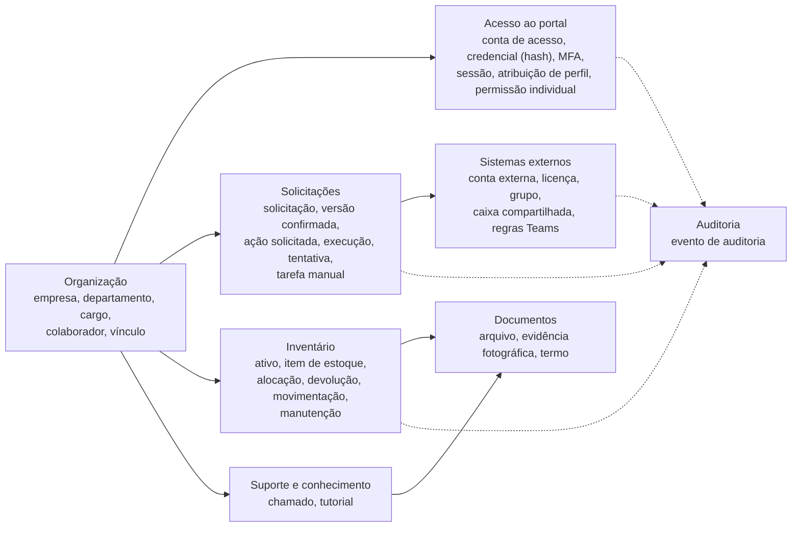
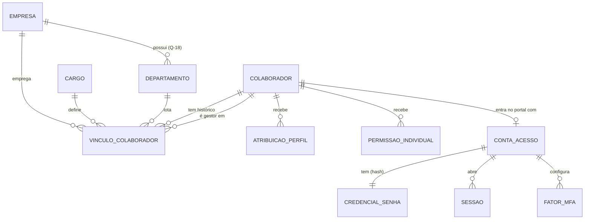
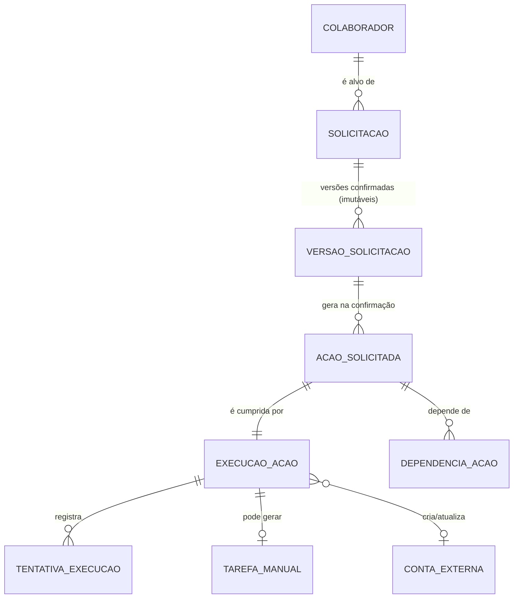
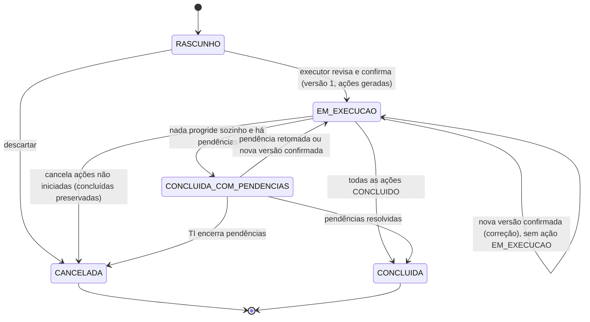
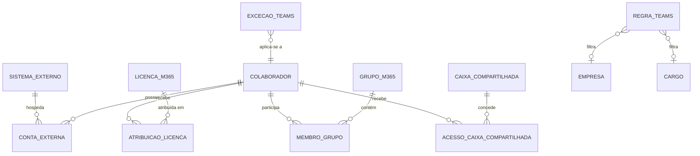
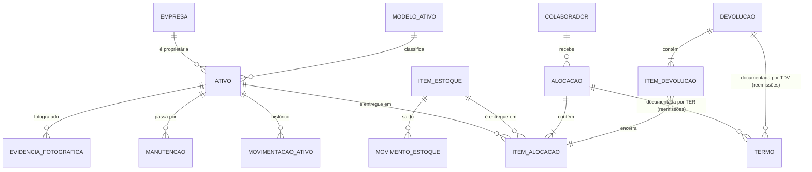
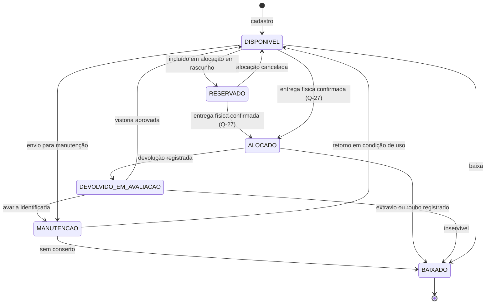

# Modelo de Dados — Portal TI Vallur

**Fase:** 01 — Arquitetura e planejamento
**Situação:** **proposta de arquitetura** para revisão. Nenhum banco foi criado e nenhuma migração foi executada.
**Referências:** `ARQUITETURA_TECNICA.md` (decisões `DA-nn`, questões `Q-nn`), Plano Mestre (`PM §n`).
Rótulos [REQ-PM], [DECISÃO-TI], [PROPOSTA], [PREMISSA], [PENDENTE-TI] conforme `ARQUITETURA_TECNICA.md` §1.
**Revisão 01.1 (14/10/2026):** incorpora as decisões aprovadas Q-04, Q-07, Q-25, Q-27 e Q-30; Q-09 permanece aberta. Consolidação em `REVISAO_FINAL_FASE_01.md`.
**Revisão 01.3 (14/10/2026):** nova versão a partir de solicitação aprovada ou em execução (Q-04, §6.6), identificadores externos resolvidos no conteúdo aprovado (§6.2), marcação de aprovador-alvo e ambiente na auditoria, papel próprio para a selagem (§11.2), carga inicial sem leitura do tenant fora de produção (Q-34) e sem vinculação automática de identidade (§14.3).
**Revisão 01.4 (15/10/2026):** incorpora as decisões da TI DT-01 a DT-07 (`ARQUITETURA_TECNICA.md` §16.2). Autenticação própria do portal: novas tabelas de conta de acesso, credencial (somente hash Argon2id), sessão revista, MFA, códigos de recuperação, tokens de verificação e limitador de tentativas (§5.2, §5.4–§5.9). Provisionamento sem aprovação hierárquica (DT-03): a tabela `aprovacao` foi removida, a versão da solicitação passa a ser o **conteúdo confirmado** pelo executor e as ações nascem na transação de confirmação (§6). `entra_object_id` continua protegido, agora só como chave de integração (§4.3). Auditoria, restrições e carga inicial ajustadas (§11–§14). As regras substituídas foram mantidas como notas históricas.

> Os nomes de entidades e atributos abaixo são propostos. As entidades em si decorrem dos requisitos do PM; os atributos marcados como requisito vêm do PM §3, §6, §7, §8, §9, §10 e §12. Os demais são propostas para suportar os fluxos.

---

## 1. Convenções

| Item | Convenção |
|---|---|
| Banco | PostgreSQL padrão; esquema dedicado `portal` (DA-06) |
| Nomes no Prisma | Modelos em PascalCase sem acento (`Colaborador`, `VinculoColaborador`); campos em camelCase |
| Nomes no banco | Tabelas e colunas em `snake_case` via `@@map`/`@map` (ex.: `vinculo_colaborador.data_inicio`) |
| Chave primária | `id UUID` gerado pela aplicação (UUIDv7 quando suportado, pela ordenação temporal; senão v4) [PROPOSTA] |
| Números legíveis | Sequências próprias para exibição: `SOL-2026-000123`, `CH-2026-000045`, `TER-2026-000210` [PROPOSTA] |
| Datas | `timestamptz` em UTC; exibição em `America/Sao_Paulo` |
| Enums | Enums do Prisma (tipos `enum` do PostgreSQL) em MAIÚSCULAS |
| Exclusão | **Sem exclusão física** de registros de negócio; uso de `situacao`/`data_fim`/`cancelado_em`. Exclusão física apenas por política de retenção aprovada (Q-17) |
| Colunas de controle | `criado_em`, `criado_por_id`, `atualizado_em`, `atualizado_por_id` em entidades editáveis |
| Concorrência | Coluna `versao INT` para bloqueio otimista em entidades editadas por várias pessoas (colaborador, solicitação, ativo, chamado) |
| Dados sensíveis | CPF cifrado + HMAC (DA-11). **Nenhum campo de senha em texto existe no modelo** [DECISÃO-TI, DT-02]. A única forma persistida de senha é o **hash Argon2id da senha do portal** (DA-25), em `credencial_senha.hash_senha` (§5.5): tabela sem leitura pela interface e fora de toda consulta, exceto a verificação feita pela biblioteca de autenticação. **O fluxo do Microsoft 365 não persiste a senha em forma alguma.** Quando a TI usa a mesma senha nos dois sistemas (DT-02), o hash do portal é o hash dessa mesma senha (R-24); por isso propõe-se um *pepper* (segredo guardado fora do banco, aplicado antes do Argon2id), para que um *dump* ou backup do banco não permita ataque offline sem esse segredo [PROPOSTA, DA-25]. Nenhuma senha (nem hash) aparece em payload JSONB, rascunho, fila, trilha de execução, log ou auditoria. *Até a Revisão 01.3 (Q-25, substituída por DT-02): nenhum campo de senha existia no modelo, porque o portal não autenticava senhas* |

---

## 2. Visão geral dos domínios



---

## 3. Fronteiras de propriedade dos dados

| Dado | Fonte oficial | Observação |
|---|---|---|
| Empresa, cargo, departamento, gestor | **Portal** [REQ-PM, PM §1] | O portal pode propagar ao Entra ID (atributos `companyName`, `jobTitle`, `department`, `manager`) mediante solicitação confirmada [PROPOSTA] |
| Identidade e autenticação **no portal** (conta de acesso, senha, MFA, sessões) | **Portal** [DECISÃO-TI, DT-01] | Conta de acesso própria, vinculada ao colaborador (§5.4); somente o hash da senha é guardado (§5.5) |
| Identidade, autenticação e MFA **no Microsoft 365** | **Entra ID** | O portal guarda apenas `entra_object_id` (chave de integração) e cópia informativa do UPN. Nunca guarda nem consulta senhas do Microsoft 365 (DT-02). *Até a Revisão 01.3, o Entra ID também autenticava o acesso ao portal (PM v1.1 §1, substituído por DT-01)* |
| Licenças disponíveis (SKUs e quantidades) | **Microsoft 365** | Cópia sincronizada para exibição; a atribuição é registrada no portal como histórico |
| Contas em sistemas terceiros | **Sistema terceiro** | O portal guarda ID externo, login e situação conhecida na última execução |
| Inventário, alocações, termos | **Portal** | Substitui `Inventário de TI.xlsx` após carga validada |
| Arquivos de tutoriais | **OneDrive/SharePoint da TI** | O portal guarda metadados e regras de publicação |
| Auditoria | **Portal** | Somente inserção |

---

## 4. Organização



### 4.1 `empresa`

| Atributo | Tipo | Regra |
|---|---|---|
| id | uuid | PK |
| razao_social | text | obrigatório |
| nome_fantasia | text | obrigatório; usado na interface |
| cnpj | char(14) | único; somente dígitos; validado por dígito verificador |
| dominio_email_padrao | text | opcional; usado na sugestão de e-mail (Q-02) |
| situacao | enum `ATIVA`, `INATIVA` | — |
| versao, criado_em, ... | — | controle |

### 4.2 `departamento` e `cargo`

- `departamento`: `id`, `nome`, `empresa_id` (anulável enquanto Q-18 não for respondida), `situacao`. Único por (`empresa_id`, `nome`).
- `cargo`: `id`, `nome`, `situacao`, `descricao`. Catálogo do grupo [PREMISSA]. Usado por regras de Teams, recomendações de tutoriais e classificação na Konviva.

### 4.3 `colaborador` [REQ-PM, PM §3]

| Atributo | Tipo | Regra |
|---|---|---|
| id | uuid | PK |
| nome | text | obrigatório |
| sobrenome | text | obrigatório |
| nome_exibicao | text | derivado, editável |
| nome_email_preferido | text | forma desejada do sobrenome no e-mail (PM §3) |
| matricula | text | opcional; único quando preenchido. Presente no TER e no `Inventário de TI.xlsx` [PROPOSTA, derivada dos modelos] |
| cpf_cifrado | bytea | AES-256-GCM (DA-11); acessível somente via caso de uso autorizado |
| cpf_hmac | bytea | HMAC-SHA-256 com chave separada; **único**; permite verificar duplicidade e buscar por CPF exato |
| cpf_final | char(2) | últimos dígitos para exibição mascarada (`***.***.***-12`) [PROPOSTA] |
| entra_object_id | uuid | **único** quando preenchido; chave de **integração** imutável (PM §4). Desde a Revisão 01.4 não é chave de login nem identificador principal (DT-01): o identificador interno estável é `colaborador.id`/`conta_acesso.id`. Gravável somente por resultado verificado do provisionamento, carga inicial revisada ou `colaborador.vincular_identidade` (Supervisor TI ou Gestor ADM — DT-05; nunca por concessão individual). A proteção continua porque um vínculo errado direcionaria ações de integração (licença, grupos, desligamento) à conta Microsoft de outra pessoa (R-18) |
| email_corporativo | citext | **único** quando preenchido; não é chave interna. É a origem do e-mail de login do portal (`conta_acesso.email_login`, DT-01). `email_corporativo`, `upn` e `email_login` só mudam **depois** de o UPN ser confirmado no Microsoft 365 (resultado `CONCLUIDO` da criação ou da atualização), na mesma transação, com auditoria e encerramento das demais sessões [PROPOSTA]. No cadastro, a conta de acesso nasce com o e-mail sugerido; se a criação Microsoft falhar por conflito de UPN e a TI corrigir o e-mail numa nova versão (§6.6), os três campos são atualizados quando o novo UPN for confirmado |
| upn | citext | **único** quando preenchido; cópia informativa; mesma regra de atualização de `email_corporativo` |
| situacao | enum | ver 4.5 |
| data_admissao, data_desligamento | date | — |
| observacoes | text | sem dados sensíveis |
| versao, controle | — | — |

> Outros "dados necessários de identificação" (PM §3) não estão especificados no PM. Nenhum campo adicional (RG, data de nascimento, endereço, telefone pessoal) é proposto até que a TI informe a necessidade e a base legal (Q-17), seguindo minimização da LGPD.

### 4.4 `vinculo_colaborador` (histórico organizacional) [REQ-PM, PM §3]

| Atributo | Tipo | Regra |
|---|---|---|
| id | uuid | PK |
| colaborador_id | uuid | FK |
| empresa_id, cargo_id, departamento_id | uuid | FK |
| gestor_id | uuid | FK → colaborador, anulável |
| data_inicio | date | obrigatório |
| data_fim | date | anulável = vínculo vigente; período semiaberto `[data_inicio, data_fim)` |
| motivo | enum `ADMISSAO`, `TRANSFERENCIA_EMPRESA`, `MUDANCA_CARGO`, `MUDANCA_DEPARTAMENTO`, `MUDANCA_GESTOR`, `CORRECAO`, `DESLIGAMENTO` | — |
| solicitacao_id | uuid | FK anulável; quando a mudança gerou propagação a sistemas externos |
| registrado_por_id, registrado_em | — | — |

Regras:

- **Nunca** se atualiza empresa/cargo de um vínculo existente: encerra-se o vigente (`data_fim`) e cria-se outro, na mesma transação.
- Um vínculo vigente por colaborador (índice único parcial, §12) [PREMISSA; Q-18 pode mudar para vínculos simultâneos].
- `CORRECAO` é a única forma de ajustar erro de digitação e também gera novo registro, preservando o anterior.

### 4.5 Situação do colaborador [PROPOSTA]

| Situação | Significado | Pode entrar no portal? |
|---|---|---|
| `PRE_CADASTRO` | Cadastro em rascunho, ainda não confirmado (§6.1) | Não |
| `ATIVO` | Cadastro confirmado, com vínculo vigente. Desde a Revisão 01.4 não depende de conta Microsoft (DT-01) | Sim, se também tiver `conta_acesso` `ATIVA` (§5.4) |
| `AFASTADO` | Afastamento temporário | Não, provisoriamente, até decisão de Q-28: a conta de acesso fica `BLOQUEADA` e as sessões são revogadas. O afastamento passa pela regra do último administrador (§5.1): não pode afastar o último administrador ativo |
| `DESLIGADO` | Desligamento registrado, somente pelo fluxo de desligamento (expansão) com as verificações de perfis de `PERMISSOES_RBAC.md` §8 | Não: a conta de acesso fica `DESATIVADA` e as sessões são revogadas na mesma transação |

*Até a Revisão 01.3: `PRE_CADASTRO` = "sem conta Microsoft" e `ATIVO` = "vínculo vigente e conta associada" (o login dependia do Entra ID).*

---

## 5. Acesso ao portal

### 5.1 `atribuicao_perfil` [PROPOSTA, DA-04]

| Atributo | Tipo | Regra |
|---|---|---|
| id | uuid | PK |
| colaborador_id | uuid | FK |
| perfil | enum `ESTAGIARIO_TI`, `SUPERVISOR_TI`, `GESTOR_ADM` | `COLABORADOR` é implícito para todo colaborador `ATIVO` |
| escopo_empresa_id | uuid | anulável = todas as empresas (Q-21) |
| concedido_por_id, concedido_em | — | obrigatórios |
| revogado_por_id, revogado_em, motivo_revogacao | — | anuláveis |

Índice único parcial: um perfil ativo do mesmo tipo por colaborador (`WHERE revogado_em IS NULL`). Histórico completo preservado.

Concessão e revogação: Supervisor TI ou Gestor ADM, inclusive dos perfis `SUPERVISOR_TI` e `GESTOR_ADM` [DECISÃO-TI, Q-07; reafirmada por DT-04 e DT-05 — autoridade equivalente, sem hierarquia]. Cada mudança gera evento de auditoria com ator, pessoa-alvo, perfis antes e depois (`detalhe_auditoria`) e justificativa. A revogação de perfil revoga as sessões da pessoa (§5.2). A regra do último administrador considera **administrador ativo** = perfil administrativo ativo **e** `conta_acesso` `ATIVA` **e** colaborador `ATIVO` (`PERMISSOES_RBAC.md` §8); um administrador com conta `BLOQUEADA` ou colaborador `AFASTADO` não conta. A regra vale para revogar o último perfil administrativo, bloquear ou desativar a conta, afastar e desligar o último administrador ativo, e é verificada sob bloqueio consultivo de transação (`pg_advisory_xact_lock`), para que duas operações simultâneas não removam os dois últimos administradores [PROPOSTA]. Atribuição e revogação de perfil travam a linha do colaborador-alvo (`SELECT … FOR UPDATE`) [PROPOSTA]. Recomendação à TI: manter pelo menos dois administradores ativos.

**Ativação de perfil de TI** [PROPOSTA, DA-26; decisão pendente Q-43]: ao atribuir um perfil de TI, as sessões do alvo são revogadas e o perfil fica **pendente de ativação** (`ativado_em` nulo): só concede `ti.acessar` depois que o titular define a própria senha e configura o MFA usando um código de ativação de uso único (§5.8, finalidade `ATIVACAO_PERFIL_TI`) gerado pelo administrador que atribuiu o perfil e entregue fora do portal. Evita que quem conhece a senha inicial (quem cadastrou, quem redefiniu ou quem conhece a senha do Microsoft 365 — R-24) entre primeiro e cadastre o próprio TOTP. O mesmo vale depois de `conta_acesso.redefinir_mfa` de membro da TI. Colunas acrescentadas: `ativado_em` (timestamptz, anulável) e `ativacao_codigo_gerado_por_id` (anulável). A experiência de interface do Gestor ADM (DT-06) não é registrada aqui: é preferência de interface, não perfil nem permissão.

### 5.2 `sessao` (revista na Revisão 01.4) [PROPOSTA, DA-24]

Sessões opacas do próprio portal (DT-01), guardadas no PostgreSQL, com revogação imediata (cache de sessão em cookie desativado).

**Divisão de responsabilidades** [PROPOSTA, DA-24 revista; R-27]: a biblioteca verifica a credencial e emite/valida o token da sessão (tabela de sessão da biblioteca, mapeada para `sessao`); o portal aplica a **política de sessão** em `exigirSessao` sobre colunas próprias (campos adicionais da mesma tabela, não graváveis pelo cliente): inatividade por área, expiração absoluta, autenticação recente e segundo fator. A renovação automática da biblioteca (expiração deslizante) **não** estende a expiração absoluta, que é calculada a partir de `criada_em`. A divisão é validada na prova de conceito da Etapa 1; se a biblioteca não comportar essas colunas e regras, a alternativa é sessão própria sobre as mesmas tabelas (R-27).

| Atributo | Tipo | Regra |
|---|---|---|
| id | uuid | PK |
| hash_token | bytea/text | único; hash do valor do cookie. **Ponto a verificar na Etapa 1:** se a biblioteca (DA-24) guardar o token em claro, registrar o desvio e preferir hash |
| conta_acesso_id | uuid | FK → `conta_acesso` |
| criada_em | timestamptz | base da expiração absoluta |
| ultimo_uso_ti_em, ultimo_uso_portal_em | timestamptz | colunas do portal; último uso por área, para as expirações por inatividade de Q-15 (30 min na área TI, 8 h no portal — valores propostos) |
| expira_em | timestamptz | mantida pela biblioteca (deslizante); o portal recusa a sessão quando `criada_em` + 12 h (proposta, Q-15) já passou, qualquer que seja `expira_em` |
| autenticado_em | timestamptz | coluna do portal; última autenticação ou reautenticação com senha; base da exigência de autenticação recente (≤ 15 min) em operações de alto risco. O conceito de sessão "nova" da biblioteca (`freshAge`, baseado na criação da sessão) não o substitui |
| segundo_fator_em | timestamptz | coluna do portal; anulável; momento em que o segundo fator foi verificado nesta sessão (exigido para `ti.acessar`, DA-26) |
| apos_redefinicao_por_id | uuid | anulável; preenchido quando a sessão foi aberta depois de redefinição de senha ou MFA feita por outra pessoa e ainda não houve troca pelo titular; marcado na auditoria [PROPOSTA] |
| user_agent_resumido | text | — |
| origem_ip | inet | truncado (/24 IPv4, /48 IPv6), como na auditoria |

**Revogação = exclusão da linha** [PROPOSTA, DA-24 revista]: revogar uma sessão apaga a linha, o que a invalida também nas rotas da própria biblioteca (uma coluna "revogada" seria ignorada por elas). O histórico fica na auditoria: evento `auth.sessao_revogada` com `conta_acesso_id`, motivo (`SAIDA`, `TROCA_SENHA`, `REDEFINICAO_SENHA`, `BLOQUEIO`, `DESATIVACAO`, `PERFIL_REVOGADO`, `PERFIL_TI_ATRIBUIDO`, `MFA_REDEFINIDO`, `ENCERRADA_PELA_TI`, `ENCERRADA_PELO_TITULAR`, `EMAIL_LOGIN_ALTERADO`, `EXPIRADA`) e ator. *Até esta correção, o modelo previa `revogada_em`/`motivo_revogacao` na própria linha.*

Revogação: saída; troca de senha pelo titular (demais sessões); redefinição de senha pela TI (todas); bloqueio e desativação da conta; revogação de perfil; atribuição de perfil de TI (todas, §5.1); redefinição de MFA; alteração do e-mail de login (demais sessões). Na restauração de backup, todas as sessões são encerradas (`ARQUITETURA_TECNICA.md` §13.4).

**Gravação em transação** [PROPOSTA]: a API da biblioteca não participa da transação do Prisma do portal; por isso, na confirmação do cadastro (transação 1), `conta_acesso` e `credencial_senha` são gravadas **diretamente pelo Prisma**, com a mesma função de hash configurada na biblioteca, e um teste de contrato verifica que a biblioteca autentica a conta assim gravada. Sem tokens do Microsoft 365 persistidos (não há login Microsoft no portal). *Até a Revisão 01.3, a sessão era aberta pelo login Entra (`colaborador_id`, `autenticado_em` a partir da declaração `auth_time`), com possível token delegado para tutoriais (DA-12/Q-11); essa possibilidade deixou de existir com DT-01.*

---

### 5.3 `permissao_individual` [DECISÃO-TI, Q-30; estrutura PROPOSTA]

| Atributo | Tipo | Regra |
|---|---|---|
| id | uuid | PK |
| colaborador_id | uuid | FK; a pessoa precisa ter perfil de TI ativo [PROPOSTA] |
| permissao | text | código do catálogo de permissões (versionado em código); somente permissões marcadas `concedivel_individualmente` |
| concedida_por_id, concedida_em | — | obrigatórios; quem concede precisa de `permissao_individual.gerenciar` |
| justificativa | text | obrigatória |
| valida_ate | timestamptz | opcional [PROPOSTA]; **obrigatório** na concessão de `provisionamento.executar` [PROPOSTA; a TI confirma — controle compensatório de R-26] |
| revogada_por_id, revogada_em, motivo_revogacao | — | anuláveis |

Índice único parcial: uma concessão ativa por (`colaborador_id`, `permissao`) `WHERE revogada_em IS NULL`. Histórico preservado.

Barreira dupla: o caso de uso recusa concessões que esbarram em restrição obrigatória e a avaliação (`PERMISSOES_RBAC.md` §3.10) descarta qualquer concessão indevida que exista no banco. Concessões e revogações geram eventos de auditoria com estado anterior e resultante.

É por esta tabela que o Estagiário TI recebe `provisionamento.executar` [DECISÃO-TI, DT-07]: a permissão não vem do perfil `ESTAGIARIO_TI`; Supervisor TI ou Gestor ADM a concede a uma pessoa, com justificativa e auditoria. Ninguém concede permissão a si mesmo por esta tabela (restrição obrigatória para `permissao_individual.gerenciar`).

### 5.4 `conta_acesso` [DECISÃO-TI, DT-01; estrutura PROPOSTA]

Conta local de acesso ao portal, uma por colaborador. Mapeada para o modelo de usuário da biblioteca de autenticação (DA-24), com nomes de tabela e campos ajustados ao esquema `portal`.

| Atributo | Tipo | Regra |
|---|---|---|
| id | uuid | PK; identificador interno estável da conta |
| colaborador_id | uuid | FK; **único** (1:1 com `colaborador`) |
| email_login | citext | e-mail corporativo usado no login (DT-01). **Único em toda a tabela** (§12), porque a biblioteca busca a conta pelo e-mail. Ao desativar a conta, o valor é trocado por um marcador de conta desativada (ex.: `desativada+<id>@invalido.local`) e o e-mail original vai para `email_login_original` e para a auditoria [PROPOSTA] |
| email_login_original | citext | anulável; preenchido só na desativação; não é usado no login |
| situacao | enum `ATIVA`, `BLOQUEADA`, `DESATIVADA` | ver ciclo de vida abaixo |
| troca_senha_exigida | bool | padrão `false`. Troca no primeiro acesso **não** é requisito confirmado (Q-36) |
| senha_definida_em | timestamptz | — |
| senha_definida_por_id | uuid | FK → colaborador; anulável quando quem definiu foi o próprio titular |
| origem_senha | enum `CADASTRO_TI`, `REDEFINICAO_TI`, `TROCA_PELO_TITULAR`, `RECUPERACAO` | — |
| mfa_confirmado_em | timestamptz | anulável; preenchido quando o titular confirma o TOTP (DA-26) |
| ultimo_acesso_em | timestamptz | — |
| bloqueada_em, bloqueada_por_id, motivo_bloqueio | — | anuláveis; bloqueio pela TI, por afastamento (Q-28) ou por revogação de acesso |
| desativada_em | timestamptz | anulável; definitiva (desligamento) |
| versao, controle | — | — |

Regras:

- **Ciclo de vida:** `ATIVA` ↔ `BLOQUEADA` (ação da TI, afastamento — Q-28, revogação de acesso) → `DESATIVADA` (desligamento; definitiva). Bloqueio e desativação revogam todas as sessões na mesma transação. Nenhum bloqueio permanente automático por tentativas falhas (DA-27).
- **Mudança de e-mail sem nova identidade:** alterar o e-mail atualiza `email_login` na mesma conta (mesmo `id`), com auditoria (`conta_acesso.alterar_email_login`) e encerramento das demais sessões; só depois de o UPN correspondente ser confirmado no Microsoft 365 (§4.3). Um e-mail liberado por conta desativada (troca pelo marcador) pode ser reutilizado no futuro por outra pessoa, sem duas contas com o mesmo `email_login` e sem misturar históricos, porque toda referência usa `id`.
- **Pode entrar no portal** quem tem conta `ATIVA` **e** colaborador `ATIVO`. Sem e-mail corporativo não há conta de acesso (Q-41).
- A conta é criada no cadastro (`conta_acesso.criar`, §6 e `ARQUITETURA_TECNICA.md` §11.4), com a senha inicial informada pela TI (DT-02); nunca por cadastro público. Criar conta para quem tem perfil de TI ativo é restrito a perfis administrativos (restrição dependente do alvo, `PERMISSOES_RBAC.md` §3.10).
- **Perfil de TI pendente de ativação** (§5.1, Q-43): enquanto `atribuicao_perfil.ativado_em` for nulo, a conta entra apenas em `/conta/ativar` e `/conta/mfa`.
- **Aviso ao titular** [PROPOSTA]: depois de redefinição de senha ou MFA por outra pessoa, o próximo acesso exibe "Sua senha foi redefinida por <nome> em <data>" (a partir da auditoria).

### 5.5 `credencial_senha` [DECISÃO-TI, DT-02; PROPOSTA, DA-25]

| Atributo | Tipo | Regra |
|---|---|---|
| conta_acesso_id | uuid | PK/FK; **único** |
| hash_senha | text | hash Argon2id em formato PHC (parâmetros embutidos, permitindo re-hash transparente), calculado sobre a senha combinada com o *pepper* guardado fora do banco [PROPOSTA, DA-25]. Nunca texto da senha |
| atualizada_em | timestamptz | — |

Mapeada para a conta do tipo "credencial" da biblioteca (DA-24). Sem leitura pela interface; nenhum caso de uso devolve este campo; fora de toda consulta, exceto a verificação da biblioteca. Os papéis `portal_leitura` e de relatórios não têm acesso.

### 5.6 `fator_mfa` [PROPOSTA, DA-26]

| Atributo | Tipo | Regra |
|---|---|---|
| id | uuid | PK |
| conta_acesso_id | uuid | FK |
| tipo | enum `TOTP` | método proposto (Q-38) |
| segredo_cifrado | bytea | segredo TOTP cifrado na aplicação |
| confirmado_em | timestamptz | anulável até o titular verificar o primeiro código |
| ultimo_passo_usado | bigint | último intervalo de tempo TOTP aceito; código do mesmo intervalo ou anterior é **recusado** (impede reutilização dentro da janela) [PROPOSTA] |
| criado_em, removido_em | — | redefinição de MFA pela TI encerra o fator (`removido_em`). Membro da TI não remove o próprio fator: só `conta_acesso.redefinir_mfa` por perfil administrativo [PROPOSTA] |

**Ponto a verificar na Etapa 1:** a documentação consultada do plugin de dois fatores da biblioteca não informa como o segredo e os códigos de recuperação são guardados. Exigência: segredo cifrado e códigos com hash; se a biblioteca não atender, cifrar com o mesmo padrão do CPF (DA-11).

### 5.7 `codigo_recuperacao` [PROPOSTA, DA-26]

`id`, `conta_acesso_id`, `hash_codigo` (nunca o código em claro), `criado_em`, `usado_em` (uso único). Regenerar os códigos invalida o conjunto anterior. Uso gera evento `mfa.codigo_recuperacao_usado`.

### 5.8 `token_verificacao` [PROPOSTA; uso depende de Q-37]

`id`, `conta_acesso_id`, `finalidade` (`RECUPERACAO_SENHA`, `ATIVACAO_PERFIL_TI`), `hash_token`, `gerado_por_id` (anulável; preenchido em `ATIVACAO_PERFIL_TI`), `criado_em`, `expira_em`, `usado_em` (uso único), `tentativas` (limitadas).

- `RECUPERACAO_SENHA` (validade ≤ 30 min): só usada se Q-37 habilitar a recuperação pelo próprio colaborador; até lá não é gerada.
- `ATIVACAO_PERFIL_TI` [PROPOSTA, Q-43]: código de ativação de uso único gerado pelo administrador que atribuiu o perfil de TI (ou redefiniu o MFA de membro da TI) e entregue ao titular fora do portal; validade proposta de 72 h; o código nunca é guardado em claro nem reexibido; gerar outro invalida o anterior. Uso registra `conta_acesso.ativar_perfil_ti`.

### 5.9 `limite_tentativa` [PROPOSTA, DA-27]

Contadores do limitador de tentativas, guardados no banco (o padrão em memória não funciona com várias instâncias): `tipo_chave` (`EMAIL_IP`, `EMAIL`, `IP`), `chave` (HMAC do e-mail normalizado — **o e-mail não é guardado em claro** — combinado ou não com o IP; o IP **não** é truncado aqui, para não juntar a rede inteira do escritório atrás do mesmo NAT; o IP vem só do cabeçalho do proxy confiável), `contador`, `janela_inicio`, `bloqueado_ate` (para `EMAIL_IP` e `IP`), `atraso_ate` (para `EMAIL`: atraso progressivo, nunca bloqueio renovável indefinido, para que ataques contra e-mails previsíveis de administradores não os mantenham sem acesso), `ultima_falha_em`. Contadores existem também para e-mails inexistentes, para não revelar se uma conta existe. O limite por IP é aplicado **antes** do cálculo do hash. Valores iniciais são parâmetros de `seguranca.configurar` (DA-27). Sem outros dados pessoais. Retenção curta [PROPOSTA]. Contadores de reautenticação, troca de senha e verificação de TOTP usam a mesma tabela, com chave por conta.

> **Mapeamento para a biblioteca (DA-24):** `conta_acesso` ↔ usuário; `credencial_senha` ↔ conta do tipo credencial; `sessao` ↔ sessão; `fator_mfa`/`codigo_recuperacao` ↔ dados do plugin de dois fatores; `token_verificacao` ↔ verificação; `limite_tentativa` ↔ armazenamento do limitador em banco. O esquema é gerado pela biblioteca e versionado por migrações do Prisma (DA-17); colunas extras do portal entram como campos adicionais. Divergências entre o que a biblioteca grava e as exigências acima (hash do token de sessão, segredo TOTP cifrado, códigos com hash, revogação por exclusão, colunas próprias de política de sessão, limitador com chave e-mail + IP) são verificadas na prova de conceito da Etapa 1 e registradas; se a biblioteca não comportar, aplica-se a alternativa de R-27. O limitador da biblioteca tem chave por IP e rota; as chaves por e-mail e e-mail + IP desta tabela exigem *hook* próprio do portal [PROPOSTA].

---

## 6. Solicitações, confirmações e execuções

Este é o núcleo da rastreabilidade **"preparado → confirmado → executado"** [REQ-PM, PM §3, §12; DECISÃO-TI, DT-03].

> **Revisão 01.4 — sem aprovação hierárquica (DT-03, 15/10/2026).** Nenhum provisionamento depende de aprovação de Supervisor TI ou Gestor ADM: criação de colaboradores e de contas Microsoft 365, alterações em contas existentes, regras do Teams e desligamento. A solicitação é preparada (rascunho, sem senha), revisada e **confirmada pelo próprio executor**, que precisa da permissão `provisionamento.executar` verificada no backend. A confirmação **não é** aprovação hierárquica: registra quem executou e exatamente o que foi confirmado. Operações destrutivas exigem confirmação reforçada (`ARQUITETURA_TECNICA.md` §11.5; `DESIGN_SYSTEM.md` §9.1). *Até a Revisão 01.3 (Q-04, substituída): a versão era enviada para aprovação, a tabela `aprovacao` registrava uma decisão por versão (autoaprovação permitida a Supervisor TI e Gestor ADM) e as ações nasciam na transação de aprovação.*



### 6.1 `solicitacao`

| Atributo | Tipo | Regra |
|---|---|---|
| id, numero | uuid, text | PK; número legível único |
| tipo | enum `ADMISSAO`, `ALTERACAO_CADASTRAL`, `ALTERACAO_LICENCA`, `ALTERACAO_GRUPOS`, `CRIACAO_CAIXA_COMPARTILHADA`, `ACESSO_CAIXA_COMPARTILHADA`, `ACESSO_SISTEMA_EXTERNO`, `TEAMS_SINCRONIZACAO` (expansão), `DESLIGAMENTO` (expansão) | inalterado |
| colaborador_alvo_id | uuid | FK anulável (ex.: criação de caixa compartilhada não tem colaborador alvo) |
| estado | enum ver 6.6 | alterado somente por atualização condicional (`WHERE estado = :esperado`) |
| rascunho | JSONB | conteúdo editável enquanto `RASCUNHO`: dados do formulário, **nunca senha** (o esquema Zod do rascunho é estrito e rejeita chaves de senha) |
| correcao | JSONB | anulável; correção editável depois da confirmação (ex.: novo e-mail após conflito de UPN), que origina a versão N+1; **nunca senha** [PROPOSTA] |
| hash_cadastro_confirmado | char(64) | anulável; hash da parte cadastral já confirmada no cadastro parcial (quem preparou não tinha `provisionamento.executar`): essa parte fica congelada e não é reeditada pelo rascunho de provisionamento [PROPOSTA] |
| versao_atual | int | número da última versão confirmada (nulo enquanto `RASCUNHO`) |
| hash_conteudo_atual | char(64) | SHA-256 do conteúdo canônico da versão vigente |
| justificativa | text | obrigatória em alterações fora da admissão |
| criado_por_id, criado_em | — | quem iniciou a preparação |
| confirmada_em | timestamptz | primeira confirmação |
| concluida_em, cancelada_em, cancelada_por_id, motivo_cancelamento | — | — |

*Removido na Revisão 01.4: `enviada_em` (envio para aprovação).*

Quando quem prepara não tem `provisionamento.executar` (ex.: Estagiário sem concessão individual, DT-07), o cadastro do colaborador e a conta de acesso podem ser confirmados e a solicitação de provisionamento fica em `RASCUNHO`, sem senha, para que alguém com a permissão revise, informe a senha e execute. Isso é execução por quem tem permissão, não aprovação. Regras desse caminho [PROPOSTA]:

- caso de uso próprio "registrar colaborador e acesso ao portal", com **chave de idempotência própria** (`registro_cadastro.chave_confirmacao`, ver abaixo), para que um duplo envio não crie dois colaboradores;
- a opção "mesma senha no Microsoft 365" não existe nesse caminho e o servidor **rejeita** senha do Microsoft 365 enviada nele;
- a parte cadastral fica congelada (`hash_cadastro_confirmado`); o rascunho de provisionamento contém só o que será executado;
- quem executa depois precisa apenas de `provisionamento.executar`, informa uma senha do Microsoft 365 (a do portal não é conhecida por ele) e **não** altera `conta_acesso` nem `credencial_senha`.

`registro_cadastro` [PROPOSTA]: `id`, `colaborador_id`, `chave_confirmacao` (**única**), `hash_cadastro`, `registrado_por_id`, `registrado_em`, `origem_permissao`. Imutável. Registra a confirmação do cadastro e da conta de acesso quando ela não gera versão de solicitação.

### 6.2 `versao_solicitacao` (imutável) = conteúdo confirmado

`id`, `solicitacao_id`, `numero_versao`, `conteudo JSONB` (dados confirmados: e-mail, licença escolhida, grupos, sistemas, perfis externos; **nunca senha**), `hash_conteudo`, `confirmada_por_id` (o executor), `confirmada_em`, `origem_permissao` (ex.: `PERFIL:SUPERVISOR_TI`, `INDIVIDUAL:<id>`), `chave_confirmacao` (**única**; gerada pelo formulário de revisão; impede que um duplo envio crie duas execuções — a violação de unicidade é tratada **fora** da transação abortada e devolve o resultado da confirmação já gravada, sem nova chamada externa). Único (`solicitacao_id`, `numero_versao`). Sem permissão de `UPDATE` para o papel da aplicação. **A versão só existe a partir da confirmação**: o que ainda está em edição fica em `solicitacao.rascunho`.

**Hash do conteúdo revisado** [PROPOSTA]: os identificadores externos são resolvidos **antes** da tela de revisão (nenhuma chamada externa dentro da transação de confirmação); `hash_conteudo` é o hash do conteúdo canônico **exibido** na revisão; a tela envia esse hash junto com a confirmação e o servidor recusa se o conteúdo atual divergir ("O cadastro mudou; revise de novo"). Assim nada é confirmado sem ter sido visto, inclusive um rascunho alterado por outra pessoa entre a revisão e o clique.

O `conteudo` guarda os **identificadores externos já resolvidos** (SKU, `objectId` do grupo, endereço e ID da caixa compartilhada) junto com os nomes exibidos na revisão. Assim, uma edição posterior do catálogo não muda o efeito do que foi confirmado: antes de executar, o worker compara o identificador confirmado com o catálogo e falha se divergirem. A lista de grupos que o portal nunca altera (atribuíveis a funções, exclusões de Acesso Condicional, administradores) fica na configuração de implantação, fora do banco [PROPOSTA].

Toda correção depois da confirmação gera nova versão, que precisa ser revisada e confirmada de novo (§6.6).

### 6.3 `acao_solicitada` (imutável, gerada na confirmação)

| Atributo | Tipo | Regra |
|---|---|---|
| id | uuid | PK |
| solicitacao_id | uuid | FK |
| versao_solicitacao_id | uuid | FK — a versão **confirmada** que originou a ação |
| sistema | enum `MICROSOFT_365`, `EXCHANGE_ONLINE`, `TEAMS`, `DIARIO_DE_OBRA`, `D4SIGN`, `KONVIVA` | — |
| tipo_acao | text | catálogo fechado validado por Zod, ex.: `m365.criar_conta`, `m365.atribuir_licenca`, `m365.adicionar_grupo`, `m365.aguardar_caixa_postal`, `exo.criar_caixa_compartilhada`, `exo.conceder_acesso_caixa`, `exo.adicionar_grupo_distribuicao`, `konviva.integrar_usuario`, `d4sign.criar_usuario`, `d4sign.bloquear_usuario`, `d4sign.desbloquear_usuario`, `diario.criar_usuario`, `diario.vincular_obra` |
| destrutiva | bool | `true` para remoções e bloqueios (remover licença, remover de grupo, revogar acesso a caixa, bloquear em sistema externo, remoções do Teams, ações de desligamento); exige confirmação reforçada na revisão [PROPOSTA, DT-03] |
| parametros | JSONB | derivados deterministicamente do `conteudo` da versão confirmada; sem segredos |
| ordem | int | exibição |
| chave_idempotencia | text | **única**: `{versao_solicitacao_id}:{tipo_acao}:{hash(parametros)}` |

Regras de integridade da confirmação:

- As ações são criadas **dentro da transação de confirmação** (outbox), a partir do conteúdo da versão confirmada. O papel `portal_app` não tem `UPDATE` sobre `acao_solicitada`.
- Antes de executar, o worker recalcula o hash dos parâmetros a partir da versão confirmada e recusa a execução se divergir (defesa contra alteração posterior).

### 6.4 `dependencia_acao`

`dependencia_acao`: `acao_id`, `depende_de_acao_id` (PK composta, ambas FK para `acao_solicitada`; mesma versão; sem ciclos — verificado na geração).

> **Tabela `aprovacao` (removida na Revisão 01.4, DT-03).** Registrava uma decisão (`APROVADA`/`REJEITADA`) por versão (`UNIQUE (versao_solicitacao_id)`), com `hash_conteudo_aprovado`, `decidido_por_id`, `autoaprovacao`, `origem_permissao`, `perfil_no_momento`, `comentario` e `aprovador_e_alvo`. Os papéis que ela cumpria passam a: conteúdo exato e hash → `versao_solicitacao.conteudo`/`hash_conteudo`; responsável → `versao_solicitacao.confirmada_por_id` e `tentativa_execucao.disparada_por_id`; origem da permissão → `versao_solicitacao.origem_permissao`; proteção contra duas decisões simultâneas → `UNIQUE (chave_confirmacao)` e transição condicional de estado.

### 6.5 `execucao_acao` e `tentativa_execucao`

`execucao_acao` (estado atual; também é a fila — DA-05):

| Atributo | Tipo | Regra |
|---|---|---|
| id | uuid | PK |
| acao_solicitada_id | uuid | **único** (uma execução por ação) |
| estado | enum `BLOQUEADO`, `PENDENTE`, `EM_EXECUCAO`, `CONCLUIDO`, `FALHOU`, `AGUARDANDO_ACAO_MANUAL`, `CANCELADO` | os cinco do PM §5 + dois propostos (Q-05) |
| modo | enum `AUTOMATICA`, `MANUAL`, `SINCRONA_INTERATIVA` | `SINCRONA_INTERATIVA` = criação de conta Microsoft com senha, executada pelo processo web na própria requisição de confirmação (DA-08, revista) |
| motivo_espera | enum `AGUARDANDO_SENHA`, `TAREFA_MANUAL`, `AGUARDANDO_DEPENDENCIA_EXTERNA` | anulável; preenchido em `AGUARDANDO_ACAO_MANUAL`, para distinguir "nova tentativa da criação de conta aguardando senha" de "tarefa manual" e de esperas como a caixa postal [PROPOSTA] |
| simulado | bool | `true` quando executada em modo `SIMULACAO`; resultados simulados nunca alimentam `colaborador.entra_object_id` nem `conta_externa` |
| tentativas, max_tentativas | int | padrão 5 |
| proxima_tentativa_em | timestamptz | usado na reivindicação |
| reservado_por, reservado_ate | text, timestamptz | arrendamento do worker (ou da requisição de confirmação, no modo síncrono); vencido = reivindicável pelo worker (automática) ou devolvido a `AGUARDANDO_ACAO_MANUAL` pela varredura (síncrona) |
| id_externo | text | ex.: `oid` do usuário criado |
| resultado | JSONB | resumo **sanitizado** |
| erro_codigo, erro_mensagem | text | sanitizados |
| motivo_cancelamento | text | ex.: `SUBSTITUIDA_POR_NOVA_VERSAO`, `SOLICITACAO_CANCELADA` |
| iniciado_em, concluido_em | timestamptz | — |
| reprocessado_por_id, reprocessado_em | — | quando houve reprocessamento manual |

`tentativa_execucao` (somente inserção): `id`, `execucao_id`, `numero`, `iniciada_em`, `finalizada_em`, `resultado` — mesmo vocabulário do contrato do conector (`INTEGRACOES.md` §1.1): `CONCLUIDO`, `JA_APLICADO`, `CONFLITO`, `FALHA_TRANSITORIA`, `FALHA_PERMANENTE`, `RESULTADO_DESCONHECIDO`, `ACAO_MANUAL_NECESSARIA`, `ARRENDAMENTO_PERDIDO`; `simulado`, `http_status`, `id_requisicao_externa` (ex.: `request-id` da Microsoft), `correlation_id`, `erro_sanitizado`, `duracao_ms`, `disparada_por_id` (o executor; nulo quando worker).

**Sem senha** [DECISÃO-TI, DT-02]: nenhum campo de `execucao_acao`, `tentativa_execucao`, `tarefa_manual` ou `tarefa_assincrona` contém a senha inicial; `resultado` e `erro_*` passam pela sanitização. Payloads de trabalho contêm apenas identificadores.

Índice da fila: `(proxima_tentativa_em) WHERE estado = 'PENDENTE' AND modo = 'AUTOMATICA'` e `(reservado_ate) WHERE estado = 'EM_EXECUCAO'` (recuperação de arrendamentos vencidos).

### 6.6 Estados da solicitação [PROPOSTA; sem aprovação — DT-03]



Estados removidos na Revisão 01.4 (DT-03): `AGUARDANDO_APROVACAO`, `APROVADA`, `REJEITADA`.

**`CANCELADA` é absorvente** [PROPOSTA]: depois dela o estado agregado não é recalculado e nenhuma ação é reprocessada. Se o cancelamento ocorrer durante a chamada síncrona da criação de conta, a transação 2 ainda grava o `oid` obtido (o efeito existe no Microsoft 365), mas **não** libera as dependentes. Transições de execução acrescentadas: `FALHOU → CANCELADO` e `EM_EXECUCAO → CANCELADO` (este último só para a ação síncrona, marcada para cancelar ao fim da chamada).

**Nova versão (correção)** [PROPOSTA]: quando um parâmetro precisa mudar depois da confirmação (ex.: conflito de UPN), a TI edita `solicitacao.correcao`, revisa e **confirma de novo** — com `provisionamento.executar`, reautenticação recente e nova `chave_confirmacao`. A versão N+1 gera novas ações; as ações não concluídas da versão N passam a `CANCELADO` (motivo `SUBSTITUIDA_POR_NOVA_VERSAO`); as concluídas são preservadas, e a geração de ações da nova versão não recria um efeito já aplicado (gera ação de atualização no lugar).

**Concorrência na confirmação e na nova versão** [PROPOSTA]:

1. Primeiro, transição condicional que trava a linha: `UPDATE solicitacao SET estado = 'EM_EXECUCAO', versao_atual = :nova WHERE id = :id AND estado IN (:permitidos) AND versao_atual IS NOT DISTINCT FROM :esperada`; se nenhuma linha mudar, a confirmação é recusada ("A solicitação mudou; revise de novo"). Só depois a versão é criada.
2. Cancelamento das ações da versão N com `UPDATE execucao_acao ... SET estado = 'CANCELADO' WHERE estado IN ('PENDENTE','BLOQUEADO','AGUARDANDO_ACAO_MANUAL','FALHOU')`; se restar ação `EM_EXECUCAO`, a transação é abortada (não se cria nova versão com arrendamento ativo).
3. A reivindicação do worker só seleciona ações da versão vigente (`versao_solicitacao.numero_versao = solicitacao.versao_atual`) de solicitação não `CANCELADA`.

**Tabela de decisão do estado agregado** [PROPOSTA; substitui o que estava adiado para PB-10] — avaliada na mesma transação de cada mudança de execução, na ordem:

| Condição sobre as ações da versão vigente | Estado da solicitação |
|---|---|
| Solicitação já `CANCELADA` | `CANCELADA` (não recalcula) |
| Todas `CONCLUIDO` | `CONCLUIDA` |
| Existe ação `PENDENTE` ou `EM_EXECUCAO` | `EM_EXECUCAO` |
| Existe ação `BLOQUEADO` cujas dependências estão todas em `PENDENTE`, `EM_EXECUCAO` ou `CONCLUIDO` | `EM_EXECUCAO` |
| Existe ação `AGUARDANDO_ACAO_MANUAL` (qualquer `motivo_espera`), `FALHOU`, ou `BLOQUEADO` atrás de ação que não progride sozinha (`AGUARDANDO_ACAO_MANUAL`, `FALHOU`, `CANCELADO`) | `CONCLUIDA_COM_PENDENCIAS` |

`CONCLUIDA_COM_PENDENCIAS` é estado de trabalho para a TI, não final: volta a `EM_EXECUCAO` quando uma pendência é retomada.

Uma solicitação `CANCELADA` após execuções parciais mantém as ações concluídas visíveis, com indicação "efeitos aplicados", para eventual reversão por nova solicitação. **Falha parcial não exclui nada automaticamente** (DT-03): colaborador, conta de acesso e efeitos externos já aplicados permanecem, e o painel mostra o que falta. Regras de cálculo do estado agregado: tabela acima e `ARQUITETURA_TECNICA.md` §11.3.

**Prevenção de duplicidade no cadastro** [DT-03; mecanismo PROPOSTA]: verificação antes da confirmação (CPF por HMAC, e-mail, UPN, nome + empresa) e índices únicos (§12); `chave_confirmacao` única contra duplo envio; `chave_idempotencia` das ações; reconciliação por `verificarEstado()` antes de toda escrita externa.

### 6.7 `tarefa_manual`

`id`, `execucao_id` (único), `tipo` (`ACAO_SISTEMA_EXTERNO`, `AGUARDANDO_SENHA_INICIAL`, `CONFERENCIA`), `instrucoes` (texto gerado do catálogo do conector, sem segredos), `prazo` (anulável), `atribuida_a_id`, `concluida_por_id`, `concluida_em`, `resultado` (`REALIZADA`, `NAO_REALIZADA`), `id_externo_informado`, `observacao`, `evidencia_arquivo_id` (opcional).

`AGUARDANDO_SENHA_INICIAL` significa, desde a Revisão 01.4 (DT-02), "**nova tentativa** de criação da conta Microsoft aguardando que a senha seja informada de novo" (`execucao_acao.motivo_espera = AGUARDANDO_SENHA`) — só ocorre depois de falha transitória, resultado desconhecido ou interrupção da requisição original **e** depois de a reconciliação sem senha indicar que a conta não existe; registra apenas que a senha deve ser informada, nunca a senha. *Até a Revisão 01.3, era o estado normal depois da aprovação.*

**Reconciliação sem senha** [PROPOSTA]: após *timeout*, interrupção, resultado desconhecido ou arrendamento perdido na transação 2, `verificarEstado()` roda **sem senha** — na varredura `RECUPERAR_EXECUCOES_SINCRONAS` e ao abrir o diálogo de nova tentativa. Se a conta já existe com o marcador do portal (`JA_APLICADO`), a ação é concluída, o `oid` é gravado e a tela avisa que **a senha original informada na confirmação continua valendo** no Microsoft 365; a senha só é pedida quando o resultado é `NAO_APLICADO`. Isso evita adotar uma conta criada com a primeira senha e descartar a segunda, que a TI entregaria ao colaborador sem que ela valesse.

**Permissões da nova tentativa** [PROPOSTA]: ação em `AGUARDANDO_ACAO_MANUAL` → `provisionamento.executar`; ação em `FALHOU` → `execucao.reprocessar` **e** `provisionamento.executar`. A tomada é por atualização condicional + arrendamento (duas pessoas não tentam ao mesmo tempo), com intervalo mínimo depois de `RESULTADO_DESCONHECIDO` (atraso de replicação do Entra ID).

**Conclusão manual da criação de conta** [PROPOSTA]: concluir manualmente a tarefa de `m365.criar_conta` não libera as dependentes (licença, grupos): elas só saem de `BLOQUEADO` depois que `colaborador.vincular_identidade` grava o `oid`.

`id_externo_informado` alimenta apenas `conta_externa` de sistemas terceiros; **nunca** altera `colaborador.entra_object_id` (ver `PERMISSOES_RBAC.md` §8).

### 6.8 `tarefa_assincrona` (trabalhos internos)

`id`, `tipo` (`GERAR_PDF_TERMO`, `SELAR_AUDITORIA`, `SINCRONIZAR_SKUS`, `VERIFICAR_TUTORIAIS`, `ANALISAR_ARQUIVO`, `VERIFICAR_BACKUP`, `RECUPERAR_EXECUCOES_SINCRONAS` — para criações de conta com arrendamento vencido, inclusive quando a requisição de confirmação foi interrompida entre o *commit* e a chamada ao Graph, roda primeiro `verificarEstado()` sem senha: conclui com o `oid` se a conta já existe com o marcador do portal; senão devolve a `AGUARDANDO_ACAO_MANUAL` com `motivo_espera = AGUARDANDO_SENHA`, §6.7), `referencia_tipo`, `referencia_id`, `estado` (`PENDENTE`, `EM_EXECUCAO`, `CONCLUIDA`, `FALHOU`), `tentativas`, `proxima_tentativa_em`, `reservado_por`, `reservado_ate`, `erro_sanitizado`, `criada_em`, `concluida_em`. Mesma estratégia de reivindicação da `execucao_acao`. Não substitui a auditoria: tarefas que alteram dados de negócio gravam seus próprios eventos.

---

## 7. Microsoft 365 e sistemas externos



| Entidade | Atributos principais | Observações |
|---|---|---|
| `sistema_externo` | `codigo` (PK textual: `MICROSOFT_365`, `EXCHANGE_ONLINE`, `TEAMS`, `DIARIO_DE_OBRA`, `D4SIGN`, `KONVIVA`), `nome`, `modo_integracao` (`AUTOMATICA`, `MANUAL`), `modo_execucao` (`DESATIVADO`, `SIMULACAO`, `ATIVO` — DA-15), `situacao_validacao` (`CONFIRMADA`, `PENDENTE`) | Configuração, sem credenciais (credenciais ficam no ambiente) |
| `conta_externa` | `colaborador_id`, `sistema`, `id_externo`, `login`, `situacao` (`ATIVA`, `BLOQUEADA`, `DESATIVADA`, `DESCONHECIDA`), `criada_por_execucao_id`, `ultima_verificacao_em` | Único (`sistema`, `id_externo`) e (`colaborador_id`, `sistema`) quando ativa [PREMISSA: uma conta por sistema] |
| `perfil_sistema_externo` | `sistema`, `codigo_externo`, `nome`, `situacao` | Perfis/papéis do Diário de Obra, D4Sign, Konviva — catálogo mantido pela TI |
| `recurso_sistema_externo` | `sistema`, `tipo` (`OBRA`, `TRILHA`, `UNIDADE`, `COFRE`...), `id_externo`, `nome` | Ex.: obras do Diário de Obra |
| `licenca_m365` | `sku_id` (único), `sku_part_number`, `nome_amigavel`, `total`, `consumidas`, `sincronizado_em` | Espelho de leitura do tenant |
| `atribuicao_licenca` | `colaborador_id`, `sku_id`, `atribuida_em`, `removida_em`, `solicitacao_id`, `execucao_id` | Histórico; base futura do módulo de custos |
| `grupo_m365` | `entra_object_id` (único), `nome`, `tipo` (`SEGURANCA`, `MICROSOFT_365`, `DISTRIBUICAO`, `SEGURANCA_EMAIL`), `gerenciavel_via_graph` (bool) | Tipo determina o conector (INTEGRACOES §2.4) |
| `membro_grupo` | `grupo_id`, `colaborador_id`, `adicionado_em`, `removido_em`, `solicitacao_id` | Histórico |
| `caixa_compartilhada` | `endereco` (único), `nome`, `id_externo`, `empresa_id`, `responsavel_id`, `situacao`, `criada_por_solicitacao_id` | PM §4 |
| `acesso_caixa_compartilhada` | `caixa_id`, `colaborador_id`, `tipo_permissao` (`ACESSO_TOTAL`, `ENVIAR_COMO`, `ENVIAR_EM_NOME`), `concedido_em`, `revogado_em`, `solicitacao_id` | Tipos a confirmar (Q-10) |
| `regra_teams` (expansão) | `empresa_id?`, `cargo_id?`, `equipe_id_externo`, `canal_id_externo?`, `papel` (`OWNER`, `MEMBER`), `vigente_desde`, `vigente_ate` | PM §13; inspirado no `TeamsReport` |
| `excecao_teams` (expansão) | `colaborador_id`, `equipe_id_externo`, `canal_id_externo?`, `tipo` (`INCLUIR`, `EXCLUIR`), `justificativa`, `validade`, `confirmada_por_solicitacao_id` | Exceções individuais. *Até a Revisão 01.3: `aprovada_por_solicitacao_id`* |

Separação **proposto → confirmado → aplicado** no Teams [DT-03]: a prévia (diferença calculada) vira `versao_solicitacao.conteudo` quando o executor (com `provisionamento.executar`) a confirma; cada inclusão/remoção é uma `acao_solicitada` com sua `execucao_acao`. Não há aprovação hierárquica; remoções são ações destrutivas (`acao_solicitada.destrutiva = true`) e exigem **confirmação reforçada** (lista das remoções e contagem digitada). *Até a Revisão 01.3: proposto → aprovado → aplicado.*

---

## 8. Inventário, alocações e devoluções



### 8.1 `modelo_ativo`

`id`, `classe` enum `NOTEBOOK`, `MONITOR`, `IMPRESSORA`, `MOUSE`, `TECLADO`, `CARREGADOR`, `MOUSEPAD`, `OUTRO` [REQ-PM, PM §6], `fabricante`, `modelo`, `modo_controle` enum `INDIVIDUAL`, `QUANTIDADE` (Q-19), `exige_fotos` (lista de tipos de foto obrigatórios, ex.: notebooks — PM §6).

### 8.2 `ativo` (controle individual) [REQ-PM, PM §6]

| Atributo | Tipo | Regra |
|---|---|---|
| id | uuid | PK |
| patrimonio | text | **único**; obrigatório |
| numero_serie | text | anulável; único por (`modelo_ativo_id`, `numero_serie`) quando preenchido |
| identificador | text | anulável; hostname, IMEI ou outro identificador técnico (campo do TER) [PROPOSTA] |
| modelo_ativo_id | uuid | FK (classe, fabricante, modelo) |
| empresa_id | uuid | empresa proprietária |
| condicao | enum `NOVO`, `BOM`, `REGULAR`, `RUIM`, `INSERVIVEL` [PROPOSTA, Q-19] | — |
| situacao | enum `DISPONIVEL`, `RESERVADO`, `ALOCADO`, `MANUTENCAO`, `DEVOLVIDO_EM_AVALIACAO`, `BAIXADO` [REQ-PM: estados "típicos", PM §6] | alterada somente por caso de uso de transição |
| local | text | — |
| observacoes | text | — |
| custo_aquisicao | numeric(12,2) | opcional (PM §6) |
| data_aquisicao | date | opcional |
| garantia_ate | date | opcional |
| fornecedor_garantia | text | opcional |
| versao | int | bloqueio otimista |

**Responsável atual** não é coluna editável: deriva do `item_alocacao` em aberto (`encerrado_em IS NULL`) de uma alocação `ATIVA`, ou seja, a partir da entrega física (Q-27). Itens de alocação em `RASCUNHO` são apenas reserva e não tornam ninguém responsável. Uma visão (`vw_ativo_atual`) aplica esse filtro e expõe o responsável para consultas.

### 8.3 Transições válidas da situação do ativo [REQ-PM: "definir transições válidas"; transições PROPOSTAS]



A matriz de transições é implementada como tabela de constantes no domínio e coberta por testes unitários; qualquer transição fora dela é rejeitada com `TRANSICAO_INVALIDA`.

> **Decisão (Q-27, aprovada em 14/10/2026):** o ativo passa a `ALOCADO` e a alocação a `ATIVA` na **entrega física** (o equipamento já está com a pessoa). A assinatura é acompanhada apenas pelo estado do termo; "TER aguardando assinatura" aparece como pendência no dashboard. Transferências entre colaboradores mantêm o ativo `ALOCADO` e geram movimentação sem mudança de situação (§8.7).

### 8.4 `item_estoque` e `movimento_estoque` (controle por quantidade)

- `item_estoque`: `modelo_ativo_id`, `empresa_id`, `local`, `quantidade_disponivel` (derivada, mantida por transação).
- `movimento_estoque` (somente inserção): `item_estoque_id`, `tipo` (`ENTRADA`, `SAIDA_ALOCACAO`, `RETORNO_DEVOLUCAO`, `BAIXA`, `AJUSTE`), `quantidade` (> 0), `referencia_id`, `realizado_por_id`, `realizado_em`, `observacao`.
- Restrição: `quantidade_disponivel >= 0` (CHECK).

### 8.5 `alocacao` e `item_alocacao`

`alocacao`: `id`, `numero`, `colaborador_id`, `empresa_id` (empresa do vínculo vigente no momento — instantâneo), `estado` (`RASCUNHO`, `ATIVA`, `ENCERRADA`, `CANCELADA`; a situação da assinatura vem do termo), `entregue_em` (obrigatório para `ATIVA`), `entregue_por_id`, `local_entrega`, `observacoes`, `alocacao_origem_id` (transferência entre colaboradores).

**Alocação e TER são ciclos distintos** [DECISÃO-TI, Q-27]:

| Conceito | Onde fica registrado | Quando muda |
|---|---|---|
| Entrega física | `alocacao.entregue_em`, `entregue_por_id`, `local_entrega`; evento `alocacao.confirmar_entrega` | Na confirmação da entrega |
| Alocação | `alocacao.estado = ATIVA`; `ativo.situacao = ALOCADO`; `movimentacao_ativo` tipo `ALOCACAO` | Na entrega física, na mesma transação |
| Responsabilidade do colaborador | `item_alocacao` em aberto (`encerrado_em IS NULL`) | Do momento da entrega até devolução ou transferência |
| Geração do TER | `termo` em `RASCUNHO` + `tarefa_assincrona` `GERAR_PDF_TERMO`; `EMITIDO` quando o PDF é gravado | Independente da alocação |
| Assinatura do TER | `termo.estado` (`AGUARDANDO_ASSINATURA` → `ASSINADO`) | Fora do portal (GOV.BR); pode ficar pendente |
| Registro do documento assinado | `termo.arquivo_assinado_id`, `sha256_assinado`, `assinado_registrado_por_id`, `assinado_registrado_em` | Na anexação do PDF assinado |

Regras: `CANCELADA` só é possível antes da entrega (estado `RASCUNHO`); depois da entrega, os itens só se encerram por devolução ou transferência. Nenhuma mudança no termo (pendência, cancelamento, reemissão) altera o estado da alocação ou do ativo.

`item_alocacao`:

| Atributo | Tipo | Regra |
|---|---|---|
| id | uuid | PK |
| alocacao_id | uuid | FK |
| ativo_id | uuid | anulável; XOR com `item_estoque_id` (CHECK) |
| item_estoque_id | uuid | anulável |
| quantidade | int | 1 para ativo; ≥ 1 para estoque |
| condicao_entrega | enum | — |
| checklist_entrega | JSONB | itens do checklist do modelo TER (estrutura a derivar da análise do `TER_VALLUR_v22.html`, Q-01) |
| encerrado_em | timestamptz | anulável = item com o colaborador |
| motivo_encerramento | enum `DEVOLUCAO`, `TRANSFERENCIA`, `CANCELAMENTO` | preenchido junto com `encerrado_em` |
| item_devolucao_id | uuid | FK anulável (quando `DEVOLUCAO`) |

**Restrição crítica** [REQ-PM, PM §6]: um ativo serializado não pode ter dois `item_alocacao` em aberto — índice único parcial em `ativo_id WHERE encerrado_em IS NULL AND ativo_id IS NOT NULL` (§12). Cancelar uma alocação encerra seus itens com motivo `CANCELAMENTO`, sem confundir com devolução.

### 8.6 `devolucao` e `item_devolucao` (TDV; módulo de expansão, modelado desde já) [REQ-PM, PM §8]

`devolucao`: `id`, `numero`, `colaborador_id`, `motivo` (PROPOSTA alinhada ao modelo TDV v08: `DESLIGAMENTO`, `SUBSTITUICAO`, `MANUTENCAO`, `TRANSFERENCIA`, `TERMINO_EMPRESTIMO`, `SOLICITACAO_EMPRESA`, `OUTRO` — Q-12), `abrangencia` (`TOTAL`, `PARCIAL`), `termo_origem_id` (TER de origem), `recebido_por_id`, `recebido_em`, `observacoes`, `estado` (`RASCUNHO`, `REGISTRADA`, `CANCELADA`).

`item_devolucao`: `item_alocacao_id` (único), `ausente` (bool), `condicao_devolucao`, `avarias` (texto), `checklist_devolucao` (JSONB, estrutura a derivar da análise do `TDV_VALLUR_v08.html`, Q-01), `destino` (`ESTOQUE`, `MANUTENCAO`, `AVALIACAO`, `BAIXA`).

Registrar devolução **não apaga nem altera** a alocação: preenche `encerrado_em` do item (motivo `DEVOLUCAO`) e cria `movimentacao_ativo`.

Na V1, a devolução é um registro simples (itens, condição, destino); checklist completo, fotos de vistoria e documento TDV fazem parte do módulo de expansão (Q-12).

### 8.7 `movimentacao_ativo` (livro-razão, somente inserção)

`id`, `ativo_id`, `tipo` (`CADASTRO`, `RESERVA`, `ALOCACAO`, `DEVOLUCAO`, `TRANSFERENCIA_COLABORADOR`, `TRANSFERENCIA_EMPRESA`, `ENVIO_MANUTENCAO`, `RETORNO_MANUTENCAO`, `BAIXA`, `AJUSTE_CADASTRAL`), `situacao_anterior`, `situacao_nova`, `colaborador_anterior_id`, `colaborador_novo_id`, `empresa_anterior_id`, `empresa_nova_id`, `referencia_tipo`, `referencia_id`, `realizado_por_id`, `realizado_em`, `observacao`.

Toda mudança de `ativo.situacao` gera exatamente uma movimentação na mesma transação (verificado por teste de integração). Eventos sem mudança de situação — `TRANSFERENCIA_COLABORADOR`, `TRANSFERENCIA_EMPRESA`, `AJUSTE_CADASTRAL` — também geram movimentação, com `situacao_anterior = situacao_nova`.

### 8.8 `manutencao`

`id`, `ativo_id`, `aberta_em`, `aberta_por_id`, `fornecedor`, `descricao_problema`, `custo` (opcional), `concluida_em`, `resultado` (`REPARADO`, `SEM_REPARO`, `CANCELADA`), `observacoes`.

### 8.9 Transferências

| Caso | Tratamento [PROPOSTA] |
|---|---|
| Ativo passa de um colaborador a outro | Encerrar o item da alocação de origem (motivo `TRANSFERENCIA`; vistoria conforme Q-12) e criar nova alocação vinculada (`alocacao_origem_id`) com novo TER, na mesma transação; o ativo permanece `ALOCADO` e recebe movimentação `TRANSFERENCIA_COLABORADOR` |
| Ativo muda de empresa proprietária | Movimentação `TRANSFERENCIA_EMPRESA`; não altera alocação vigente |
| Colaborador muda de empresa | Novo vínculo (§4.4); alocações seguem válidas; a TI decide se emite novo TER (Q-12) |

---

## 9. Arquivos, evidências e termos

### 9.1 `arquivo`

`id`, `chave_storage` (única; sem dado pessoal), `classe` (`EVIDENCIA_FOTO`, `TERMO_EMITIDO`, `TERMO_ASSINADO`, `ANEXO_CHAMADO`, `EVIDENCIA_TAREFA`), `nome_original`, `mime`, `tamanho_bytes`, `sha256`, `enviado_por_id`, `enviado_em`, `situacao_analise` (`PENDENTE`, `LIBERADO`, `BLOQUEADO` — DA-19), `retencao_ate` (anulável até Q-17), `removido_em`. Todo arquivo pertence a uma entidade dona; sem dono, o acesso é negado.

### 9.2 `evidencia_fotografica` [REQ-PM, PM §6]

| Atributo | Regra |
|---|---|
| arquivo_id | FK único |
| ativo_id | FK obrigatório |
| contexto | `CADASTRO`, `ENTREGA`, `DEVOLUCAO`, `MANUTENCAO` |
| item_alocacao_id / item_devolucao_id / manutencao_id | conforme contexto (CHECK de coerência) |
| tipo_foto | `ETIQUETA_TRASEIRA`, `TELA`, `TECLADO`, `TAMPA_SUPERIOR`, `PARTE_INFERIOR`, `LATERAL_ESQUERDA`, `LATERAL_DIREITA`, `CARREGADOR`, `OUTRO` (PM §6 cita "laterais" — dividido em esquerda/direita, PROPOSTA) |
| legenda | text | opcional; o TER atual permite legenda por foto |
| capturada_em, registrada_por_id | — |

A foto pertence ao ativo **e** ao evento (PM §6). Fotos de eventos passados nunca são substituídas; novas fotos geram novos registros.

### 9.3 `termo` (TER e TDV)

| Atributo | Regra |
|---|---|
| id, numero | PK; número legível por tipo |
| tipo | `TER`, `TDV` |
| alocacao_id / devolucao_id | exatamente um preenchido conforme o tipo (CHECK) |
| colaborador_id, empresa_id | instantâneo do momento da emissão |
| estado | `RASCUNHO`, `EMITIDO`, `AGUARDANDO_ASSINATURA`, `ASSINADO`, `CANCELADO` [REQ-PM: estados "sugeridos", PM §7]. `EMITIDO` quando a tarefa assíncrona grava o PDF |
| versao_modelo | ex.: `TER_VALLUR_v22` |
| conteudo_snapshot | JSONB imutável após emissão: dados exatamente como impressos |
| arquivo_emitido_id, sha256_emitido | PDF gerado |
| arquivo_assinado_id, sha256_assinado, assinado_registrado_por_id, assinado_registrado_em | PDF assinado via GOV.BR (externo) |
| disponivel_ao_colaborador | bool; o portal do colaborador mostra apenas termos atuais disponibilizados (PM §7) |
| substitui_termo_id | quando um termo é reemitido |
| cancelado_em, cancelado_por_id, motivo_cancelamento | — |

Regras: termo `EMITIDO` não tem conteúdo editável — correção exige cancelar e emitir outro (rastreável por `substitui_termo_id`). `EMITIDO` = PDF gerado; `AGUARDANDO_ASSINATURA` = PDF entregue ao colaborador para assinatura. O ciclo do termo é independente do estado da alocação (Q-27, §8.5). Um estado para recusa ou insucesso da assinatura **não** foi criado (Q-32).

---

### 9.4 Compatibilidade com os modelos TER e TDV (análise estrutural preliminar, 14/10/2026)

Os arquivos `TER - TDV/TER_VALLUR_v22.html` (FORM-TI-TR-001) e `TER - TDV/TDV_VALLUR_v08.html` (FORM-TI-TDV-001) foram analisados apenas quanto à **estrutura** (campos, regras e layout), sem copiar dados pessoais. A análise ainda precisa ser aprovada pela TI (Q-01). Nenhum texto jurídico foi alterado ou reescrito.

| Aspecto do modelo | Como o modelo atual funciona | Situação no modelo de dados |
|---|---|---|
| Data e hora da entrega (obrigatória) | Campo próprio, distinto da data de emissão (que é o momento da impressão) | Compatível: `alocacao.entregue_em` × geração do termo — confirma a separação de Q-27 |
| Responsável pela entrega (obrigatório) | Texto livre | `alocacao.entregue_por_id` (usuário do portal); o instantâneo do termo guarda o nome impresso |
| Colaborador, matrícula, função, departamento, gestor, empresa e CNPJ | Importados de catálogo; a empresa segue o colaborador | Compatível com `colaborador` + `vinculo_colaborador` + `empresa`; `matricula` acrescentada (§4.3) |
| CPF (obrigatório, com dígito verificador) | Impresso no termo | Compatível: revelado só para montar o instantâneo do termo, por caso de uso autorizado e auditado |
| Um anexo por equipamento | Patrimônio, categoria, descrição, marca, modelo, série, identificador, condição na entrega, local, avarias preexistentes | Compatível com `ativo` + `item_alocacao`; `identificador` acrescentado (§8.2) |
| Categorias | Notebook, carregador, kit teclado e mouse, monitor, mouse, cabo HDMI, hub, suporte de monitor, microfone e outras | As classes do PM (§8.1) não cobrem todas: é preciso um catálogo de categorias ligado à classe (Q-19) |
| Condição na entrega | "Novo" / "Usado" | Diverge do enum proposto (`NOVO`...`INSERVIVEL`); o TDV usa "Excelente/Bom/Regular/Danificado" — reconciliar (Q-19) |
| Checklist por equipamento | Critérios mínimos por categoria (tabela de 52 critérios em 9 categorias), critérios extras livres, situação "Não testado / Conforme / Não conforme / Não se aplica" e observação; "Não testado" bloqueia a emissão | `checklist_entrega` (JSONB) comporta; a regra "Não testado bloqueia a emissão" deve ser preservada; catálogo de critérios a criar (`criterio_checklist`, PROPOSTA) |
| Acessórios | Linhas livres por equipamento: acessório, quantidade, identificação, estado | O modelo trata acessórios como `item_estoque` (quantidade) ou `ativo`; o TER os trata como linhas livres do anexo. Reconciliar (Q-19) |
| Fotos | Livres por equipamento (sem slots fixos nem obrigatoriedade), com legenda, tamanho de impressão e rotação; hoje sem limite de tamanho ou compressão | `evidencia_fotografica` comporta (`tipo_foto = OUTRO` + `legenda`). Os tipos obrigatórios do PM §6 para notebooks são **mais exigentes** que o modelo atual — confirmar com a TI |
| Assinaturas | Linhas para "Assinatura eletrônica do colaborador" e "Responsável pela entrega / conferência"; cláusula aceita assinatura eletrônica que comprove autoria, integridade e data; **não menciona GOV.BR** | Compatível com assinatura externa (PM §7); o provedor (GOV.BR) vem do PM |
| Declarações | 7 parágrafos no TER (≈ 330 palavras); 8 no TDV (≈ 420) | Preservar literalmente no template; qualquer mudança exige autorização |
| Identificação do documento | Nome `<NOME> - AAAA.MM.DD - TER`; não há numeração sequencial; cabeçalho indica "Revisão 20" e rodapé "Revisão 22" | Número sequencial do portal é PROPOSTA; o padrão de nome do PDF pode ser mantido; a divergência de revisão deve ser corrigida pela TI (Q-01) |
| Layout | A4 retrato, margens fixas, uma página de capa, uma de declarações e assinaturas, um anexo por equipamento e páginas de fotos paginadas | Compatível com o template HTML → PDF (DA-16) |
| Estados do documento | Não existem no HTML; o `Inventário de TI.xlsx` controla "TER Criado?" e "TER Assinado?" separadamente da alocação | Confirma a independência entre alocação e TER (Q-27) |
| TDV | Data/hora da devolução, TER de origem (texto livre), abrangência (total/parcial), motivo (desligamento, substituição, manutenção, transferência, término de empréstimo, solicitação da empresa, outro), condição observada, resultado, encaminhamento, quantidades esperada/devolvida de acessórios | `devolucao`/`item_devolucao` comportam com ajustes: os enums de motivo e destino devem seguir o modelo TDV; o vínculo com o TER de origem passa a ser referência estruturada (Q-12) |

---

## 10. Chamados e tutoriais

### 10.1 Chamados [REQ-PM, PM §9]

| Entidade | Atributos principais |
|---|---|
| `chamado` | `numero`, `solicitante_id`, `titulo`, `descricao`, `categoria` (catálogo PM §9: Microsoft 365; equipamentos; sistemas corporativos; rede e conectividade; acessos e permissões; instalação e configuração; outros), `prioridade` (`BAIXA`, `MEDIA`, `ALTA`, `CRITICA` — PROPOSTA, Q-14), `estado` (`ABERTO`, `TRIAGEM`, `EM_ATENDIMENTO`, `AGUARDANDO_COLABORADOR`, `AGUARDANDO_TERCEIRO`, `RESOLVIDO`, `FECHADO` — PM §9), `responsavel_id`, `ativo_id` (opcional; quando aberto pelo colaborador, deve ser um ativo alocado a ele), `prazo_primeira_resposta`, `prazo_resolucao` (anuláveis até Q-14), `primeira_resposta_em`, `resolvido_em`, `fechado_em`, `versao` |
| `comentario_chamado` | `chamado_id`, `autor_id`, `texto`, `interno` (bool: visível apenas à TI — PROPOSTA), `criado_em` (imutável) |
| `anexo_chamado` | `chamado_id`, `arquivo_id`, `comentario_id?`, `interno` (bool, herdado do comentário; anexos internos nunca chegam ao colaborador) |
| `historico_chamado` | `chamado_id`, `campo` (`estado`, `responsavel`, `prioridade`, `categoria`), `valor_anterior`, `valor_novo`, `alterado_por_id`, `alterado_em` |
| `politica_sla` | `categoria?`, `prioridade`, `minutos_primeira_resposta`, `minutos_resolucao`, `calendario` — **estrutura preparada, valores pendentes (Q-14)** |

### 10.2 Tutoriais [REQ-PM, PM §10]

| Entidade | Atributos principais |
|---|---|
| `categoria_tutorial` | `nome` (por produto), `ordem` |
| `tutorial` | `titulo`, `descricao`, `categoria_id`, `formato` (`VIDEO`, `PDF`, `WORD`, `IMAGEM`, `LINK`), `origem` (`ONEDRIVE`, `SHAREPOINT`, `LINK_EXTERNO`), `drive_id`, `item_id` (IDs do driveItem), `url_externa`, `estado` (`RASCUNHO`, `PUBLICADO`, `DESPUBLICADO`, `INDISPONIVEL` — arquivo de origem removido ou inacessível na última verificação), `verificado_em`, `destaque`, `publicado_por_id`, `publicado_em` |
| `publico_tutorial` | `tutorial_id`, `tipo` (`TODOS`, `EMPRESA`, `CARGO`, `SISTEMA`), `referencia_id` |
| `tutorial_relacionado_categoria_chamado` | liga tutoriais às categorias de chamado (exibir artigos antes de abrir chamado — PM §9) |

---

## 11. Auditoria [REQ-PM, PM §12; PROPOSTA DA-10]

### 11.1 `evento_auditoria` (somente inserção)

| Atributo | Regra |
|---|---|
| id | `bigint` de sequência (identificador; **não** define a ordem da cadeia) |
| ocorrido_em | `timestamptz` imposto por trigger `BEFORE INSERT` (`now()`), ignorando valor enviado |
| ator_tipo | `USUARIO`, `WORKER`, `SISTEMA` |
| ator_colaborador_id | anulável (worker/sistema) |
| ator_perfis | perfis ativos no momento (array) |
| acao | código da permissão/evento, ex.: `solicitacao.confirmar`, `colaborador.cpf_revelar`, `auth.entrar`, `conta_acesso.redefinir_senha` (inclui os eventos de autenticação, §11.3) |
| entidade_tipo, entidade_id | objeto afetado |
| resultado | `SUCESSO`, `FALHA`, `NEGADO` |
| motivo | código de erro/negação |
| correlation_id | propagado do request ao worker |
| solicitacao_id, versao_solicitacao_id | referência à solicitação e à versão **confirmada** quando aplicável (PM §12, v1.2; DT-03): identifica o conteúdo exato executado e, por `versao_solicitacao.confirmada_por_id`, o executor |
| origem_permissao | origem da permissão usada (`PERFIL:<perfil>`, `INDIVIDUAL:<id>`) ou motivo da negação (`RESTRICAO_OBRIGATORIA`, `SEM_PERMISSAO`) |
| campos_alterados | lista dos **nomes** dos campos alterados e referências (IDs) — sem valores pessoais |
| detalhe_id | FK anulável para `detalhe_auditoria` |
| origem_ip | IP truncado (/24 IPv4, /48 IPv6) [PROPOSTA, minimização] |
| ambiente | `DESENVOLVIMENTO`, `HOMOLOGACAO`, `PRODUCAO` (DA-23) |

*Removidos na Revisão 01.4 (DT-03): `aprovacao_id` (referência à aprovação), `autoaprovacao` (Q-04) e `aprovador_e_alvo` (Q-31 a, obsoleta). Eventos gravados antes da revisão não existem (não há banco), então não há migração de dados.*

Nenhum evento contém senha, hash de senha, segredo TOTP, código de recuperação ou token (DT-02). Em `auth.entrar` com falha, o motivo interno (`CONTA_INEXISTENTE`, `SENHA_INVALIDA`, `CONTA_BLOQUEADA`, `SEGUNDO_FATOR_INVALIDO`, `LIMITE_TENTATIVAS`) é gravado no evento, mas a mensagem exibida é sempre a mesma (DA-27); quando a conta não existe, `entidade_id` fica nulo e o e-mail tentado não é gravado em claro [PROPOSTA].

**Falhas de login agregadas** [PROPOSTA, DA-27]: para que um ataque de força bruta não encha a auditoria imutável com um evento selado por tentativa, as falhas de `auth.entrar` são agregadas por chave do limitador e janela (evento `auth.falhas_agregadas` com contagem, janela e motivo predominante) e os bloqueios geram `auth.bloqueio_temporario`; sucessos, bloqueios, ações sobre contas e falhas em reautenticação de operação de alto risco continuam individuais. Os contadores detalhados ficam em `limite_tentativa` (§5.9).

`detalhe_auditoria` (separada para permitir anonimização exigida pela LGPD sem quebrar a cadeia): `id`, `antes` e `depois` (JSONB, com campos sensíveis como CPF sempre redigidos), `hmac_conteudo` (HMAC do conteúdo original, que entra na cadeia), `anonimizado_em`. A anonimização apaga `antes`/`depois` e preserva o `hmac_conteudo`.

`selo_auditoria` (somente inserção): `evento_id` (PK, FK), `seq_cadeia` (único, sequencial), `hash_anterior`, `hash`.

### 11.2 Proteções contra adulteração

1. Papel `portal_app`: somente `INSERT` e `SELECT` em `evento_auditoria` e `detalhe_auditoria` (exceto a rotina de anonimização, com papel próprio); somente `SELECT` em `selo_auditoria`; sem `UPDATE`, `DELETE` ou `TRUNCATE`. Os selos são gravados por um papel próprio (`portal_selo`), usado apenas pelo trabalho de selagem, para que a aplicação não consiga gravar selos falsos [PROPOSTA]. O papel `portal_leitura` (relatórios e suporte) **não** tem acesso a `credencial_senha`, `fator_mfa`, `codigo_recuperacao`, `token_verificacao`, `sessao` e `limite_tentativa` (Revisão 01.4) [PROPOSTA].
2. Triggers que lançam exceção: `BEFORE UPDATE OR DELETE` (por linha) e `BEFORE TRUNCATE` (por instrução), inclusive para o dono.
3. **Selagem assíncrona**: um único trabalho (`tarefa_assincrona` `SELAR_AUDITORIA`, a cada minuto, protegido por bloqueio consultivo em transação curta) encontra eventos ainda sem selo, atribui `seq_cadeia` na ordem em que os encontra e calcula `hash = SHA256(hash_anterior ‖ campos canônicos ‖ hmac_conteudo)`. As transações de negócio **não** disputam bloqueio global.
4. **Ancoragem externa**: a cada hora, o último `seq_cadeia` e seu `hash` são gravados fora do banco (storage com bloqueio de objeto/WORM, se disponível — dependência de infraestrutura, Q-16), num destino separado do bucket da aplicação e com credencial que só acrescenta, sem acesso de web e worker comuns (as chaves S3 do Supabase valem para o projeto inteiro). A verificação diária recalcula a cadeia e compara com as âncoras.
5. Exportação diária dos eventos para armazenamento separado, com retenção definida em Q-17.
6. Verificar na Etapa 1 se o registro de comandos DDL do PostgreSQL (ex.: `pgaudit`) está disponível no plano do Supabase; desabilitar triggers exige DDL [PENDENTE, R-16].
7. A interface oferece apenas consulta e exportação; não existe caso de uso de edição.

Eventos de **falha e negação** são gravados em transação própria (a transação de negócio é desfeita, mas o evento permanece). Eventos de sucesso são gravados na mesma transação da alteração.

Retenção: quando Q-17 definir prazos, a tabela poderá ser particionada por mês (particionamento declarativo padrão do PostgreSQL, criado em SQL na migração); antes de remover uma partição, registra-se uma âncora de verificação do trecho removido.

### 11.3 Eventos obrigatórios (mínimo)

Entrada/saída e acesso negado; **autenticação** (Revisão 01.4): `auth.entrar` (sucesso individual; falhas agregadas em `auth.falhas_agregadas`, §11.1), `auth.sair`, `auth.bloqueio_temporario`, `auth.reautenticar`, `auth.sessao_revogada` (histórico da revogação, que apaga a linha da sessão — §5.2); **conta de acesso**: `conta_acesso.criar`, `conta_acesso.redefinir_senha`, `conta.alterar_propria_senha`, `conta_acesso.bloquear`/`desbloquear`, `conta_acesso.encerrar_sessoes`, `conta_acesso.redefinir_mfa`, `conta_acesso.gerar_codigo_ativacao` e `conta_acesso.ativar_perfil_ti` (Q-43), `mfa.configurar`, `mfa.codigo_recuperacao_usado`, `conta_acesso.alterar_email_login`, `colaborador.registrar` (cadastro parcial sem provisionamento, §6.1); `seguranca.configurar`; **provisionamento**: `provisionamento.executar` (cada execução síncrona da criação de conta, com resultado e `correlation_id`); criação/alteração de colaborador e vínculo; vinculação de identidade Entra; atribuição/revogação de perfil e concessão/revogação de permissão individual (com ator, pessoa-alvo, estado anterior e resultante); tentativa de criação de conta Microsoft dependente de senha (somente metadados); revelação de CPF; criação de rascunho, **confirmação com executor** (`solicitacao.confirmar`), nova versão confirmada e cancelamento de solicitação; cada execução e tentativa de integração; conclusão de tarefa manual; reprocessamento; atribuição/revogação de perfil; cadastro/transição de ativo; alocação, devolução, emissão, cancelamento e anexação de termo; download de termo e evidência; publicação de tutorial; mudança de estado/responsável de chamado; consulta filtrada e exportação de auditoria; carga de dados; alteração de configuração de conector.

---

## 12. Restrições de integridade

| Restrição | Implementação | Origem |
|---|---|---|
| Um vínculo vigente por colaborador | Índice único parcial em `vinculo_colaborador (colaborador_id) WHERE data_fim IS NULL`; períodos semiabertos `[data_inicio, data_fim)` (o novo vínculo começa no mesmo dia em que o anterior termina, sem sobreposição) | PREMISSA (Q-18) |
| Ativo não alocado a duas pessoas | Índice único parcial em `item_alocacao (ativo_id) WHERE ativo_id IS NOT NULL AND encerrado_em IS NULL` | REQ-PM, PM §6 |
| `item_alocacao` aponta para ativo XOR estoque | `CHECK ((ativo_id IS NULL) <> (item_estoque_id IS NULL))` | PROPOSTA |
| Quantidade de ativo = 1 | `CHECK (ativo_id IS NULL OR quantidade = 1)` | PROPOSTA |
| Saldo de estoque não negativo | `CHECK (quantidade_disponivel >= 0)` | PROPOSTA |
| Termo pertence a alocação (TER) ou devolução (TDV) | `CHECK` coerente com `tipo` | PROPOSTA |
| Um termo vigente por alocação/devolução | Índice único parcial em `termo (alocacao_id) WHERE estado <> 'CANCELADO'` (idem `devolucao_id`); reemissão cancela o anterior | PROPOSTA |
| Perfil ativo único por tipo | Índice único parcial em `atribuicao_perfil (colaborador_id, perfil) WHERE revogado_em IS NULL` | PROPOSTA |
| Concessão individual ativa única | Índice único parcial em `permissao_individual (colaborador_id, permissao) WHERE revogada_em IS NULL` | PROPOSTA (Q-30) |
| Alocação ativa tem entrega registrada | `CHECK (estado <> 'ATIVA' OR entregue_em IS NOT NULL)` | DECISÃO-TI Q-27 |
| Associações abertas únicas | Índices únicos parciais: `membro_grupo (grupo_id, colaborador_id) WHERE removido_em IS NULL`; `atribuicao_licenca (colaborador_id, sku_id) WHERE removida_em IS NULL`; `acesso_caixa_compartilhada (caixa_id, colaborador_id, tipo_permissao) WHERE revogado_em IS NULL`; `conta_externa (colaborador_id, sistema) WHERE situacao <> 'DESATIVADA'` | PROPOSTA |
| CPF único | `UNIQUE (cpf_hmac)` | PROPOSTA |
| `entra_object_id`, `upn`, `email_corporativo` únicos | `UNIQUE` (nulos permitidos) | REQ-PM, PM §3–4 |
| Uma execução por ação; idempotência | `UNIQUE (acao_solicitada_id)`, `UNIQUE (chave_idempotencia)` | REQ-PM, PM §3 |
| Uma confirmação por envio | `UNIQUE (versao_solicitacao.chave_confirmacao)`; transição condicional de estado | DECISÃO-TI DT-03 (prevenção de duplicidade); mecanismo PROPOSTA. *Substitui "uma decisão por versão" (`UNIQUE (aprovacao.versao_solicitacao_id)`, Q-04), removida com a tabela `aprovacao`* |
| Uma conta de acesso por colaborador | `UNIQUE (conta_acesso.colaborador_id)` | DECISÃO-TI DT-01; mecanismo PROPOSTA |
| E-mail de login único | `UNIQUE (conta_acesso.email_login)` em toda a tabela; na desativação o valor é trocado por marcador de conta desativada (§5.4). *Substitui o índice único parcial `WHERE desativada_em IS NULL`, incompatível com a busca por e-mail da biblioteca* | DECISÃO-TI DT-01 (login = e-mail corporativo); mecanismo PROPOSTA |
| Um cadastro parcial por envio | `UNIQUE (registro_cadastro.chave_confirmacao)` | DT-03 (prevenção de duplicidade); PROPOSTA |
| Um token de ativação vigente por conta e finalidade | Índice único parcial em `token_verificacao (conta_acesso_id, finalidade) WHERE usado_em IS NULL` (gerar outro invalida o anterior na mesma transação) | PROPOSTA (Q-43) |
| Um fator TOTP ativo por conta | Índice único parcial em `fator_mfa (conta_acesso_id) WHERE removido_em IS NULL` | PROPOSTA (DA-26) |
| Solicitação cancelada não muda | Transições condicionais nunca partem de `CANCELADA` (§6.6) | PROPOSTA |
| Uma credencial por conta | `UNIQUE (credencial_senha.conta_acesso_id)` | PROPOSTA (DA-25) |
| Conta externa única | `UNIQUE (sistema, id_externo)` | REQ-PM, PM §3 |
| Datas de vigência | `CHECK (data_fim IS NULL OR data_fim > data_inicio)` | PROPOSTA |
| Auditoria imutável | privilégios + triggers (§11.2) | REQ-PM, PM §12 |
| Movimentação a cada transição | Caso de uso único de transição + teste de integração | PROPOSTA |

Índices parciais, triggers, privilégios e particionamento são escritos em SQL nas migrações. Como o Prisma 7 só conhece índices parciais com o recurso *Preview* `partialIndexes`, a Fase 02 deve **escolher uma das duas opções** e registrá-la: (a) habilitar `partialIndexes` e declarar os índices no esquema; ou (b) mantê-los somente em SQL e incluir no CI uma verificação que falhe se uma migração gerada tentar removê-los (`DROP INDEX`) e testes que confirmem sua existência. Até a decisão da Etapa 1, o padrão desta proposta é (b), coerente com §14.1; (a) só será adotada se o recurso deixar de ser *Preview* ou se mostrar estável nos testes.

---

## 13. Dados pessoais e LGPD

| Classe | Exemplos | Quem acessa | Proteção |
|---|---|---|---|
| Identificação sensível | CPF | Perfis de TI com `colaborador.cpf_revelar` (PM §12, Q-06) | Cifrado; mascarado por padrão; revelação auditada |
| Identificação corporativa | nome, e-mail, cargo, empresa | TI; o próprio colaborador (seus dados) | Controle de acesso |
| Evidências | fotos de equipamentos | TI; colaborador vê apenas as do próprio termo, se disponibilizadas | Storage privado; remoção de geolocalização EXIF |
| Documentos | TER/TDV | TI; colaborador (termos atuais disponibilizados) | Storage privado; URL assinada |
| Operacionais | chamados, anexos | TI; colaborador solicitante | Controle de acesso |
| Auditoria | eventos | TI (PM §12) | Somente leitura; IP truncado |
| Credenciais do portal (Revisão 01.4) | hash da senha, segredo TOTP, códigos de recuperação, tokens de verificação e de sessão | **Ninguém pela interface**; somente a biblioteca de autenticação no servidor | Senha só como hash Argon2id; segredo TOTP cifrado; códigos e tokens com hash; sem acesso dos papéis `portal_leitura` e de relatórios (DT-02, DA-24 a DA-26) |
| Controle de tentativas | contadores do limitador | Ninguém pela interface | E-mail guardado apenas como HMAC; IP completo só no limitador (necessário para não juntar redes atrás de NAT), com retenção curta; sem acesso de `portal_leitura` (DA-27) |

Retenção, base legal e atendimento a direitos do titular dependem de Q-17. O modelo prevê `retencao_ate` em `arquivo` e a possibilidade de anonimização (substituir nome/CPF por marcador) sem quebrar referências, mas **nenhuma rotina de exclusão será ativada sem política aprovada**.

Dados de teste: seeds e fixtures usam somente dados fictícios (CPFs gerados válidos e marcados como teste) [REQ-PM, PM §19].

---

## 14. Estratégia de migrações Prisma e carga inicial

### 14.1 Regras

> **Versão do Prisma [PROPOSTA, DA-17]:** fixar Prisma ORM 7. A documentação oficial consultada em 14/10/2026 indica que o Prisma 8 está em *release candidate* e substitui `schema.prisma` por `contract.prisma`, com novo sistema de migrações em TypeScript; o Prisma 7 permanece suportado por 18 meses após o GA do 8. As regras abaixo referem-se ao Prisma 7. No Prisma 7, a URL direta para migrações é configurada em `prisma.config.ts`; índices parciais existem apenas como recurso *Preview* (`partialIndexes`) — por isso esta proposta os mantém em SQL manual na migração.

1. `prisma/schema.prisma` é a fonte do modelo; toda mudança gera migração versionada em `prisma/migrations/` (PM §17.1, §22.6).
2. Em desenvolvimento: `prisma migrate dev --create-only` para gerar o SQL, revisar e acrescentar SQL específico (índices parciais, triggers, `GRANT/REVOKE`, funções de auditoria); depois aplicar.
3. Em homologação/produção: somente `prisma migrate deploy`, executado por pipeline com o papel `portal_owner` por conexão direta. A aplicação nunca roda com o papel dono.
4. Proibido `prisma db push` fora do ambiente local descartável.
5. Migrações **aditivas e compatíveis com a versão anterior** (expandir → migrar dados → contrair em versões separadas), para permitir implantação sem parada e retorno.
6. Verificação no CI: `prisma migrate diff` entre o esquema e as migrações deve ser vazio; migrações aplicadas em PostgreSQL limpo da versão adotada (17, DA-21).
7. Cada migração com SQL manual tem teste de integração correspondente (ex.: tentativa de alocar ativo duas vezes deve falhar no banco).

### 14.2 Esboço ilustrativo (não é o esquema final)

```prisma
// Proposta ilustrativa — sujeita a revisão
model Ativo {
  id             String          @id @db.Uuid
  patrimonio     String          @unique
  numeroSerie    String?         @map("numero_serie")
  modeloAtivoId  String          @map("modelo_ativo_id") @db.Uuid
  empresaId      String          @map("empresa_id") @db.Uuid
  condicao       CondicaoAtivo
  situacao       SituacaoAtivo   @default(DISPONIVEL)
  custoAquisicao Decimal?        @map("custo_aquisicao") @db.Decimal(12, 2)
  garantiaAte    DateTime?       @map("garantia_ate") @db.Date
  versao         Int             @default(1)
  itens          ItemAlocacao[]
  movimentacoes  MovimentacaoAtivo[]
  @@unique([modeloAtivoId, numeroSerie])
  @@map("ativo")
}

enum SituacaoAtivo {
  DISPONIVEL
  RESERVADO
  ALOCADO
  MANUTENCAO
  DEVOLVIDO_EM_AVALIACAO
  BAIXADO
}
```

```sql
-- Trecho a ser acrescentado manualmente na migração (ilustrativo)
CREATE UNIQUE INDEX item_alocacao_ativo_em_aberto_uk
  ON portal.item_alocacao (ativo_id)
  WHERE ativo_id IS NOT NULL AND encerrado_em IS NULL;

REVOKE UPDATE, DELETE, TRUNCATE ON portal.evento_auditoria FROM portal_app;
REVOKE UPDATE, DELETE, TRUNCATE ON portal.selo_auditoria FROM portal_app;

CREATE FUNCTION portal.bloquear_alteracao_auditoria() RETURNS trigger
LANGUAGE plpgsql AS $$
BEGIN
  RAISE EXCEPTION 'evento_auditoria é somente inserção';
END $$;

CREATE TRIGGER evento_auditoria_imutavel
  BEFORE UPDATE OR DELETE ON portal.evento_auditoria
  FOR EACH ROW EXECUTE FUNCTION portal.bloquear_alteracao_auditoria();

CREATE TRIGGER evento_auditoria_sem_truncate
  BEFORE TRUNCATE ON portal.evento_auditoria
  FOR EACH STATEMENT EXECUTE FUNCTION portal.bloquear_alteracao_auditoria();
```

### 14.3 Carga inicial de dados

| Origem | Destino | Regras |
|---|---|---|
| Cadastro de empresas | `empresa` | Manual pela TI |
| Usuários existentes no tenant | `colaborador` (com `entra_object_id` verificado) + `vinculo_colaborador` + `conta_externa` | Leitura via Graph (somente leitura) de `id`, `displayName`, `userPrincipalName`, `mail`, `jobTitle`, `department`, `companyName`, **somente em produção** após A-06, salvo decisão diferente em Q-34; revisão humana antes de importar. A carga **propõe** a associação de `entra_object_id`; a gravação exige confirmação, por lote, de quem tem `colaborador.vincular_identidade` (`PERMISSOES_RBAC.md` §3.10). A carga nunca cria nem altera perfis e recusa vincular `oid` a registro com perfil de TI ativo [PROPOSTA] |
| `docs/Inventário/Inventário de TI.xlsx` | `modelo_ativo`, `ativo`, `item_estoque`, alocações vigentes | Planilha de pré-validação (duplicidades de patrimônio/série, responsáveis inexistentes) antes de qualquer carga (PM §14) |
| Contas de acesso ao portal | **Nenhuma conta criada pela carga** | A carga cria colaboradores **sem** `conta_acesso` e sem senha; a conta é criada depois pela TI (`conta_acesso.criar`), uma a uma, com a senha inicial informada naquele momento (DT-02), até decisão de Q-40 [PENDENTE-TI]. Colaborador sem e-mail corporativo não recebe conta (Q-41) |
| `SGSI - Senhas.xlsx` | **Nenhum** | **Não importar senhas** (PM §14) |
| `docs/SGSI/SGSI - Novo Usuário.xlsx` | Regras de e-mail e catálogo de sistemas | Apenas convenções (Q-02) |
| `docs/dISTRIBUIÇÃO DE CUSTOS/Distribuição de Custos.xlsx` | Módulo de custos (expansão) | Fora da V1 |

A carga é feita por scripts idempotentes (reexecutáveis sem duplicar), com relatório de divergências, permissão `carga.importar` e evento de auditoria `carga.importar`. O ensaio em homologação usa dados fictícios ou anonimizados, nunca leitura do tenant de produção (Q-34).
