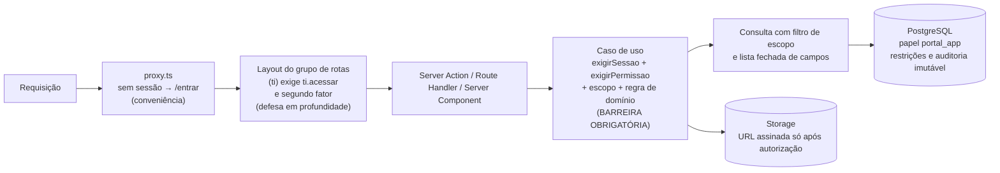

# Permissões e RBAC — Portal TI Vallur

**Fase:** 01 — Arquitetura e planejamento
**Situação:** proposta para revisão. As regras marcadas **[REQ-PM]** vêm da tabela de perfis do Plano Mestre (PM §12) e não podem ser alteradas sem decisão da TI; as marcadas **[DECISÃO-TI]** vêm de decisões registradas em `ARQUITETURA_TECNICA.md` §16; as marcadas **[PROPOSTA]** detalham operações que o PM não especifica.
**Referências:** `ARQUITETURA_TECNICA.md` (`DA-nn`, `DT-nn`, `Q-nn`), `MODELO_DE_DADOS.md`.
**Revisão 01.1 (14/10/2026):** incorpora as decisões aprovadas Q-04, Q-07, Q-25, Q-27 e Q-30; Q-09 permanece aberta. Consolidação em `REVISAO_FINAL_FASE_01.md`.
**Revisão 01.3 (14/10/2026):** fecha três caminhos de contorno de Q-30 (perfis acumulados com `ESTAGIARIO_TI`, permissões individuais após perda do perfil de TI, vinculação de identidade pela carga inicial), alinha rótulos de Q-04 e amplia os testes de §9.
**Revisão 01.4 (15/10/2026):** incorpora as decisões da TI DT-01 a DT-07. Autenticação própria do portal (DT-01). Nenhum provisionamento tem aprovação hierárquica (DT-03): `solicitacao.aprovar` e a autoaprovação deixam de existir e entra `provisionamento.executar`. Supervisor TI e Gestor ADM ficam sem hierarquia e com autoridade equivalente (DT-04, DT-05). O Gestor ADM ganha experiência gerencial (DT-06). O Estagiário TI provisiona só por concessão individual (DT-07). Também entram: a matriz consolidada por tipo de operação (§3.0), as permissões de contas de acesso e segurança (§3.7a), as restrições obrigatórias revistas, inclusive as que dependem do alvo (§3.10), e as regras de confirmação no lugar das regras de aprovação (§4).
**Revisão 01.4 — correções da revisão especializada (15/10/2026):**
- `conta_acesso.criar` e `provisionamento.executar` passam a ter restrição dependente do alvo.
- A restrição por alvo falha fechada: sem `alvo`, a permissão é negada. A avaliação faz `SELECT … FOR UPDATE` no alvo.
- Novas: a permissão `catalogo.gerenciar_grupos`, a ativação de perfil de TI (Q-43) e alertas compensatórios.
- `execucao.reprocessar` passa a exigir também `provisionamento.executar`.
- A regra do último administrador é serializada e passa a cobrir o afastamento.
- Só entrar, sair e verificar o segundo fator ficam expostos pela biblioteca.
- Testes ampliados.

---

## 1. Princípios

1. **A autorização é do backend.** Esconder um menu ou botão é experiência, não segurança. Toda Server Action, Route Handler e consulta de Server Component chama um caso de uso que verifica permissão e escopo (PM §19; REQ-PROMPT §5).
2. **Permissão por operação**, não por tela: `dominio.acao`.
3. **Negar por padrão.** Operação sem permissão declarada no catálogo é negada.
4. **Escopo de dados** além da permissão: `PROPRIO` (somente registros do próprio colaborador) ou `GRUPO` (todas as empresas). `EMPRESA` está previsto no modelo, mas não é usado na V1 (Q-21).
5. **Perfis e permissões individuais lidos do banco a cada requisição**; revogação tem efeito imediato.
6. **Toda negação em operação sensível é auditada** (`resultado = NEGADO`).
7. **Restrições obrigatórias prevalecem** sobre qualquer concessão individual (§3.10).
8. **Autenticação própria do portal** [DECISÃO-TI, DT-01]. A biblioteca de autenticação (DA-24) só autentica: identifica a conta de acesso e a sessão. A autorização continua sendo do portal: perfis, permissões individuais e restrições obrigatórias (DA-22). A senha do colaborador nunca serve de credencial para as integrações.
9. **A experiência de interface não é autorização** [DECISÃO-TI, DT-06]. A visão gerencial do Gestor ADM e a visão operacional do Supervisor TI mudam a página inicial, a ordem dos menus e os indicadores. As permissões efetivas continuam idênticas (DT-05).

---

## 2. Perfis

| Perfil | Código | Quem | Origem |
|---|---|---|---|
| Colaborador | `COLABORADOR` | Todo colaborador com situação `ATIVO` **e** conta de acesso `ATIVA` (`MODELO_DE_DADOS.md` §5). Implícito, não precisa ser atribuído. Usa o portal de autosserviço e vê somente os próprios equipamentos, documentos, chamados e os tutoriais autorizados; não acessa dados administrativos | REQ-PM, PM §11–12; DT-01 |
| Estagiário TI | `ESTAGIARIO_TI` | Estagiários da equipe de TI. Executam a operação diária: cadastram e atualizam colaboradores; trabalham com inventário, alocações, TER, TDV e chamados. Criam contas Microsoft 365 e executam provisionamento **somente com a permissão individual `provisionamento.executar`**. Não modificam perfis administrativos, não concedem privilégios a si mesmos nem a outros e não alteram regras de segurança | REQ-PM, PM §12; DECISÃO-TI DT-07 |
| Supervisor TI | `SUPERVISOR_TI` | Coordena a operação de TI. Tem acesso administrativo completo: gerencia integrações, colaboradores, inventário e suporte, administra perfis e permissões e concede e remove perfis administrativos, inclusive `GESTOR_ADM`. A experiência de interface é **operacional** | REQ-PM, PM §12; DECISÃO-TI Q-07, DT-04, DT-05 |
| Gestor ADM | `GESTOR_ADM` | Gestão administrativa. Não está acima do Supervisor TI, e a autoridade administrativa dos dois é equivalente. Faz alterações administrativas quando necessário, administra perfis e permissões e concede e remove perfis administrativos. A experiência de interface é **gerencial**: dashboards, indicadores, consultas, relatórios e auditoria | REQ-PM, PM §12; DECISÃO-TI Q-07, DT-04, DT-05, DT-06 |

- **Perfis administrativos** = `SUPERVISOR_TI` e `GESTOR_ADM`. Não há relação hierárquica entre eles [DECISÃO-TI, DT-04]. Têm **permissões administrativas equivalentes** [DECISÃO-TI, Q-07, DT-05]: tudo o que um pode fazer, o outro também pode, inclusive conceder e remover os perfis `SUPERVISOR_TI` e `GESTOR_ADM`.
- **Regra fundamental:** Supervisor TI e Gestor ADM têm as mesmas permissões administrativas, mas experiências de interface diferentes. O foco do Supervisor TI é operacional; o do Gestor ADM é gerencial e de acompanhamento. Essa diferença **não** limita a autorização (DT-06; `DESIGN_SYSTEM.md`).
- Os perfis de TI **somam-se** ao perfil Colaborador: um membro da TI também tem seu portal pessoal.
- Um colaborador pode ter mais de um perfil de TI; a permissão efetiva é a união (com as restrições obrigatórias de §3.10).
- Além do perfil, uma pessoa pode receber **permissões individuais sensíveis** [DECISÃO-TI, Q-30] — §3.9.
- O campo `gestor` do vínculo organizacional **não** concede nenhuma permissão no portal (o PM não prevê área para gestores de equipe).
- Quem tem perfil de TI ativo só acessa a área de TI com o segundo fator configurado e verificado na sessão [PROPOSTA, DA-26; Q-38].

---

## 3. Matriz de permissões

Legenda:

| Símbolo | Significado |
|---|---|
| **G** | Permitido pelo perfil, escopo `GRUPO` (todas as empresas) |
| **P** | Permitido pelo perfil, escopo `PROPRIO` (somente registros do próprio colaborador) |
| **—** | Não incluído no perfil |
| **I** | Não incluído no perfil, mas **pode ser concedido individualmente** (§3.9) |
| **R** | **Restrição obrigatória**: nunca permitido, nem por concessão individual (§3.10) |
| **G\*** / **I\*** | Permitido (ou concedível), **exceto quando o alvo tem perfil de TI ativo** (e, em `provisionamento.executar`, também quando o alvo é o próprio ator); nesses casos vale **R** (§3.10, item 6) |
| **?** | Pendente de decisão |

Coluna "Origem": **PM** = deriva da tabela PM §12 · **DECISÃO-TI** = decisão aprovada (§16 da arquitetura) · **PROP** = proposta desta fase.
As colunas "Superv." e "Gestor" são idênticas por decisão (Q-07, DT-05). Concessões individuais só se aplicam a quem possui perfil de TI [PROPOSTA]; por isso a coluna "Colab." não usa **I**.

### 3.0 Matriz consolidada por tipo de operação [DECISÃO-TI DT-03 a DT-07; detalhamento PROPOSTA]

Visão resumida pedida pela TI. As tabelas de §3.1 a §3.8 detalham cada permissão e prevalecem em caso de dúvida.
- **Encerrar/excluir lógico** = cancelar, baixar, encerrar, revogar, bloquear ou desativar. Não existe exclusão física de registros de negócio (`MODELO_DE_DADOS.md` §1).
- **Ninguém exclui ou altera eventos de auditoria**, por nenhuma interface (§7).
- **Provisionar** = escrever em sistemas externos (Microsoft 365, Exchange, Teams, terceiros).

Formato de cada célula: Colab. / Estag. / Superv. = Gestor.

| Domínio | Ler | Criar | Editar | Encerrar/excluir lógico | Provisionar | Configurar | Auditar |
|---|---|---|---|---|---|---|---|
| Acesso e dashboard | P / G / G | — | — | — | — | — | — |
| Empresas e catálogos | — / G / G | — / I / G | — / I / G | — / I / G | — | Catálogos: — / I / G; catálogo de grupos permitidos: — / **R** / G | — / G / G |
| Colaboradores | P (sem CPF) / G / G | — / G / G | — / G (membros da TI: R) / G | Desligamento: — / I\* / G | — | — | — / G / G |
| Identidade Entra (`entra_object_id`) | — / G / G | — / R / G | — / R / G | — | — | — | — / G / G |
| Contas de acesso do portal | Própria: P / P / P; de outros: — / G / G | — / G\* / G | Senha: — / G\* / G; MFA: — / R / G | Bloquear/encerrar sessões: — / G\* / G | — | — | — / G / G |
| Solicitações e execuções | — / G / G | Rascunho: — / G / G | Rascunho: — / G / G | Cancelar: — / P (as que criou) / G | — / **I\*** / G | — | — / G / G |
| Microsoft 365 (licenças, grupos, caixas) | — / G / G | Via provisionamento | Via provisionamento | Via provisionamento (confirmação reforçada) | — / **I\*** / G | Sincronizar SKUs: — / G / G | — / G / G |
| Inventário, alocações e termos | P (próprios) / G / G | — / G / G | — / G / G | Baixa e cancelamento: — / G (Q-26) / G | — | — | — / G / G |
| Chamados e tutoriais | P / G / G | P / G / G | Atender: — / G / G; comentar: P / G / G | Encerrar chamado: — / G / G; despublicar: — / G / G | — | SLA: — / I / G | — / G / G |
| Perfis e permissões individuais | — / G / G | — / R / G | — / R / G | — / R / G | — | — | — / G / G |
| Segurança (senha, MFA, sessão, limites) | — / — / G | — | — | — | — | — / **R** / G | — / G / G |
| Integrações (modo dos conectores) | — / G / G | — | — | — | — | — / I / G | — / G / G |
| Auditoria | — / G (Q-06) / G | Automática (ninguém cria manualmente) | **Ninguém** | **Ninguém** | — | — | Exportar: — / I / G |
| Relatórios (Q-42) | — / G / G | — | — | — | — | — | Exportar: — / I / G |
| Expansão: Teams, desligamento | — / G / G | Regras: — / G / G | Regras: — / G / G | Desligamento: — / I\* / G | Aplicar regras: — / **I\*** / G | — | — / G / G |

Na coluna "Provisionar", o asterisco indica a restrição de autoprovisionamento: o Estagiário com a concessão individual **não** provisiona para si mesmo nem para quem tem perfil de TI ativo (§3.10, item 6).

### 3.1 Acesso e navegação

| Permissão | Colab. | Estag. | Superv. | Gestor | Origem |
|---|---|---|---|---|---|
| `portal.acessar` (área do colaborador) | P | P | P | P | PM §11 |
| `ti.acessar` (área administrativa; exige segundo fator verificado na sessão — DA-26) | — | G | G | G | PM §12; MFA PROP (Q-38) |
| `dashboard.ver` (painel operacional ou gerencial — DT-06) | — | G | G | G | PM §2; DT-06 |
| `relatorio.ver` | — | G | G | G | PROP (Q-42) |
| `relatorio.exportar` (nunca inclui CPF) | — | I | G | G | PROP (Q-42); concessão individual (Q-30) |

### 3.2 Empresas e catálogos

| Permissão | Colab. | Estag. | Superv. | Gestor | Origem |
|---|---|---|---|---|---|
| `empresa.ver` | — | G | G | G | PROP |
| `empresa.gerenciar` | — | I | G | G | PROP; concessão individual (Q-30) |
| `catalogo.gerenciar` (cargos, departamentos, modelos de ativo, categorias, perfis externos) | — | I | G | G | PROP; concessão individual (Q-30) |
| `catalogo.gerenciar_grupos` (catálogo de grupos Microsoft 365 permitidos para provisionamento — `INTEGRACOES.md` §2.7) | — | **R** | G | G | PROPOSTA derivada de DT-07, **a TI confirma**. Até a 01.4 inicial, fazia parte de `catalogo.gerenciar` (I). Incluir um grupo no catálogo define o que o provisionamento pode conceder; com a concessão de provisionamento, o Estagiário poderia ampliar o próprio acesso (§3.10, item 7) |

### 3.3 Colaboradores

| Permissão | Colab. | Estag. | Superv. | Gestor | Origem |
|---|---|---|---|---|---|
| `colaborador.ver` | P (dados próprios básicos, sem CPF) | G | G | G | PM §3, §11 |
| `colaborador.criar` | — | G | G | G | PM §12 "Cadastrar e preparar"; DT-07 |
| `colaborador.editar` (sem identidade Entra e sem situação; inclui o e-mail de login de colaboradores **sem** perfil de TI) | — | G | G | G | PM §12; DT-07 |
| `colaborador.editar_equipe_ti` (dados de identificação, **e-mail de login** e situação de quem possui perfil de TI) | — | **R** | G | G | PROPOSTA derivada de DT-07, **a TI confirma** (é mais restritiva que PM §12 "Cadastrar e atualizar colaborador: Estagiário Sim"). Era **I** até a Revisão 01.3. Com a autenticação própria, alterar o e-mail de login de um membro da TI equivale a mexer na credencial dele (§3.10, item 6) |
| `colaborador.vinculo_registrar` (transferência, mudança de cargo) | — | G | G | G | PM §3, §12 |
| `colaborador.cpf_revelar` | — | G (Q-06) | G | G | PM §12 "Consultar CPF" |
| `colaborador.vincular_identidade` (gravar/alterar `entra_object_id` fora do provisionamento) | — | **R** | G | G | DECISÃO-TI Q-07; restrição obrigatória derivada, com justificativa revista na Revisão 01.4 (§3.10; R-18) |
| `carga.importar` (carga inicial de colaboradores e inventário) | — | I | G | G | PROP; concessão individual (Q-30). A carga apenas **propõe** vínculos de `entra_object_id`; gravá-los exige confirmação de quem tem `colaborador.vincular_identidade`. A carga nunca cria nem altera perfis, recusa vincular `oid` a registro com perfil de TI ativo [PROPOSTA] e **não cria conta de acesso nem senha** (Q-40) |

### 3.4 Solicitações, provisionamento e execuções [DECISÃO-TI DT-03, DT-07]

| Permissão | Colab. | Estag. | Superv. | Gestor | Origem |
|---|---|---|---|---|---|
| `solicitacao.ver` / `execucao.ver` | — | G | G | G | PM §12 |
| `solicitacao.criar` / `solicitacao.editar` (rascunho, **sem senha**) | — | G | G | G | PM §3 "prepara o cadastro"; DT-03 |
| **`provisionamento.executar`** (confirmar e executar solicitação: criar conta Microsoft 365 informando a senha inicial, licenças, grupos, caixas compartilhadas, acessos externos, regras do Teams; nova tentativa da criação de conta com a senha digitada de novo) | — | **I\*** | G | G | **DECISÃO-TI DT-03, DT-07**. Exige reautenticação recente; operações destrutivas exigem confirmação reforçada (§4.2). \*Restrição de autoprovisionamento: para quem não tem perfil administrativo, **R** quando o alvo é o próprio ator ou tem perfil de TI ativo (PROPOSTA derivada de DT-07, a TI confirma; §3.10 item 6). A concessão exige `valida_ate` (§3.9) |
| `solicitacao.cancelar` | — | P (as que criou) | G | G | PROP |
| `execucao.reprocessar` | — | I | G | G | PROP (PM §3 "repetição autorizada"); concessão individual (Q-30). Exige **também** `provisionamento.executar`, porque repete escritas externas (DT-07). A nova tentativa de ação em `AGUARDANDO_ACAO_MANUAL` exige só `provisionamento.executar`; reprocessar ação em `FALHOU` exige as duas |
| `tarefa_manual.ver` / `tarefa_manual.assumir` / `tarefa_manual.concluir` | — | G | G | G | PROP |
| `licenca.ver` / `grupo.ver` / `caixa_compartilhada.ver` | — | G | G | G | PM §4 |
| `licenca.sincronizar` (atualizar espelho de SKUs) | — | G | G | G | PROP (somente leitura no tenant) |

- **Estagiário sem a concessão:** prepara o rascunho e deixa a solicitação pronta. Quem tem `provisionamento.executar` revisa, informa a senha inicial e executa. Isso é **execução por quem tem a permissão, não aprovação**: não há fila de aprovação, estado de espera por decisão nem registro de aprovador (DT-03).
- **Alterações em contas existentes** (licenças, grupos, caixas compartilhadas, acessos externos), a aplicação de regras do Teams e o desligamento também passam por solicitação, com confirmação explícita e `provisionamento.executar` (ou `desligamento.executar`), **sem aprovação hierárquica** (DT-03). Não existe permissão de alteração direta fora de uma solicitação.

> **Permissões removidas na Revisão 01.4 (registro histórico):**
> - `solicitacao.aprovar`: aprovar ou rejeitar, inclusive as próprias. Deixou de existir com DT-03, que substitui Q-04. Na Revisão 01.3 era **R** para o Estagiário e **G** para Supervisor TI e Gestor ADM.
> - `solicitacao.enviar`: enviar para aprovação. Substituída por `provisionamento.executar`.
> - `provisionamento.executar_conta`: renomeada para `provisionamento.executar`, com escopo ampliado a todo o provisionamento. Até a Revisão 01.3 era **G** para todos os perfis de TI; agora o Estagiário só a recebe por concessão individual (DT-07; resolve Q-31 c).
> - `desligamento.solicitar`: substituída por `desligamento.executar` (§3.8).

### 3.5 Inventário, alocações e termos

| Permissão | Colab. | Estag. | Superv. | Gestor | Origem |
|---|---|---|---|---|---|
| `ativo.ver` | P (somente os alocados a si, campos limitados — §5.2) | G | G | G | PM §11, §12 |
| `ativo.criar` / `ativo.editar` | — | G | G | G | PM §12 "Inventário" |
| `ativo.transicionar` (manutenção, avaliação, disponível) | — | G | G | G | PM §12 |
| `ativo.baixar` | — | G (ver Q-26) | G | G | PM §12 |
| `estoque.movimentar` | — | G | G | G | PM §12 |
| `alocacao.criar` / `alocacao.confirmar_entrega` / `alocacao.cancelar` (somente antes da entrega) | — | G | G | G | PM §12; DECISÃO-TI Q-27 |
| `devolucao.registrar` (registro simples na V1; TDV na expansão — Q-12) | — | G | G | G | PM §12 "TER/TDV" |
| `evidencia.enviar` | — | G | G | G | PM §6 |
| `evidencia.ver` | P (fotos dos próprios termos disponibilizados) | G | G | G | PROP |
| `termo.emitir` / `termo.cancelar` / `termo.anexar_assinado` | — | G | G | G | PM §12 |
| `termo.ver` / `termo.baixar` | P (termos atuais disponibilizados) | G | G | G | PM §7, §11 |
| `termo.disponibilizar` (marcar visível ao colaborador) | — | G | G | G | PROP |

### 3.6 Chamados e tutoriais

| Permissão | Colab. | Estag. | Superv. | Gestor | Origem |
|---|---|---|---|---|---|
| `chamado.criar` | P | G (em nome de outro colaborador — PROP) | G | G | PM §9 |
| `chamado.ver` | P | G | G | G | PM §9, §11 |
| `chamado.comentar` | P (apenas comentários públicos) | G | G | G | PM §9 |
| `chamado.comentar_interno` / `chamado.ver_interno` | — | G | G | G | PROP |
| `chamado.atender` (atribuir, mudar estado, prioridade, categoria, encerrar) | — | G | G | G | PM §9, §12 |
| `chamado.anexar` | P | G | G | G | PM §9 |
| `chamado.vincular_ativo` | P (somente ativos alocados a si) | G | G | G | PROP |
| `sla.configurar` | — | I | G | G | PROP (Q-14); concessão individual (Q-30) |
| `tutorial.ver` | P (publicados ao seu público) | G | G | G | PM §10 |
| `tutorial.gerenciar` / `tutorial.publicar` | — | G | G | G | PM §12 "administrar tutoriais" |

### 3.7 Auditoria e administração do portal

| Permissão | Colab. | Estag. | Superv. | Gestor | Origem |
|---|---|---|---|---|---|
| `auditoria.ver` | — | G (Q-06) | G | G | PM §12 "Consultar auditoria" |
| `auditoria.exportar` | — | I | G | G | PROP; concessão individual (Q-30) |
| `perfil.ver` / `permissao_individual.ver` | — | G | G | G | PROP |
| **`perfil.atribuir` / `perfil.revogar`** (inclusive `SUPERVISOR_TI` e `GESTOR_ADM`) | — | **R** | G | G | **PM §12; DECISÃO-TI Q-07, DT-05, DT-07** |
| **`permissao_individual.gerenciar`** (conceder/revogar permissões individuais, inclusive a si mesmo) | — | **R** | G | G | DECISÃO-TI Q-30, DT-07; restrição derivada de PM §12 (§3.10) |
| `integracao.ver` (estado dos conectores) | — | G | G | G | PROP |
| `integracao.configurar` (modo do conector, catálogos de ações) | — | I | G | G | PROP; DECISÃO-TI Q-07 e DT-05 (equivalência); concessão individual (Q-30) |

### 3.7a Contas de acesso e segurança [DECISÃO-TI DT-01, DT-02, DT-07; detalhamento PROPOSTA]

Contas de acesso são as contas locais do portal (`conta_acesso`, `MODELO_DE_DADOS.md` §5). Nenhuma permissão dá acesso ao hash da senha, ao segredo TOTP, a códigos de recuperação ou a tokens.

| Permissão | Colab. | Estag. | Superv. | Gestor | Origem |
|---|---|---|---|---|---|
| `conta_acesso.ver` (situação, último acesso, MFA configurado; nunca hash nem segredo) | — | G | G | G | PROP |
| `conta_acesso.criar` (criar a conta local com a senha inicial no cadastro) | — | G\* | G | G | DT-01, DT-02, DT-07. \*R quando o alvo tem perfil de TI ativo (ex.: membro da TI vindo da carga inicial sem conta — Q-40): quem cria a conta conhece a senha |
| `conta_acesso.redefinir_senha` (pela TI; nova senha entregue ao titular fora do portal; revoga todas as sessões) | — | G\* | G | G | DT-02; PROP. \*R quando o alvo tem perfil de TI ativo |
| `conta_acesso.bloquear` / `conta_acesso.desbloquear` | — | G\* | G | G | PROP. \*R quando o alvo tem perfil de TI ativo; regra do último administrador (§8) |
| `conta_acesso.encerrar_sessoes` (de outra pessoa) | — | G\* | G | G | PROP. \*R quando o alvo tem perfil de TI ativo |
| `conta_acesso.redefinir_mfa` | — | **R** | G | G | PROP (DA-26, Q-38) |
| `conta.gerenciar_propria` (alterar a própria senha com a senha atual, configurar o próprio MFA, ver e encerrar as próprias sessões) | P | P | P | P | DT-01; PROP. Executada por casos de uso do portal, com reautenticação, auditoria e política de senha (Q-39), e não pelas rotas da biblioteca (§6, regra 7). Quem tem perfil de TI ativo **não** desativa o próprio MFA: só um administrador o redefine (`conta_acesso.redefinir_mfa`) |
| `seguranca.configurar` (política de senha, MFA, sessão, limites de tentativa, lista de bloqueio, lista de grupos proibidos quando não for configuração de implantação) | — | **R** | G | G | DECISÃO-TI DT-07 |

- O e-mail de login é alterado pelo caso de uso de edição do colaborador: `colaborador.editar` para quem não tem perfil de TI e `colaborador.editar_equipe_ti` para quem tem. A mesma conta é mantida, sem criar nova identidade, e as demais sessões são encerradas, com auditoria (`MODELO_DE_DADOS.md` §5).
- Recuperação de senha pelo próprio colaborador, por link enviado ao e-mail corporativo: desenhada e **desligada até Q-37**. Até a decisão, a recuperação é feita só pela TI, com `conta_acesso.redefinir_senha`.
- Troca obrigatória da senha no primeiro acesso: **não** é requisito confirmado (Q-36; DT-02).

### 3.8 Expansão (sem telas na V1; previsto no catálogo)

| Permissão | Estag. | Superv. | Gestor | Observação |
|---|---|---|---|---|
| `teams.regra_gerenciar` | G | G | G | A aplicação das regras usa `provisionamento.executar` (**I** para o Estagiário), com prévia e confirmação reforçada para remoções; sem aprovação hierárquica (DT-03) |
| `desligamento.executar` | I\* | G | G | Desativa contas pelos conectores, bloqueia e depois desativa a conta de acesso, revoga perfis, permissões individuais e sessões e lista os ativos a recolher. Confirmação reforçada e reautenticação. \*R quando o alvo tem perfil de TI ativo; regra do último administrador (§8). Substitui `desligamento.solicitar` |
| `custo.ver` / `custo.gerenciar` | ? | ? | ? | A definir com o módulo de custos |

### 3.9 Permissões individuais sensíveis [DECISÃO-TI, Q-30 e DT-07; detalhamento PROPOSTA]

| Regra | Detalhe |
|---|---|
| O que é | Concessão a uma pessoa específica de uma permissão marcada como `concedivel_individualmente` no catálogo de permissões (versionado em código, `src/server/authz/catalogo.ts`). As permissões **I** da matriz são as concedíveis |
| Provisionamento do Estagiário | `provisionamento.executar` não vem com o perfil `ESTAGIARIO_TI`: o Estagiário só cria contas Microsoft 365 e executa provisionamento com essa concessão individual [DECISÃO-TI, DT-07] |
| Quem concede/revoga | Quem tem `permissao_individual.gerenciar`: Supervisor TI e Gestor ADM (equivalentes, Q-07, DT-05). Estagiário nunca, nem a si mesmo nem a outros (restrição obrigatória, DT-07). Para Supervisor TI e Gestor ADM a concessão a si mesmo não tem efeito, porque o perfil já inclui todas as permissões concedíveis |
| Quem pode receber | Colaboradores com perfil de TI ativo [PROPOSTA]. A condição vale também na avaliação: concessões de quem perdeu todos os perfis de TI deixam de contar, e a revogação do último perfil de TI revoga as concessões na mesma transação, com auditoria |
| Registro | Tabela `permissao_individual` (`MODELO_DE_DADOS.md` §5.3): quem concedeu, quando, justificativa obrigatória, validade, revogação. A validade (`valida_ate`) é opcional, **exceto** na concessão de `provisionamento.executar`, em que é obrigatória [PROPOSTA, a TI confirma; R-26] |
| Alerta | Conceder `provisionamento.executar` gera alerta no painel dos demais administradores (§4.2) [PROPOSTA] |
| Efeito | Imediato: permissões efetivas são recalculadas a cada requisição. A revogação também tem efeito imediato |
| Distinção | Permissões individuais ficam separadas das de perfil, e a origem de cada permissão efetiva é exibida na interface e gravada na auditoria |
| Auditoria | Eventos `permissao_individual.conceder` e `permissao_individual.revogar` com ator, pessoa-alvo, permissão, estado anterior e resultante, justificativa e reautenticação recente |
| Restrição de perfil por pessoa | Retirar de uma pessoa uma permissão que vem do perfil **não** é suportado até a decisão de Q-31 (b) |
| Proteção dupla | A concessão de uma permissão com restrição obrigatória é recusada no cadastro **e**, se algum registro indevido existir, é descartada na avaliação (§3.10) |
| Revisão periódica | Recomendada à TI, em especial das concessões de `provisionamento.executar` (R-26) [PROPOSTA] |

### 3.10 Avaliação da permissão efetiva

```ts
// src/server/authz/avaliar.ts — pseudocódigo
function permissaoEfetiva(ator, permissao, alvo?): Resultado {
  if (restricaoObrigatoria(ator, permissao, alvo))            // 1. restrições obrigatórias primeiro
    return { permitido: false, origem: 'RESTRICAO_OBRIGATORIA' };  //    (inclusive as que dependem do alvo)
  const doPerfil = ator.perfisAtivos.find(p => MATRIZ[p].inclui(permissao));
  if (doPerfil) return { permitido: true, origem: `PERFIL:${doPerfil}` };
  const individual = ator.temPerfilTiAtivo &&                  // concessões só valem com perfil de TI ativo
    ator.permissoesIndividuaisAtivas                           // não revogadas e dentro da validade
    .find(pi => pi.permissao === permissao && CATALOGO[permissao].concedivelIndividualmente);
  if (individual) return { permitido: true, origem: `INDIVIDUAL:${individual.id}` };
  return { permitido: false, origem: 'SEM_PERMISSAO' };       // negar por padrão
}

function restricaoObrigatoria(ator, permissao, alvo?): boolean {
  const restrito = !ator.temPerfilAdministrativoAtivo || ator.perfisAtivos.includes('ESTAGIARIO_TI');
  if (!restrito) return false;
  if (RESTRITAS_SEMPRE.includes(permissao)) return true;      // itens 1 a 5 e 7
  if (!RESTRITAS_POR_ALVO.includes(permissao)) return false;
  if (!alvo) return true;                                      // FALHA FECHADA: sem alvo informado, nega
  return alvo.temPerfilTiAtivo                                 // item 6: alvo com perfil de TI ativo
    || (AUTOPROVISIONAMENTO.includes(permissao)                // item 6: provisionar para si mesmo
        && alvo.colaboradorId === ator.colaboradorId);
}
// Chamada DENTRO da transação da operação, depois de `SELECT … FOR UPDATE` na linha do
// colaborador-alvo (também em perfil.atribuir/revogar), para que uma atribuição de perfil
// concorrente não abra brecha. O escopo (PROPRIO/GRUPO) é aplicado depois, na consulta.
```

**Restrições obrigatórias.** Valem quando a pessoa **não** possui perfil administrativo ativo (`SUPERVISOR_TI` ou `GESTOR_ADM`) **ou** possui o perfil `ESTAGIARIO_TI` ativo; neste caso a restrição prevalece sobre a soma de perfis. Para evitar ambiguidade, `ESTAGIARIO_TI` e perfis administrativos **não coexistem** na mesma pessoa: atribuir um perfil administrativo a um Estagiário exige revogar `ESTAGIARIO_TI` na mesma operação [PROPOSTA; Q-31 (f)].

| # | Permissão bloqueada | Fonte |
|---|---|---|
| 1 | `perfil.atribuir`, `perfil.revogar` | PM §12 ("Alterar perfis administrativos": Estagiário Não); DT-07 |
| 2 | `permissao_individual.gerenciar`, inclusive conceder a si mesmo | Derivada de PM §12: conceder permissões administrativas equivale a alterar perfis administrativos; DT-07 ("não concede privilégios a si mesmo") |
| 3 | `colaborador.vincular_identidade` | Justificativa revista na Revisão 01.4. O `entra_object_id` não concede mais login (DT-01), mas um vínculo errado direciona ações de integração (licença, grupos, desligamento) à conta Microsoft de outra pessoa (R-18). Vale também para a carga inicial (`carga.importar` só propõe vínculos) |
| 4 | `seguranca.configurar` | DECISÃO-TI DT-07 ("não altera regras de segurança") |
| 5 | `conta_acesso.redefinir_mfa` | PROPOSTA (DA-26): redefinir o segundo fator de alguém abre caminho para assumir a conta |
| 6 | **Ações sobre credenciais e acesso de quem tem perfil de TI ativo e autoprovisionamento** (restrição que depende do alvo): `conta_acesso.criar`, `conta_acesso.redefinir_senha`, `conta_acesso.bloquear`, `conta_acesso.desbloquear`, `conta_acesso.encerrar_sessoes`, `colaborador.editar_equipe_ti` e `desligamento.executar` quando o alvo tem perfil de TI ativo; `provisionamento.executar` (e, por consequência, `execucao.reprocessar`) quando o alvo tem perfil de TI ativo **ou é o próprio ator** | DT-07 (sem elevação de privilégio, inclusive sobre a própria conta, porque o próprio Estagiário tem perfil de TI); PROPOSTA de mecanismo. A inclusão de `conta_acesso.criar` e de `provisionamento.executar` é proposta derivada de DT-07 que **a TI confirma**. Para quem não tem perfil de TI, essas ações seguem a matriz (G ou I) |
| 7 | `catalogo.gerenciar_grupos` | PROPOSTA derivada de DT-07, **a TI confirma**: o catálogo de grupos permitidos define o que o provisionamento pode conceder; a lista de grupos proibidos só bloqueia o que já consta nela |

> `solicitacao.aprovar` saiu desta lista na Revisão 01.4: a permissão deixou de existir (DT-03).

A função passa a ser `permissaoEfetiva(ator, permissao, alvo?)`. Para as permissões do item 6, **o alvo é obrigatório**: um caso de uso que não o informe é negado (falha fechada), e um teste percorre o catálogo para garantir que todo caso de uso dessas permissões passa o alvo. Os perfis do alvo são lidos **dentro da transação da operação**, depois de `SELECT … FOR UPDATE` na linha do colaborador-alvo. `perfil.atribuir` e `perfil.revogar` também tomam esse bloqueio, para que uma atribuição de perfil concorrente não abra brecha em leitura com isolamento READ COMMITTED.

Nenhuma restrição desta lista reduz a autoridade de Supervisor TI ou Gestor ADM (Q-07, DT-05). O resultado da avaliação (`origem`) é gravado no evento de auditoria da operação.

---

## 4. Operações críticas e regras de confirmação

### 4.1 Operações críticas

**Reautenticação recente** = autenticação há menos de 15 min (Q-15), com senha e, para perfis de TI, segundo fator. Ela atualiza `sessao.autenticado_em` (`ARQUITETURA_TECNICA.md` §9).

| Operação | Por que é crítica | Controles |
|---|---|---|
| Confirmar e executar solicitação (criação de conta Microsoft 365, licenças, grupos, caixas, acessos externos, regras do Teams) | Altera o tenant e sistemas externos sem segundo olhar (R-26) | `provisionamento.executar` (Estagiário só por concessão individual); reautenticação recente; tela de revisão com o efeito exato em cada sistema; executor registrado; auditoria (§4.2) |
| Criar conta Microsoft 365 informando a senha inicial | Cria identidade corporativa | Permissão avaliada no momento da execução; senha só em memória, usada na mesma requisição e nunca persistida; nova tentativa após o fim da requisição exige digitar a senha de novo (DT-02); auditoria só com metadados |
| Operações destrutivas: remover licença, remover de grupo, revogar acesso a caixa compartilhada, bloquear em sistema externo, remoções do Teams, desligamento | Retira acesso ou desfaz efeito, possivelmente em massa | **Confirmação reforçada**: lista do que será removido + digitação da contagem ou do identificador + reautenticação recente |
| Reprocessar execução | Pode repetir efeito externo | `execucao.reprocessar` **e** `provisionamento.executar`; mesmos parâmetros confirmados; `verificarEstado()` antes, sem senha; na criação de conta, a senha só é pedida se a conta não existir no Microsoft 365; motivo obrigatório |
| Criar conta de acesso com senha inicial | Concede acesso ao portal | `conta_acesso.criar`; política de senha (Q-39); hash Argon2id (DA-25); auditoria sem senha |
| Redefinir senha do portal pela TI | Permite assumir a conta | `conta_acesso.redefinir_senha`; restrição para alvos com perfil de TI; reautenticação; revoga todas as sessões do alvo; auditoria |
| Redefinir MFA | Permite assumir conta com segundo fator | `conta_acesso.redefinir_mfa` (somente perfis administrativos); reautenticação; verificação de identidade do titular definida pela TI (Q-38); auditoria |
| Bloquear/desbloquear conta de acesso; encerrar sessões de outra pessoa | Corta ou devolve acesso | Permissões de §3.7a; restrição para alvos com perfil de TI; regra do último administrador; auditoria |
| Alterar regras de segurança | Afeta a proteção de todas as contas | `seguranca.configurar` (somente perfis administrativos); reautenticação; auditoria com estado anterior e resultante |
| Atribuir/revogar perfil | Escalonamento de privilégio | §8; reautenticação; auditoria com estado anterior e resultante; alerta aos demais administradores quando o perfil é administrativo |
| Ativar perfil de TI (Q-43) | Quem conhece a senha inicial poderia entrar primeiro e cadastrar o próprio segundo fator | Ao atribuir perfil de TI: revogar as sessões do alvo; o perfil só concede `ti.acessar` depois que o titular define a própria senha e configura o MFA com **código de ativação de uso único** gerado pelo administrador e entregue fora do portal. Vale também depois de `conta_acesso.redefinir_mfa` de membro da TI. Evento `conta_acesso.ativar_perfil_ti` [PROPOSTA; Q-43] |
| Conceder/revogar permissão individual | Escalonamento de privilégio | §3.9; justificativa; reautenticação; auditoria com estado anterior e resultante |
| Vincular identidade Entra | Direciona ações de integração à conta Microsoft correta (R-18) | Somente perfis administrativos (restrição obrigatória para os demais); reautenticação; auditoria |
| Revelar CPF | Dado pessoal | Ação explícita "Mostrar CPF"; auditoria por revelação |
| Baixar ativo, cancelar termo | Afeta patrimônio e evidência | Confirmação com justificativa; auditoria |
| Exportar auditoria | Volume de dados pessoais | `auditoria.exportar`; reautenticação; auditoria da exportação |
| Mudar modo de conector para `ATIVO` | Habilita escrita real | `integracao.configurar` (Supervisor TI ou Gestor ADM, ou concessão individual); reautenticação; em produção também exige configuração de implantação |
| Desligamento (expansão) | Desativa contas e acessos | `desligamento.executar`; restrição para alvos com perfil de TI; regra do último administrador; confirmação reforçada; reautenticação |

### 4.2 Regras de provisionamento sem aprovação hierárquica [DECISÃO-TI, DT-03]

| Regra | Origem |
|---|---|
| Nenhum provisionamento depende de aprovação de Supervisor TI ou Gestor ADM: criação de colaboradores e contas Microsoft 365, alterações em contas existentes, regras do Teams e desligamento | **DECISÃO-TI, DT-03** (substitui Q-04) |
| Não existe fila de aprovação, estado "aguardando aprovação", exigência de aprovador nem bloqueio por falta de aprovação | DT-03 |
| A **confirmação explícita** feita pelo próprio executor, depois de revisar exatamente o que será executado em cada sistema, é obrigatória e **não é aprovação hierárquica** | DT-03 |
| Quem executa precisa de `provisionamento.executar`, avaliada **no momento da execução**, dentro da transação de confirmação (perfil + permissões individuais − restrições obrigatórias). O Estagiário só a tem por concessão individual | DT-03, DT-07 |
| O executor é registrado: `versao_solicitacao.confirmada_por_id` e `confirmada_em` na confirmação; `tentativa_execucao.disparada_por_id` em cada tentativa iniciada por pessoa | DT-03; mecanismo PROPOSTA (`MODELO_DE_DADOS.md` §6) |
| A confirmação vale para um conteúdo exato (versão imutável com hash). Corrigir depois exige revisar e confirmar de novo uma nova versão; nenhuma execução nasce antes da confirmação | DT-03; mecanismo PROPOSTA |
| Duplo envio não gera duas execuções: `chave_confirmacao` única por confirmação | PROPOSTA (`MODELO_DE_DADOS.md` §6) |
| Operações destrutivas exigem **confirmação reforçada** (lista dos efeitos, contagem ou identificador digitado, reautenticação) | DT-03 |
| Toda confirmação e execução exige reautenticação recente (§4.1) | DT-03; PROPOSTA de parâmetro (Q-15) |
| Em falha parcial, nada é excluído automaticamente; a TI vê o estado de cada ação e retoma com controle | DT-03 |
| Expansão Teams: remoções aparecem destacadas na prévia e **sempre** exigem confirmação reforçada (contagem digitada). Acima de um limite de quantidade, a confirmação é agravada (lista completa revisada item a item e alerta aos administradores), mas nunca dispensada | PROPOSTA (`INTEGRACOES.md` §4) |
| Uma solicitação com adições e remoções usa um único painel de confirmação com a seção de confirmação reforçada e **uma** reautenticação | PROPOSTA (`DESIGN_SYSTEM.md` §9.1) |
| A confirmação envia o hash do conteúdo **exibido** na revisão; se o rascunho mudou depois de exibido, o servidor recusa ("O cadastro mudou; revise de novo") | PROPOSTA (SEC-08) |
| **Alertas compensatórios** no painel dos administradores (canal dentro do portal até Q-35/Q-37) para: atribuição de perfil administrativo, concessão de `provisionamento.executar`, alteração de `seguranca.configurar`, redefinição de senha ou MFA de membro da TI e operação destrutiva acima do limite. O titular é avisado no próximo acesso ("Sua senha foi redefinida por <nome> em <data>"), e a sessão aberta após redefinição por terceiro fica marcada na auditoria | PROPOSTA (R-26) |
| Revisão periódica de provisionamentos por executor, a partir da visão gerencial e da auditoria | PROPOSTA (R-26; Q-42) |

> **Registro histórico (Revisões 01.1–01.3, substituído por DT-03):** só `SUPERVISOR_TI` ou `GESTOR_ADM` aprovavam; o `ESTAGIARIO_TI` preparava e nunca aprovava; a autoaprovação era permitida e marcada (Q-04); havia uma decisão por versão e as execuções nasciam na transação de aprovação. Os campos e eventos de aprovação foram retirados do modelo.

---

## 5. Visibilidade de dados

### 5.1 Escopo `PROPRIO` (portal do colaborador) [REQ-PM, PM §11]

O escopo é aplicado **na consulta**, a partir da sessão, nunca de um parâmetro enviado pelo navegador:

```ts
// pseudocódigo — repositório de alocações no portal
listarMeusEquipamentos(ator) =>
  db.itemAlocacao.findMany({
    where: { encerradoEm: null, alocacao: { colaboradorId: ator.colaboradorId, estado: 'ATIVA' } },
    select: CAMPOS_PUBLICOS_ATIVO,   // lista fechada de campos
  })
```

Rotas como `/portal/chamados/[id]` verificam a propriedade no servidor; um ID de outra pessoa retorna **404** (não 403), para não revelar a existência do registro.

### 5.2 O que o colaborador vê

| Dado | Visível? | Campos |
|---|---|---|
| Próprios dados cadastrais | Sim | Nome, e-mail, empresa, cargo, departamento, gestor. **CPF não** (PM §3: só na área de TI) |
| Própria conta de acesso | Sim (`conta.gerenciar_propria`) | Alterar senha, configurar MFA, ver e encerrar as próprias sessões. Nunca hash, segredo ou token |
| Próprios equipamentos | Sim | Classe, fabricante, modelo, patrimônio, número de série, data de entrega, acessórios. **Não:** custo, garantia, fornecedor, observações internas |
| Próprios termos | Somente os marcados `disponivel_ao_colaborador` (PM §7) | PDF assinado (ou emitido, se ainda sem assinatura), data, estado |
| Próprios chamados | Sim | Tudo, exceto comentários internos e histórico interno de atribuição |
| Tutoriais | Somente publicados ao seu público | Título, descrição, link/arquivo |
| Sistemas liberados ao perfil | Sim (PM §11 "orientações sobre sistemas liberados") | Nome do sistema e orientação; sem detalhes técnicos de contas |
| Dados de outros colaboradores | **Nunca** | — |

### 5.3 Equipe de TI

- Escopo `GRUPO`: todas as empresas do grupo, porque a TI é única e o tenant é único [PREMISSA, Q-21].
- CPF aparece mascarado (`***.***.***-12`) em todas as telas; a revelação é uma ação explícita e auditada.
- Listagens e exportações não incluem CPF.
- Nenhuma tela exibe hash de senha, segredo TOTP, códigos de recuperação ou tokens, nem para perfis administrativos.

### 5.4 Fronteiras de empresa

- Na V1 não há restrição de visibilidade por empresa para a TI (Q-21). O modelo (`atribuicao_perfil.escopo_empresa_id`) permite restringir no futuro sem mudar a matriz.
- As empresas determinam: domínio/convenção de e-mail (Q-02), regras de Teams, propriedade de ativos e futura alocação de custos.

---

## 6. Pontos de aplicação



Regras de implementação (verificadas por testes e revisão):

1. Todo caso de uso declara a permissão exigida; um teste percorre o catálogo de casos de uso e falha se algum não declarar.
2. Server Actions não recebem identificadores de ator do cliente; o ator vem da sessão.
3. Esquemas Zod de entrada são estritos (rejeitam campos extras), impedindo atribuição em massa de campos como `estado`, `situacao`, `perfil`. Os esquemas de rascunho rejeitam qualquer chave de senha.
4. Respostas usam listas fechadas de campos (`select`), nunca o objeto completo do banco.
5. Downloads de arquivo passam por `GET /api/arquivos/{id}`, que reaplica a autorização do objeto dono (termo, chamado, comentário, evidência). Anexos de comentários internos herdam a marcação `interno`; arquivo sem dono é negado.
6. O worker não tem sessão de usuário: executa somente ações de versões **confirmadas** e registra `ator_tipo = WORKER` com referência à confirmação (`versao_solicitacao_id`). Nunca executa ações do modo `SINCRONA_INTERATIVA` e nunca recebe senha.
7. As rotas da biblioteca de autenticação (DA-24) expõem **somente** entrar, sair e verificar o segundo fator; todas as demais ficam desativadas. Os campos adicionais da conta não podem ser gravados pelo cliente. Troca de senha, configuração do MFA, encerramento de sessões, alteração de e-mail e de dados da conta passam por **casos de uso do portal**, com `conta.gerenciar_propria` ou a permissão administrativa correspondente, reautenticação, política de senha (Q-39) e auditoria. Quem tem perfil de TI ativo não desativa o próprio MFA. O cadastro público fica desativado, e a criação de contas ocorre apenas pelo caso de uso `conta_acesso.criar`. Um teste lista as rotas expostas pela biblioteca e falha se surgir outra [PROPOSTA].

---

## 7. Acesso à auditoria

| Item | Regra |
|---|---|
| Quem consulta | `auditoria.ver`: Estagiário, Supervisor e Gestor (PM §12; Q-06 pode restringir o Estagiário) |
| Quem exporta | `auditoria.exportar`: Supervisor e Gestor; Estagiário somente por concessão individual (Q-30) [PROPOSTA] |
| Rastreabilidade administrativa | Mudanças de perfil, de permissão individual, de conta de acesso, de MFA e de regras de segurança registram ator, pessoa-alvo, estado anterior e resultante. Confirmações de solicitação registram o **executor** (`confirmada_por_id`), a versão confirmada e a origem da permissão usada |
| Edição/exclusão | **Ninguém**, por nenhuma interface, nem perfis administrativos (PM §12). Proteções de banco em `MODELO_DE_DADOS.md` §11.2 |
| Filtros | Período, ator, ação, entidade, resultado, `correlation_id`, solicitação, executor |
| Meta-auditoria | Consultas com filtro por colaborador e exportações geram evento `auditoria.consultar`/`auditoria.exportar` |
| Conteúdo exibido | Campos sensíveis já gravados redigidos; IP truncado; nunca senha, hash, segredo TOTP ou token |
| Visão gerencial | O Gestor ADM tem a auditoria em destaque na interface (DT-06); a regra de acesso é a mesma do Supervisor TI |

---

## 8. Restrições administrativas e prevenção de escalonamento de privilégio

| Regra | Detalhe |
|---|---|
| Atribuição de perfis | Supervisor TI e Gestor ADM atribuem e revogam qualquer perfil, inclusive `SUPERVISOR_TI` e `GESTOR_ADM` [DECISÃO-TI, Q-07, DT-05]. Estagiário nunca (restrição obrigatória, PM §12; DT-07) |
| Registro de mudanças de perfil | Evento `perfil.atribuir`/`perfil.revogar` com ator, pessoa-alvo, perfis antes e depois, justificativa e `origem` da permissão do ator; reautenticação recente exigida |
| Alteração dos próprios perfis | As decisões aprovadas não tratam o caso. Como Supervisor TI e Gestor ADM já têm autoridade equivalente, isso não amplia privilégio; a autorrevogação é limitada pela regra do último administrador. Comportamento até decisão: permitido e auditado (Q-31 d). O Estagiário nunca altera os próprios perfis nem se concede permissões (DT-07) |
| Administrador ativo | Perfil `SUPERVISOR_TI` ou `GESTOR_ADM` ativo **e** conta de acesso `ATIVA` **e** colaborador `ATIVO`. Administrador com conta `BLOQUEADA` ou colaborador `AFASTADO` **não** conta |
| Último administrador | O sistema impede: revogar o último perfil administrativo ativo; bloquear ou desativar a conta de acesso do último administrador; registrar o afastamento dele (que bloqueia a conta, Q-28); desligá-lo. A verificação é serializada por bloqueio consultivo de transação (`pg_advisory_xact_lock`), para que dois administradores revogando um ao outro ao mesmo tempo não zerem a administração. Recomendação à TI: manter **pelo menos dois** administradores ativos [PROPOSTA] |
| Bootstrap e emergência | O primeiro administrador é criado por script de servidor auditado. O script cria o colaborador e a conta de acesso e lê a senha no terminal, sem eco nem registro. Recusa executar se já houver administrador ativo, exige configurar o MFA no primeiro acesso e nunca passa por tela pública (`ARQUITETURA_TECNICA.md` §9). O **procedimento de emergência** (perda de todos os administradores, desbloqueio de emergência) é entregue já na **Etapa 1** [PROPOSTA] |
| Efeito imediato | Perfis e permissões individuais lidos do banco a cada requisição; revogação invalida as sessões afetadas (perfis) ou vale na requisição seguinte (permissões individuais) |
| Reautenticação | Exigida (≤ 15 min, Q-15; senha e, para perfis de TI, segundo fator) para: `provisionamento.executar`, `execucao.reprocessar`, `perfil.atribuir`/`revogar`, `permissao_individual.gerenciar`, `colaborador.vincular_identidade`, `conta_acesso.redefinir_senha`, `conta_acesso.redefinir_mfa`, `conta_acesso.bloquear`/`desbloquear`, `seguranca.configurar`, `integracao.configurar`, `auditoria.exportar`, `desligamento.executar` |
| Credenciais de membros da TI | Criar conta de acesso, redefinir senha, bloquear, desbloquear, encerrar sessões, alterar o e-mail de login e desligar quem tem perfil de TI ativo exige perfil administrativo (restrição obrigatória dependente do alvo, §3.10 item 6). Redefinir MFA de qualquer pessoa exige perfil administrativo |
| Autoprovisionamento | Quem não tem perfil administrativo não executa provisionamento para si mesmo nem para quem tem perfil de TI ativo, e não inclui grupos no catálogo de grupos permitidos (§3.10, itens 6 e 7; propostas derivadas de DT-07 que a TI confirma) |
| E-mail de login | A alteração mantém a mesma conta e o mesmo identificador interno (sem duplicar identidade), encerra as demais sessões e é auditada (`conta_acesso.alterar_email_login`). Para membros da TI exige `colaborador.editar_equipe_ti` |
| Senha conhecida por quem cadastrou | Quem informa a senha inicial a conhece e, se ela for a mesma do Microsoft 365, conhece as duas (Q-31 e, R-24). Sem controle, essa pessoa poderia entrar antes do titular e cadastrar o próprio TOTP numa conta que depois recebe perfil de TI. **Aplicado como proposta técnica até a decisão de Q-43:** a ativação de perfil de TI (§4.1) exige senha definida pelo próprio titular e MFA configurado com código de ativação de uso único entregue pelo administrador fora do portal, e revoga as sessões do alvo na atribuição. A troca obrigatória no primeiro acesso para os demais colaboradores continua dependendo de Q-36 |
| Alertas | Atribuição de perfil administrativo, concessão de `provisionamento.executar`, alteração de regras de segurança e redefinição de senha ou MFA de membro da TI geram alerta aos demais administradores e aviso ao titular (§4.2) [PROPOSTA] |
| Desligamento | Colaborador `DESLIGADO` perde acesso. A conta de acesso é desativada; perfis, permissões individuais e sessões são revogados automaticamente, com auditoria. Afastamento (Q-28) bloqueia a conta de acesso |
| Vinculação de identidade | `entra_object_id` não concede login (DT-01), mas direciona ações de integração. Só é gravado por resultado verificado do provisionamento, carga inicial revisada ou `colaborador.vincular_identidade` (somente perfis administrativos — restrição obrigatória para os demais, §3.10); `colaborador.editar` e `tarefa_manual.concluir` não alteram esse campo |
| Cadastro de membros da TI | Dados de identificação, e-mail de login e situação de colaboradores com perfil de TI exigem `colaborador.editar_equipe_ti`, que é exclusiva dos perfis administrativos desde a Revisão 01.4 (antes era concedível individualmente; proposta derivada de DT-07 que a TI confirma) |
| Situação `DESLIGADO` | Somente pelo fluxo de desligamento, que aplica as mesmas regras de `perfil.revogar` (inclusive "último administrador") |
| Concessões individuais | Nunca contornam restrições obrigatórias (§3.10); só recaem sobre permissões marcadas como concedíveis |
| Limites de uso | Limites por usuário em revelação de CPF, envio de arquivos e abertura de chamados; alerta à TI para revelações de CPF em volume atípico; limites de tentativas de login (DA-27) |
| Permissões externas | O portal não concede papéis administrativos no Entra ID; a automação só usa as permissões de aplicação listadas em `INTEGRACOES.md` §2.3 |
| Contas de serviço | Credenciais de conectores ficam fora do alcance da interface; nenhuma tela exibe ou edita segredos. A senha de um colaborador nunca é credencial de integração (DT-02) |

---

## 9. Testes de autorização (obrigatórios por etapa)

| Teste | Tipo |
|---|---|
| Matriz completa: para cada permissão × perfil, o caso de uso aceita ou nega conforme §3 (incluindo colunas idênticas de Supervisor TI e Gestor ADM) | Integração (Vitest), gerado a partir do catálogo |
| Estagiário **sem** a concessão de `provisionamento.executar` não confirma nem executa solicitação, nem por chamada direta à Server Action; salva o rascunho normalmente | Integração + E2E (Playwright) |
| Estagiário **com** a concessão individual confirma e executa; a origem `INDIVIDUAL:<id>` aparece na auditoria; após a revogação, a execução seguinte é negada | Integração |
| Supervisor TI e Gestor ADM confirmam e executam solicitações; o executor fica registrado (`confirmada_por_id`) e não existe estado ou registro de aprovação | Integração |
| Permissão revogada entre a montagem do rascunho e a confirmação: a confirmação é negada (verificação no momento da execução) | Integração |
| Duplo envio da confirmação (mesma `chave_confirmacao`) gera uma única versão e uma única execução | Integração |
| Operação destrutiva sem confirmação reforçada ou sem reautenticação recente é recusada | Integração + E2E |
| Estagiário não redefine senha, não bloqueia, não encerra sessões, não altera o e-mail de login e não desliga quem tem perfil de TI ativo; para colaborador sem perfil de TI, as mesmas ações funcionam conforme a matriz | Integração |
| Estagiário não redefine MFA de ninguém, não altera `seguranca.configurar` e não concede permissão individual a si mesmo nem a outros | Integração |
| Tentativa de conceder a Estagiário permissão com restrição obrigatória (`perfil.atribuir`, `permissao_individual.gerenciar`, `colaborador.vincular_identidade`, `seguranca.configurar`, `conta_acesso.redefinir_mfa`, `colaborador.editar_equipe_ti`) é recusada e auditada; um registro indevido inserido diretamente no banco é ignorado pela avaliação | Integração |
| Restrição dependente do alvo usa os perfis do alvo lidos na mesma transação: atribuir perfil de TI ao alvo em paralelo não abre brecha | Integração |
| Supervisor TI concede e revoga `GESTOR_ADM`; Gestor ADM concede e revoga `SUPERVISOR_TI`; Gestor ADM revoga outro Gestor ADM; Supervisor TI revoga outro Supervisor TI (Q-07, DT-05) | Integração |
| A visão gerencial e a operacional mostram os mesmos menus e botões para Supervisor TI e Gestor ADM, porque ambos vêm das permissões efetivas; trocar de visão não altera nenhuma resposta do servidor (DT-06) | E2E |
| Concessão individual a Estagiário de permissão marcada **I** passa a valer na requisição seguinte; revogação também | Integração |
| Colaborador A não acessa equipamento, termo, chamado, arquivo ou conta de acesso do colaborador B (IDs forjados retornam 404) | E2E |
| Revogação de perfil corta acesso na próxima requisição e invalida as sessões afetadas | Integração |
| Último administrador não pode ter o perfil revogado, a conta de acesso bloqueada ou desativada, nem ser desligado | Unitário + integração |
| Perfil de TI sem segundo fator verificado não acessa `/ti` (`ti.acessar`) | Integração + E2E |
| Negações sensíveis geram evento de auditoria | Integração |
| `proxy.ts` desativado não abre nenhuma rota protegida (barreira está nos casos de uso) | Integração |
| Pessoa com `ESTAGIARIO_TI` não recebe perfil administrativo sem revogar o de estagiário; uma combinação inserida diretamente no banco continua sujeita às restrições obrigatórias (Q-30, Q-31 f) | Integração |
| Concessão individual deixa de valer quando a pessoa perde o último perfil de TI, e quando vence `valida_ate` (Q-30) | Integração |
| Carga inicial com `carga.importar` concedida a Estagiário não grava `entra_object_id`, não cria perfis e não cria contas de acesso (Q-30, Q-40) | Integração |
| A interface mostra botões e menus conforme as permissões efetivas calculadas no servidor, inclusive concessões individuais (Q-30) | E2E |
| Restrição por alvo falha fechada: caso de uso de permissão do item 6 chamado **sem alvo** é negado; um teste percorre o catálogo e falha se algum caso de uso dessas permissões não passar o alvo | Integração |
| Estagiário agindo sobre a **própria** conta pelo caminho da TI (redefinir senha, bloquear, encerrar sessões, alterar e-mail de login) é negado | Integração |
| Estagiário não **cria conta de acesso** para quem tem perfil de TI ativo (ex.: membro da TI vindo da carga sem conta) | Integração |
| Estagiário não **desbloqueia** a conta de quem tem perfil de TI ativo | Integração |
| Estagiário com a concessão de `provisionamento.executar` não provisiona para si mesmo nem para quem tem perfil de TI ativo; provisiona normalmente para os demais | Integração |
| Estagiário não inclui grupo no catálogo de grupos permitidos (`catalogo.gerenciar_grupos`), mesmo com `catalogo.gerenciar` concedida | Integração |
| `execucao.reprocessar` sem `provisionamento.executar` é negado; com as duas, funciona | Integração |
| Concessão de `provisionamento.executar` sem `valida_ate` é recusada | Integração |
| Ativação de perfil de TI (Q-43): ao atribuir o perfil, as sessões do alvo são revogadas; `ti.acessar` só passa a valer depois de o titular definir a própria senha e configurar o MFA com o código de ativação; quem conhece a senha inicial, sem o código, não ativa o MFA | Integração + E2E |
| Redefinição de MFA revoga as sessões do alvo; para membro da TI, exige nova ativação (Q-43) | Integração |
| Membro da TI não desativa o próprio MFA (só redefinição por administrador) | Integração |
| Rotas da biblioteca de autenticação: só entrar, sair e verificar o segundo fator respondem; as demais (troca de senha, desativação de MFA, alteração de usuário, cadastro) retornam 404 | Integração |
| Último administrador sob concorrência: dois administradores revogando um ao outro ao mesmo tempo deixam pelo menos um ativo | Integração |
| Afastamento do último administrador é negado; administrador com conta `BLOQUEADA` ou colaborador `AFASTADO` não conta como administrador ativo | Integração |
| Alertas: atribuição de perfil administrativo, concessão de `provisionamento.executar`, alteração de `seguranca.configurar` e redefinição de senha/MFA de membro da TI geram evento e indicador no painel dos administradores | Integração |
| Confirmação com hash diferente do conteúdo atual do rascunho é recusada | Integração |

---

## 10. Itens pendentes deste documento

Abertas:
- **Já existentes:** Q-06 (CPF e auditoria para Estagiário), Q-12 (devolução sem TDV na V1), Q-15 (tempos de sessão e de reautenticação, agora aplicados às sessões próprias), Q-21 (escopo por empresa), Q-26 (baixa de ativo por Estagiário), Q-28 (afastado: bloqueio da conta de acesso).
- **Q-31:** (a) **obsoleta**, porque não há aprovação; (b) restrição individual de permissão de perfil, inalterada; (c) **resolvida** para o Estagiário por DT-07 (concessão individual), e os perfis administrativos têm `provisionamento.executar` pelo perfil; (d) alteração dos próprios perfis, inalterada; (e) **agravada**: quem cadastra conhece a senha inicial do portal e, se for a mesma, a do Microsoft 365 (R-24); (f) definição de "Estagiário", inalterada.
- **Novas:** Q-36 (troca da senha no primeiro acesso), Q-37 (canal de e-mail e recuperação pelo próprio colaborador), Q-38 (MFA), Q-39 (política de senha), Q-40 (contas de acesso na carga inicial), Q-41 (colaborador sem e-mail corporativo), Q-42 (indicadores e relatórios da visão gerencial), Q-43 (ativação de perfil de TI com senha própria e MFA por código de ativação — aplicada como proposta até a decisão).
- **Propostas derivadas de DT-07 que a TI confirma:** `colaborador.editar_equipe_ti` como R para o Estagiário (§3.3); `catalogo.gerenciar_grupos` como R (§3.2); `conta_acesso.criar` e `provisionamento.executar` na restrição dependente do alvo, incluindo o autoprovisionamento (§3.10, item 6); `valida_ate` obrigatório na concessão de `provisionamento.executar` (§3.9).

Encerrada: Q-33, porque não se aplica (DT-01: o portal não usa login Microsoft).

Resolvidas em 14/10/2026 e incorporadas: Q-07 (reafirmada e complementada por DT-04, DT-05 e DT-06), Q-27 e Q-30 (mantida, com as restrições revistas na Revisão 01.4).

Substituídas em 15/10/2026: Q-04, por DT-03, e Q-25, por DT-02.

Detalhes em `ARQUITETURA_TECNICA.md` §16.
