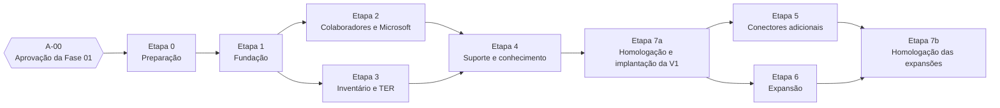

# Plano de Implementação — Portal TI Vallur

**Fase:** 01 — Arquitetura e planejamento
**Situação:** proposta para revisão. **A execução deste plano não foi iniciada** e depende de aprovação explícita (ponto A-00).
**Revisão 01.1 (14/10/2026):** incorpora as decisões aprovadas Q-04, Q-07, Q-25, Q-27 e Q-30; Q-09 permanece aberta. Consolidação em `REVISAO_FINAL_FASE_01.md`.
**Revisão 01.3 (14/10/2026):** pré-requisitos da Etapa 0 ajustados à inspeção do tenant (Q-09 pendente, sem bloquear a fundação), trava de ambiente (DA-23), Q-34 e preparação do primeiro commit.
**Revisão 01.4 (15/10/2026):** incorpora as decisões da TI DT-01 a DT-07 (`ARQUITETURA_TECNICA.md` §16.2). As mudanças: autenticação própria do portal na Etapa 1, sem dependência do tenant (DT-01; Q-33 encerrada); senha inicial definida no cadastro (DT-02, substitui Q-25); nenhum provisionamento com aprovação hierárquica, e por isso o módulo Aprovações sai da V1 (DT-03, substitui Q-04); equivalência e visões de Supervisor TI e Gestor ADM (DT-04 a DT-06); Estagiário TI com provisionamento só por concessão individual (DT-07). Também foram revistos os critérios das Etapas 1 e 2 e os marcos S-01 e S-03. Entram as novas questões Q-36 a Q-42 e as novas decisões DA-24 a DA-27. Depois da revisão especializada (senior-architect, senior-security, senior-backend, senior-frontend, senior-qa), foram acrescentados à Etapa 1 a prova de conceito da biblioteca (R-27), a ativação de perfil de TI (Q-43), o procedimento de emergência e os critérios 16 a 24; à Etapa 2, os critérios 10a a 10d, o Graph falso de contrato e o marco S-02 no escopo de provisionamento.
**Base:** etapas do PM §20 ("Plano de entrega por etapas"), detalhadas com dependências, critérios de aceite, testes e marcos de segurança/integração. Referências cruzadas: `ARQUITETURA_TECNICA.md` (`DA-nn`, `R-nn`, `Q-nn`), `MODELO_DE_DADOS.md`, `INTEGRACOES.md`, `PERMISSOES_RBAC.md`, `DESIGN_SYSTEM.md`.

---

## 1. Escopo da V1

Conforme PM §2 [REQ-PM]:

| Na V1 | Fora da V1 (modelado desde já quando indicado) |
|---|---|
| Dashboard (visões operacional e gerencial — DT-06); Empresas; Colaboradores (com histórico e conta de acesso ao portal); Microsoft 365 (provisionamento, licença, e-mail, grupos, caixas postais); Inventário (ativos, acessórios, manutenção, fotografias); Alocações; TER (emissão, evidências, PDF assinado); Chamados; Central de Tutoriais; Portal do colaborador; Auditoria. **Aprovações: removido da V1 na Revisão 01.4** (DT-03; PM §2 v1.2) | TDV (modelo de dados sim, telas não); Microsoft Teams (regras por empresa/cargo); Desligamentos; Custos e licenças/rateio; conectores automáticos de Diário de Obra, D4Sign e Konviva (até validação — na V1 operam por tarefa manual) |

Nota do PM: V1 é escopo planejado; entidades e integrações são projetadas para expansão sem antecipar todas as telas.

---

## 2. Visão das etapas

- As etapas 1 a 7 correspondem às etapas 1 a 7 do PM §20. A **Etapa 0** (preparação) e a divisão da Etapa 7 em **7a** (V1) e **7b** (expansões) são [PROPOSTA], para permitir que a V1 entre em uso sem esperar conectores que dependem de fornecedores.
- Etapas 2 e 3 dependem apenas da Etapa 1 e podem ser desenvolvidas em paralelo, se houver capacidade.
- Cada etapa só é considerada concluída com critérios de aceite, testes, revisão de permissões e documentação mínima (PM §20).

---

## 3. Etapa 0 — Preparação (sem código de aplicação)

| Item | Conteúdo |
|---|---|
| Objetivo | Resolver as dependências que bloqueiam o início seguro do desenvolvimento |
| Entregas | Respostas às questões da Etapa 1 (Q-15, Q-18, Q-31 d/f, Q-36, Q-38, Q-39 e Q-43 bloqueiam apenas o fechamento da Etapa 1, não o início); ambiente de desenvolvimento sem dados reais; repositório inicial sem arquivos com dados pessoais ou credenciais; versões sanitizadas dos arquivos de referência, quando a TI as produzir |
| Pré-requisitos técnicos | Arquivos com dados pessoais ou credenciais fora do versionamento (R-21, R-23), com verificação de segredos antes do **primeiro commit** (`REVISAO_FINAL_FASE_01.md` §7.2), nesta ordem: retirar os originais do diretório ou mantê-los ignorados → varredura de segredos (ex.: gitleaks) → primeiro commit só com caminhos explícitos (nunca `git add -A`) → repositório GitHub privado `vallur-ti-portal` com dono organizacional → proteção da branch `main` e push. Confirmar se o plano GitHub contratado oferece regras de proteção de branch e proteção de push de segredos em repositório privado; se não oferecer, manter a varredura no *pre-commit* e no CI; Node.js 24 LTS (DA-20) e Docker nas máquinas de desenvolvimento; confirmação da versão PostgreSQL do projeto Supabase (DA-21); projeto Supabase de homologação (o desenvolvimento usa PostgreSQL em Docker, `ARQUITETURA_TECNICA.md` §13.1); identificador do tenant Virta (`tid`) registrado para a trava de ambiente (DA-23). **Nenhuma app registration com permissão de aplicação é criada no tenant de produção para desenvolvimento ou homologação**: as de automação (DA-09) dependem de um ambiente de testes definido (Q-09). *Removido na Revisão 01.4: "app registration de login de desenvolvimento, somente se a TI autorizar o registro no tenant de produção (Q-33)". O portal não tem login Microsoft (DT-01) e Q-33 foi encerrada* |
| Questões a responder | Resolvidas em 14/10/2026: Q-04 (substituída por DT-03), Q-07 (reafirmada por DT-04 a DT-06), Q-25 (substituída por DT-02), Q-27, Q-30 (mantida, restrições revistas). Decisões da TI de 15/10/2026: DT-01 a DT-07. Encerrada: Q-33 (não se aplica, DT-01). Abertas por etapa — Etapa 1: Q-15 (parâmetro), Q-18, Q-31 (d, f), Q-36, Q-38, Q-39, Q-43 (ativação de perfil de TI). Etapa 2: Q-02, Q-03, Q-05, Q-09 (somente I-02/I-03), Q-10, Q-23, Q-28, Q-31 (e), Q-34, Q-40, Q-41. Etapa 3: Q-01 (aprovação da análise), Q-12, Q-13, Q-19, Q-26, Q-32. Etapa 4: Q-11, Q-14, Q-42. Etapa 5: Q-24. Etapa 7a: Q-08, Q-16, Q-17, Q-29, Q-35, Q-37. Não bloqueantes: Q-06, Q-20, Q-21, Q-22, Q-31 (b). Q-31 (a) ficou obsoleta e Q-31 (c) foi resolvida por DT-07. Classificação A/B/C em `REVISAO_FINAL_FASE_01.md` §8–9. **Q-09 não bloqueia a Etapa 0 nem a Etapa 1** |
| Decisões aprovadas na A-00 (pré-condição da Etapa 0) | DA-01, DA-03 a DA-13, DA-15 a DA-23 (`ARQUITETURA_TECNICA.md` §15) |
| Decisões a aprovar por escrito antes da Etapa 1 (Revisão 01.4) | Revistas depois da A-00: DA-02 (substituída por DT-01), DA-03, DA-04, DA-08, DA-09 e DA-22. Novas: DA-24 (biblioteca de autenticação), DA-25 (hash e política de senha), DA-26 (MFA para perfis de TI) e DA-27 (força bruta e enumeração). Sem essa aprovação, a fundação implementaria uma autenticação ainda não aprovada [PENDENTE-TI] |
| Registros da Etapa 0 | Os itens de `CHECKLIST_ETAPA_0.md` ligados à app de login e a Q-33 deixam de se aplicar (DT-01). O `RELATORIO_ETAPA_0.md` citado no checklist não existe no repositório |
| Critério de aceite | Ajustes posteriores à A-00 registrados por escrito; repositório inicial verificado sem dados sensíveis (`REVISAO_FINAL_FASE_01.md` §7.2); ambientes de desenvolvimento acessíveis sem uso de dados reais |
| Ponto de aprovação | **A-01**: autorização para iniciar a Etapa 1 |

---

## 4. Etapa 1 — Fundação

| Item | Conteúdo |
|---|---|
| Escopo | Projeto Next.js 16 + TypeScript estrito; Tailwind + shadcn/ui; estrutura de diretórios (`ARQUITETURA_TECNICA.md` §8); Dockerfile com alvos `web` e `worker`; trava de ambiente (DA-23); núcleo da fila de `tarefa_assincrona`, worker mínimo e agendador de tarefas recorrentes, necessários à selagem da auditoria; selagem da auditoria; GitHub Actions (lint, tipos, testes, build); Prisma 7 com esquema `portal` e papéis de banco; tabelas base (`empresa`, `cargo`, `departamento`, `colaborador`, `vinculo_colaborador`, `atribuicao_perfil`, `permissao_individual`, `conta_acesso`, `credencial_senha`, `sessao`, `fator_mfa`, `codigo_recuperacao`, `limite_tentativa`, `token_verificacao` — esta sem uso até Q-37 —, `evento_auditoria`, `arquivo`); **autenticação própria do portal** (DT-01; DA-24 a DA-27): login por e-mail corporativo e senha, hash Argon2id, sessões opacas no PostgreSQL com revogação imediata, limitador de tentativas com armazenamento no banco e proteção contra enumeração, reautenticação, MFA TOTP obrigatório para perfis de TI, "Minha conta" (troca da própria senha, MFA, sessões), redefinição de senha, bloqueio e desbloqueio de conta e encerramento de sessões pela TI, recuperação pelo próprio colaborador desenhada e **desligada** até Q-37; catálogo de permissões (com atributos `concedivel_individualmente` e restrições obrigatórias, inclusive as dependentes do alvo), avaliação de permissão efetiva (`PERMISSOES_RBAC.md` §3.10) e funções `exigirPermissao`; telas de perfis e permissões individuais; módulo de auditoria imutável; adaptador de storage; tokens do design system, layouts da área de TI e do portal, telas de autenticação, página de referência de componentes; script de bootstrap do primeiro perfil administrativo (cria colaborador e conta de acesso, lê a senha no terminal sem eco nem registro e exige configurar o MFA no primeiro acesso); **procedimento de emergência para perda de todos os administradores e desbloqueio de emergência** (antes previstos para a Etapa 7a; antecipados na revisão especializada da Revisão 01.4); **ativação de perfil de TI** com senha definida pelo titular e MFA configurado com código de ativação de uso único (Q-43, proposta técnica); **prova de conceito da biblioteca de autenticação no início da etapa** (Better Auth 1.7.x + Next.js 16 + Prisma 7 + PostgreSQL 17) com critério de saída: somente as rotas de entrar, sair e verificar o segundo fator expostas pela biblioteca; política de sessão própria (inatividade por área e expiração absoluta não estendida pela renovação); revogação imediata por exclusão da linha de sessão; MFA conforme DA-26; gravação de conta e credencial dentro da transação do portal. Se a prova de conceito falhar, adota-se a alternativa de R-27 (sessão própria sobre as mesmas tabelas, usando da biblioteca só hash e TOTP) [PROPOSTA]. *Até a Revisão 01.3: "login Entra ID com sessão opaca" (substituído por DT-01)* |
| Dependências | A-01; aprovação escrita das decisões revistas e novas (DA-02, DA-03, DA-04, DA-08, DA-09, DA-22, DA-24 a DA-27 — §3); PostgreSQL 17 em Docker para desenvolvimento e projeto Supabase de homologação (critério 5, S-04). **O login deixa de depender do tenant**: com Q-33 encerrada (DT-01), o critério 1 e a A-02 não ficam mais bloqueados por autorização no tenant de produção. Verificar no início da etapa a compatibilidade da biblioteca de autenticação com Next.js 16 e Prisma 7 e como ela armazena tokens de sessão, segredo TOTP e códigos de recuperação (DA-24, DA-26) |
| Fora do escopo | Qualquer integração que escreva no tenant; qualquer leitura de dados reais do tenant a partir de ambiente não produtivo (Q-34) |

**Critérios de aceite**

1. Colaborador `ATIVO` com conta de acesso `ATIVA` entra com e-mail corporativo e senha na tela própria do portal (DT-01) e é direcionado conforme o perfil e a visão (operacional ou gerencial, DT-06). E-mail inexistente, senha errada, conta `BLOQUEADA`/`DESATIVADA` ou colaborador não `ATIVO` recebem a mesma mensagem ("E-mail ou senha inválidos"), em tempo de resposta equivalente; o evento `auth.entrar` (falha) é gravado com o motivo interno. Nenhum caminho de login Microsoft existe no código.
2. Sessão expira por inatividade (30 min na área TI, 8 h no portal) e de forma absoluta (12 h), ou nos valores definidos em Q-15. A saída invalida a sessão no banco, e o cache de sessão em cookie fica desativado. Operação de alto risco com reautenticação há mais de 15 min abre o diálogo de reautenticação, que pede a senha e, para perfis de TI, o código TOTP, e atualiza `sessao.autenticado_em`. O mecanismo de "sessão nova" da biblioteca (`freshAge`) não substitui essa verificação.
3. Atribuir e revogar perfis funciona com as regras de `PERMISSOES_RBAC.md` §8: Supervisor TI concede e revoga `GESTOR_ADM`, Gestor ADM concede e revoga `SUPERVISOR_TI` (DT-04, DT-05). O último **administrador ativo** (perfil administrativo, conta `ATIVA` e colaborador `ATIVO`) não pode ser revogado, bloqueado nem desativado. Cada mudança registra ator, alvo, estado anterior e resultante.
4. Tentativa de `UPDATE`/`DELETE` em `evento_auditoria` com o papel da aplicação falha no banco; verificação da cadeia de hash passa.
5. O esquema `portal` não é acessível pela Data API do Supabase.
6. Layouts aprovados nos viewports 375, 390, 768 e 1440 px segundo os critérios de `DESIGN_SYSTEM.md` §14.1 e as verificações automatizadas do §14.2, incluindo as telas de autenticação, com aceite registrado pelo Supervisor TI ou pelo Gestor ADM.
7. Pipeline de CI verde; `prisma migrate diff` vazio.
8. `entra_object_id` não pode ser alterado por `colaborador.editar` (teste de integração); ele não participa do login (DT-01). O e-mail de login de quem tem perfil de TI só é alterado com `colaborador.editar_equipe_ti`. A alteração atualiza a mesma conta de acesso, sem criar nova identidade, e encerra as demais sessões.
9. Permissões individuais (Q-30, DT-07): concessão a Estagiário de permissão marcada **I** passa a valer na requisição seguinte, com origem `INDIVIDUAL` na auditoria. São recusadas a concessão de permissão com restrição obrigatória (inclusive `seguranca.configurar` e `conta_acesso.redefinir_mfa`) e qualquer concessão de um Estagiário a si mesmo. Um registro indevido inserido diretamente no banco é ignorado pela avaliação.
10. Trava de ambiente (DA-23): sem `AMBIENTE` válido, web e worker não iniciam; fora de produção, conector Microsoft em `ATIVO` com `tid` fora de `TENANTS_ESCRITA_AUTORIZADOS` ou igual a `TENANT_PRODUCAO_ID` impede a inicialização; `SIMULACAO` em produção impede a inicialização; a faixa de ambiente aparece fora de produção (testes automatizados).
11. Senha do portal (DA-25): só o hash Argon2id, com parâmetros no formato PHC, é gravado em `credencial_senha`. A busca automatizada pela senha de teste em banco, logs, auditoria, respostas e erros não a encontra. A política de senha (Q-39 ou, até a decisão, a proposta de DA-25) é aplicada no cadastro, na redefinição e na troca.
12. MFA (DA-26): quem tem perfil de TI ativo sem MFA confirmado só acessa a configuração do próprio MFA; `ti.acessar` exige sessão com segundo fator verificado; "lembrar dispositivo" fica desativado para perfis de TI; códigos de recuperação são de uso único. Redefinir o MFA de outra pessoa exige perfil administrativo e é auditado.
13. Força bruta e enumeração (DA-27, revista): o limite por **(e-mail, IP)** gera bloqueio temporário com a mesma mensagem para conta existente ou não ("Muitas tentativas. Tente novamente mais tarde."); para o e-mail sozinho há **atraso progressivo**, não bloqueio renovável. **DoS:** um e-mail de administrador sob ataque a partir de um IP continua entrando a partir de outro IP. O limite por IP é aplicado **antes** do cálculo do hash; o IP vem só do cabeçalho do proxy confiável. Não há bloqueio permanente automático. O limitador funciona com duas instâncias do processo web (armazenamento no banco). Os limites são parâmetros de `seguranca.configurar`, com valores iniciais propostos. **Métrica de tempo equivalente** [PROPOSTA]: diferença de mediana < 50 ms entre conta existente e inexistente em 200 tentativas. Volume atípico gera **evento de auditoria agregado e indicador no painel** (verificáveis sem canal externo; o canal de alerta depende de Q-35/Q-37); falhas de login são agregadas, não um evento selado por tentativa.
14. Redefinição, bloqueio e revogação: a redefinição de senha pela TI revoga todas as sessões do titular, e a redefinição de MFA também. Bloqueio e desativação da conta revogam todas as sessões na mesma transação. A troca da própria senha encerra as demais sessões. Estagiário não redefine senha, não bloqueia, **não desbloqueia**, não encerra sessões, não redefine o MFA e **não cria conta de acesso** de quem tem perfil de TI (restrição dependente do alvo), nem age sobre a própria conta pelo caminho da TI. Todos os casos ficam auditados.
15. Recuperação pelo próprio colaborador: a rota existe só desenhada e fica **desligada** até Q-37; com ela desligada, nenhum endpoint de recuperação responde.
16. Superfície da biblioteca (DA-24, revista): um teste lista as rotas expostas em `/api/auth/*` e falha se houver outra além de entrar, sair e verificar o segundo fator; a rota de cadastro público responde 404; somente o plugin de dois fatores está habilitado; a revogação de sessão (exclusão da linha) tem efeito imediato também nas rotas da biblioteca; a expiração absoluta não é estendida pela renovação automática; campos da conta não são graváveis pelo cliente.
17. MFA (DA-26, revista): "lembrar dispositivo" enviado pelo cliente é ignorado; código TOTP já usado na janela é recusado; membro da TI não desativa o próprio MFA; reautenticação, troca de senha e verificação de TOTP também passam pelo limitador; segredo TOTP gravado cifrado e códigos de recuperação com hash (inspeção do banco).
18. Ativação de perfil de TI (Q-43, proposta): ao atribuir perfil de TI, as sessões do alvo são revogadas e `ti.acessar` só passa a valer depois que o titular define a própria senha e configura o MFA com o código de ativação de uso único gerado pelo administrador; quem conhece a senha inicial (ex.: o Estagiário que cadastrou) não consegue configurar o MFA sem o código. O mesmo vale depois de redefinir o MFA de membro da TI.
19. Restrições dependentes do alvo: chamada de permissão da lista dependente do alvo **sem** `alvo` informado é negada (teste percorre o catálogo); a verificação usa bloqueio de linha do colaborador-alvo (`SELECT … FOR UPDATE`) e não falha em corrida com `perfil.atribuir`.
20. Último administrador sob concorrência: dois administradores revogando ou bloqueando um ao outro ao mesmo tempo não zeram a administração (bloqueio consultivo); o afastamento do último administrador é negado; administrador com conta `BLOQUEADA` ou colaborador `AFASTADO` não conta como administrador ativo.
21. Bootstrap: o script recusa executar se já houver administrador ativo, lê a senha sem eco e sem registro e marca o MFA como obrigatório no primeiro acesso. Procedimento de emergência e desbloqueio de emergência testados em ambiente de desenvolvimento.
22. Banco e cookies: o papel `portal_leitura` tem acesso negado a `credencial_senha`, `fator_mfa`, `codigo_recuperacao`, `token_verificacao`, `sessao` e `limite_tentativa`; o `Set-Cookie` da sessão tem prefixo `__Host-`, `HttpOnly`, `Secure`, `SameSite=Lax`, `Path=/` e não tem `Domain`; requisição de mutação com `Origin` não confiável é recusada.
23. Senhas independentes e ausência de login Microsoft (DT-01, DT-02): troca ou redefinição da senha do portal não faz nenhuma chamada ao Graph (verificado com conector de teste); o CI falha se aparecer `acquireTokenByUsernamePassword`, escopos `openid`/`offline_access` ou `passwordProfile` fora de `m365.criar_conta`.
24. Recursos do Argon2id: semáforo de concorrência limita os cálculos de hash simultâneos (o hash fictício também conta); uma rajada de tentativas não esgota a memória do contêiner web.

**Testes esperados**

| Tipo | Cobertura mínima |
|---|---|
| Unitário (Vitest) | Política de senha; hash e verificação Argon2id (inclusive re-hash ao mudar parâmetros); regras de perfil e restrições dependentes do alvo; sanitização de logs/erros (campos de senha, hash, segredo TOTP e token redigidos); utilitários de CPF/CNPJ. *Removido: validação de token OIDC (iss, aud, tid, nonce, exp), que não se aplica mais (DT-01)* |
| Integração (Vitest + PostgreSQL em Docker) | Sessão (criação, expiração por área, absoluta não estendida, revogação por exclusão da linha); reautenticação; limitador por (e-mail, IP), atraso progressivo e bloqueio temporário; MFA (TOTP repetido, lembrar dispositivo ignorado, desativação negada); ativação de perfil de TI (Q-43); redefinição, bloqueio e desbloqueio pela TI; restrições dependentes do alvo (sem `alvo` nega; corrida com `perfil.atribuir`); último administrador sob concorrência e afastamento; matriz de permissões gerada do catálogo; lista de rotas expostas da biblioteca; imutabilidade da auditoria; índices únicos (`conta_acesso.colaborador_id`, `email_login`); papel `portal_leitura` negado nas tabelas de credencial e sessão; troca de senha sem chamada ao Graph |
| E2E (Playwright) | Login real pela tela do portal com contas fictícias criadas pelo *seed*; segundo fator com TOTP de teste; ativação de perfil de TI com código de ativação; redirecionamento por perfil e visão; páginas de acesso negado; usuário A e depois B no mesmo navegador sem vazamento de dados; aviso de expiração de sessão |
| Desempenho e abuso | Rajada de tentativas de login contra e-mail de administrador (DoS) e contra o semáforo do Argon2id; métrica de tempo equivalente do critério 13 |
| CI (estático) | Ausência de `acquireTokenByUsernamePassword`, escopos `openid`/`offline_access` e `passwordProfile` fora de `m365.criar_conta` (critério 23) |
| Visual | Capturas dos layouts nos quatro viewports |

**Marcos de segurança**: S-01, S-02, S-04, S-05 (§11).
**Ponto de aprovação**: **A-02** (revisão funcional, de segurança e visual da fundação).

---

## 5. Etapa 2 — Colaboradores e Microsoft 365

| Item | Conteúdo |
|---|---|
| Escopo | Empresas e catálogos; cadastro de colaboradores (CPF cifrado, revelação auditada) com criação da conta de acesso ao portal e senha inicial definida pela TI (DT-01, DT-02); vínculos e histórico; sugestão de e-mail com verificação de duplicidade (portal + Graph somente leitura; fora de produção a consulta ao Graph é simulada — Q-34); solicitações com rascunho, versão confirmada e execução, **sem aprovação** (DT-03; até a Revisão 01.3: "solicitações com versões e aprovações (autoaprovação registrada, Q-04)"); confirmação reforçada para operações destrutivas; fila em PostgreSQL e worker; conector Graph (criar conta síncrona na confirmação, licenças, grupos de segurança/M365, aguardar caixa postal); conector Exchange em **modo manual**; ponte PowerShell desenvolvida e testada em homologação; tarefas manuais; painel de execução; espelho de SKUs; carga inicial de usuários existentes, sem criar contas de acesso (Q-40) — ensaio com dados fictícios ou anonimizados; leitura real do tenant somente em produção após A-06, salvo decisão diferente em Q-34 |
| Dependências | A-02; Q-02, Q-03, Q-10, Q-23, Q-40 e Q-41 respondidas; desenvolvimento e testes automatizados avançam em `SIMULACAO` sem depender de Q-09; **I-02 e I-03 dependem de Q-09** e de app registrations com consentimento administrativo **no ambiente de testes definido em Q-09** (nunca no tenant de produção) |
| Restrição | Conectores em `SIMULACAO` em desenvolvimento; `ATIVO` apenas contra tenant de testes ou ambiente não produtivo explicitamente autorizado (Q-09). **Nenhuma escrita no tenant de produção nesta etapa; o tenant de produção nunca é alternativa implícita** (`INTEGRACOES.md` §13) |

**Critérios de aceite**

1. Fluxo de cadastro e admissão completo (PM §3 v1.2; `ARQUITETURA_TECNICA.md` §11.5) em homologação com conectores em `SIMULACAO` (a escrita real só é verificada em I-02/I-03). A solicitação passa por `RASCUNHO → EM_EXECUCAO → CONCLUIDA` ou `CONCLUIDA_COM_PENDENCIAS`, sem estado de aprovação (DT-03). Ao final, o colaborador fica `ATIVO` com conta de acesso `ATIVA` e o fluxo segue para equipamentos e TER.
2. Permissão de provisionamento (DT-07): Estagiário **sem** a concessão individual de `provisionamento.executar` cadastra o colaborador e a conta de acesso, mas não confirma ações externas, nem pela interface nem por chamada direta à Server Action; a solicitação fica em `RASCUNHO` (sem senha) para quem tem a permissão. Estagiário **com** a concessão executa e a auditoria registra a origem `INDIVIDUAL:<id>`. Supervisor TI e Gestor ADM executam pelo perfil. *Até a Revisão 01.3: "Estagiário não consegue aprovar"*.
3. Correção depois da confirmação: alterar parâmetros de uma solicitação `EM_EXECUCAO` (sem ação em execução) ou `CONCLUIDA_COM_PENDENCIAS` cria a versão N+1, que precisa ser revisada e confirmada de novo. As ações não concluídas da versão N passam a `CANCELADO` (`SUBSTITUIDA_POR_NOVA_VERSAO`), as concluídas são preservadas e nenhuma execução nova referencia a versão N. *Até a Revisão 01.3, a nova versão voltava para aprovação (Q-04)*.
4. Falha simulada em uma ação (ex.: licença) não afeta as demais; reprocessamento não duplica a conta.
5. Timeout após criação de conta leva a reconciliação **sem senha** e adoção do `oid` correto, sem segunda conta; a tela informa que a senha original continua valendo e não pede nova senha. Verificado com um **Graph falso de contrato** (servidor de teste que reproduz as respostas documentadas e mantém estado), e não com o modo `SIMULACAO`, que nunca grava `oid`.
6. UPN existente de outra pessoa gera `CONFLITO`, nunca adoção.
7. Senha inicial (DT-02): o rascunho salvo no servidor nunca contém senha (inspeção das requisições e do banco). Na confirmação, a mesma requisição grava só o hash Argon2id da senha do portal e chama o Graph com a senha do Microsoft 365, com a mesma senha ou senha separada. Toda tentativa posterior ao fim da requisição original (falha transitória, resultado desconhecido, interrupção do processo web, reprocessamento) começa pela reconciliação **sem senha** e só exige nova digitação quando a conta não existe (`NAO_APLICADO`). A busca automatizada não encontra a senha de teste em nenhuma tabela, payload de trabalho, log, auditoria, resposta, erro, armazenamento do navegador ou *dump* de teste; a única forma persistida é o hash do portal. O fluxo do Microsoft 365 não persiste a senha em forma alguma; quando a TI usa a mesma senha nos dois sistemas, o hash do portal é o hash dessa mesma senha (R-24). *Até a Revisão 01.3 valia o fluxo de Q-25 (senha descartada na preparação e redigitada após a aprovação)*.
7a. Falha parcial (DT-03): se a criação da conta Microsoft falha depois da criação da conta do portal, a conta do portal e o colaborador permanecem, o estado parcial aparece no painel de execução e nada é excluído automaticamente. Duplo envio da confirmação (mesma `chave_confirmacao`) não cria segundo colaborador, segunda conta de acesso nem segunda execução. *Até a Revisão 01.3, este critério tratava da autoaprovação (Q-04): **removido na Revisão 01.4***.
7b. Autorização insuficiente na confirmação ou numa nova tentativa (sessão expirada, reautenticação vencida, permissão revogada, solicitação cancelada ou substituída) impede a chamada ao Graph e descarta a senha.
7c. Confirmação reforçada: operações destrutivas (remover licença, remover de grupo, revogar acesso a caixa compartilhada, bloquear em sistema externo) só são executadas com a lista do que será removido, a digitação da contagem ou do identificador e reautenticação recente.
8. Ações sem automação geram tarefa manual; conclusão manual registra ID externo e auditoria.
9. Histórico de vínculos preservado após transferência entre empresas.
10. Duas confirmações simultâneas do mesmo rascunho: exatamente uma gera versão e execuções. Duplo clique e duas abas com a mesma `chave_confirmacao` resultam em **exatamente um `POST /users`**, e o reenvio devolve o resultado já gravado. *Até a Revisão 01.3: "Duas aprovações simultâneas da mesma versão"*.
10a. Processo web encerrado entre o commit da transação 1 e a chamada ao Graph (e durante a chamada): a varredura reconcilia sem senha; se a conta existir, conclui; se não, a ação fica aguardando a senha. Cancelamento da solicitação durante a chamada: o resultado é gravado, as dependentes não são liberadas e a solicitação continua `CANCELADA`.
10b. Nova versão × worker: confirmar a versão N+1 enquanto o worker reivindica ações da versão N não executa ação da versão N depois do cancelamento; se houver ação `EM_EXECUCAO`, a nova versão é recusada.
10c. Caminho Estagiário → executor: no cadastro por quem não tem `provisionamento.executar`, a opção "mesma senha" não aparece e uma senha do Microsoft 365 enviada ao servidor é rejeitada e não é registrada; o executor depois informa a senha do Microsoft 365, confirma só com `provisionamento.executar` e não altera a conta do portal nem a credencial.
10d. Autoprovisionamento (DT-07): Estagiário com a concessão de `provisionamento.executar` não executa provisionamento para si mesmo nem para quem tem perfil de TI; Estagiário não inclui grupo no catálogo de grupos permitidos (`catalogo.gerenciar_grupos`); `execucao.reprocessar` sem `provisionamento.executar` não repete escrita externa.
11. Worker interrompido durante uma execução: outra instância retoma após o arrendamento vencer, sem efeito duplicado.
12. Alteração direta de `acao_solicitada.parametros` após a confirmação é recusada pelo banco e detectada pelo worker.
13. Colaborador sem e-mail corporativo não recebe conta de acesso (comportamento até Q-41); a carga inicial não cria contas de acesso nem senhas (Q-40).

**Testes esperados**

| Tipo | Cobertura mínima |
|---|---|
| Unitário | Máquinas de estado de solicitação (sem estados de aprovação) e execução; cálculo de dependências; política de retentativa; geração de e-mail, chave de confirmação e chave de idempotência |
| Integração | Fila com `SKIP LOCKED` e concorrência de dois workers; outbox transacional na confirmação; transação de cadastro (colaborador, conta de acesso, versão, ações) e gravação do resultado em transação separada com guarda `reservado_por`; reconciliação por `verificarEstado()` sem senha; contratos do conector Graph contra respostas gravadas da documentação e **Graph falso de contrato** com estado (sem tenant); duplo envio, interrupção entre commit e chamada, cancelamento durante a chamada, nova versão × worker (critérios 10 a 10d) |
| E2E | Cadastro e admissão ponta a ponta em modo `SIMULACAO`, com Estagiário sem e com concessão de `provisionamento.executar`; painel de execução atualizando; confirmação reforçada de operação destrutiva |
| Integração real (homologação) | Marco I-02 e I-03 |

**Marcos de segurança**: S-02 (escopo provisionamento: `provisionamento.executar`, `execucao.reprocessar`, restrições dependentes do alvo do autoprovisionamento), S-03, S-06 (§11). **Marcos de integração**: I-01, I-02, I-03.
**Ponto de aprovação**: **A-03**.

---

## 6. Etapa 3 — Inventário e TER

| Item | Conteúdo |
|---|---|
| Escopo | Modelos de ativo, ativos e itens de estoque; transições de situação com livro-razão; manutenções; evidências fotográficas (upload, validação, remoção de geolocalização); alocações com checklist; **TER** a partir do modelo `TER_VALLUR_v22.html` (template de servidor, instantâneo, PDF, hash); anexação do PDF assinado; disponibilização ao colaborador; carga do `Inventário de TI.xlsx` com relatório de divergências; modelo de dados de devolução/TDV (sem telas) |
| Dependências | A-02; **Q-01 — arquivos disponíveis em `TER - TDV/`; falta aprovar a análise e obter versões sem dados pessoais — bloqueante para o TER**; Q-12, Q-13, Q-19, Q-26, Q-32 |
| Atividade obrigatória antes do TER | Aprovação pela TI da análise estrutural preliminar (`MODELO_DE_DADOS.md` §9.4), incluindo as divergências de condição, categorias e acessórios (Q-19) e a regra "Não testado bloqueia a emissão". **Nenhuma alteração de texto jurídico sem autorização** |

**Critérios de aceite**

1. Um ativo serializado não pode ser alocado a duas pessoas (verificado no banco e na interface).
1a. Alocação na entrega física (Q-27): ao confirmar a entrega, o ativo fica `ALOCADO` e a alocação `ATIVA` na mesma transação, com data e responsável da entrega; o TER pendente de assinatura aparece como pendência; cancelar ou reemitir o TER e anexar o PDF assinado não alteram o estado da alocação nem do ativo; uma alocação entregue não pode ser "cancelada" (só devolvida ou transferida).
2. Toda mudança de situação gera exatamente uma movimentação; transições inválidas são rejeitadas.
3. Fotos exigidas por classe (notebook: etiqueta traseira, tela, teclado, tampa, parte inferior, laterais, carregador — PM §6) são cobradas no checklist, ficam ligadas ao ativo e ao evento, e não são substituídas em eventos passados.
4. O PDF do TER reproduz o modelo aprovado: o texto extraído do PDF é idêntico ao texto jurídico do modelo (comparação automatizada, exceto campos preenchidos); todos os campos obrigatórios identificados na análise estão presentes; número de páginas e quebras conferidos; aceite registrado pela TI. O hash é gravado e o termo emitido não é editável.
5. PDF assinado anexado muda o termo para `ASSINADO` e fica disponível ao colaborador quando marcado.
6. Carga do inventário é idempotente e produz relatório de divergências antes de gravar.
7. A renderização não faz requisições de rede (verificado em teste com HTML contendo URL externa).

**Testes esperados**: unitários da matriz de transições; integração das restrições do banco e do livro-razão; teste de validação de upload (tipo real, tamanho, EXIF); E2E de alocação até TER emitido nos quatro viewports, incluindo captura de fotos em 375/390 px.
**Marcos de segurança**: S-06 (arquivos), revisão de acesso às evidências.
**Ponto de aprovação**: **A-04** (inclui aprovação da TI sobre a fidelidade do TER).

---

## 7. Etapa 4 — Suporte e conhecimento

| Item | Conteúdo |
|---|---|
| Escopo | Chamados (abertura, anexos, comentários públicos e internos, atribuição, estados, estrutura de SLA); portal do colaborador (meus equipamentos, chamados, documentos, tutoriais, sistemas liberados); Central de Tutoriais (catálogo, categorias, públicos, destaques, busca, recomendação por cargo/acesso, artigos sugeridos ao abrir chamado); dashboard da TI em duas visões (DT-06): **painel operacional** (cadastros em rascunho, execuções com falha ou aguardando senha, tarefas manuais, termos sem assinatura, chamados sem responsável) e **painel gerencial** do Gestor ADM (indicadores de ativos e chamados, provisionamentos por período e executor, falhas de integração, eventos críticos de auditoria, com atalhos para auditoria e relatórios — Q-42). *Até a Revisão 01.3, as pendências incluíam "aprovações"* |
| Dependências | A-03 e A-04; Q-11 (tutoriais), Q-14 (SLA — sem ela, SLA fica apenas estruturado, sem prazos), Q-42 (sem ela, a visão gerencial usa os indicadores já previstos no PM §2 e as exportações existentes) |

**Critérios de aceite**

1. Colaborador vê **apenas** seus equipamentos, chamados, documentos disponibilizados e tutoriais do seu público; IDs de terceiros retornam 404.
2. Comentários internos nunca chegam ao colaborador (verificado por resposta de API, não só pela tela).
3. Tutoriais respeitam a alternativa aprovada em Q-11 (DA-12), sem permissão ampla de leitura de arquivos.
4. Com o conjunto de dados de teste de referência (*seed* com quantidades conhecidas), cada contador do dashboard, nas duas visões, mostra o valor esperado e leva à lista filtrada com o mesmo número de registros.
5. Anexo de comentário interno não é baixável pelo colaborador, mesmo com o ID do arquivo.
6. Trocar entre visão operacional e gerencial não altera nenhuma permissão: menus e botões são os mesmos calculados pelas permissões efetivas, e Supervisor TI e Gestor ADM têm acesso às mesmas funções nas duas visões (DT-05, DT-06).

**Testes esperados**: E2E com dois colaboradores e tentativas cruzadas de acesso; integração de visibilidade de comentários; visual nos quatro viewports para todas as telas do portal.
**Marcos de segurança**: S-02 (reexecução completa da matriz), S-07.
**Ponto de aprovação**: **A-05** (V1 funcionalmente completa).

---

## 8. Etapa 7a — Homologação e implantação da V1

| Item | Conteúdo |
|---|---|
| Escopo | Ambiente de produção (Supabase de produção ou VPS conforme Q-08); app registrations de produção com consentimento; backups e teste de restauração; carga de dados reais revisada; habilitação controlada dos conectores; treinamento da TI; monitoramento |
| Dependências | A-05; Q-08, Q-16, Q-17; Q-37 (canal de e-mail; sem ela, a recuperação de senha pelo próprio colaborador continua desligada e só a TI redefine senhas) |
| Sequência de habilitação | 1) Portal em produção com conectores `DESATIVADO` (tudo como tarefa manual) → 2) Graph em `ATIVO` após I-04 → 3) Exchange PowerShell em `ATIVO` após I-04 |

**Critérios de aceite**

1. Restauração completa (banco + storage) testada em ambiente isolado dentro do RTO definido.
2. Revisão de segurança antes da produção concluída sem achados críticos ou altos abertos (S-08).
3. Primeira admissão real acompanhada pela TI: conta, licença, grupos e caixas conferidos no Centro de Administração do Microsoft 365 batem exatamente com a versão confirmada, sem conta duplicada e sem a senha em nenhum registro (a única forma persistida é o hash da senha do portal).
4. Documentação mínima entregue e revisada pela TI: manual de operação (inicialização, parada, variáveis), procedimento de incidentes, procedimento manual de cada conector, rotação de certificados e chaves, restauração de backup.
5. Marco S-09 concluído.

**Ponto de aprovação**: **A-06** (autorização formal para operação em produção e para cada conector em `ATIVO`, conforme PM §22.10).

---

## 9. Etapa 5 — Conectores adicionais

| Conector | Pré-condição | Entrega | Marco |
|---|---|---|---|
| Unividade/UCS Online (Konviva) | Habilitação pela Senior; acesso ao `/api_doc/` do ambiente; token de homologação | Conector `konviva.integrar_usuario`/`desativar_usuario` ou exportação CSV | I-05 |
| D4Sign | Confirmação do fornecedor sobre provisionamento de usuários | Automação de bloqueio/desbloqueio (documentada); criação apenas se confirmada | I-06 |
| Diário de Obra | Confirmação de API oficial | Conector conforme documentação recebida; enquanto isso, tarefa manual | I-07 |

Critérios de aceite comuns: (1) documentação oficial do ambiente contratado arquivada; (2) testes de contrato e de reconciliação (`verificarEstado`) verdes; (3) execução em homologação de criação/atualização/desativação com evidências; (4) procedimento manual mantido como contingência; (5) aprovação A-07. Nenhum conector sai do modo manual sem esses itens.

---

## 10. Etapa 6 — Expansão

| Módulo | Dependências | Observações |
|---|---|---|
| TDV | Q-01, Q-12 | Modelo de dados já existe; telas, PDF e checklist do `TDV_VALLUR_v08.html` |
| Microsoft Teams | Catálogo de regras (PM §21); análise do `TeamsReport` | Prévia, confirmação explícita (reforçada para remoções) e salvaguardas de remoção, sem aprovação (DT-03; `INTEGRACOES.md` §4) |
| Desligamentos | TDV; conectores com desativação | Solicitação `DESLIGAMENTO` com ações de desativação, desativação da conta de acesso ao portal e revogação das sessões, recolhimento de ativos e preservação de histórico. Sem aprovação (DT-03); `desligamento.executar` com confirmação reforçada e reautenticação; quem não tem perfil administrativo não desliga pessoa com perfil de TI; regra do último administrador |
| Custos e licenças | `Distribuição de Custos.xlsx` | Usa `atribuicao_licenca` e custos de ativos já registrados |

Critérios de aceite por módulo: TDV com a mesma regra de fidelidade do TER (Etapa 3, critério 4); Teams com prévia que mostra entradas e saídas, recálculo antes da execução e confirmação reforçada das remoções (antes da Revisão 01.4: "regra de aprovação de remoções"); desligamento que revoga perfis e sessões, desativa a conta de acesso ao portal, encerra contas pelos conectores e lista ativos a recolher; custos que reproduzem os totais da planilha de referência para um mês de teste.

Ponto de aprovação por módulo: **A-08**.

### 10.1 Etapa 7b — Homologação das expansões

Mesmos critérios da Etapa 7a aplicados a cada módulo de expansão e conector adicional: testes em homologação, revisão de segurança dos novos fluxos (S-02 e S-08 repetidos no escopo alterado) e aprovação A-06 específica antes do uso em produção.

---

## 11. Marcos de validação de segurança

| ID | Marco | Etapa | Evidência esperada |
|---|---|---|---|
| S-01 | Revisão da **autenticação própria** (DT-01; DA-24 a DA-27): hash Argon2id e parâmetros; política de senha; limitador com armazenamento no banco e bloqueio temporário; ausência de enumeração (mensagem e tempo de resposta iguais); cookies `__Host-`, `HttpOnly`, `Secure`, `SameSite=Lax`; verificação de `Origin`; cache de sessão em cookie desativado; expiração por área e absoluta; revogação (saída, troca e redefinição de senha, bloqueio, desativação, revogação de perfil, redefinição de MFA); reautenticação; MFA dos perfis de TI e códigos de recuperação; recuperação desligada até Q-37; cadastro público desativado e somente o plugin de dois fatores habilitado; **lista das rotas expostas pela biblioteca** (só entrar, sair e verificar o segundo fator; demais operações por casos de uso do portal) e revogação efetiva nessas rotas; "lembrar dispositivo" ignorado, TOTP repetido recusado e desativação do próprio MFA negada a membro da TI; ativação de perfil de TI com código de ativação (Q-43); limite por (e-mail, IP), atraso progressivo, limite por IP antes do hash e semáforo do Argon2id; Supabase Auth desligado no projeto; versão da biblioteca fixada e avisos de segurança verificados; revisão de código confirmando que não há login Microsoft, ROPC, sincronização de senhas nem consulta de senhas no Entra. *Até a Revisão 01.3: validação de token OIDC com `auth_time`* | 1 | Testes automatizados verdes + registro de revisão de código com checklist assinado por revisor diferente do autor |
| S-02 | Matriz de permissões completa testada (cada permissão × perfil, incluindo chamadas diretas a Server Actions), equivalência Supervisor/Gestor, permissões individuais, restrições obrigatórias (inclusive as dependentes do alvo) e: Estagiário sem concessão não executa provisionamento; Estagiário não redefine senha nem MFA de membro da TI; Estagiário não altera `seguranca.configurar`; Estagiário não concede permissão a si mesmo; Estagiário não cria conta de acesso nem desbloqueia membro da TI; restrição dependente do alvo sem `alvo` nega | 1; repetido na 2 (escopo provisionamento) e na 4 | Relatório de testes gerado do catálogo |
| S-03 | Senha inicial e segredos nunca persistidos ou registrados (DT-02; até a Revisão 01.3, Q-25) | 2 | Teste automatizado que procura a senha de teste em banco, payloads de trabalho, logs, auditoria, respostas, erros e armazenamento do navegador. **Nenhum destino persistente além do hash Argon2id da senha do portal**; o fluxo do Microsoft 365 não persiste a senha em forma alguma (quando a TI usa a mesma senha, o hash do portal é o dessa mesma senha — R-24). Verificações: o rascunho nunca contém senha; o campo da senha de outra pessoa **não oferece salvar no gerenciador de senhas do Chrome nem do Edge** (teste Playwright nos dois navegadores; "sem oferta" é esforço máximo, porque navegadores podem ignorar `autocomplete`); o `POST /users` com senha é enviado uma única vez por tentativa (sem retentativa automática) e exatamente uma vez com duplo envio; a reconciliação após o fim da requisição original roda sem senha e só pede a senha de novo quando a conta não existe; senha do Microsoft 365 rejeitada no cadastro parcial; a reivindicação do worker nunca seleciona ações `SINCRONA_INTERATIVA` |
| S-04 | Não exposição do banco pela Data API do Supabase | 1 | Teste automatizado contra o endpoint da Data API |
| S-05 | Imutabilidade da auditoria e verificação da cadeia | 1 | Teste de banco |
| S-06 | Upload seguro (tipo real, tamanho, EXIF, URLs assinadas curtas, autorização no download) | 2–3 | Testes de integração |
| S-07 | Modelagem de ameaças STRIDE atualizada sobre o sistema implementado | 4 | Documento com cada ameaça classificada, mitigação implementada ou risco aceito com responsável |
| S-08 | Revisão de segurança pré-produção (OWASP Top 10, dependências, segredos no repositório, cabeçalhos HTTP) | 7a | Relatório sem achados críticos/altos abertos |
| S-09 | Teste de restauração de backup | 7a | Registro do teste |

---

## 12. Marcos de validação de integração

| ID | Marco | Condição para avançar |
|---|---|---|
| I-01 | Conectores em `SIMULACAO` com testes de contrato baseados na documentação oficial | Testes verdes |
| I-02 | Graph em homologação: criar conta, licença, grupo, reconciliação, conflito, limitação de taxa | **Bloqueado enquanto Q-09 estiver aberta.** Executado somente em tenant de testes ou ambiente não produtivo explicitamente autorizado; nunca no tenant de produção como alternativa implícita; evidências registradas |
| I-03 | Exchange Online PowerShell app-only em homologação: caixa compartilhada, FullAccess, SendAs, verificação de estado | Idem |
| I-04 | Habilitação em produção do Graph e do Exchange | Aprovação A-06; certificados de produção; monitoramento ativo |
| I-05 | Konviva | Documentação do ambiente contratado + testes em homologação |
| I-06 | D4Sign | Confirmação do fornecedor + testes |
| I-07 | Diário de Obra | Documentação oficial de API + testes |

---

## 13. Expectativas gerais de testes

| Camada | Ferramenta | Regra |
|---|---|---|
| Regras de domínio, máquinas de estado, permissões, sanitização | Vitest | Obrigatório para todo caso de uso novo |
| Banco (restrições, índices parciais, triggers, fila) | Vitest + PostgreSQL em Docker, mesma versão major do Supabase | Toda migração com SQL manual tem teste |
| Conectores | Vitest com respostas gravadas (*fixtures*) | Nunca chamam serviços reais em CI |
| Fluxos de interface | Playwright | Fluxos críticos de cada etapa nos viewports 375, 390, 768 e 1440 |
| Visual e acessibilidade | Playwright (capturas) + verificação automatizada de acessibilidade; MCP `chrome-devtools` para console, rede e desempenho | Antes de considerar cada tela concluída (`CLAUDE.md`, diretriz nº 11) |
| Dados de teste | Somente fictícios | PM §19 |

---

## 14. Riscos do plano

| Risco | Efeito no plano | Resposta |
|---|---|---|
| R-01 — regras dos modelos TER/TDV ainda não aprovadas | Etapa 3 bloqueada no TER | Iniciar inventário e alocações; TER só após aprovação da análise (Q-01) |
| R-02 — ambiente seguro de testes Microsoft 365 não definido (Q-09; só o tenant de produção Virta apareceu entre os diretórios acessíveis à conta consultada) | I-02/I-03 bloqueados, e com eles A-03 e I-04 | Avançar com `SIMULACAO`, testes de contrato e trava de ambiente (DA-23); decidir uma das opções de `INTEGRACOES.md` §13.2 até o fim da Etapa 2; manter o modo `ATIVO` desligado até lá |
| R-05 — APIs externas não confirmadas | Etapa 5 pode resultar apenas em procedimentos manuais | Já previsto: manual é o modo padrão |
| R-14 — escopo extenso da V1 | Atrasos | Etapas 2 e 3 paralelizáveis; pontos de aprovação curtos por etapa |
| R-15 — mudança major do Prisma | Retrabalho | Versão fixada (DA-17) |
| Respostas pendentes da TI | Bloqueios em cadeia | Lista de questões por etapa (§3) revisada a cada ponto de aprovação |

---

## 15. Pontos de aprovação

| ID | Momento | Quem aprova (proposta) | O que é aprovado |
|---|---|---|---|
| **A-00** | Fase 01 (decisões alteradas e novas da Revisão 01.4 dependem de aprovação escrita antes da Etapa 1 — §3) | TI Vallur | Documentos da Fase 01 e decisões `DA-nn` |
| A-01 | Fim da Etapa 0 | TI Vallur | Início do desenvolvimento |
| A-02 | Fim da Etapa 1 | Supervisor TI / Gestor ADM | Fundação, segurança base e linguagem visual |
| A-03 | Fim da Etapa 2 | Supervisor TI / Gestor ADM | Provisionamento em homologação |
| A-04 | Fim da Etapa 3 | Supervisor TI / Gestor ADM | Inventário e fidelidade do TER |
| A-05 | Fim da Etapa 4 | Supervisor TI / Gestor ADM (equivalentes, Q-07) | V1 funcionalmente completa |
| A-06 | Etapa 7a | Supervisor TI / Gestor ADM (equivalentes, Q-07) | Produção e cada conector em `ATIVO` |
| A-07 | Etapa 5 | Supervisor TI / Gestor ADM | Cada conector adicional |
| A-08 | Etapa 6 | Supervisor TI / Gestor ADM (equivalentes, Q-07) | Cada módulo de expansão |

**Nenhuma etapa começa sem a aprovação anterior.**

> **Nota (Revisão 01.4):** os pontos A-00 a A-08 são aprovações de **etapa do projeto** (aceite de entregas e autorização para avançar ou para ligar o modo `ATIVO`). Eles **não** são aprovação hierárquica de provisionamento: nenhuma operação de cadastro, criação de conta ou alteração de acessos depende de aprovação de Supervisor TI ou Gestor ADM (DT-03).
